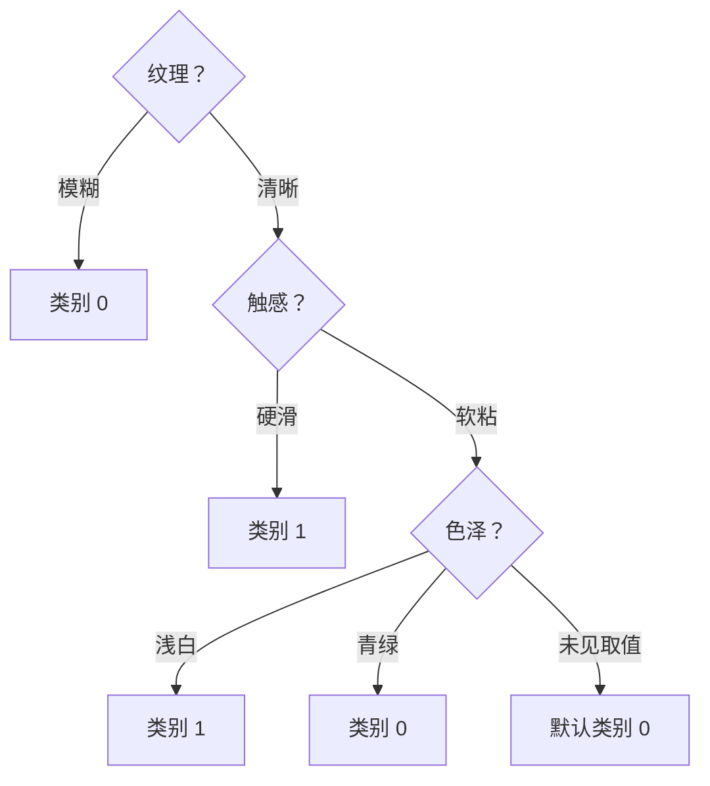

# 第 4 章：决策树自学笔记

> 依据：周志华《机器学习》第 4 章，正文第 73—92 页。本文按“问题—概念—计算—选择—验证”的顺序展开，补足独立学习所需的中间步骤。标明“拓展”的部分超出本章正文。文中自编数据只用于教学，不代表真实西瓜或水合物实验结果。

## 目录

- [一、这章究竟要解决什么问题](#一这章究竟要解决什么问题)
- [二、先认识一棵树及其学习过程](#二先认识一棵树及其学习过程)
- [三、信息熵：是什么、为什么、怎样计算](#三信息熵是什么为什么怎样计算)
- [四、信息增益：怎样用熵选择问题](#四信息增益怎样用熵选择问题)
- [五、增益率：为什么要修正信息增益](#五增益率为什么要修正信息增益)
- [六、基尼值与三种准则的判断标准](#六基尼值与三种准则的判断标准)
- [七、从十二个样本完整建立一棵树](#七从十二个样本完整建立一棵树)
- [八、剪枝：何时继续、何时停、何时删](#八剪枝何时继续何时停何时删)
- [九、连续属性：一步一步寻找阈值](#九连续属性一步一步寻找阈值)
- [十、缺失值：怎样计算、分流和预测](#十缺失值怎样计算分流和预测)
- [十一、多变量决策树与原书阅读材料](#十一多变量决策树与原书阅读材料)
- [十二、进一步理解树模型](#十二进一步理解树模型)
- [十三、分层练习与详细解答](#十三分层练习与详细解答)
- [十四、用代码复现手算和训练流程](#十四用代码复现手算和训练流程)
- [十五、怎样应用于真实问题](#十五怎样应用于真实问题)
- [十六、自学检查表与参考资料](#十六自学检查表与参考资料)

## 一、这章究竟要解决什么问题

假设你拿到一批已经知道好坏的西瓜，每个西瓜有色泽、纹理、触感等属性。现在希望根据这些记录，对一个没有切开的新西瓜作判断。

可以依次问问题：“纹理是否清晰？”“触感是否硬滑？”每次回答都缩小可能范围，最后给出好坏判断。决策树就是把这种过程组织成模型，并从训练数据中学习应当问什么、按什么顺序问。

**本章的核心不是画一张树状图，而是学习一套有数据依据的提问和停止规则。**

| 你可能产生的问题 | 本章对应内容 |
|---|---|
| 怎样把逐步判断组织成模型？ | 4.1 基本流程 |
| 首先问纹理还是色泽？ | 4.2 划分选择 |
| 是不是问题问得越细越好？ | 4.3 剪枝 |
| 温度、密度有很多数值，怎么问？ | 4.4 连续值 |
| 样本某项没有测到，怎么办？ | 4.4 缺失值 |
| 能否同时考虑多个属性作一次判断？ | 4.5 多变量决策树 |

作者先说明递归建树框架，再重点回答“怎样选测试”。为了给选择提供标准，引入信息熵、信息增益、增益率和基尼指数。随后发现，把训练样本不断分纯可能导致过拟合，于是讨论剪枝；最后把方法推广到连续、缺失和更复杂边界。

学习顺序建议是：先会读树，再理解熵，接着学会比较划分，最后完成一次从数据到树、从树到预测的全过程。导数证明和集成模型放在基础概念之后阅读。

## 二、先认识一棵树及其学习过程

### 2.1 四个组成部分

| 名称 | 作用 | 例子 |
|---|---|---|
| 根结点 | 第一个测试，接收全部训练样本 | “纹理是否清晰？” |
| 内部结点 | 对已经进入该处的样本继续测试 | “触感是否硬滑？” |
| 分支 | 一次测试的一种结果 | “清晰”“模糊” |
| 叶结点 | 停止提问并给出预测 | “好瓜” |

同一个样本从根结点出发，每一步只依据当前测试选择分支，直到到达叶子。完整路径可以改写为一条规则：“如果纹理清晰，并且触感硬滑，则预测为好瓜。”

路径上的条件是同时成立的。第二个测试只针对已经通过第一个测试的样本，所以不能脱离上面的条件，孤立解释一个深层规则。

### 2.2 训练、预测有什么区别

训练阶段已经知道每条样本的类别，算法用这些类别检查不同测试是否有区分作用；预测阶段不知道新样本的类别，只沿已经确定的树走到叶子。预测时不会重新搜索最优测试。

“当前结点的样本集合”是一个重要概念。根结点拥有所有训练样本，进入子结点后只有满足路径条件的子集。此后比例、熵和信息增益都要在这个子集内重新计算。

### 2.3 叶结点为什么通常取多数类

假设一个结点有 8 个好瓜、2 个坏瓜。如果停止提问，而且必须对这个结点中的所有样本给出同一个类别：

- 全预测好瓜，错 2 个。
- 全预测坏瓜，错 8 个。

在两种错误代价相同、每条样本权重相同时，预测多数类使该结点的训练错误数最少。这就是多数类规则的依据。

如果每条样本有不同权重，就比较各类别的权重总和。若漏判和误报代价不同，还需要结合代价，而不能机械地套用未加权多数类。

### 2.4 什么时候停止生长

原书给出三种基本情况。

| 情况 | 如何理解 | 怎样生成叶子 |
|---|---|---|
| 当前样本全属于同一类 | 已经不需要区分 | 取该类别 |
| 属性用完，或者可用属性在所有样本上都相同 | 现有信息已经无法继续区分 | 取当前结点多数类 |
| 待生成分支没有样本 | 该分支没有局部统计依据 | 取父结点多数类作为默认值 |

第二种与第三种不能混淆：有当前数据时用当前分布，没有当前数据时才借助父结点。如果多数类并列，需要规定可复现的并列处理方法，例如固定类别顺序；它不是数据已经证明某一类更可能。

实际算法还会因为最大深度、最小叶样本数等复杂度限制提前停止，这属于后面讨论的预剪枝思路。

### 2.5 为什么称为递归、分而治之和贪心

**递归**：在每个子结点重复“选择测试—划分样本—继续处理”的同一过程。

**分而治之**：先把大问题分成几个局部问题，再分别解决。

**贪心**：通常只根据当前一步的效果选择测试，不枚举所有可能的完整树。当前最好的第一步，不一定能组成全局最好的整棵树。

后面会用具体数据说明：有的特征在根部没有信息增益，进入一个特定分支后却能把样本完全分开。因此，不应把一次局部评价扩大为对这个特征的永久结论。

## 三、信息熵：是什么、为什么、怎样计算

### 3.1 先理解“结点纯度”

假设有三个盒子，每个盒子里放着已经标注好坏的西瓜：

| 盒子 | 好瓜 | 坏瓜 | 只凭盒子身份预测时的直觉 |
|---|---:|---:|---|
| 甲 | 10 | 0 | 可以统一预测好瓜 |
| 乙 | 9 | 1 | 大概率是好瓜，但存在例外 |
| 丙 | 5 | 5 | 两类一样多，仅凭盒子身份难以判断 |

甲最纯，丙最混杂。**信息熵就是用一个数衡量这种类别分布的不确定性。**

训练样本的标签已经知道，但如果只告诉你“新样本进入了这个结点”，不进一步看其他属性，你仍然面对这个结点的类别分布。熵量化的是这种分布的混杂程度；不是说算法在训练时忘记了样本标签。

### 3.2 从“一个结果的信息量”理解对数

一个原本几乎肯定发生的结果，发生后提供的新信息很少；一个原本很少发生的结果，发生后通常更令人意外。对概率为 p 的结果，定义自信息量：

```math
I(p)=-\log_2p.
```

这个表达式要求事件概率大于 0；概率越接近 0，自信息量越大。不要把它与后面“零概率类别对平均熵的贡献按 0 处理”混淆。

| 结果的概率 p | 信息量 | 解释 |
|---|---:|---|
| 1 | 0 bit | 本来就肯定发生，没有新的不确定性被消除 |
| 1/2 | 1 bit | 两个等可能结果中的一个 |
| 1/4 | 2 bit | 四个等可能结果中的一个 |
| 1/8 | 3 bit | 八个等可能结果中的一个 |

对独立结果，联合概率相乘；对数把乘法变成加法，因此适合表示可累加的信息量。以 2 为底时单位是 bit。换成自然对数会改变数值单位，但在同一组候选中统一换底，不改变信息增益的大小排序。[信息论来源][shannon]

这里的“信息量”不表示结果在现实中有多重要或损失有多大。一个罕见故障可能很重要，但故障代价需要另外建模。

### 3.3 从单个结果到整个分布：为什么要取加权平均

如果类别一发生的概率为 0.9、类别二为 0.1，两个结果的信息量不同。衡量整个分布时，不能简单把两个信息量等权平均，因为第二个结果出现得更少。

应按照各类别出现的概率，加权平均其信息量。设当前结点有 K 个类别，第 k 类比例为 pₖ，就得到信息熵：

```math
\boxed{\mathrm{Ent}(D)=-\sum_{k=1}^{K}p_k\log_2p_k}.
```

符号逐个解释：D 是当前结点的样本集合；K 是类别数；pₖ 是第 k 类在 D 中的样本比例；求和表示把每个类别的贡献加在一起。

实际计算时，先用类别数量除以当前结点总数，得到经验比例。这是从有限样本估计出来的分布，不保证与未来真实比例完全相同。

### 3.4 一个完整手算：8 个好瓜、2 个坏瓜

第一步，算比例：好瓜占 8/10，即 0.8；坏瓜占 2/10，即 0.2。

第二步，求各项对数：以 2 为底的 0.8 的对数约为 −0.3219，0.2 的对数约为 −2.3219。

第三步，乘以对应比例，再加起来并取负：

```math
\begin{aligned}
\mathrm{Ent}(D)
&=-[0.8\log_2 0.8+0.2\log_2 0.2]\\
&=-[0.8\times(-0.3219)+0.2\times(-2.3219)]\\
&\approx0.7219.
\end{aligned}
```

这个数表示该结点还有一定类别混杂。它不是“模型有 72.19% 的错误率”，也不是“有 72.19% 的坏瓜”。坏瓜比例仍然是 20%；如果停止并预测多数类，训练错误率是 20%。

### 3.5 熵的判断标准：多大算大，多小算小

二分类且采用以 2 为底的对数时，熵在 0 到 1 之间。

| 好瓜数 | 坏瓜数 | 熵 | 怎样判断 |
|---:|---:|---:|---|
| 10 | 0 | 0 | 完全纯净 |
| 9 | 1 | 0.4690 | 较集中，但存在少数类 |
| 8 | 2 | 0.7219 | 比 9∶1 更混杂 |
| 6 | 4 | 0.9710 | 接近最混杂 |
| 5 | 5 | 1 | 二分类最混杂 |
| 0 | 10 | 0 | 同样完全纯净，只是类别相反 |

类别颠倒不会改变熵。熵判断的是纯度，不判断哪一类是正类，也不判断哪个类别更值得关注。

一般 K 类情况下：

```math
0\le\mathrm{Ent}(D)\le\log_2K.
```

全部属于一类时为 0；K 类均匀分布时最大。例如三类各占三分之一，最大熵约为 1.585，因此“熵最大为 1”只适用于这里的二分类条件。

**不存在一个普遍适用的“熵低于 0.5 就合格”标准。**决策树主要比较某次划分把当前熵降低了多少，并结合样本量、复杂度约束和验证表现决定是否保留这个划分。

### 3.6 熵不等于样本数量、可靠程度或任务价值

1 个好瓜、0 个坏瓜的熵为 0；100 个好瓜、0 个坏瓜的熵也为 0。纯度相同，统计依据却很不同。熵本身不包含“样本是否充足”的判断，所以需要最小叶样本数等约束。

对于 99% 正类、1% 反类，熵约为 0.0808，已经很低，但若那 1% 是不能漏掉的故障，仍然需要认真识别。低熵不能自动代表业务目标已经满足。

还要区分两件事：概率 0.01 的罕见结果一旦出现，自信息量约为 6.644 bit；整个 99∶1 分布的平均熵却只有约 0.0808 bit。前者是一个结果的信息量，后者是按发生概率平均后的分布不确定性。

### 3.7 读公式时的边界问题

某类别在结点中没有样本，比例为 0。不能直接在计算器中输入 0 的对数，而应使用约定：

```math
\lim_{p\to0^+}p\log_2p=0.
```

因此零比例类别对熵的贡献按 0 处理。若整个结点没有样本，则类别比例本身无法定义，应按空分支规则处理，而不是假装它有一个正常的经验熵。

**学到这里应能回答：**熵测量什么？为什么要按类别概率加权？二分类熵为 1 意味着什么？为什么一个熵为 0 的小叶子仍可能不可靠？

## 四、信息增益：怎样用熵选择问题

### 4.1 熵只评价一个结点，信息增益评价一次划分

只知道当前结点熵为 1，不能决定首先测纹理还是触感。需要分别假设使用这些属性，看看划分后还有多少平均不确定性。

设一次测试产生 V 个分支，第 v 个分支中的样本集合记为 Dᵛ。信息增益定义为：

```math
\boxed{
\mathrm{Gain}(D,a)=
\mathrm{Ent}(D)-
\sum_{v=1}^{V}\frac{|D^v|}{|D|}\mathrm{Ent}(D^v)
}.
```

其中 a 是此次测试使用的属性；竖线表示样本数量；每个分支的权重是该分支样本数占父结点样本数的比例。

可以按一句话记忆：**信息增益 = 划分前的熵 − 划分后的加权平均熵。**

### 4.2 为什么分支不能简单等权平均

如果一个分支包含 99 个样本，另一个只包含 1 个，两个分支对未来随机进入该结点样本的影响通常不同。因此，99 个样本分支的权重为 0.99，小分支为 0.01。

简单把两个分支各算一半，会让一个孤立样本与几乎全部数据拥有同等影响。加权平均是在与父结点相同的样本尺度下评价整个划分。

### 4.3 完整手算：比较两个测试

父结点有 10 个样本，6 正、4 反，熵约为 0.9710。候选测试的分组如下：

| 测试 | 分支 | 正类 | 反类 | 分支熵 |
|---|---|---:|---:|---:|
| A | 左 | 4 | 0 | 0 |
| A | 右 | 2 | 4 | 0.9183 |
| B | 左 | 3 | 2 | 0.9710 |
| B | 右 | 3 | 2 | 0.9710 |

测试 A 的加权子熵为：

```math
\frac4{10}\times0+\frac6{10}\times0.9183\approx0.5510.
```

测试 A 的信息增益约为：

```math
\mathrm{Gain}_A\approx0.9710-0.5510=0.4200.
```

测试 B 的两个分支都保留原来的 6∶4 比例，所以加权子熵仍约为 0.9710，信息增益为 0。

若采用 ID3 的信息增益准则，当前这一步选择 A。理由是：A 减少了平均类别不确定性，B 这一步没有减少。

### 4.4 实际选择时到底看什么

在同一个父结点内，先逐一计算所有合法候选的信息增益，再取最大的一个。判断对象必须是同一批当前样本，不能把根结点的 0.4 与另一个子结点的 0.3 直接排在一起决定根结点怎么分。

在完整数据、相同样本权重与同一个父子划分下，信息增益满足：

```math
0\le\mathrm{Gain}(D,a)\le\mathrm{Ent}(D).
```

增益为 0，表示这一步测试没有降低经验平均熵；增益等于父熵，表示所有非空子结点都已经纯净。浮点计算可能出现非常小的负数，需要与数学意义上的负增益区分。

最大增益也可能很小。是否值得增加一个节点，还要看最小样本数、复杂度限制和验证表现。不能凭“比另外一个候选大”就推断它已经有稳定的实际作用。

### 4.5 “平均更纯”不等于每个子结点都更纯

父结点有 90 正、10 反，熵约为 0.4690。某划分形成两个分支：一个是 80 正、0 反；另一个是 10 正、10 反。

第二个分支熵为 1，比父结点更混杂；第一个分支熵为 0。加权平均子熵为：

```math
\frac{80}{100}\times0+\frac{20}{100}\times1=0.2.
```

因此信息增益约为 0.2690，仍然是正的。一个有效划分完全可能把容易判断的样本分纯，同时把困难样本集中到另一个分支继续处理。

### 4.6 为什么信息增益仍可能选出坏规则

若把每个训练样本独有的编号作为类别属性，按编号分组后，每个分支只有一个样本，熵都为 0，信息增益很大。

但新样本有新编号，规则没有可重复利用的依据。问题在于“训练数据可以分得很纯”与“新数据也能分好”不同。信息增益对取值很多的离散属性有所偏好，下一节的增益率就是针对这类问题提出的修正。

### 4.7 拓展：它与互信息的联系

可以把一次测试的分支结果看成一个随机变量。例如“纹理清晰”记为一个结果，“纹理模糊”记为另一个结果。知道分支结果前有一个类别分布，知道后有各分支的条件分布。

此时信息增益就是类别与分支结果之间的经验互信息：知道分支结果后，平均少了多少类别不确定性。这个解释强调的是统计关联，不能据此直接认定该属性造成了类别变化。

## 五、增益率：为什么要修正信息增益

### 5.1 被除掉的“固有值”是什么

信息增益评价类别不确定性的下降；固有值评价这次测试把样本分到不同分支时，分支大小分布的不确定性。

如果一半样本向左、一半向右，分支结果比较均匀；如果 99% 向左、1% 向右，分支结果非常集中。固有值只由各分支样本比例决定，不直接使用好坏标签：

```math
\mathrm{IV}(a)=
-\sum_{v=1}^{V}\frac{|D^v|}{|D|}
\log_2\frac{|D^v|}{|D|}.
```

**它在形式上也是熵，但计算的对象变成了分支结果，不是类别。**这正是容易混淆的地方。

| 分支比例 | 固有值 | 为什么 |
|---|---:|---|
| 一半、一半 | 1 | 两个分支均匀 |
| 四个分支各四分之一 | 2 | 分支结果有更多等可能选择 |
| 十个分支各十分之一 | 约 3.3219 | 划分更细 |
| 99%、1% | 约 0.0808 | 几乎都进入同一边 |

分支数量越多，固有值的上限越大；实际大小还取决于分支是否均衡，不能只看分支个数。

### 5.2 增益率怎样计算

把信息增益除以固有值：

```math
\boxed{
\mathrm{GainRatio}(D,a)=
\frac{\mathrm{Gain}(D,a)}{\mathrm{IV}(a)}
}.
```

直觉上，一个测试如果为了获得增益制造了很多分支，其收益需要相应折减。它能缓解对多取值属性的偏好，但不是一种保证泛化的万能修正。

例如测试 A 的信息增益为 0.3，固有值为 1，增益率为 0.3；测试 B 的信息增益为 0.4，固有值为 2，增益率为 0.2。按信息增益选 B，按增益率则选 A。采用什么算法，比较的对象就是什么，不能在看到结果后任意挑一个对自己有利的指标。

### 5.3 为什么还要先筛选信息增益

分母太小也会产生问题。一个测试只单独分出很少样本，固有值可能很小，即使真正减少的不确定性不多，比值仍可能较高。

因此，C4.5 的常见描述是：**先筛选信息增益达到平均水平的候选，再在这些候选中选增益率最大的。**原书用“高于平均水平”描述这一启发式；并列边界等实现细节不应变成把全部候选直接按比值排序的理由。[Quinlan 的原始论文][quinlan1996]

这套规则包含两道判断：先确认绝对收益不太弱，再比较相对收益。它与“直接取最大信息增益”以及“直接取最大增益率”都不相同。

### 5.4 一个真实数值的反例

父结点有 20 个样本，10 正、10 反，熵为 1。

测试 A 分出一个纯正类样本，另一边为 9 正、10 反。计算得到信息增益约 0.0519，固有值约 0.2864，增益率约 0.1812。

测试 B 分出两个大小相同的分支，分别为 7 正、3 反和 3 正、7 反。其信息增益约 0.1187，固有值为 1，增益率为 0.1187。

| 测试 | 信息增益 | 固有值 | 增益率 |
|---|---:|---:|---:|
| A | 0.0519 | 0.2864 | 0.1812 |
| B | 0.1187 | 1 | 0.1187 |

只按比值会选 A；先按两个候选平均增益约 0.0853 筛选，A 就被排除，留下 B。

若某个属性在当前结点恒定，根本没有有效划分，其固有值为 0，应排除该候选，不能直接做除零运算。

## 六、基尼值与三种准则的判断标准

### 6.1 基尼值测量什么

基尼值同样测量类别混杂程度，定义为：

```math
\boxed{\mathrm{Gini}(D)=1-\sum_{k=1}^{K}p_k^2}.
```

pₖ 仍然是当前结点第 k 类的比例。它与前面的经济学基尼系数不是同一个指标。

可以这样理解这个式子：按当前结点的类别比例，独立抽取两个标签。两个标签都是第 k 类的概率是 pₖ²；把所有“同一类别”的概率加起来，再用 1 减去，就得到两个标签不一致的概率。

这里对应独立、有放回意义的抽取。若实际从有限样本中无放回抽两个不同样本，精确概率有有限样本修正，不能直接把两种抽法混为一谈。

### 6.2 手算与范围

8 正、2 反时：

```math
\mathrm{Gini}(D)=1-0.8^2-0.2^2=0.32.
```

如果全为正类，基尼为 0；正反各半，基尼为 0.5。二分类可化简为：

```math
\mathrm{Gini}(D)=2p(1-p).
```

一般 K 类情况下，最小值为 0，最大值为 1−1/K。例如三类均匀时最大为 2/3，不是 0.5。

基尼和熵的数值尺度不同。不能因为 8∶2 的基尼为 0.32、熵为 0.7219，就认为基尼评价“更乐观”。它们是不同单位和形式的不纯度量。

### 6.3 基尼指数、基尼下降分别是什么

单个结点的基尼值，与一次划分后的基尼指数需要分清。

划分后的加权基尼指数：

```math
\mathrm{GiniIndex}(D,a)=
\sum_{v=1}^{V}\frac{|D^v|}{|D|}\mathrm{Gini}(D^v).
```

基尼下降：

```math
\Delta G=
\mathrm{Gini}(D)-\mathrm{GiniIndex}(D,a).
```

在同一个父结点比较候选时，**基尼指数越小越好，基尼下降越大越好**，两者选择结果等价，因为父结点基尼固定。

例如 6 正、4 反，父基尼为 0.48；测试 A 分成 4 正、0 反与 2 正、4 反，加权子基尼约为 0.2667，下降约为 0.2133。若另一个测试分裂后比例不变，子基尼仍为 0.48、下降为 0，因此选择 A。

### 6.4 一张表分清所有判断方向

| 量 | 评价对象 | 判断方向 | 是否有通用“合格阈值” |
|---|---|---|---|
| 信息熵 | 单个结点的类别分布 | 越小越纯 | 没有；0 只代表经验分布纯净 |
| 信息增益 | 某次划分减少的平均熵 | 同一父结点内越大越好 | 没有通用数值；还需复杂度与验证判断 |
| 固有值 | 测试的分支大小分布 | 单独大或小都不表示预测好坏 | 没有；它是增益率分母 |
| 增益率 | 信息增益与分支固有值之比 | 通过增益筛选后越大越好 | 没有通用数值 |
| 基尼值 | 单个结点的类别分布 | 越小越纯 | 没有 |
| 基尼指数 | 划分后的加权子基尼 | 同一父结点内越小越好 | 没有 |
| 基尼下降 | 父基尼减去加权子基尼 | 同一父结点内越大越好 | 可设复杂度控制门槛，但需验证选择 |
| 验证集指标 | 树对未参与拟合样本的表现 | 由指标定义决定，例如准确率越高越好 | 取决于任务和比较对象 |

最常见的错误是把“信息增益越大”和“基尼指数越小”记反，或把训练节点的纯度当成整棵树的泛化性能。

### 6.5 ID3、C4.5、CART 应怎样区分

| 项目 | ID3 的经典形式 | C4.5 | CART |
|---|---|---|---|
| 主要任务 | 分类 | 分类 | 分类与回归 |
| 经典划分依据 | 信息增益 | 信息增益筛选加增益率 | 分类常用基尼；回归可用平方误差 |
| 分支结构 | 离散属性通常多路 | 离散可多路，连续阈值二路 | 二叉树 |
| 连续值 | 原始形式以离散属性为主 | 搜索连续阈值 | 搜索连续阈值 |
| 剪枝 | 基础生长框架需另结合扩展 | 有相应剪枝机制 | 经典方法包括代价复杂度剪枝 |

原书用多分支的加权公式统一说明基尼指数，不意味着经典 CART 会对一个多值属性直接生成很多子节点。CART 采用二分，可以测试“属性值属于某个集合吗”。

例如色泽有青绿、乌黑、浅白三种值，二分可以是“青绿或乌黑”对“浅白”，而不是必须一次生成三条分支。若有 V 个离散取值，不计左右交换的重复，非空二分数量为：

```math
2^{V-1}-1.
```

分类准则相同，不代表两个软件实现就是同一个完整算法。用熵的二叉树，也不能直接称为完整 C4.5。

## 七、从十二个样本完整建立一棵树

### 7.1 数据与预先规定

以下是教学构造数据，不是原书 17 条西瓜数据。用它是为了能从头到尾手算。类别 1 表示好瓜，0 表示坏瓜。

| 编号 | 纹理 | 触感 | 色泽 | 类别 |
|---:|---|---|---|---:|
| 1 | 清晰 | 硬滑 | 青绿 | 1 |
| 2 | 清晰 | 硬滑 | 青绿 | 1 |
| 3 | 清晰 | 硬滑 | 乌黑 | 1 |
| 4 | 清晰 | 硬滑 | 乌黑 | 1 |
| 5 | 清晰 | 软粘 | 浅白 | 1 |
| 6 | 清晰 | 软粘 | 浅白 | 1 |
| 7 | 清晰 | 软粘 | 青绿 | 0 |
| 8 | 清晰 | 软粘 | 青绿 | 0 |
| 9 | 模糊 | 硬滑 | 乌黑 | 0 |
| 10 | 模糊 | 硬滑 | 乌黑 | 0 |
| 11 | 模糊 | 软粘 | 浅白 | 0 |
| 12 | 模糊 | 软粘 | 浅白 | 0 |

采用信息增益；候选并列时优先选触感再选色泽；类别数量并列时默认类别 0。这些并列规则只是为了使教学过程可复现。

### 7.2 第一步：计算根结点的熵

12 个样本中 6 正、6 反，所以：

```math
\mathrm{Ent}(D)=-\frac12\log_2\frac12-\frac12\log_2\frac12=1.
```

### 7.3 第二步：逐一比较三个属性

按纹理划分：

- 清晰分支有 8 个样本，其中 6 正、2 反，熵为 0.8113。
- 模糊分支有 4 个样本，全部为反类，熵为 0。

因此：

```math
\mathrm{Gain}(D,\text{纹理})
=1-\left(\frac8{12}\times0.8113+\frac4{12}\times0\right)
\approx0.4591.
```

按触感划分，硬滑分支为 4 正、2 反，软粘分支为 2 正、4 反，两个分支熵都为 0.9183：

```math
\mathrm{Gain}(D,\text{触感})
=1-\left(\frac6{12}\times0.9183+\frac6{12}\times0.9183\right)
\approx0.0817.
```

按色泽划分，青绿、乌黑、浅白各有 4 个样本，每组都是 2 正、2 反，所以每组熵都是 1，信息增益为 0。

| 属性 | 加权子熵 | 信息增益 | 当前结点选择 |
|---|---:|---:|---|
| 纹理 | 0.5409 | 0.4591 | 最大，选它 |
| 触感 | 0.9183 | 0.0817 | 暂不选 |
| 色泽 | 1 | 0 | 暂不选 |

根结点测试纹理。模糊分支已经纯净，直接成为类别 0 的叶子；只有清晰分支需要继续处理。

### 7.4 第三步：在清晰子集中重新计算

现在只考虑编号 1—8。此时父熵已经不是 1，而是 6 正、2 反对应的 0.8113。纹理在这里都相同，不再有区分作用。

按触感划分，硬滑分支为 4 正、0 反，软粘分支为 2 正、2 反。加权子熵为：

```math
\frac48\times0+\frac48\times1=0.5.
```

所以该子集上触感的信息增益为 0.8113−0.5，即 0.3113。

按色泽划分，青绿为 2 正、2 反，乌黑为 2 正、0 反，浅白为 2 正、0 反，加权子熵同样为 0.5，信息增益同样为 0.3113。

两者并列。按前面预先规定的顺序选择触感；若选色泽，也可能形成另一棵训练表现同样正确的树。决策树不一定唯一。

硬滑分支全部为类别 1，停止。软粘分支仍然 2 正、2 反，继续。

### 7.5 第四步：在清晰且软粘的子集中划分

现在只有编号 5、6、7、8。它们的纹理、触感完全一样，但色泽不同：

- 浅白：编号 5、6，都是类别 1。
- 青绿：编号 7、8，都是类别 0。

父熵为 1，两个已出现分支都为纯叶，因此用色泽划分的信息增益为 1，完成分类。

若按完整属性值集合创建一个“乌黑”分支，它没有训练样本，使用父节点默认类别。父节点正反并列，依预先规定取 0。也可以不显式画出空分支，但预测遇到未见取值时仍需规定回退规则。

### 7.6 最终树与预测路径



新样本“清晰、软粘、浅白”先进入清晰分支，再进入软粘分支，再进入浅白叶子，预测为 1。新样本“模糊、硬滑、青绿”在根部就进入类别 0 叶子，后面的属性不再测试。

原来的 12 个训练样本都能正确分类，训练准确率为 100%。但这只说明它与训练数据一致，没有证明未见样本同样能达到 100%。

### 7.7 这次完整计算应该带来哪些理解

色泽在根部信息增益为 0，在“清晰且软粘”子集中却能完美区分。一个变量是否有用，可能取决于已经满足的条件。根部排名也不是永久特征排名。

树的每次计算都需要写清当前样本集合。忽略这一点，就容易错误地把根部 6∶6 的比例继续带到下面所有节点。

原书真实西瓜示例采用 17 条数据，初始为 8 正、9 反，按书中近似结果选纹理为根节点。算法逻辑与这里相同，只是具体分组和数值不同。

## 八、剪枝：何时继续、何时停、何时删

### 8.1 为什么不能一直分到训练样本全部正确

假设一个分支最后只剩一条记录，树可以把它的类别记住，从而让这个叶子熵为 0。但是这条记录可能带有测量噪声、误标，或者只是一个偶然的特殊个体。

树如果把这些偶然细节也写进规则，对训练数据越来越准确，对新数据却可能更差。这叫过拟合。剪枝的目的就是控制复杂度，保留有泛化依据的结构。

过于简单的树也可能错过真实规律，形成欠拟合。因此，剪枝不是“树越小越好”，而是让复杂度与数据支持的规律相匹配。

### 8.2 必须分清三个数据用途

| 数据 | 用途 | 可以决定什么 |
|---|---|---|
| 训练集 | 计算类别比例、增益，拟合测试和叶预测 | 模型参数与初始结构 |
| 验证集 | 比较深度、剪枝程度等候选 | 选择复杂度和超参数 |
| 最终测试集 | 在模型已经选定后评估 | 报告对独立数据的表现 |

不能先把全部数据长成树，再把其中一部分称为“未见验证数据”。这些样本的标签已经参与过划分选择。

如果数据少，可以在训练数据内部做交叉验证，但仍应避免拿最终测试结果反复调整模型。重复看同一验证集并尝试大量结构，也会使选择过程偏向验证集中的偶然性。

### 8.3 预剪枝具体怎样判断

原书的讲解方法是：在某个结点准备划分前，比较“保持叶子”与“执行本次划分”的验证表现。

1. 保持叶子时，预测类别取这个结点的训练多数类。
2. 临时划分时，新子结点也按各自训练多数类预测。
3. 把验证样本沿当前路径送入相应位置，比较整棵树的验证指标。
4. 若改善达到选定标准，保留划分；否则停止。

叶子的类别不能用验证标签重新投票决定，否则验证数据也参与了拟合。使用准确率时，一般希望划分后准确率更高；若相同而倾向简化，就保留叶子。也可以采用召回率、误判代价等与任务一致的指标，不是所有任务都应只看准确率。

最大深度、最小叶样本数等限制也是生长控制手段，但它们不等于“每次显式用验证集比较”的同一种实现。

### 8.4 一个会让预剪枝过早停止的实例

沿用上节 12 条训练样本，增加下面 6 条独立验证记录：

| 编号 | 纹理 | 触感 | 色泽 | 真实类别 |
|---|---|---|---|---:|
| V1 | 清晰 | 硬滑 | 青绿 | 1 |
| V2 | 清晰 | 软粘 | 浅白 | 1 |
| V3 | 清晰 | 软粘 | 青绿 | 0 |
| V4 | 模糊 | 硬滑 | 乌黑 | 0 |
| V5 | 模糊 | 软粘 | 浅白 | 0 |
| V6 | 清晰 | 硬滑 | 乌黑 | 0 |

V6 与部分训练记录有相同观测属性，却有不同结果，可以理解为噪声或未观测因素。这正好说明经验纯叶不等于未来必然正确。

训练根节点 6 正、6 反，按约定并列预测 0；验证集有 4 个类别 0，因此不分裂时正确 4/6。

如果根节点只按纹理分裂，“清晰”暂时预测 1，“模糊”预测 0。此时 V1、V2、V4、V5 正确，仍是 4/6，没有立即改善。若采用“不改善就停止”的预剪枝，树会停在根部。

但如果允许长出上节完整树，V1—V5 都正确，只有 V6 错，准确率为 5/6。

| 当前候选 | 验证正确数 | 准确率 |
|---|---:|---:|
| 根节点单叶 | 4/6 | 66.7% |
| 只做第一次纹理划分 | 4/6 | 66.7% |
| 完整树 | 5/6 | 83.3% |

**结论仅针对这个例子：当前一步不改善，不代表后续组合没有价值。**这就是预剪枝欠拟合风险的一个具体来源，不是“后剪枝永远更好”的证明。

### 8.5 后剪枝具体怎样判断

先用训练集长出树，再从底部向上考察一个内部节点：

1. 记录保留当前子树时的验证表现。
2. 用一个叶子替换整棵子树，叶预测仍取该节点的训练多数类。
3. 重新计算验证表现。
4. 如果更好，就剪；如果相同，按预先约定的简化规则处理；如果更差，就保留。

例如某节点训练数据中正类占多数；到达它的 6 条验证样本真实标签为 1、1、1、1、1、0。原子树预测为 1、0、1、1、0、0，正确 4 条；改成统一预测 1 的叶子，正确 5 条。因此剪除该子树改善了这部分验证结果，其他分支不变时整棵树也改善。

后剪枝观察到了已经展开的组合结构，但需要先建立较大的树，计算与存储开销通常更高。它也不能保证没有验证选择误差。

原书的特定 7 条验证样本例子中，未剪枝树为 3/7，预剪枝与后剪枝都为 5/7。例子是在说明方法，不能把这组小样本结果当作通用性能比例。

### 8.6 结构参数是什么意思

| 控制项 | 实际限制 | 常见误解 |
|---|---|---|
| 最大深度 | 一条根到叶路径最多测试几层 | 深度小不等于任何任务都合适 |
| 最小分裂样本数 | 当前节点至少有多少样本才允许尝试分裂 | 不保证两个子叶都有这么多样本 |
| 最小叶样本数 | 每个子叶至少有多少样本 | 它直接限制孤立小叶 |
| 最大叶数 | 整棵树最多保留多少叶子 | 与最大深度不是同一个限制 |
| 最小不纯度下降 | 局部收益必须达到指定门槛 | 不是普遍适用的物理或统计常数 |

参数应该通过合适验证选择。比如“最小叶样本数为 5”可以是起点，但不是课本证明的最佳值。

### 8.7 拓展：代价复杂度剪枝为什么有这个式子

与逐次比较验证准确率不同，CART 常用经验风险加复杂度惩罚来生成候选子树：

```math
R_\alpha(T)=R(T)+\alpha L.
```

T 是一棵树；R(T) 是它的训练风险；L 是叶数；α 是每增加一个叶子要付出的复杂度惩罚。

如果只比较训练风险，复杂树通常占便宜；加入叶数惩罚后，只有风险改善足以补偿新增结构时才保留。α 越大，对叶数越敏感。

风险可能定义为误分类风险，具体软件也可能使用样本加权不纯度。比较时必须统一尺度。例如不能把某分支内部未加权的基尼值，与整棵树的总误分类率直接相加。

设某个节点 t 下有一棵子树，记为 Tₜ，它包含 Lₜ 个叶。保留它的代价为 R(Tₜ)+αLₜ；剪成一个叶子的代价为 R(t)+α。让二者相等：

```math
\boxed{\alpha_{\mathrm{eff}}(t)=
\frac{R(t)-R(T_t)}{L_t-1}}.
```

分子是剪枝增加的风险，分母是减少的叶数，所以这个比值就是“每减少一个叶子要牺牲多少拟合效果”。比值小的子树先剪更划算。

例：三叶子树风险为 0.10，剪成单叶风险为 0.16，有效惩罚为 (0.16−0.10)/(3−1)=0.03。α=0.02 时保留成本 0.16、剪掉成本 0.18，保留；α=0.04 时保留成本 0.22、剪掉成本 0.20，剪掉。

算法据此生成不同复杂度的候选，再用验证或交叉验证选择。软件中的 ccp_alpha 是这类惩罚参数，不是叶数，也不是错误概率。[官方剪枝示例][pruning]

## 九、连续属性：一步一步寻找阈值

### 9.1 为什么不能按每个精确数值直接分支

密度、温度等连续属性可能几乎每条样本都不同。若给每个精确值一个分支，就容易重现“编号”问题，也难以处理新数值。

常见做法是二分提问：“这个值是否不大于阈值 t？”例如温度是否不大于某个数据学出的阈值。这个阈值是预测规则，不自动等于相平衡温度或机理临界点。

### 9.2 为什么只需要考察相邻不同值之间

假设一个属性在当前节点的不同观测值为 1、2、3、4。阈值 2.1 与 2.8 都把 1、2 放左边，3、4 放右边，对训练样本产生完全相同的分组。

因此，每个相邻不同值之间只需选一个代表，通常用中点。一般记排序后的不同值为：

```math
a^{(1)}\lt a^{(2)}\lt\cdots\lt a^{(n)}.
```

这里 n 是不同取值的个数，不一定等于样本数。候选阈值为：

```math
T_a=\lbrace
\tfrac12(a^{(1)}+a^{(2)}),\ldots,
\tfrac12(a^{(n-1)}+a^{(n)})
\rbrace.
```

若一个相同数值对应多个样本，阈值测试不能把相同值随意拆到两边；否则实际预测时没有对应规则。

### 9.3 遍历五个阈值的完整例子

| 输入 x | 1 | 2 | 3 | 4 | 5 | 6 |
|---|---:|---:|---:|---:|---:|---:|
| 类别 | 0 | 0 | 1 | 1 | 1 | 0 |

父节点 3 正、3 反，熵为 1。不同观测值 6 个，因此有 5 个中点：1.5、2.5、3.5、4.5、5.5。

以 2.5 为例，左边有两个类别 0，熵为 0；右边有三个类别 1、一个类别 0，熵为 0.8113。信息增益为：

```math
1-\left(\frac26\times0+\frac46\times0.8113\right)
\approx0.4591.
```

其他阈值同样计算：

| 阈值 | 左边正∶反 | 右边正∶反 | 信息增益 |
|---:|---|---|---:|
| 1.5 | 0∶1 | 3∶2 | 0.1909 |
| 2.5 | 0∶2 | 3∶1 | 0.4591 |
| 3.5 | 1∶2 | 2∶1 | 0.0817 |
| 4.5 | 2∶2 | 1∶1 | 0 |
| 5.5 | 3∶2 | 0∶1 | 0.1909 |

按信息增益选择 2.5。若还有其他属性，则还要把这个属性的最佳结果与其他属性的最佳结果比较。

### 9.4 连续属性为什么能重复使用

第一次测试把 x 不大于 2.5 的样本分走后，右分支仍有 3、4、5、6 四个不同值，因此 x 仍有区分能力。右分支继续在 5.5 分裂，可把 3、4、5 的类别 1 与 6 的类别 0 分开。

这与“离散属性已经一次性按所有取值分组”不同；后者在每个子节点内属性值已经固定。是否删除已用属性，应看测试是否已经耗尽它的区分能力。

### 9.5 训练中等价的阈值，对新样本未必等价

阈值 2.1 和 2.8 对训练观测 1、2、3、4 分组一样，但对新数值 2.5 的预测不同。选择中点是一种明确约定，不是数据证明中点处存在物理突变。

数据量小、测量精度有限时，应检查重采样或新批次下阈值是否稳定。对于真正的临界现象，还需要额外实验和相应机理分析。

## 十、缺失值：怎样计算、分流和预测

### 10.1 两个不同问题

某个样本没测色泽，但测了纹理；另一个样本没测触感。直接删除所有不完整记录可能损失大量信息。

需要分别解决：

1. 色泽有部分缺失，怎样判断色泽是否值得选？
2. 如果选了色泽，那些没测色泽的样本怎样走分支？

原书介绍的是一种 C4.5 风格的权重处理机制。这里缺失的是输入属性，类别标签仍然已知；标签本身缺失属于另外的学习问题。

### 10.2 为什么引入样本权重

最初每条样本权重为 1，表示完整的一条记录。经过缺失属性测试时，一条记录的归属不确定，可以把它的权重分给多个分支。

例如 0.6 的权重向左、0.4 向右，总影响仍为 1。这是分配同一条证据的不确定归属，不能在左右两边都当成一个完整样本。

以后计算类别比例、熵和多数类，都必须使用权重总和。不能刚分流时使用小数权重，下一层又恢复为未加权人数。

### 10.3 第一步：先在该属性已知的样本上评价

用 D 表示当前全部样本，用 D̃ 表示其中属性 a 已知的子集。设 W(S) 表示集合 S 内样本权重之和：

```math
W(S)=\sum_{i\in S}w_i.
```

已知样本权重比例为 ρ：

```math
\rho=\frac{W(\widetilde D)}{W(D)}.
```

在已知子集内部，第 k 类比例与第 v 个分支比例为：

```math
\widetilde p_k=\frac{W(\widetilde D_k)}{W(\widetilde D)},
\qquad
\widetilde r_v=\frac{W(\widetilde D^v)}{W(\widetilde D)}.
```

D̃ₖ 是已知子集中第 k 类样本；D̃ᵛ 是已知子集中会进入第 v 个分支的样本。先按这些比例计算已知子集上的信息增益，再乘 ρ：

```math
\boxed{
\mathrm{Gain}(D,a)=\rho\left[
\mathrm{Ent}(\widetilde D)
-\sum_v\widetilde r_v\mathrm{Ent}(\widetilde D^v)
\right]}.
```

ρ 的作用是折减“只靠少量已知数据得到的高收益”。如果属性完全缺失，就没有可用分支比例，不能进行这种测试。

### 10.4 手算：十条样本中八条已知

10 条样本初始权重均为 1，其中 8 条属性已知，所以 ρ=0.8。已知样本为 4 正、4 反，按该属性分成两个分支：3 正、1 反和 1 正、3 反。

已知子集父熵为 1，两个分支熵都为 0.8113，所以已知部分的信息增益为 0.1887。最终评分为：

```math
0.8\times0.1887\approx0.1510.
```

若另一个完整属性在当前 10 条样本上的信息增益为 0.16，按这项评分应选择后者。不能把前者未折减的 0.1887 直接拿来比较。

### 10.5 第二步：缺失样本怎样进入分支

已知样本中两个分支各占一半，因此每条缺失样本以权重 0.5 进入每个分支。一般写为：

```math
w_i^{(v)}=\widetilde r_vw_i,
\qquad
\sum_vw_i^{(v)}=w_i.
```

假设一条缺失样本是正类，它在左边给正类权重加 0.5，在右边也加 0.5，合计仍然只是一条正类记录。沿多层缺失测试继续分流，路径权重相乘。

这是一种利用已知分支比例表达未知归属的方法，不等于已经证明缺失完全随机，也不能保证消除所有缺失机制引入的偏差。

### 10.6 新样本属性缺失时怎样给出预测

如果测试结果已知，直接走对应分支；若未知，可以按已知分支比例组合下面的预测分布。

例如左右分支权重为 0.75 和 0.25，各自得到的正类概率为 0.8 和 0.4，则组合正类概率为：

```math
0.75\times0.8+0.25\times0.4=0.7.
```

再根据任务采用的概率阈值分类。不能随意选择一边，也不能只看哪个分支叶子数量更多。

### 10.7 不同算法的缺失处理不一样

| 机制 | 核心做法 | 应避免的误解 |
|---|---|---|
| 原书介绍的权重分流 | 已知部分评价，未知样本分配权重 | 不是完整复制多份样本 |
| rpart 的替代划分 | 用其他属性模仿主测试的左右分组 | 模仿对象是主测试，不是重新直接预测原类别 |
| 当前部分 scikit-learn 树配置 | 训练中比较缺失值统一走左或走右并学习方向 | 是否支持取决于版本、模型与参数 |

具体使用软件前要核对相应文档，不能把一种树的缺失策略套到所有实现上。[rpart 文档][rpart]、[scikit-learn 指南][tree-guide]

### 10.8 拓展：仿照这个机制怎样处理基尼评分

若希望按原书的分流思想推广到基尼，一种一致的评分方式是先算已知子集的基尼下降，再乘已知比例：

```math
\mathrm{Score}(a)=\rho\left[
\mathrm{Gini}(\widetilde D)
-\sum_v\widetilde r_v\mathrm{Gini}(\widetilde D^v)
\right].
```

然后取最大评分。不能机械地把“子基尼指数”乘 ρ 再取最小，因为 ρ 越小越会把数值压低，从而错误奖励大量缺失。这是仿照原书机制的拓展说明，不是声称所有 CART 软件都使用这条公式。

## 十一、多变量决策树与原书阅读材料

### 11.1 单变量树的边界为什么轴平行

在二维空间，测试 x₁ 是否不大于某个阈值，相当于画一条竖线；测试 x₂ 相当于画一条横线。多次这样的测试把空间分成轴平行区域，叶子在各区域内给出预测。

如果真正的类别分界大致为 x₁+x₂=1，一条斜线就能表示。普通单变量树通常要用多段横、竖线形成阶梯状近似，可能需要更多节点。

### 11.2 多变量测试究竟多在哪里

斜决策树允许一个内部节点测试多个输入的线性组合：

```math
w_1x_1+\cdots+w_dx_d\le t.
```

这里每个 x 是一个特征，w 是对应权重，t 是阈值，均在当前节点内学习。它与上一章线性分类器联系起来：一个节点内部就可以是一个线性判别器，整棵树再组合多个局部判别。

“多变量”在这里强调单次测试组合多个属性；不是仅仅指整棵树用了多个属性，更不是指同时预测多个输出。

好处是更容易用少量节点描述斜边界；代价是每次测试更复杂，权重学习与解释也更困难。节点更少，不必然意味着预测更快，因为一次测试可能要访问很多特征。

### 11.3 规则提取和增量学习

原书阅读材料还提到：把路径转成规则，再合并或删减规则条件；在叶子放入其他模型；接收新样本后只更新部分结构。

这些方向共同说明，树提供的是条件化、分区域的组织方式，内部测试和叶输出可以有不同实现。在线增量更新的树也不一定等于用全部历史数据从头重新训练的树，因为局部修改受过去结构影响。

## 十二、进一步理解树模型

以下为拓展，第一次学习可以先掌握回归树、概率解释和贪心局限，再读损失函数与集成。

### 12.1 回归树在叶结点应该输出什么

分类树的目标是类别，回归树的目标是连续数值，例如生长速率。普通回归树在每个叶子内输出同一个常数。选什么常数，取决于损失函数。

若当前叶有响应 1、2、8、9，采用平方误差，不划分时最优常数为均值 5。如果在输入的某个阈值处分为响应 1、2 和 8、9 两组，各叶输出均值 1.5 和 8.5。

为什么均值最优？设当前叶响应为 y₁ 到 yₙ，统一输出 c，平方误差为：

```math
E(c)=\sum_{i=1}^{n}(y_i-c)^2.
```

对 c 求导并令其为零：

```math
-2\sum_{i=1}^{n}(y_i-c)=0
\quad\Longrightarrow\quad
\boxed{c=\frac1n\sum_{i=1}^{n}y_i}.
```

第二阶导数为 2n，大于 0，因此这是唯一最小值。带权重时是加权均值。采用绝对误差时，最优常数变为中位数，不能不看损失就永远取均值。

回归划分通过比较两个子叶各自拟合后的平方误差之和来选择。刚才例子不划分的误差为 50，分成两组后为 1，降低 49。

**回归树的外推限制来自常数叶输出。**每个叶的均值都位于训练响应的最小、最大值之间，输入超出训练范围后也只是进入一个已有叶子，不能自动沿趋势延伸。带线性叶模型的扩展不能直接套用这一限制。[回归树接口][tree-regressor]

### 12.2 叶子类别比例能否当成“真实概率”

如果一个叶子有 8 正、2 反，最直接的正类概率估计是 0.8。这里有三个层次：

1. 在该叶训练数据中，正类比例确实为 0.8。
2. 用它估计未来进入该叶样本的正类概率，需要训练与应用分布具有适当代表性。
3. 这个估计还受样本量、结构选择偏差、类别加权等影响，不能自动当作无误差的真实概率。

一个只含两条正样本的叶子会输出 1，但不意味着现实结果百分之百确定。限制叶子规模可以缓解极端估计；也可以在概率估计中加入平滑。

例如对二分类，两类各先增加 1 个伪计数：一个纯正类小叶原为 1 正、0 反，平滑后正类比例为 2/3；一个 100 正、0 反的叶，平滑后为 101/102，约 0.9902。两者原来的经验熵都为 0，但数据支持量不同。

这只是平滑的例子，不是说所有软件都默认这样做，也不保证经过平滑就完成了概率校准。

### 12.3 类别不平衡怎样改变判断

若正类是稀有缺陷，全部预测正常可能准确率很高，却漏掉全部缺陷。此时可以考虑类别权重、误判代价、召回率和阈值选择。

类别权重会改变节点中的加权类别比例，也可能改变划分和叶输出。例：2 正、18 反的原始比例为 0.1；正类权重设为 9、反类权重为 1 后，加权正类比例为 18/(18+18)=0.5。

因此，不能把加权后的比例未经解释就报告为总体真实发生率。训练中强调少数类与在实际应用分布中估计发生概率，需要分别处理。

若已得到应用分布下可靠的正类后验概率 p，漏判正类的代价记为 C_FN，误报正类的代价记为 C_FP，正确分类代价为 0，则：

```math
R(\text{判正})=C_{\mathrm{FP}}(1-p),
\qquad
R(\text{判负})=C_{\mathrm{FN}}p.
```

当判正风险更小时判为正类，得到：

```math
p\gt\frac{C_{\mathrm{FP}}}{C_{\mathrm{FP}}+C_{\mathrm{FN}}}.
```

这个阈值来自代价比较，不是由节点熵“低于多少”得到的。

### 12.4 为什么树有能力表示 XOR，贪心算法却可能停下来

四条数据为：

| x₁ | x₂ | 类别 |
|---:|---:|---:|
| 0 | 0 | 0 |
| 0 | 1 | 1 |
| 1 | 0 | 1 |
| 1 | 1 | 0 |

单独看任何一个属性，它的每个取值下都是一正一反，所以第一步增益为 0。但先按 x₁ 分，再在两个分支各按 x₂ 分，可以得到纯叶。

因此，树的表示能力与学习策略的搜索能力是两件事。如果程序要求每一步严格正增益，就可能在根部停下；允许零收益分裂的实现可能继续得到正确树。不能笼统说所有贪心树都学不会 XOR。

这个例子也提醒我们：没有单变量总体关联，不等于不存在条件关联或交互作用。

### 12.5 熵、基尼与预测损失有什么关系

先理解损失：如果模型给真实类别很高的概率，应当受较小惩罚；如果很自信却给真实类别极低概率，应当受较大惩罚。对数损失采用真实类别预测概率的负对数。

例如真实类别对应概率为 0.9，负自然对数约为 0.1053；若只有 0.1，损失约为 2.3026，明显更大。

若一个叶子中类别比例为 pₖ，而给这些样本统一预测分布 qₖ，平均对数损失是：

```math
-\sum_kp_k\log q_k.
```

这个目标在 qₖ 等于经验比例 pₖ 时最小，最小值就是相应底数下的熵。因此，比较熵下降可以理解为比较分区域概率预测的对数损失改善。不是因为“熵这个名字听起来合理”就任意采用它。

基尼也有类似解释。二分类预测完整概率向量为 (0.8,0.2)，真实正类用 (1,0) 表示、反类用 (0,1) 表示。用向量平方误差：

- 对正类样本，误差为 (1−0.8)²+(0−0.2)²=0.08。
- 对反类样本，误差为 (0−0.8)²+(1−0.2)²=1.28。

若正反比例确实为 0.8、0.2，平均误差为 0.8×0.08+0.2×1.28=0.32，恰好就是该分布的基尼值。这是完整类别概率向量的平方损失；若只用单个正类概率计算二分类标量平方误差，会相差常数因子。

与之相对，分类错误率只看最终类别。例如父节点 80 正、20 反，分成 45∶5 与 35∶15 两组，父子都预测正类，总错数还是 20。熵与基尼则能看出两组分布发生了变化，因此通常比即时错误率更适合指导树逐步生长。

### 12.6 可选数学推导：为什么二分类熵在一半一半处最大

令正类比例为 p，二分类熵为：

```math
H(p)=-p\log_2p-(1-p)\log_2(1-p).
```

其一阶、二阶导数为：

```math
H'(p)=\log_2\frac{1-p}{p},
\qquad
H''(p)=-\frac1{\ln2}\left(\frac1p+\frac1{1-p}\right).
```

在 0 到 1 内二阶导数小于 0，说明函数向下弯；一阶导数在 p=1/2 时为 0，因此那里为最大值。两端完全确定时熵为 0。如果暂时不熟悉求导，先掌握前面的数值表和计算，不影响理解划分选择。

### 12.7 为什么单树不稳定，随机森林能起什么作用

两个候选的增益很接近时，增加或删去少量记录就可能改变根部测试。根部一变，下面所有子集跟着改变，整棵深树可能差异很大。这是单棵树高方差的一个来源。

经典随机森林通过重复有放回抽取训练样本，并在节点处随机限制候选特征，训练多棵具有差异的树，再组合预测。回归常平均数值，分类可投票或平均类别概率。随机化帮助降低树间相似性，平均化帮助降低不稳定性。[Breiman（2001）][random-forests]

为说明相关性的影响，作一个简化假设：每棵树的预测误差方差均为 σ²，任意两棵误差相关系数均为 ρ，平均 M 棵树，M 是树的数量，则平均误差方差为：

```math
\mathrm{Var}(\bar f)=
\sigma^2\left[\rho+\frac{1-\rho}{M}\right].
```

增加 M 会减小第二项，但相关性项不会凭空消失，所以不是复制很多完全相同的树就能改善。公式依赖等方差、等相关的简化条件，用于理解机制，不是任意森林的精确性能定律。

样本没有被某棵树的自助采样选中时，可以参与该树的袋外评价。但如果同一实验的相邻帧高度相关，样本级袋外评价仍不能代替按独立实验分组的验证。

### 12.8 梯度提升树与随机森林的关键区别

随机森林主要平均多棵随机化的树；梯度提升按顺序添加树，新树针对已有模型的不足。

用平方损失演示：响应为 1、2、8、9，先只输出均值 5。残差为 −4、−3、3、4。若下一棵树把前两条与后两条分开，它拟合的平均残差就是 −3.5 和 3.5。

若完整加上这棵树，预测成为 1.5、1.5、8.5、8.5；若学习率为 0.1，只加一成修正，预测变为 4.65、4.65、5.35、5.35，然后再继续迭代。

对一般损失，新树拟合的是负梯度方向的信息；平方损失下负梯度才直接等于这种残差。XGBoost 是树提升的一种具体系统，不是另一种单棵决策树。[Chen 与 Guestrin（2016）][xgboost]

### 12.9 特征重要性与可解释性的边界

树常把各节点由某特征带来的加权不纯度下降加总，作为特征重要性。这衡量当前模型怎样利用特征，不是一个独立于数据与模型的物理贡献率。

候选切分很多的特征可能更占优势，相关特征可能互相替代。一种补充办法是在验证集上打乱某个特征，观察模型得分下降多少，即置换重要性；但相关特征能互相补偿，它也需要谨慎解释。[重要性说明][importance]

单变量树一般不要求把不同单位都标准化，因为测试依据是单个属性的取值顺序。但特征旋转会改变轴平行边界的表达难度，回归响应的极端值也会影响均值与平方误差。不能把“通常不需要标准化”扩大为“对任何数据变化都不敏感”。

树常被称为非参数方法，含义是模型复杂度可以随数据和生长过程变化，不是说一棵训练好的树没有阈值等参数。浅树易读，深树和多树集成仍可能很难整体解释。

## 十三、分层练习与详细解答

先做前四题检查概念，再做第五到第九题练习计算，最后三题检查建模判断。解答包含判断理由，不只列数值。

### 练习 1：同样的熵表示同样的可靠程度吗

甲节点有 6 正、4 反，乙有 60 正、40 反。两者熵是否相同？能否认定两者对真实概率估计同样可靠？

**解答：**两者比例都是 0.6、0.4，熵都约为 0.9710。熵只使用比例，没有保留样本总量。样本代表性等条件相当时，更多独立样本通常能提供更充分的分布估计依据，不能仅凭熵相等就判定可靠程度相同。

### 练习 2：罕见结果的信息量与整体熵

正类概率为 0.99、反类为 0.01。求观察到反类时的信息量与整个分布的熵。

**解答：**反类自信息量为负的以 2 为底的 0.01 的对数，约为 6.6439 bit。整体熵为两类信息量按概率的加权平均：

```math
-0.99\log_2 0.99-0.01\log_2 0.01\approx0.0808.
```

罕见结果一旦出现很有信息，不妨碍整个分布在绝大多数时候比较可预期。

### 练习 3：比较两个完整划分

父节点 12 条样本，6 正、6 反。测试 A 分为两个各 6 条的节点，分别为 5 正、1 反与 1 正、5 反。测试 B 左边 4 正、0 反，右边 2 正、6 反。分别计算信息增益与基尼下降，选择哪一个？

**解答：**父熵为 1，父基尼为 0.5。

A 两个子节点熵都约为 0.6500，所以信息增益约为 0.3500。子基尼均为 2×(5/6)×(1/6)=0.2778，下降约为 0.2222。

B 加权子熵为 (4/12)×0+(8/12)×0.8113≈0.5409，信息增益约为 0.4591。加权子基尼为 (8/12)×0.375=0.25，下降为 0.25。

这一次两种准则都选 B。不能据此推断两种准则在所有数据上永远排序相同。

### 练习 4：增益率大就一定入选吗

两候选的已计算结果为：A 信息增益 0.24、固有值 2；B 信息增益 0.18、固有值 0.5。若先按平均信息增益筛选，再比较增益率，应选谁？

**解答：**A 增益率为 0.12，B 为 0.36；但平均增益为 0.21，B 未达到筛选标准，只有 A 留下。因此选 A。应先明确算法规定的两步顺序。

### 练习 5：一个子节点熵更高，能否说明划分失败

父节点 90 正、10 反。分裂后为 80 正、0 反与 10 正、10 反。较混杂分支熵为 1，高于父熵。是否应据此拒绝？

**解答：**不能。父熵约 0.4690，加权子熵为 0.2，信息增益约 0.2690。应比较整个划分的加权平均效果，再考虑复杂度和验证，而不是只挑一个困难分支下结论。

### 练习 6：重复取值与无法消除的训练错误

输入依次为 1、1、2、3、5、5；标签依次为 0、1、0、1、1、1。有哪些合法中点候选？能否得到零训练错误？

**解答：**不同输入值为 1、2、3、5，中点为 1.5、2.5、4。不能在相同的两个 1 之间插入一个按数值可执行的阈值。

父熵约 0.9183，三个候选的信息增益依次约为 0.0441、0.4591、0.2516，所以第一步选 2.5。

两个输入完全相同的 1 具有不同标签，只靠这个输入的确定性树无法同时正确预测它们，训练至少错一条。继续加深不能制造原本没有的信息。

### 练习 7：缺失属性如何比较和分配

20 条等权样本中，某属性有 12 条已知；其已知部分信息增益为 0.30。另一完整属性信息增益为 0.20。前者应得多少评分？若一条权重为 2 的缺失样本按 1∶3 分给两边，权重各是多少？

**解答：**已知比例为 12/20=0.6，修正评分为 0.18，所以按该机制选择完整属性的 0.20。缺失记录权重分别为 0.5 和 1.5，总和为 2；不是左右各放权重 2。

### 练习 8：剪枝惩罚怎样计算

四叶子树风险为 0.08，剪成单叶风险为 0.20，风险已统一尺度。求有效 α，并比较 α=0.03 和 0.05。

**解答：**有效 α=(0.20−0.08)/(4−1)=0.04。α=0.03 时，保留成本为 0.20，单叶成本为 0.23，保留。α=0.05 时，保留为 0.28，单叶为 0.25，剪掉。

应比较加上复杂度代价的目标，而不能因为剪后训练风险上升就一律拒绝剪枝。

### 练习 9：回归树的叶输出

响应为 2、4、10、12。划分为前两条与后两条，平方损失下各叶输出多少？总误差与不划分相比如何？

**解答：**两叶均值为 3 和 11，误差为 1+1+1+1=4。不划分的均值为 7，误差为 25+9+9+25=68，划分减少 64。普通常数叶树对超出原输入范围的新样本，仍只输出进入叶子的常数，不会自动外推线性趋势。

### 练习 10：零收益第一步是否没有意义

使用第 12.4 节的四个 XOR 样本。为什么第一步信息增益为 0，但两层测试仍有价值？

**解答：**单看任一属性，两个分支都各有一正一反，所以平均熵不变。固定其中一个属性后，另一个属性与类别的关系却变得确定，可以继续分成纯叶。第一步的价值来自与后续步骤组合，单步严格正收益要求可能错过它。

### 练习 11：读路径与解释概率

在第七节的树中，“清晰、软粘、浅白”预测什么？“模糊、硬滑、浅白”预测什么？如果一个叶只有两条正样本，能否报告“正类在真实世界必然发生”？

**解答：**前者依次测试纹理、触感、色泽，预测 1；后者根部进入模糊分支就停止，预测 0，不再看触感和色泽。两条正样本只产生经验比例 1，样本量和选择过程不足以支持“必然”结论。

### 练习 12：哪一种验证在实验数据上更可信

一次实验视频产生 100 帧观测。把同一次视频的帧随机分成训练和测试，获得很高准确率；与按独立实验编号划分相比，能否说明前者模型更好？

**解答：**不能直接这样比较。同一实验的帧有共同背景和时间关联，随机分开容易让几乎重复的信息同时出现于两侧。若目标是推广到新实验，应按独立实验分组；若关心新批次，还需要相应批次隔离。验证方式应对应未来使用情境。

## 十四、用代码复现手算和训练流程

### 14.1 先自己实现一个小型离散分类树

第一份代码只用 Python 标准库，实现本笔记十二条教学数据上的熵、信息增益、递归生长和预测。目的在于把手算步骤对应到程序，而不是一开始把全部过程交给库。

变量说明：rows 是当前节点的记录列表；attribute 是某个属性名；groups 是按照该属性值分组后的字典；prediction 是节点默认类别；children 保存各个分支。类别名 label 是已知训练目标。

这个教学实现只处理完整离散属性，并要求每次有正信息增益。它没有实现连续阈值、权重分流或剪枝；遇到 XOR 这样的零收益第一步可能停止。预测遇到未见属性值时回退到当前节点默认类别，这也不是 C4.5 的多路径加权策略。

```python
from collections import Counter
from math import log2

raw_data = [
    ("清晰", "硬滑", "青绿", 1),
    ("清晰", "硬滑", "青绿", 1),
    ("清晰", "硬滑", "乌黑", 1),
    ("清晰", "硬滑", "乌黑", 1),
    ("清晰", "软粘", "浅白", 1),
    ("清晰", "软粘", "浅白", 1),
    ("清晰", "软粘", "青绿", 0),
    ("清晰", "软粘", "青绿", 0),
    ("模糊", "硬滑", "乌黑", 0),
    ("模糊", "硬滑", "乌黑", 0),
    ("模糊", "软粘", "浅白", 0),
    ("模糊", "软粘", "浅白", 0),
]
columns = ["texture", "touch", "color", "label"]
data = [dict(zip(columns, row)) for row in raw_data]
attributes = ["texture", "touch", "color"]
names = {"texture": "纹理", "touch": "触感", "color": "色泽"}


def entropy(rows):
    """当前节点类别分布的信息熵。"""
    if not rows:
        return 0.0
    counts = Counter(row["label"] for row in rows)
    total = len(rows)
    return -sum((n / total) * log2(n / total) for n in counts.values())


def group_by(rows, attribute):
    """每个属性值对应一个子样本集合。"""
    groups = {}
    for row in rows:
        groups.setdefault(row[attribute], []).append(row)
    return groups


def information_gain(rows, attribute):
    groups = group_by(rows, attribute)
    remainder = sum(
        len(group) / len(rows) * entropy(group)
        for group in groups.values()
    )
    return entropy(rows) - remainder


def majority_label(rows):
    counts = Counter(row["label"] for row in rows)
    # 数量最大者优先；并列时数值小的类别优先，即本例选择 0。
    return min(counts, key=lambda label: (-counts[label], label))


def build_tree(rows, available_attributes):
    if not rows:
        raise ValueError("进入本函数的当前集合不能为空")

    node = {
        "prediction": majority_label(rows),
        "attribute": None,
        "children": {},
    }
    labels = {row["label"] for row in rows}
    if len(labels) == 1 or not available_attributes:
        return node

    # max 在完全并列时保留列表中先出现的属性。
    best = max(
        available_attributes,
        key=lambda attribute: information_gain(rows, attribute),
    )
    if information_gain(rows, best) <= 1e-12:
        return node

    node["attribute"] = best
    remaining = [a for a in available_attributes if a != best]
    for value, subset in group_by(rows, best).items():
        node["children"][value] = build_tree(subset, remaining)
    return node


def predict_one(node, sample):
    while node["attribute"] is not None:
        value = sample.get(node["attribute"])
        child = node["children"].get(value)
        if child is None:
            return node["prediction"]
        node = child
    return node["prediction"]


print("父节点熵：", round(entropy(data), 6))
for attribute in attributes:
    score = information_gain(data, attribute)
    print(names[attribute], "根节点信息增益：", round(score, 6))

clear_data = [row for row in data if row["texture"] == "清晰"]
for attribute in ["touch", "color"]:
    print(
        names[attribute],
        "清晰子集信息增益：",
        round(information_gain(clear_data, attribute), 6),
    )

model = build_tree(data, attributes)
correct = sum(predict_one(model, row) == row["label"] for row in data)
print("选择的根属性：", names[model["attribute"]])
print("训练正确数：", correct, "/", len(data))
print(
    "新样本预测：",
    predict_one(
        model,
        {"texture": "清晰", "touch": "软粘", "color": "浅白"},
    ),
)
```

你应观察到：根熵为 1；纹理、触感、色泽的根部增益分别约为 0.459148、0.081704、0；清晰子集中触感和色泽都约为 0.311278；训练正确数为 12/12；指定新样本预测为 1。

如何把递归对应到手算：第一次调用接收 12 条记录；进入“清晰”子分支后，rows 变成 8 条；进入“软粘”后变成 4 条。函数没有凭空改变公式，而是不断换用正确的当前子集。

### 14.2 再使用库学习连续属性树和验证选参

第二份代码采用 scikit-learn 自带鸢尾花数据。它有 150 条样本、4 个连续特征、3 个类别。依赖为 scikit-learn，不需要自行下载数据文件。

流程不是“在全部数据上训练后报分数”，而是：

1. 先分出 30 条最终测试样本，暂时不用于选参。
2. 在剩余 120 条训练样本内部做五折交叉验证，每次用其中四折拟合、另一折评价。
3. 比较最大深度、最小叶样本数和剪枝惩罚的参数组合。
4. 用平均验证分数最高的参数，在全部 120 条训练样本上重训。
5. 最后评价此前保留的 30 条测试样本。

分层划分的意思是尽量保持各类比例；交叉验证的平均分用于参数选择，不是独立测试分数。这里使用平衡准确率，即各类别召回率的平均值。[分类树接口][tree-classifier]、[网格搜索接口][grid-search]

```python
import sklearn
from sklearn.datasets import load_iris
from sklearn.metrics import accuracy_score, balanced_accuracy_score
from sklearn.model_selection import GridSearchCV, StratifiedKFold, train_test_split
from sklearn.tree import DecisionTreeClassifier

iris = load_iris()
X, y = iris.data, iris.target

X_train, X_test, y_train, y_test = train_test_split(
    X, y, test_size=0.20, stratify=y, random_state=42
)

cv = StratifiedKFold(n_splits=5, shuffle=True, random_state=42)
search = GridSearchCV(
    estimator=DecisionTreeClassifier(criterion="gini", random_state=42),
    param_grid={
        "max_depth": [2, 3, 4, None],
        "min_samples_leaf": [1, 3, 5],
        "ccp_alpha": [0.0, 0.005, 0.02],
    },
    scoring="balanced_accuracy",
    cv=cv,
    n_jobs=1,
    refit=True,
)
search.fit(X_train, y_train)

best_tree = search.best_estimator_
prediction = best_tree.predict(X_test)

print("scikit-learn version:", sklearn.__version__)
print("Best parameters:", search.best_params_)
print("CV balanced accuracy:", round(float(search.best_score_), 4))
print("Test accuracy:", round(float(accuracy_score(y_test, prediction)), 4))
print(
    "Test balanced accuracy:",
    round(float(balanced_accuracy_score(y_test, prediction)), 4),
)
print("Tree depth:", best_tree.get_depth())
print("Number of leaves:", best_tree.get_n_leaves())
```

代码中的 X 是特征矩阵，一行对应一条样本、一列对应一个特征；y 是类别向量。None 表示该项不预设最大深度，其他参数仍然可能限制树生长。refit=True 表示选出最佳参数后重新拟合训练集。

这里比较 4×3×3=36 种参数组合，各做五折评价。测试集只在最后使用。对于有批次或个体关联的数据，要换成合适的分组验证方式，不能把这个随机分层流程照搬过去。

本次在 scikit-learn 1.8.0、代码所示随机种子下验证，选择的参数为最大深度 3、最小叶样本数 3、ccp_alpha 为 0；五折平均平衡准确率和最终测试准确率均约为 0.9667，最终树深度为 3、叶数为 5。

这只是指定数据和划分下的运行记录。选中零剪枝惩罚不代表剪枝没有作用，因为模型同时受深度和叶样本数约束；也不能把鸢尾花分数作为自己实验数据的预期精度。

### 14.3 可选绘图及怎样读节点

接在第二份代码之后运行；另需 matplotlib：

```python
import matplotlib.pyplot as plt
from sklearn.tree import plot_tree

fig, ax = plt.subplots(figsize=(12, 6))
plot_tree(
    best_tree,
    feature_names=list(iris.feature_names),
    class_names=list(iris.target_names),
    filled=False,
    rounded=True,
    ax=ax,
)
fig.tight_layout()
plt.show()
```

| 图中字段 | 应怎样读 |
|---|---|
| 例如 petal length ≤ 2.45 | 当前节点的测试，满足条件走对应分支 |
| gini | 当前节点类别分布的基尼不纯度，不是信息熵 |
| samples | 当前节点包含的训练样本数，具体加权语义需看接口 |
| value | 各类别的数量、权重或相应比例表示，依版本与绘图设置而定 |
| class | 当前多数类预测，叶节点最终按相应规则输出 |

不要把图中的 gini=0.5 解释为“节点正类概率必为 0.5”。二分类中它对应两类各半，但三分类等多分类下，必须看完整分布。也不要把三分类树图中的基尼上限当成二分类的 0.5。

### 14.4 建立自己的核对习惯

先核对手算小数据，确认类别编码、权重和划分方式没有弄反；再进入真实数据训练。每次至少记录训练规模、特征含义、划分方式、参数范围、评价指标、选定参数和独立测试结果。

需要缺失填补、类别编码、特征选择时，这些步骤也应只在每个训练折中学习，通常用 Pipeline 组织。先用全部数据做预处理再交叉验证，会泄漏测试折的信息。

固定随机种子能复现一次计算，不等于已经评估了统计不确定性。不同划分、不同批次和新实验仍可能产生不同结果。

## 十五、怎样应用于真实问题

### 15.1 第一步先写清预测时点与目标

| 问题 | 输入示例 | 目标类型 | 初步方法 |
|---|---|---|---|
| 实验开始前预测首次结晶位置 | 初始接触方式、温度、初始组成 | 多分类 | 浅分类树，比较对率回归等基线 |
| 给定初始条件预测生长速率 | 初始条件与预先可测性质 | 连续数值 | 回归树，与线性模型比较 |
| 检测稀有设备异常 | 预测时已可获得的传感器指标 | 二分类 | 分类树配合合适代价和少数类指标 |
| 根据检测结果识别材料类别 | 已测理化或光谱特征 | 多分类 | 树、森林与其他分类方法比较 |

预测时点决定什么能作为输入。若目标是在实验开始前预测首次成核位置，实验结束后才知道的后续生长速率不能放入输入，否则模型利用了未来信息。

探索相关性、预测新样本和解释因果机制，是不同目标。一棵树找到“温度在某阈值一侧时某现象更多”的规则，首先是数据关系，还需要稳定性与实验对照来支持机理解释。

### 15.2 THF 实验记录怎样组织

每次独立重复实验保留一个编号，记录初始混合方式、温度、初始组成、批次、观察时长、首次结晶位置、诱导时间以及生长观测。编号用于追溯与分组，一般不作为记忆样本身份的预测属性。

若分析“混合方式是否影响首次位置”，首先需要统一位置类别的标注规则。例如怎样区分容器壁、接触界面和体相，必须在分析前定义，不能看模型结果后随意改标签。

建树前检查每种类别有多少独立重复、是否存在某个批次与某种方式完全绑定、温度是否同时变化。否则树可能用温度或批次间接区分方式，而无法说明方式自身的作用。

### 15.3 一个具体的分析流程

1. 画出两种方式在各温度范围内的位置分布，检查样本是否有明显不平衡。
2. 预先确定要推广到新的独立实验，还是新的实验日、样品批次。
3. 按对应实验或批次划分训练与验证，保留共同评价口径。
4. 先拟合浅树，检查每个叶子有多少独立实验，是否只有一两例。
5. 在训练内部选择深度、叶样本数和剪枝程度，与简单基线比较。
6. 用未参与选择的数据评价；换批次或重复划分时检查规则、阈值是否稳定。
7. 把稳定但尚未验证的条件规则转化为下一轮对照实验假设。

这比单独报告“某个属性重要性最高”更能回答原研究问题。模型也应报告它在哪些条件范围内缺乏数据支持。

### 15.4 诱导时间与“未观察到结晶”

如果观察结束仍未结晶，已知的是诱导时间大于观察时长，而不是等于观察时长。这属于右删失。直接删除这些记录，或将截止时刻当成真实诱导时间，都改变了数据含义。

若要预测完整事件时间，应考虑适当的生存分析方法；普通回归树不会自动处理删失。生存树是专门扩展，不是把同一列数据换个名称就完成了。

如果目标明确为“固定时长 τ 内是否结晶”，且每次实验至少完整观察至 τ，或此前已经发生事件，可以定义相应二分类标签。这个目标与预测诱导时间分布不同。

### 15.5 时间点多，不等于独立实验多

一条视频中的相邻帧共享实验条件与背景。同一实验数百个时间点，不能简单当成数百次独立重复来证明泛化能力。训练与测试应按独立实验隔离，必要时进一步按批次隔离。

对于后续生长问题，可以先定义每次实验层面的指标，例如统一时间窗内按同一方法拟合的生长速率，再比较不同方式。若直接建模整段时间序列，还要采用与序列结构相符的方法。

### 15.6 树中的阈值怎样报告才合适

可以报告“在本数据和当前建模方法下，模型选用了某个阈值，并在这些实验范围内得到这样的分布或预测效果”。同时给出阈值附近的样本量、测量精度和验证稳定性。

不应直接把一个数据驱动阈值写成已经确定的物理临界点。更合理的下一步是在阈值两侧增加重复和对照，检查规律是否重现。

## 十六、自学检查表与参考资料

### 16.1 能解释这些问题，才算掌握基础

| 检查问题 | 回答必须包含的要点 |
|---|---|
| 信息熵是什么？ | 类别分布不确定性；是按类别概率平均的信息量 |
| 熵为 0、二分类熵为 1 分别意味着什么？ | 完全纯净；正反各半；不能当成错误率 |
| 熵低于多少就算好？ | 无通用合格阈值，要看划分收益、样本量和验证 |
| 信息增益为什么加权？ | 用分支比例在相同样本尺度下衡量整个划分 |
| 增益率的分母是什么？ | 分支大小分布的熵，不是子节点类别熵 |
| 基尼指数与基尼下降哪个要大？ | 前者小，后者大；限同一个父节点比较 |
| 为什么根部没用的变量以后可能有用？ | 条件分布变化、交互作用；需在子集重新计算 |
| 为什么树不一定越深越好？ | 可能记住噪声，小叶估计不稳定，需验证复杂度 |
| 连续属性为什么能再用？ | 一次阈值只切开一部分范围，子集内仍有不同值 |
| 缺失样本进两个分支是否算两条？ | 不是，分配权重且总权重守恒 |
| 训练全对是否证明模型好？ | 只说明训练一致性，不证明未见样本表现 |
| 特征重要性是否是物理作用大小？ | 不是，它依赖当前模型、数据和评价方式 |

### 16.2 计算与阅读中的常见检查点

- 写清“当前节点”是哪一批样本，再算类别比例。
- 分支比例用于平均子节点不纯度，类别比例用于计算节点自身不纯度，两者不可交换。
- 先保留较高计算精度，最后再四舍五入，避免把舍入差异误当作算法差异。
- 空类别的熵贡献按 0 处理，空节点按默认分支规则处理，两者不同。
- 同一节点比较候选时使用相同准则；做验证时使用与真实目标一致的指标。
- 程序运行成功只证明它能执行，仍需用已知手算结果检查是否实现了预期机制。

### 16.3 原书与拓展资料

1. 周志华：《机器学习》，清华大学出版社，2016，第 4 章，正文第 73—92 页。主要依据为用户提供版本。
2. Shannon, C. E. (1948). *A Mathematical Theory of Communication*. The Bell System Technical Journal, 27, 379–423, 623–656。[原始论文公开本][shannon]。用于补充信息量、对数与熵的来源。
3. Quinlan, J. R. (1996). *Improved Use of Continuous Attributes in C4.5*. Journal of Artificial Intelligence Research, 4, 77–90。[论文页面][quinlan1996]。用于核对增益率和连续测试的实际算法背景。
4. Breiman, L., Friedman, J. H., Olshen, R. A., & Stone, C. J. (1984). *Classification and Regression Trees*. Wadsworth。CART 与代价复杂度剪枝的经典专著。
5. scikit-learn：[决策树指南][tree-guide]、[分类树接口][tree-classifier]、[回归树接口][tree-regressor]。用于核对具体软件行为。
6. scikit-learn：[代价复杂度剪枝示例][pruning]、[GridSearchCV 接口][grid-search]。用于核对复杂度控制与参数验证流程。
7. Therneau, T. M., & Atkinson, E. J. *An Introduction to Recursive Partitioning Using the RPART Routines*。[rpart 官方说明][rpart]，第 5 节补充替代划分。
8. scikit-learn：[置换重要性][importance]。用于了解训练不纯度重要性的偏好及相关特征问题。
9. Breiman, L. (2001). *Random Forests*. Machine Learning, 45, 5–32。[作者公开论文][random-forests]。
10. Chen, T., & Guestrin, C. (2016). *XGBoost: A Scalable Tree Boosting System*。[论文页面][xgboost]。

[shannon]: https://people.math.harvard.edu/~ctm/home/text/others/shannon/entropy/entropy.pdf
[quinlan1996]: https://arxiv.org/abs/cs/9603103
[tree-guide]: https://scikit-learn.org/stable/modules/tree.html
[tree-classifier]: https://scikit-learn.org/stable/modules/generated/sklearn.tree.DecisionTreeClassifier.html
[tree-regressor]: https://scikit-learn.org/stable/modules/generated/sklearn.tree.DecisionTreeRegressor.html
[pruning]: https://scikit-learn.org/stable/auto_examples/tree/plot_cost_complexity_pruning.html
[grid-search]: https://scikit-learn.org/stable/modules/generated/sklearn.model_selection.GridSearchCV.html
[rpart]: https://cran.r-project.org/web/packages/rpart/vignettes/longintro.pdf
[importance]: https://scikit-learn.org/stable/modules/permutation_importance.html
[random-forests]: https://www.stat.berkeley.edu/~breiman/randomforest2001.pdf
[xgboost]: https://arxiv.org/abs/1603.02754
