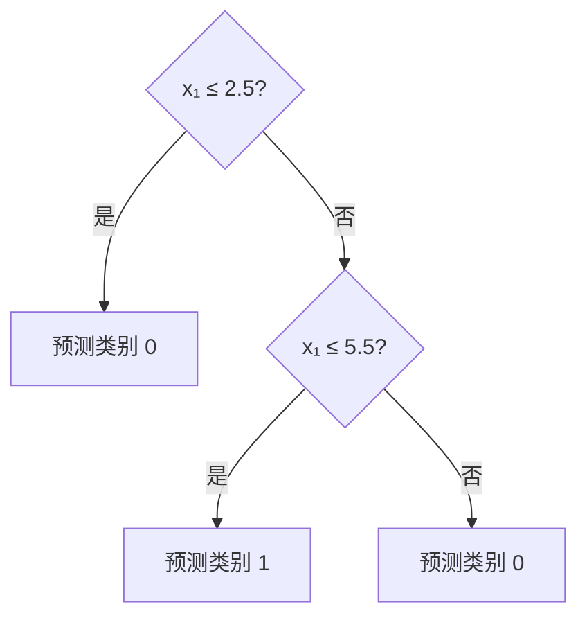

# 第 4 章：决策树——原理、推导、拓展与实践

> 本章笔记依据周志华《机器学习》第 4 章，正文第 73—92 页。按原书顺序解释基本算法，并补充回归树、损失函数视角、代价复杂度剪枝、模型解释与树集成。文中“补充”表示超出本章正文的内容；样题为自编。实验情境中的阈值均为教学示例，不代表真实物理临界值。

## 目录

- [作者思路与学习路线](#作者思路与学习路线)
- [4.1 基本流程](#41-基本流程)
- [4.2 划分选择](#42-划分选择)
- [4.3 剪枝处理](#43-剪枝处理)
- [4.4 连续与缺失值](#44-连续与缺失值)
- [4.5 多变量决策树](#45-多变量决策树)
- [4.6 阅读材料](#46-阅读材料)
- [补充知识](#补充知识)
- [样题与解答](#样题与解答)
- [Python 实践](#python-实践)
- [实际应用场景](#实际应用场景)
- [参考资料](#参考资料)

## 作者思路与学习路线

上一章用一个线性组合综合所有特征；本章改用一系列条件判断，把输入空间逐步划分成不同区域。每条从根到叶的路径是一组同时成立的条件，每个叶结点给出该区域的预测。

**决策树的核心问题是：在当前样本中，问哪个问题、在哪里划分，才能让后续预测更可靠？**

| 小节 | 作者要解决的问题 | 主要思路 | 学习重点 |
|---|---|---|---|
| 4.1 基本流程 | 怎样把一系列判断组织成模型？ | 自顶向下递归划分，直至停止 | 样本子集、递归、叶结点预测 |
| 4.2 划分选择 | 下一步问哪个属性？ | 比较划分后的类别纯度 | 信息熵、信息增益、增益率、基尼指数 |
| 4.3 剪枝处理 | 怎样避免记住训练数据中的偶然现象？ | 限制生长或删除分支 | 预剪枝、后剪枝、验证集 |
| 4.4 连续与缺失值 | 数据没有整齐的离散取值时怎么办？ | 搜索阈值；按样本权重处理缺失 | 阈值候选、连续属性复用、权重分流 |
| 4.5 多变量决策树 | 轴平行边界是否过于受限？ | 在结点上测试多个特征的组合 | 斜划分、与线性模型的联系 |
| 4.6 阅读材料 | 树还能怎样发展？ | 规则提取、混合模型、增量学习 | 识别基本思想与具体实现的区别 |

本章可以围绕四个问题阅读：**怎样生长、按什么标准生长、何时停止、遇到复杂数据怎样调整。**划分准则决定局部选择，剪枝与验证决定复杂度，最终目标始终是对未见样本的泛化性能。

全文主要符号如下。

| 符号 | 含义 |
|---|---|
| $D$ | 当前结点的训练样本集合 |
| $A$ | 当前可用属性或测试的集合 |
| $K$ | 类别数 |
| $p_k$ | 当前结点中第 $k$ 类的比例 |
| $D^v$ | 一次划分得到的第 $v$ 个子集 |
| $a,t$ | 划分属性与连续属性的阈值 |
| $w_i$ | 第 $i$ 个样本的权重，默认初始值为 $1$ |
| $T,L$ | 一棵树及其叶结点数 |

## 4.1 基本流程

### 4.1.1 一棵树表示什么

根结点接收全部训练样本；内部结点执行测试；分支表示测试结果；叶结点给出类别或数值预测。例如一条路径可以表示：

$$
\text{条件 A 成立}\ \land\ \text{条件 B 不成立}\ \Longrightarrow\ \text{预测为类别 1}.
$$

路径中的条件是逐步累积的。第二个测试仅针对已经通过第一个测试筛选的样本，因此同一个属性在不同分支中的作用可以不同。树天然能够表达这种条件依赖与特征交互。

分类树通常在叶结点预测当前训练样本的多数类：

$$
\hat y=\arg\max_k\sum_{i\in D}\mathbf{1}(y_i=k).
$$

有样本权重时，将数量替换为权重和。叶结点也可以输出类别比例作为概率估计，具体可靠性将在补充部分讨论。

### 4.1.2 三种基本停止情形

原书给出三种递归返回情形。

| 情形 | 为什么不能或不必继续 | 叶结点怎样预测 |
|---|---|---|
| 当前样本全属于同一类 | 已经纯净 | 预测该类 |
| 没有可用属性，或所有样本在可用属性上的取值都相同 | 现有信息无法进一步区分 | 预测当前结点多数类 |
| 某个分支没有训练样本 | 缺乏该分支的数据 | 以父结点多数类作为默认预测 |

“当前结点多数类”与“父结点多数类”的区别是：前者有当前结点的数据支持，后者是在缺少局部数据时借助上一级分布。

如果特征完全相同的样本具有不同标签，称为冲突样本。仅凭现有特征，任何确定性分类规则都不能同时正确分类这些样本。继续加深树不能消除这种信息限制。

### 4.1.3 递归学习的简化伪代码

```text
Grow(D, A, parent_default):
    若 D 为空：返回预测 parent_default 的叶结点
    若 D 中标签全部相同：返回该类别叶结点
    default = D 的多数类
    若无可用测试，或现有测试无法区分样本：返回 default 叶结点
    若达到预设停止条件：返回 default 叶结点

    在当前 D 上选择最优测试 s
    根据 s 创建分支
    对每个分支 v：
        得到样本子集 D_v
        按测试类型确定后续可用属性 A_next
        子结点 = Grow(D_v, A_next, default)
    返回当前内部结点
```

这个过程属于**分而治之**。但“选择最优测试”通常只看当前结点的一步收益，因此树的生长也是贪心搜索，不保证得到全局最优的整棵树。

原书在离散属性多路划分后删除已经测试的属性，因为该属性在每个子结点内已经固定。连续阈值测试，以及某些离散属性的二元子集测试，不应机械地沿用这个删除规则。

## 4.2 划分选择

### 4.2.1 纯度与不纯度

若一个结点中的样本几乎属于同一类别，就称它比较纯。若多个类别混杂，则不纯度较高。划分的目标是降低子结点总体的不纯度。

**必须比较按样本比例加权后的子结点不纯度。**不能对大分支与极小分支简单等权平均，否则只含一个样本的分支会被赋予不合理的影响。

### 4.2.2 信息熵

当前结点中第 $k$ 类比例为 $p_k$ 时：

$$
\boxed{\mathrm{Ent}(D)=-\sum_{k=1}^{K}p_k\log_2p_k}
$$

约定 $0\log_2 0=0$。熵的范围为：

$$
0\le\mathrm{Ent}(D)\le\log_2K.
$$

全部属于同一类时熵为 $0$；类别均匀分布时达到最大值。二分类时：

$$
H(p)=-p\log_2p-(1-p)\log_2(1-p).
$$

其一、二阶导数分别为：

$$
H'(p)=\log_2\frac{1-p}{p},
$$

$$
H''(p)=-\frac{1}{\ln 2}\left(\frac1p+\frac1{1-p}\right)<0.
$$

因此它是凹函数，在 $p=1/2$ 处达到最大值 $1$。这解释了为什么正反样本各半时最不确定。

### 4.2.3 信息增益与 ID3

属性 $a$ 产生 $V$ 个分支时：

$$
\boxed{\mathrm{Gain}(D,a)=\mathrm{Ent}(D)-\sum_{v=1}^{V}\frac{|D^v|}{|D|}\mathrm{Ent}(D^v)}
$$

它表示：**知道这次测试的结果后，类别不确定性在平均意义上减少了多少。**ID3 选择信息增益最大的属性。

例如当前有 $10$ 个样本，正类 $6$ 个、反类 $4$ 个：

$$
\mathrm{Ent}(D)=-0.6\log_2 0.6-0.4\log_2 0.4\approx0.9710.
$$

某测试将它分为：左分支 $4$ 正 $0$ 反，右分支 $2$ 正 $4$ 反。子结点加权熵为：

$$
\frac4{10}\times0+\frac6{10}\left[-\frac26\log_2\frac26-\frac46\log_2\frac46\right]\approx0.5510.
$$

因此信息增益为：

$$
\boxed{\mathrm{Gain}\approx0.9710-0.5510=0.4200}.
$$

原书西瓜数据集有 $17$ 个样本，其中 $8$ 正、$9$ 反，根结点熵约为 $0.998$。各属性信息增益的书中近似值为：

| 属性 | 色泽 | 根蒂 | 敲声 | 纹理 | 脐部 | 触感 |
|---|---:|---:|---:|---:|---:|---:|
| 信息增益 | 0.109 | 0.143 | 0.141 | 0.381 | 0.289 | 0.006 |

所以选择“纹理”作为根结点测试。进入不同分支后，需要使用各自子集重新计算增益，不能把根结点的属性排序沿用到底。手算时中间舍入会导致最后几位略有差异。

**补充：信息增益与互信息。**令 $B$ 为该次测试的分支结果，则经验信息增益就是：

$$
\mathrm{Gain}=H(Y)-H(Y\mid B)=I(Y;B).
$$

离散属性完整多路测试时，$B$ 可以就是该属性值；连续属性二分时，$B$ 是阈值测试结果。标准完整数据、相同权重下，增益非负，但这不表示每个子结点的熵都一定低于父结点。它保证的是加权平均意义上的下降。

### 4.2.4 信息增益为什么偏好多取值属性

若把“编号”作为属性，每个训练样本编号都唯一，就会产生许多只含一个样本的叶结点。每个叶子熵都为 $0$，信息增益达到父结点全部熵。

但新样本具有新编号，这种划分难以推广。训练样本纯净与泛化能力强之间没有必然对应关系。经验信息增益偏好多取值属性，也可以理解为候选划分越灵活，越容易把训练数据中的偶然差异解释成规律。

### 4.2.5 增益率与 C4.5

定义划分本身的固有值：

$$
\mathrm{IV}(a)=-\sum_{v=1}^{V}\frac{|D^v|}{|D|}\log_2\frac{|D^v|}{|D|}.
$$

它是分支大小分布的熵，与分支内标签无直接关系。若 $V$ 个分支一样大，则 $\mathrm{IV}(a)=\log_2V$；高度不均衡时会更小。

增益率为：

$$
\boxed{\mathrm{GainRatio}(D,a)=\frac{\mathrm{Gain}(D,a)}{\mathrm{IV}(a)}}.
$$

这会惩罚产生大量分支的测试。但如果某划分把极少量样本单独分出去，分母很小，也可能得到不合理的高比值。因此，C4.5 采用先按信息增益达到平均水平筛选、再比较增益率的启发式规则，不能简化为“在全部候选中直接取增益率最大者”。连续属性的实际 C4.5 还有更细的测试构造与修正，原书是入门层面的概括。[Quinlan（1996）][quinlan1996]

若某属性在当前结点恒定，则没有有效划分，$\mathrm{IV}=0$，应排除该候选，不能直接计算 $0/0$。

### 4.2.6 基尼值与基尼指数

定义：

$$
\boxed{\mathrm{Gini}(D)=1-\sum_{k=1}^{K}p_k^2}.
$$

可以解释为：按结点类别分布独立抽取两次标签，它们不相同的概率。这里对应有放回或独立抽取；有限样本不放回抽取的精确概率会有修正。

二分类时：

$$
\mathrm{Gini}(D)=2p(1-p),\qquad 0\le\mathrm{Gini}(D)\le\frac12.
$$

一般 $K$ 类的最大值为 $1-1/K$。与熵一样，越小越纯。

划分后加权基尼指数为：

$$
\mathrm{GiniIndex}(D,a)=\sum_{v=1}^{V}\frac{|D^v|}{|D|}\mathrm{Gini}(D^v).
$$

选择它最小的测试。也可以最大化基尼下降：

$$
\Delta G=\mathrm{Gini}(D)-\mathrm{GiniIndex}(D,a).
$$

在前面 $6$ 正 $4$ 反的例子中，父结点基尼值为 $0.48$，子结点加权基尼值为 $0.2667$，下降约为 $0.2133$。

### 4.2.7 ID3、C4.5 与 CART 的区别

| 比较项 | ID3 的经典形式 | C4.5 | CART |
|---|---|---|---|
| 主要任务 | 分类 | 分类 | 分类和回归 |
| 经典划分准则 | 信息增益 | 信息增益筛选结合增益率 | 分类常用基尼；回归常用平方误差 |
| 树的分支 | 离散属性通常多路 | 离散通常多路，连续测试二路 | 二叉树 |
| 连续属性 | 原始形式以离散属性为主 | 在结点内搜索阈值 | 在结点内搜索阈值 |
| 复杂度控制 | 基础生长过程需结合具体扩展 | 有剪枝机制 | 代价复杂度剪枝等 |

原书用多分支公式解释基尼指数，便于统一符号；**经典 CART 的具体划分是二元划分**。对有 $V$ 个离散取值的属性，可以测试“属于某个取值子集”还是“不属于”。不计互为补集的重复，非空二分候选数为：

$$
\frac{2^V-2}{2}=2^{V-1}-1.
$$

因此，离散属性的二元子集搜索也可能有较大计算开销。软件实现还会采用各种限制或加速策略。

## 4.3 剪枝处理

### 4.3.1 为什么训练集上越准确，实际效果可能越差

继续生长通常能使训练误差下降，但小叶结点容易记住噪声、误标和偶然样本关系。学习目标需要兼顾拟合能力与复杂度，不能只追求训练误差为零。

**预剪枝**在生长时判断是否继续；**后剪枝**先生成较充分的树，再考察是否删除已经生成的分支。

### 4.3.2 预剪枝

原书通过验证集判断一次划分是否提高泛化性能。若不划分，就把当前结点当作训练多数类叶结点；若划分，就按临时子结点预测验证样本，比较两者表现。

常见的结构限制还包括最大深度、最小分裂样本数、最小叶样本数、最小不纯度下降。它们属于限制生长的方法，并不都等同于原书“每次用验证集判断”的具体流程。

优点是减少训练与预测开销，限制复杂度。局限是一步收益不能代表后续收益：当前划分没有改善，但再往下划分可能识别重要交互，因此过早停止会欠拟合。

### 4.3.3 后剪枝

先生成树，然后自底向上考察内部结点。将一个结点及其整棵子树替换为叶结点，叶标签取该结点训练样本多数类；如果验证表现更好，或在相同表现下按简化原则选择更小模型，就实施剪枝。

不能用验证样本的多数类给新叶子贴标签，否则验证集也参与了参数拟合。验证集用于选择结构，最终测试集用于评估选定模型。

原书小型示例的结果为：

| 模型 | 验证集准确率 |
|---|---:|
| 未剪枝树 | $3/7\approx42.9\%$ |
| 预剪枝树 | $5/7\approx71.4\%$ |
| 后剪枝树 | $5/7\approx71.4\%$ |

这个例子展示了剪枝如何改善验证表现，也说明后剪枝不保证每次优于预剪枝。验证样本只有 $7$ 个，一个样本就影响约 $14.3$ 个百分点，不能把这些数值作为普遍性能结论。

| 方面 | 预剪枝 | 后剪枝 |
|---|---|---|
| 判断时机 | 分支展开之前 | 分支展开之后 |
| 能否观察后续组合收益 | 容易错过 | 能考察已长出的子树 |
| 计算开销 | 通常较低 | 通常较高 |
| 常见风险 | 限制过强导致欠拟合 | 初始树很大；结构选择仍可能过拟合验证数据 |

### 4.3.4 补充：代价复杂度剪枝

CART 常通过在经验风险和叶结点数之间折中选择子树：

$$
\boxed{R_\alpha(T)=R(T)+\alpha L,\qquad\alpha\ge0}.
$$

这里 $R(T)$ 是叶结点风险的总和，$L$ 为叶数。风险必须采用统一尺度，可以是误分类风险，也可以是样本加权不纯度；scikit-learn 的实现采用后者。$\alpha$ 越大，复杂度惩罚越强。

设内部结点 $t$ 下的子树为 $T_t$，有 $L_t$ 个叶。把它剪成一个叶子的风险为 $R(t)$。令保留与剪除的目标相等：

$$
R(T_t)+\alpha L_t=R(t)+\alpha,
$$

得到：

$$
\boxed{\alpha_{\mathrm{eff}}(t)=\frac{R(t)-R(T_t)}{L_t-1}}.
$$

有效惩罚系数最小的子树是优先剪除的薄弱环节。由此生成一系列嵌套候选子树，再根据验证或交叉验证选择复杂度；并非拿最终测试集反复挑 $\alpha$。实现参数通常叫 `ccp_alpha`。[剪枝示例][pruning]

## 4.4 连续与缺失值

### 4.4.1 连续属性怎样构造候选阈值

设当前样本在属性 $a$ 上有 $n$ 个不同观测值，排序为：

$$
a^{(1)}<a^{(2)}<\cdots<a^{(n)}.
$$

两个相邻观测值之间的阈值，对训练样本产生相同分组，因此可选中点作为代表：

$$
\boxed{T_a=\left\{\frac{a^{(i)}+a^{(i+1)}}2:i=1,\ldots,n-1\right\}}.
$$

注意 $n$ 是不同取值数量，不一定等于样本总数。重复取值之间不能产生有效的按值切分。

每个阈值将样本分为：

$$
D^-_{a,t}=\{\boldsymbol{x}\in D:x_a\le t\},\qquad D^+_{a,t}=\{\boldsymbol{x}\in D:x_a>t\}.
$$

计算：

$$
\mathrm{Gain}(D,a,t)=\mathrm{Ent}(D)-\sum_{s\in\{-,+\}}\frac{|D^s_{a,t}|}{|D|}\mathrm{Ent}(D^s_{a,t}).
$$

对所有合法阈值搜索，得到该属性的最优阈值，再与其他属性比较。**阈值由当前结点的数据学习得到，不能预先固定一个阈值用于整棵树。**

### 4.4.2 连续属性可以重复使用

父结点测试 $x_1\le2.5$ 后，右子集内部仍可能有不同的 $x_1$，所以可以继续测试 $x_1\le5.5$。例如标签先为 $0$、中间为 $1$、后面又为 $0$，可由以下规则表示：



重复使用同一连续属性，可以表达多个不相邻区间。它与离散属性完整多路测试后在子结点中取值已经固定的情况不同。

### 4.4.3 缺失值需要分别回答两个问题

1. 某属性有缺失时，怎样评价它是否适合划分？
2. 选中该属性后，该属性缺失的样本应当走哪个分支？

原书 C4.5 思路使用样本权重。令 $\widetilde D$ 为当前结点中属性 $a$ 没有缺失的样本，定义总权重函数：

$$
W(S)=\sum_{i\in S}w_i.
$$

无缺失样本比例为：

$$
\rho=\frac{W(\widetilde D)}{W(D)}.
$$

在这些已知样本内部，类别比例与分支比例分别为：

$$
\widetilde p_k=\frac{W(\widetilde D_k)}{W(\widetilde D)},\qquad
\widetilde r_v=\frac{W(\widetilde D^v)}{W(\widetilde D)}.
$$

评价属性时，先在已知样本上计算增益，再用可用数据比例折减：

$$
\boxed{\mathrm{Gain}(D,a)=\rho\left[\mathrm{Ent}(\widetilde D)-\sum_v\widetilde r_v\mathrm{Ent}(\widetilde D^v)\right]}.
$$

因此，只有极少量已知值的属性，即使在已知样本上看起来很好，也不会直接获得与完整属性同等的评价。若全部缺失，就无法据此估计分支分布，应排除该测试。

### 4.4.4 缺失样本如何分配

属性已知的样本进入对应分支，权重不变。属性未知的样本同时进入所有分支，在第 $v$ 个分支的权重变为：

$$
\boxed{w_i^{(v)}=\widetilde r_vw_i}.
$$

由于 $\sum_v\widetilde r_v=1$，样本总权重守恒：

$$
\sum_vw_i^{(v)}=w_i.
$$

这是一种权重分流，不是把完整权重重复计入每个分支。后续熵、类别比例与多数类都要使用这些权重。连续经历多个缺失测试时，沿路径的权重会继续相乘。

预测样本在测试属性上缺失时，也可以按分支概率组合各路径的类别分布。例如两条路径权重为 $0.75,0.25$，正类概率分别为 $0.8,0.4$，组合结果为：

$$
p(y=1\mid\boldsymbol{x})=0.75\times0.8+0.25\times0.4=0.7.
$$

### 4.4.5 补充：不同实现的缺失策略不能混用

| 方法 | 基本机制 |
|---|---|
| 原书介绍的 C4.5 机制 | 已知样本评价增益，缺失样本按权重进入多个分支 |
| rpart 中的替代划分 | 主测试缺失时，使用其他属性学习出的、尽量模仿主测试分组的替代测试 |
| 当前 scikit-learn 的部分树配置 | 在训练中比较缺失值全部走左或全部走右的方案，学习其方向 |

替代划分模拟的是“主测试把样本送向哪边”，不是重新直接预测原类别。[rpart 官方说明][rpart]

是否原生支持 NaN，取决于模型、版本和参数组合。不要把某个实现的策略当作全部决策树的通用规则。[scikit-learn 决策树指南][tree-guide]

## 4.5 多变量决策树

### 4.5.1 单变量树为何形成轴平行边界

测试 $x_j\le t$ 在特征空间中对应与坐标轴平行的划分。多次测试后，普通数值分类树把空间切成一系列轴平行区域。每个叶结点对应这些半空间条件的交集。

例如真实边界为：

$$
x_1+x_2=1,
$$

普通轴平行树通常需要多次测试形成阶梯状近似；边界越倾斜或复杂，为了提高近似精度可能需要更多叶结点。

### 4.5.2 斜决策树

多变量决策树允许内部结点测试特征的线性组合：

$$
\boxed{\boldsymbol{w}^{T}\boldsymbol{x}\le t}.
$$

“多变量”强调一个测试同时组合多个输入属性，不是只说整棵树用了多个属性，也不是说模型预测多个输出。

结点内部可以借助上一章的线性分类器思想学习划分方向。这样可能用较少的结点表达斜边界，但每个测试更复杂，学习也更困难，可解释性需要结合具体系数和特征含义判断。结点数减少不必然意味着整体预测更快，因为一次稠密线性测试要访问多个特征。

| 模型 | 单个测试 | 边界特点 | 典型解释方式 |
|---|---|---|---|
| 线性分类器 | 对一个线性得分作判断 | 一条超平面 | 系数与得分 |
| 单变量决策树 | 测试某一个属性 | 多段轴平行边界 | 条件规则 |
| 斜决策树 | 测试多个属性的组合 | 多段斜边界 | 路径条件与结点系数 |

## 4.6 阅读材料

原书给出几个继续发展的方向。

**规则提取。**一条根到叶的路径可以转成一条 IF–THEN 规则。进一步合并、删去规则前件，可能得到比直接照搬整棵树更简洁的规则集。

**划分准则与剪枝的相对作用。**书中引用的特定实验认为，不同划分准则的差异可能主要体现在树大小，剪枝对泛化表现影响显著。不能把某个数据条件下的百分比结果当作所有任务的定律。

**混合模型。**可以在内部结点用线性模型，也可以在叶结点嵌入感知机或其他学习器。内部测试决定区域，叶模型负责区域内的预测。

**增量学习。**新数据到来时只更新部分结构，避免每次从头训练。更新后模型不一定与把所有历史数据重新训练的树完全一致，因为学习路径和局部调整方式不同。

这些内容说明，“决策树”是一种建模结构；具体怎样选测试、处理数据、预测叶输出，可以有多种算法。

## 补充知识

以下内容用于把本章连接到统计学习与实际建模，不要求首次阅读时全部掌握。

### 补充 1：回归树为什么在叶结点预测均值

分类树预测类别，回归树预测连续数值。普通 CART 回归树可写成分段常数函数：

$$
f(\boldsymbol{x})=\sum_{\ell=1}^{L}c_\ell\mathbf{1}(\boldsymbol{x}\in R_\ell),
$$

其中 $R_\ell$ 为第 $\ell$ 个叶结点对应的区域，$c_\ell$ 是该叶的预测值。

固定一个叶子，平方误差为：

$$
E(c)=\sum_{i\in R_\ell}(y_i-c)^2.
$$

令导数为零：

$$
E'(c)=-2\sum_{i\in R_\ell}(y_i-c)=0,
$$

得到：

$$
\boxed{c_\ell=\frac1{n_\ell}\sum_{i\in R_\ell}y_i}.
$$

若有权重，则为加权均值。若目标是绝对误差，叶结点的最优常数改为中位数。

平方误差树选择划分时，寻找使两个子区域残差平方和最小的属性与阈值：

$$
\min_{j,t}\left[\sum_{i\in R_L(j,t)}(y_i-\bar y_L)^2+\sum_{i\in R_R(j,t)}(y_i-\bar y_R)^2\right].
$$

它在每个小区域内拟合一个常数；线性回归则在整个空间拟合一个线性函数。两者假设不同，可以作为互补的比较模型。[回归树接口][tree-regressor]

**常数叶回归树不擅长外推。**每个预测都是某个训练子集的均值，因而位于训练响应最小值与最大值之间。输入超出训练范围时，模型通常沿已有分支走到边缘叶子，并输出固定值。这个限制针对普通常数叶回归树；带线性叶模型等扩展不能直接套用这个结论。

### 补充 2：熵和基尼为什么适合划分，而分类错误率可能不敏感

一个叶子预测多数类时，训练错误率为：

$$
\mathrm{Err}(D)=1-\max_k p_k.
$$

它只看最大类比例，无法充分反映其他分布变化。例如父结点 $80$ 正 $20$ 反，分成两个各 $50$ 个样本的子结点：一个 $45$ 正 $5$ 反，另一个 $35$ 正 $15$ 反。父、子结点都预测正类，因此总错误数仍为 $20$。

但两个子结点的正类比例变成 $0.9$ 和 $0.7$，熵和基尼能够识别这种分布变化：信息增益约为 $0.0468$，基尼下降为 $0.02$。这使其更适合指导逐步生长。

还可以从损失函数理解它们。若叶子用类别分布 $q_k$ 预测，其平均对数损失为：

$$
-\sum_kp_k\log q_k.
$$

最优解为 $q_k=p_k$，最小值就是熵（取自然对数时与以 $2$ 为底仅差一个比例常数）。因此，按熵下降划分，相当于比较分段常数类别分布带来的对数损失改善。

对类别独热向量 $\boldsymbol{e}_y$ 和预测概率向量 $\boldsymbol{p}$，平均向量平方损失为：

$$
\frac1{|D|}\sum_{i\in D}\|\boldsymbol{e}_{y_i}-\boldsymbol{p}\|_2^2=1-\sum_kp_k^2.
$$

右边正是基尼值。这里是完整概率向量的平方损失；二分类只对正类概率计算标量平方误差时，会相差一个常数因子。

### 补充 3：贪心搜索与 XOR

考虑四个样本：

| $x_1$ | $x_2$ | $y$ |
|---:|---:|---:|
| 0 | 0 | 0 |
| 0 | 1 | 1 |
| 1 | 0 | 1 |
| 1 | 1 | 0 |

整体正反各半，熵为 $1$。单独用 $x_1$ 或 $x_2$ 划分，两个子集仍然正反各半，所以第一步信息增益都是 $0$。

但先按 $x_1$ 分，再在两个子结点按 $x_2$ 分，深度为 $2$ 的树就能完全分类。

**表示能力足够，不等于训练策略一定能找到。**若算法要求每一步有严格正收益，或用预剪枝禁止零收益的第一步，就会错过这个解；允许零收益分裂的实现可能继续学出 XOR。不能笼统地说“所有贪心树都学不会 XOR”。

### 补充 4：高方差、特征尺度与几何限制

数据稍有变化，两个相近候选的增益排名就可能交换。一旦根部选了不同测试，后面的样本集合和整棵树也随之改变。这是单棵深树往往方差较高、不够稳定的原因之一。

| 问题 | 应怎样理解 |
|---|---|
| 是否需要标准化 | 单变量阈值树通常不需要；线性单位缩放保留排序与可实现的样本划分 |
| 极端值是否没有影响 | 排序测试不像平方距离那样直接受数值尺度支配，但极端值仍可形成小叶子；回归目标极端值也会影响均值与平方误差 |
| 是否对旋转不变 | 轴平行树通常不是；特征旋转可能让边界更容易或更难表达 |
| 是否能自动选择特征 | 树会选择用于测试的特征，但这不保证识别了全部相关因素，也不等于完成因果筛选 |
| 是否适合小样本高维 | 易找到偶然划分，必须限制复杂度并进行适当验证 |

严格单调变换保留训练样本排序及可实现的分组；但若在变换后的尺度上取中点，再映回原尺度，对未见样本的精确边界不一定与原中点一致。因此不要把“保留排序”扩大解释为所有预测完全不变。

### 补充 5：概率、平滑与类别不平衡

叶结点中第 $k$ 类有 $n_k$ 个样本，总数为 $n$，最直接的概率估计是：

$$
\hat p_k=\frac{n_k}{n}.
$$

一个只包含两例正样本的叶子会输出正类概率 $1$，但这不能被解释为在现实中已经确定必然发生。叶子规模过小会导致极端且不稳定的概率。

可以采用简单的对称平滑：

$$
\hat p_k=\frac{n_k+\eta}{n+K\eta},\qquad\eta>0.
$$

平滑可以避免直接给出 $0$ 或 $1$，但不保证概率已经校准。限制叶样本数、保留独立校准数据等，是不同层面的处理。

类别权重也会改变树。若正类权重大，节点中的加权类别比例、划分准则和叶预测都可能变化。概率加权或重采样后的叶比例，需要结合训练方式解释，不能自动当作原始总体下的概率。

例如一个叶子真实训练计数为 $2$ 正 $18$ 反，若给正类权重 $9$、反类权重 $1$，加权比例就变成 $18/(18+18)=0.5$，而原始比例是 $0.1$。这个例子说明了“提高少数类影响”和“恢复真实发生率”是两个不同目标。

### 补充 6：特征重要性怎样解释

常见的重要性是把某个特征造成的节点不纯度下降累加，再归一化。较高的重要性表示该模型在训练中依赖这个特征进行划分。

它可能偏向候选切分较多的特征；相关特征之间也可能争夺或分摊重要性。重要性不等于因果作用，较低的重要性也不能证明一个物理因素无关。

一种补充检查是验证集置换重要性：打乱一个特征，观察模型分数下降多少，并重复多次。它衡量当前模型在该数据和指标下对该特征的依赖。强相关特征可以互相替代，仍可能使置换重要性偏低。[置换重要性官方说明][importance]

### 补充 7：随机森林怎样缓解单树不稳定

经典随机森林让多棵树使用随机化的训练样本，并在节点划分时只考察随机选取的一部分特征，再组合预测。分类常用投票或平均类别概率，回归常用平均数。随机化既保留单树的表达能力，又降低树之间的相似性。[Breiman（2001）][random-forests]

在一个简化的回归预测误差模型中，若每棵树方差为 $\sigma^2$，任意两棵的相关系数均为 $\rho$，平均 $B$ 棵树的方差为：

$$
\boxed{\mathrm{Var}(\bar f)=\sigma^2\left[\rho+\frac{1-\rho}{B}\right]}.
$$

这解释了为什么增加树数与降低树间相关性都重要。公式依赖等方差、等相关的简化假设，不是对任意森林的精确性能保证。

对 $m$ 个样本有放回抽取 $m$ 次，一条样本完全未被抽中的概率为：

$$
\left(1-\frac1m\right)^m\longrightarrow e^{-1}\approx0.368.
$$

这些没有参与某棵树训练的样本称为袋外样本，可用于袋外评估。存在同一实验或批次内强相关时，普通样本级袋外评估仍不能代替按实验或批次隔离的验证。

### 补充 8：梯度提升树与随机森林有何不同

随机森林主要组合多棵随机化的树；梯度提升树按顺序添加新树，逐步改善当前模型：

$$
F_M(\boldsymbol{x})=F_0(\boldsymbol{x})+\nu\sum_{m=1}^{M}h_m(\boldsymbol{x}).
$$

其中 $\nu$ 为学习率。新树通常拟合损失关于当前预测的负梯度：

$$
r_{im}=-\left.\frac{\partial\ell(y_i,F(\boldsymbol{x}_i))}{\partial F(\boldsymbol{x}_i)}\right|_{F=F_{m-1}}.
$$

平方损失 $\ell=\tfrac12(y-F)^2$ 下，负梯度正好是残差 $y-F$；其他损失下不能都简单称作“拟合原始残差”。

XGBoost 是树提升的一个具体系统，结合正则化目标与高效的划分算法等工程设计。学习本章后，可以把它理解为“用树作为基本函数，在损失优化过程中逐步相加”，而不是另一种单棵分类树。[Chen 与 Guestrin（2016）][xgboost]

| 方法 | 树之间的关系 | 主要思路 | 解释时注意 |
|---|---|---|---|
| 单棵树 | 只有一棵 | 局部划分，形成规则 | 规模小时路径清楚，深树仍可能复杂 |
| 随机森林 | 多棵随机化的树组合 | 平均化并降低相关性 | 整体不再是一组简单路径 |
| 梯度提升树 | 新树依赖已有模型的误差结构 | 逐步优化损失 | 学习率、树复杂度与树数共同作用 |

树越多不等于一定更准确，单棵树越浅也不等于整体模型越简单；需要结合整个集成和验证结果判断。

## 样题与解答

建议先独立计算，再阅读解答。数值按四位小数展示，计算过程保留较多位数。

### 样题 1：三种停止情形

当前节点含 $7$ 个正类、$3$ 个反类，但所有样本在剩余属性上的取值完全相同。另一个待生成分支没有训练样本，其父节点含 $4$ 个正类、$6$ 个反类。两者分别如何预测？

**解：**前者无法再区分，取当前节点多数类，预测正类；后者没有局部数据，取父节点多数类，预测反类。不能给空分支任意指定一个固定类别。

### 样题 2：同时计算信息增益与基尼下降

父节点 $8$ 个样本，$4$ 正 $4$ 反。划分后左节点 $3$ 正 $1$ 反，右节点 $1$ 正 $3$ 反。

**解：**父节点熵为 $1$，两个子节点熵均为：

$$
-\frac34\log_2\frac34-\frac14\log_2\frac14\approx0.8113.
$$

所以：

$$
\boxed{\mathrm{Gain}=1-0.8113=0.1887}.
$$

父节点基尼为 $0.5$，子节点均为 $1-(3/4)^2-(1/4)^2=0.375$，因此：

$$
\boxed{\Delta G=0.5-0.375=0.125}.
$$

### 样题 3：为什么不能只取增益率最大者

父节点 $20$ 个样本，$10$ 正 $10$ 反。测试 A 分出一个纯正类样本，另一个分支有 $9$ 正 $10$ 反；测试 B 分出两个各 $10$ 个样本的分支，分别为 $7$ 正 $3$ 反与 $3$ 正 $7$ 反。

**解：**A 的增益和固有值为：

$$
\mathrm{Gain}_A=1-\frac{19}{20}H\left(\frac9{19}\right)\approx0.0519,
$$

$$
\mathrm{IV}_A=H(1/20)\approx0.2864,
$$

所以增益率约为 $0.1812$。

B 的增益为 $1-H(0.7)\approx0.1187$，固有值为 $1$，增益率也为 $0.1187$。直接比较增益率会选择 A，虽然它的信息增益较小。两者平均增益约为 $0.0853$，先按增益筛选后只保留 B。

### 样题 4：分类错误率为何看不出改进

父节点有 $80$ 正 $20$ 反，划分后是 $45$ 正 $5$ 反和 $35$ 正 $15$ 反。计算划分前后训练错误率和基尼指数。

**解：**划分前多数类为正，错误数为 $20$。两个子节点多数类仍为正，错误数为 $5+15=20$，错误率都为 $0.2$。

父节点基尼为 $1-0.8^2-0.2^2=0.32$；两个子节点基尼为 $0.18,0.42$，等权平均为 $0.30$。基尼下降为 $0.02$，能够识别分布结构的变化。

### 样题 5：连续阈值搜索与属性复用

给定：

| $x$ | 1 | 2 | 3 | 4 | 5 | 6 |
|---|---:|---:|---:|---:|---:|---:|
| $y$ | 0 | 0 | 1 | 1 | 1 | 0 |

求信息增益最大的第一次划分阈值。

**解：**候选阈值为 $1.5,2.5,3.5,4.5,5.5$。父节点熵为 $1$，对应增益如下。

| 阈值 | 1.5 | 2.5 | 3.5 | 4.5 | 5.5 |
|---|---:|---:|---:|---:|---:|
| 信息增益 | 0.1909 | 0.4591 | 0.0817 | 0 | 0.1909 |

所以最优阈值为 $2.5$。右子节点继续用同一属性在 $5.5$ 处分裂，就能正确分类全部训练样本。

### 样题 6：缺失值的增益折减与权重守恒

当前 $10$ 个样本权重均为 $1$，其中 $8$ 个在属性 $a$ 上已知。这 $8$ 个样本 $4$ 正 $4$ 反，按该属性分为两个分支，分别是 $3$ 正 $1$ 反和 $1$ 正 $3$ 反。求修正信息增益，并说明其余样本如何进入分支。

**解：**已知样本增益为 $0.1887$，可用比例为 $\rho=8/10$，因此：

$$
\boxed{\mathrm{Gain}(D,a)=0.8\times0.1887\approx0.1510}.
$$

两个分支在已知样本中各占 $1/2$，所以每个缺失样本以权重 $0.5$ 进入左分支、以权重 $0.5$ 进入右分支。总权重仍为 $1$。不能在两个分支中都计为一个完整样本。

### 样题 7：代价复杂度剪枝

一个子树有 $3$ 个叶结点，总风险为 $0.10$。若剪成一个叶结点，风险为 $0.16$。求有效惩罚系数，并比较 $\alpha=0.02$ 与 $0.04$ 时的选择。风险已经采用同一总样本尺度。

**解：**

$$
\boxed{\alpha_{\mathrm{eff}}=\frac{0.16-0.10}{3-1}=0.03}.
$$

当 $\alpha=0.02$，保留子树的目标为 $0.10+3\times0.02=0.16$，剪成单叶为 $0.16+0.02=0.18$，保留。

当 $\alpha=0.04$，保留子树为 $0.22$，单叶为 $0.20$，剪除。在 $0.03$ 处两者相等，通常可倾向较简模型。

### 样题 8：回归树与外推

给定输入 $x=1,2,3,4$，输出 $y=1,2,8,9$。若在 $x=2.5$ 处分裂，两个叶子的预测值和总平方误差是多少？普通常数叶树对 $x=100$ 预测多少？

**解：**左叶均值为 $1.5$，右叶均值为 $8.5$。总误差：

$$
(1-1.5)^2+(2-1.5)^2+(8-8.5)^2+(9-8.5)^2=1.
$$

不划分时均值为 $5$，平方误差为 $50$，此次划分减少 $49$。$x=100$ 进入右叶，仍预测 $8.5$，说明树不会自动沿趋势向外延伸。

### 样题 9：零信息增益是否说明无法分类

对于补充部分的四个 XOR 样本，单独测试任一属性的信息增益都是 $0$。是否说明决策树不能表示正确分类规则？

**解：**不能这样判断。深度为 $2$ 的树可以表示正确规则。零增益只说明当前一步的平均不确定性没有下降；若预剪枝要求严格正增益，则可能阻止必要的第一步。

### 样题 10：无冲突数据为何存在零训练误差树

有限训练集中，不存在特征完全相同但标签不同的样本。说明为什么存在与训练集一致的决策树。

**解：**若当前子集混有不同类别，则其中必有两个不同类别样本，其至少一个属性取值不同。用该离散属性测试，或在两个不同连续值之间设阈值，就能作出非平凡划分。持续细分，直到各叶中只有同标签样本，或只有相同特征向量的样本；后者因无冲突也只有一个标签。

样本有限，因此存在这样的有限树。此结论是表示能力与存在性结论，不保证某个贪心算法必能找到，也不保证对新样本泛化良好。

## Python 实践

### 1. 完整示例：只在训练集内部选择复杂度

以下使用 scikit-learn 自带的鸢尾花数据，演示三分类树。样本有 $4$ 个连续特征、$3$ 个类别；不需要下载外部数据文件。依赖为 `scikit-learn`，可选绘图另需 `matplotlib`。

步骤是：先留出测试集，再在训练集内做分层交叉验证，比较最大深度、叶样本数和剪枝惩罚，最后只用选定模型评估测试集。[分类树接口][tree-classifier]、[网格搜索接口][grid-search]

```python
import sklearn
from sklearn.datasets import load_iris
from sklearn.metrics import accuracy_score, balanced_accuracy_score
from sklearn.model_selection import GridSearchCV, StratifiedKFold, train_test_split
from sklearn.tree import DecisionTreeClassifier

# 1. 载入数据；目标是三个已知类别中的一个。
iris = load_iris()
X, y = iris.data, iris.target

# 2. 在任何参数选择之前留出测试集。
X_train, X_test, y_train, y_test = train_test_split(
    X, y, test_size=0.20, stratify=y, random_state=42
)

# 3. 参数选择只使用训练数据内部的五折划分。
cv = StratifiedKFold(n_splits=5, shuffle=True, random_state=42)
base_tree = DecisionTreeClassifier(criterion="gini", random_state=42)
param_grid = {
    "max_depth": [2, 3, 4, None],
    "min_samples_leaf": [1, 3, 5],
    "ccp_alpha": [0.0, 0.005, 0.02],
}
search = GridSearchCV(
    estimator=base_tree,
    param_grid=param_grid,
    scoring="balanced_accuracy",
    cv=cv,
    n_jobs=1,
    refit=True,
)
search.fit(X_train, y_train)

# 4. best_estimator_ 已使用选定参数在整个训练集上重新拟合。
best_tree = search.best_estimator_
prediction = best_tree.predict(X_test)

print("scikit-learn version:", sklearn.__version__)
print("Best parameters:", search.best_params_)
print("CV balanced accuracy:", round(float(search.best_score_), 4))
print("Test accuracy:", round(float(accuracy_score(y_test, prediction)), 4))
print(
    "Test balanced accuracy:",
    round(float(balanced_accuracy_score(y_test, prediction)), 4),
)
print("Tree depth:", best_tree.get_depth())
print("Number of leaves:", best_tree.get_n_leaves())
```

这里的网格是一个便于学习的小示例，不是对任意数据都合适的参数范围。`balanced_accuracy` 为各类别召回率的平均值；该数据各类样本量相同，测试准确率与平衡准确率可能相同。

本次验证环境为 scikit-learn 1.8.0，保持代码中的随机种子，得到以下运行记录：

| 项目 | 运行结果 |
|---|---|
| 训练集、测试集样本数 | $120$、$30$ |
| 所选参数 | `max_depth=3`、`min_samples_leaf=3`、`ccp_alpha=0.0` |
| 五折平均平衡准确率 | 约 $0.9667$ |
| 测试准确率、测试平衡准确率 | 均约 $0.9667$ |
| 深度、叶数 | $3$、$5$ |

这是一次指定数据与划分下的运行结果，不是对所有版本或实际实验数据的性能保证。这里选中 `ccp_alpha=0`，同时仍有深度和最小叶样本数约束；它不表示剪枝在其他任务中没有价值。

### 2. 参数分别约束什么

| 参数 | 作用 | 增大或收紧后的常见效果 |
|---|---|---|
| `max_depth` | 限制根到叶的最大深度 | 减小它通常使树更浅 |
| `min_samples_split` | 内部节点至少达到多少样本才允许尝试划分 | 增大后减少可分裂节点 |
| `min_samples_leaf` | 每个子叶至少保留多少样本 | 增大后减少孤立小叶，概率与回归均值通常更稳定 |
| `max_leaf_nodes` | 限制叶结点总数 | 可以直接控制最终规模 |
| `min_impurity_decrease` | 要求分裂达到一定加权不纯度下降 | 增大后要求更明显的局部改进 |
| `ccp_alpha` | 后剪枝的复杂度惩罚 | 增大通常剪去更多分支 |
| `class_weight` | 改变不同类别样本的训练影响 | 可强调少数类或特定代价，但也改变概率解释 |
| `random_state` | 固定实现中涉及随机性的选择 | 便于复现，不能消除统计不确定性 |

`min_samples_split=10` 并不保证每个叶子至少有 $10$ 个样本；这类保证应看 `min_samples_leaf`。即使使用了熵准则，scikit-learn 的树也不能直接称作完整的 C4.5，因为分支结构、增益率和缺失处理等机制不同。

### 3. 可选：绘出已经拟合好的树

接在上面的代码之后运行：

```python
import matplotlib.pyplot as plt
from sklearn.tree import plot_tree

fig, ax = plt.subplots(figsize=(12, 6))
plot_tree(
    best_tree,
    feature_names=list(iris.feature_names),
    class_names=list(iris.target_names),
    filled=False,
    rounded=True,
    ax=ax,
)
fig.tight_layout()
plt.show()
```

图中通常会显示测试条件、不纯度、样本数与类别分布。根部测试不能脱离整条路径解释：同一个后续阈值只适用于已经进入该分支的样本。

### 4. 换成自己的数据时

分类任务使用类别标签；回归任务换成连续目标和 `DecisionTreeRegressor`，并选择与研究目的相符的回归指标。对时间、批次或个体相关的数据，需要改用相应的时间划分或分组交叉验证，不能直接照搬随机分层划分。

有缺失值填补、类别编码、特征选择等步骤时，应在每个训练折内拟合这些步骤，通常放进 Pipeline。不要先用全部数据计算填补值或选择特征，再交叉验证。

保持测试集不参与反复选参。一次小型留出测试的高分，只代表该次划分的观察结果，不能直接推断模型在新实验条件下同样可靠。

## 实际应用场景

### 1. 选择模型时，先明确要预测什么

| 场景 | 可用输入 | 目标 | 合适的树模型及重点 |
|---|---|---|---|
| 产品质量分类 | 原料性质、工艺条件、检测指标 | 合格与否或质量等级 | 浅分类树便于形成规则；验证跨批次稳定性 |
| 实验响应预测 | 温度、浓度、初始状态、配比 | 产量、生长速率、响应强度 | 回归树识别局部非线性；检查外推限制 |
| 稀有故障识别 | 传感器统计量、设备状态 | 故障与否 | 分类树结合代价、类别权重和召回率评估 |
| 已标注材料识别 | 光谱或理化指标 | 一个已知类别 | 控制高维小样本过拟合，比较其他基线 |
| 过程规则探索 | 实验前可获取条件 | 结果类别或连续响应 | 浅树用于描述性规则；阈值需重复验证 |
| 更高预测精度的表格建模 | 多种数值与类别特征 | 分类或回归 | 将森林、提升树与单树进行同条件比较 |

模型选择还应考虑预测时能否获得这些输入。例如，要在实验开始前预测首次成核位置，就不能把实验结束后才测得的生长速率作为输入。

### 2. THF 水合物：初始混合方式与首次结晶位置

可把每次独立重复实验作为一条记录，输入包括初始混合方式、设定温度、初始组成、可控接触几何和批次信息；目标为首次结晶位置类别。

先使用浅树探索：在什么条件范围内，某种位置更常出现？初始混合方式是在根部就有区分作用，还是只在某些温度范围内有作用？不同批次能否得到相似规则？

建议保留以下字段，具体测量定义需由实验方案统一。

| 字段 | 作用 |
|---|---|
| `trial_id` | 独立重复实验编号，用于关联全部观测 |
| `batch_id` | 批次、实验日或样品准备批号 |
| `initial_mode` | 两种初始混合或接触方式 |
| `temperature` | 按预先规定口径记录的温度 |
| `first_site` | 依据固定判据标注的首次结晶位置 |
| `induction_time` | 仅在观察到结晶时记录对应事件时间 |
| `event_observed` | 是否在观察窗口内看到结晶 |
| `observation_duration` | 总观察时长，帮助识别未完成观察 |
| `growth_measure` | 按统一方法得到的后续生长指标 |

表中哪些列可进入模型，取决于预测时点；编号通常用于分组与追溯，不作为记忆样本身份的预测特征。

### 3. 诱导时间：可以回归，但要处理观察窗口

若所有实验都观测到结晶，可用回归树探索诱导时间与初始条件的非线性关系，并与对数线性回归比较。诱导时间偏斜明显时，可研究对数变换，但需要明确优化的是哪个尺度上的误差。

若部分实验结束仍未结晶，实际信息是“诱导时间超过观察时长”，属于右删失。直接删掉这些记录或把截止时间当作真实诱导时间，会改变数据含义。应考虑合适的生存分析方法；生存树与生存森林属于进一步的专门模型，不能用普通回归树直接替代。

若研究问题明确改成“固定时间 $\tau$ 内是否结晶”，在每个实验至少完整观察到 $\tau$ 或此前已发生事件的条件下，可以构造对应二分类任务。这个目标与预测完整诱导时间分布不同。

### 4. 后续生长：避免把同一实验拆到训练与测试两侧

一条实验视频可以产生很多时间点，但这些点通常不等于同等数量的独立实验。若同一实验的相邻帧分别进入训练和测试集，模型可能利用几乎重复的信息取得过高分数。

需要按独立实验编号分组；若关心跨实验日或样品准备批次的推广，再考虑按批次验证。比较混合方式时，还要控制温度、组成和观测条件，而不能只凭某棵树出现了一个阈值就宣布存在机理分界。

### 5. 用树分析实验时，应报告哪些结果

除了准确率或误差，建议报告所选树的深度、叶数、各叶样本量、类别或响应分布，以及不同划分或重复采样下规则的稳定性。比较模型时，应使用相同的数据划分和评价口径。

在实验数量很少时，浅树首先可以作为探索性工具，帮助提出可检验的假设。树中的关联规则与特征重要性不能直接证明因果机制；后续仍需针对候选规律设计重复实验与对照。

## 参考资料

1. 周志华：《机器学习》，清华大学出版社，2016，第 4 章，正文第 73—92 页。本笔记原书部分以用户提供版本为准。
2. Quinlan, J. R. (1996). *Improved Use of Continuous Attributes in C4.5*. Journal of Artificial Intelligence Research, 4, 77–90. [论文页面][quinlan1996]。
3. Breiman, L., Friedman, J. H., Olshen, R. A., & Stone, C. J. (1984). *Classification and Regression Trees*. Wadsworth。CART 与代价复杂度剪枝的经典专著。
4. scikit-learn：[*DecisionTreeClassifier* 官方接口][tree-classifier]。用于核对划分准则、规模控制参数及分类概率接口。
5. scikit-learn：[*Post pruning decision trees with cost complexity pruning*][pruning]。用于理解 `ccp_alpha` 与候选剪枝路径。
6. scikit-learn：[*DecisionTreeRegressor* 官方接口][tree-regressor]。用于核对回归准则及叶结点预测。
7. Therneau, T. M., & Atkinson, E. J. *An Introduction to Recursive Partitioning Using the RPART Routines*. [官方说明][rpart]，第 5 节用于补充替代划分。
8. scikit-learn：[*Permutation feature importance*][importance]。用于理解不纯度重要性的偏好及相关特征的影响。
9. Breiman, L. (2001). *Random Forests*. Machine Learning, 45, 5–32. [作者公开论文][random-forests]。
10. Chen, T., & Guestrin, C. (2016). *XGBoost: A Scalable Tree Boosting System*. [论文页面][xgboost]。
11. scikit-learn：[*GridSearchCV* 官方接口][grid-search]。用于核对交叉验证选参与重新拟合的流程。
12. scikit-learn：[*Decision Trees* 用户指南][tree-guide]。用于补充具体实现的缺失值策略等。

[quinlan1996]: https://arxiv.org/abs/cs/9603103
[tree-classifier]: https://scikit-learn.org/stable/modules/generated/sklearn.tree.DecisionTreeClassifier.html
[pruning]: https://scikit-learn.org/stable/auto_examples/tree/plot_cost_complexity_pruning.html
[tree-regressor]: https://scikit-learn.org/stable/modules/generated/sklearn.tree.DecisionTreeRegressor.html
[rpart]: https://cran.r-project.org/web/packages/rpart/vignettes/longintro.pdf
[importance]: https://scikit-learn.org/stable/modules/permutation_importance.html
[random-forests]: https://www.stat.berkeley.edu/~breiman/randomforest2001.pdf
[xgboost]: https://arxiv.org/abs/1603.02754
[grid-search]: https://scikit-learn.org/stable/modules/generated/sklearn.model_selection.GridSearchCV.html
[tree-guide]: https://scikit-learn.org/stable/modules/tree.html
