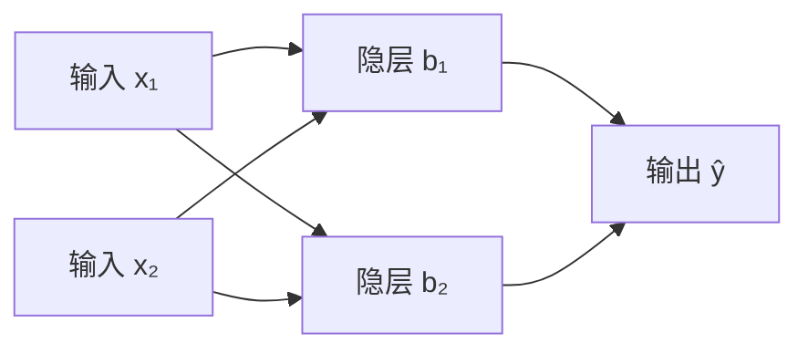

# 第 5 章：神经网络自学笔记

> 依据：周志华《机器学习》第 5 章，正文第 97—115 页，习题见第 116 页。本文保留原书“神经元—感知机—多层网络—BP—优化—其他网络—深度学习”的主线，补足符号、推导、手算和训练判断标准。标为“拓展”的部分用于连接实际建模。人工数据与代码实验均为教学用途。
>
> 格式约定：独立公式统一使用 math 围栏，正文与表格使用普通文字或 Unicode 符号。BP 主线沿用原书的“减去阈值”写法，明确区分隐层输出 bₕ 与加性偏置，避免符号混淆。

## 目录

- [一、作者思路与学习路线](#一作者思路与学习路线)
- [二、神经元模型与激活函数](#二神经元模型与激活函数)
- [三、感知机怎样学习以及为什么有局限](#三感知机怎样学习以及为什么有局限)
- [四、多层网络与表示能力](#四多层网络与表示能力)
- [五、BP的符号与前向计算](#五bp的符号与前向计算)
- [六、逐步推导误差逆传播](#六逐步推导误差逆传播)
- [七、完整手算一次参数更新](#七完整手算一次参数更新)
- [八、标准BP累积BP与小批量训练](#八标准bp累积bp与小批量训练)
- [九、输出层损失函数与现代分类训练](#九输出层损失函数与现代分类训练)
- [十、学习率优化与局部极小](#十学习率优化与局部极小)
- [十一、初始化正则化与泛化](#十一初始化正则化与泛化)
- [十二、其他常见神经网络](#十二其他常见神经网络)
- [十三、深度学习与卷积网络](#十三深度学习与卷积网络)
- [十四、从数据到模型的训练流程](#十四从数据到模型的训练流程)
- [十五、分层样题与详细解答](#十五分层样题与详细解答)
- [十六、可以直接运行的代码实验](#十六可以直接运行的代码实验)
- [十七、实际应用场景](#十七实际应用场景)
- [十八、自学检查表与参考资料](#十八自学检查表与参考资料)

## 一、作者思路与学习路线

### 1.1 神经网络要解决什么问题

在线性模型中，预测来自若干特征的加权和。若原始特征与目标之间的关系复杂，只靠一个线性边界可能分不开。

神经网络把若干“加权求和再非线性变换”的单元连接起来：前面的层构造中间表示，后面的层利用这些表示完成分类或回归。训练时，除了最终预测规则，中间表示也随目标一起调整。

本章最重要的两个问题是：**多层结构为什么有更强的表达能力？隐藏在中间层的参数怎样根据最终误差学习？** 前者由非线性组合解释，后者由链式法则与反向传播回答。

| 原书小节 | 作者提出的问题 | 引入的内容 | 应掌握什么 |
|---|---|---|---|
| 5.1 神经元模型 | 单个计算单元怎样表示？ | 加权和、阈值、激活 | 会算一次神经元输出 |
| 5.2 感知机与多层网络 | 单层能做什么，不能做什么？ | 感知机、异或、隐层 | 理解非线性表示的作用 |
| 5.3 误差逆传播 | 隐层没有直接标签，怎样训练？ | 链式法则、梯度下降、BP | 能推导四类参数更新 |
| 5.4 全局最小与局部极小 | 下降了为什么仍不一定最优？ | 非凸优化、随机性、多次初始化 | 区分驻点、局部与全局 |
| 5.5 其他常见网络 | 不同任务需要哪些结构？ | RBF、ART、SOM、Elman、RBM等 | 比较结构、目标和训练方式 |
| 5.6 深度学习 | 更深网络怎样学习表示？ | 预训练、权共享、CNN | 理解层次表示和参数共享 |
| 5.7 阅读材料 | 方法怎样进一步发展？ | 优化、正则化、可解释性等 | 建立延伸阅读方向 |

### 1.2 建议的阅读顺序

第一轮先掌握神经元、感知机、前向传播、异或和一次手算更新。第二轮逐项推导 BP，分清每个导数的符号。第三轮学习训练诊断和其他网络，最后运行代码验证。

不能只背“误差从后往前传”。真正应理解的是：每个参数通过哪些计算路径影响损失，沿路径相乘，多个路径再相加。

## 二、神经元模型与激活函数

### 2.1 一个神经元做了哪两步

设输入为 d 维向量 x，对应连接权为 w，阈值为 θ：

```math
z=\sum_{i=1}^{d}w_ix_i-\theta,
\qquad
a=\phi(z).
```

第一步用权重汇总输入，再减去阈值；第二步通过激活函数 φ 得到输出。z 是激活前的净输入，a 是激活后的响应，二者不能混为一谈。

权重为正表示该输入的增加倾向于增加净输入；权重为负则相反。但多层模型中的最终影响还经过后续非线性与连接，不能只凭某个权重符号判断整体作用。

### 2.2 阈值与偏置为什么差一个负号

现代代码常写成：

```math
z=w^\top x+c.
```

它与前面的表达等价，只需令 c=−θ。因此增加减性阈值 θ 会降低净输入；增加加性偏置 c 会提高净输入。

本文 BP 推导保留减性阈值。看到其他资料中偏置更新的正负号不同，先检查定义，不要直接断定谁写错。

### 2.3 阶跃函数

约定：

```math
\mathrm{step}(z)=
\begin{cases}
1,&z\ge0,\\
0,&z\lt0.
\end{cases}
```

它可以将一个线性得分变成二分类结果，但在 0 处不连续，其他位置导数为 0，不适合直接按普通可微函数的梯度反传来训练多层网络。

在手工构造逻辑网络时很方便，在 BP 推导中则换成可微激活。

### 2.4 Sigmoid及其导数

本章典型 Sigmoid 为对率函数：

```math
\sigma(z)=\frac1{1+e^{-z}}.
```

它把实数映射到 (0,1)。例如 σ(0)=0.5，σ(2)≈0.8808，σ(−2)≈0.1192。

求导：

```math
\begin{aligned}
\sigma'(z)
&=\frac{e^{-z}}{(1+e^{-z})^2}\\
&=\frac1{1+e^{-z}}
\left(1-\frac1{1+e^{-z}}\right)\\
&=\boxed{\sigma(z)(1-\sigma(z))}.
\end{aligned}
```

若已经知道神经元输出 a，导数就是 a(1−a)，不必重新算指数。这使 BP 的局部计算很方便。

但当 z 的绝对值很大，a 接近 0 或 1，导数接近 0，称为饱和。最大的导数也只有 1/4。

输出在 (0,1) 不自动意味着概率已经校准。是否可作类别概率，还与模型、损失及训练分布有关。

### 2.5 拓展：tanh与ReLU

```math
\begin{aligned}
\tanh(z)&=\frac{e^z-e^{-z}}{e^z+e^{-z}},\\
\frac{d}{dz}\tanh(z)&=1-\tanh^2(z),\\
\mathrm{ReLU}(z)&=\max(0,z).
\end{aligned}
```

| 激活 | 输出范围 | 优点或用途 | 需要注意 |
|---|---|---|---|
| Sigmoid | 0到1之间 | 二分类输出，便于解释本章推导 | 两端饱和，隐层可能梯度小 |
| tanh | −1到1之间 | 隐层输出以0为中心 | 两端仍会饱和 |
| ReLU | 非负，无有限上界 | 正区间导数为1，计算简单 | 负区间梯度为0，可能长期不激活 |
| 恒等函数 | 任意实数 | 常用于普通回归输出 | 隐层全线性时无法增加非线性表示 |

ReLU 在 0 处不可微，实际使用规定的次梯度等处理，并不因此无法训练。也不能说使用 ReLU 就完全解决了梯度消失或爆炸。

### 2.6 神经元阈值与分类阈值不同

神经元阈值θ是净输入中的可训练参数；最终分类阈值t是在得到输出p后，决定何时预测正类的规则。

若p=σ(z)，以0.5分类等价于看z是否非负。一般0<t<1时：

```math
p\ge t
\quad\Longleftrightarrow\quad
z\ge\ln\frac{t}{1-t}.
```

例如t=0.2，对应logit阈值约−1.3863。把概率阈值从0.5调为0.2，不等于把神经元阈值θ直接减去0.3。

分类阈值可以按验证集上的召回或成本选择，不能反复用最终测试结果调整。隐层激活通常也无需被强制再变成0、1。

### 2.7 与第三章对率回归怎样连接

没有隐层、只有一个 Sigmoid 输出的神经网络，其函数形式为：

```math
p(y=1\mid x)=\sigma(w^\top x-\theta).
```

令加性偏置 c=−θ，就得到第三章对率回归的模型形式。若再使用二元交叉熵、相同正则化和相同数据处理，二者优化的是同一个目标；叫“神经元”还是“对率回归”，不会改变这一数学事实。

但同样的 Sigmoid 输出若配平方损失，训练目标就变了，不能再说它等同于按伯努利最大似然拟合的对率回归。**模型的函数形式相同，不代表损失、学习规则与最终解也相同。** 这也解释了为什么学习神经网络时必须同时写清结构、激活和损失。

## 三、感知机怎样学习以及为什么有局限

### 3.1 感知机的输入输出

感知机使用加权求和和阶跃输出，可以看成一个线性分类器：

```math
\widehat y=\mathrm{step}(w^\top x-\theta).
```

虽然图中有输入层、输出层，真正执行激活计算的只有输出层。原书因此说它只有一层功能神经元。

### 3.2 手工实现逻辑运算

对布尔输入 0、1，可以设置：

| 运算 | 净输入 | 输出为1的条件 |
|---|---|---|
| 与 AND | x₁+x₂−1.5 | 两个输入都是1 |
| 或 OR | x₁+x₂−0.5 | 至少一个输入是1 |
| 非 NOT | −x₁+0.5 | 输入为0 |

原书“与”也给出阈值 2 的设置，配合 step(0)=1 同样成立；这里使用 1.5，避免逻辑点恰好落在阶跃位置上。

同一个逻辑函数可以有多组参数实现，训练任务是找到有效参数，并不要求恢复某个唯一的“真实权重”。

### 3.3 感知机学习规则

对标签 y∈{0,1}，学习率 η>0：

```math
\boxed{
\begin{aligned}
w_i&\leftarrow w_i+\eta(y-\widehat y)x_i,\\
\theta&\leftarrow\theta-\eta(y-\widehat y).
\end{aligned}}
```

预测正确时不更新。若真实为 1 却预测 0，就沿当前输入增加权重、降低阈值，使这个样本更容易激活；相反则抑制。

阈值可以视为固定输入 −1 对应的连接权，因而能统一进同一种更新规则。

注意感知机更新不能简单理解成对阶跃输出做普通链式求导。它有自身的错误驱动学习规则；后面的 BP 则明确对可微损失和可微激活求梯度。

### 3.4 一次更新例子

初始 w=(0,0)、θ=0.5，输入 x=(1,0)，真实 y=1，η=0.1。

当前净输入 −0.5，预测 0；错误差 y−ŷ=1，因此新权重为 (0.1,0)，新阈值为 0.4。

一次更新后仍可能没分对该样本，学习需要继续遍历，不要求每一步立刻解决整个问题。

### 3.5 收敛条件

在线性可分的有限训练集上，采用常规感知机学习、正的固定学习率并持续检查错误样本，可以在有限更新后找到分开训练集的超平面。

如果原始输入空间不可分，不能保证收敛到零错误，可能反复调整。这个结论不等于“所有神经网络都能有限步达到零误差”。

### 3.6 单个感知机为什么做不了异或

异或的标签为：

| x₁ | x₂ | y |
|---:|---:|---:|
| 0 | 0 | 0 |
| 0 | 1 | 1 |
| 1 | 0 | 1 |
| 1 | 1 | 0 |

若 (0,0) 输出 0，需 θ>0。若 (1,0)、(0,1) 都输出 1，需 w₁≥θ、w₂≥θ。于是：

```math
w_1+w_2-\theta\ge\theta\gt0.
```

这会迫使 (1,1) 也输出 1，与异或要求矛盾。困难来自一个线性边界的表示限制，不是因为训练轮数还不够。

## 四、多层网络与表示能力

### 4.1 隐层是什么

输入与最终输出之间的计算层称为隐层。它的响应不是直接给定标签，而是由训练过程自动形成。

一个包含两个输入、两个隐层单元、一个输出的结构示意如下；偏置或阈值未单独画出：



输入层通常不计作可训练的功能层，因此“单隐层网络”也常被称作“两层网络”。阅读时最好明确说几个隐层，避免层数计数习惯带来的歧义。

“前馈”指网络预测的拓扑无环，不是说训练时不能反向计算梯度。

### 4.2 两个隐层单元怎样构造异或

先让一个单元表示“至少有一个为1”，另一个表示“两个都为1”：

```math
\begin{aligned}
b_1&=\mathrm{step}(x_1+x_2-0.5),\\
b_2&=\mathrm{step}(x_1+x_2-1.5),\\
\widehat y&=\mathrm{step}(b_1-2b_2-0.5).
\end{aligned}
```

| 输入 | b₁：或 | b₂：与 | 最终输出 |
|---|---:|---:|---:|
| (0,0) | 0 | 0 | 0 |
| (0,1) | 1 | 0 | 1 |
| (1,0) | 1 | 0 | 1 |
| (1,1) | 1 | 1 | 0 |

原空间中分不开的点，经过中间表示后变得可分。这是神经网络学习表示的最小例子之一。它展示“存在这样的结构与参数”，不等于 BP 必然从任意初值学出这一组参数。

### 4.3 为什么隐层需要非线性

如果每层都是线性或仿射变换，两层组合仍然是仿射变换：

```math
W_2(W_1x+c_1)+c_2
=(W_2W_1)x+(W_2c_1+c_2).
```

堆更多这样的层，不会突破仿射函数的表示范围。因此单纯“层数多”不够，中间非线性非常关键。

回归中最后一层可以保持线性，这不妨碍前面隐层提供非线性特征。

### 4.4 万能逼近说明什么

原书指出，足够宽的单隐层网络可以任意精度逼近连续函数。更准确地说，常见定理针对适当激活和紧致输入区域上的连续目标，允许隐层宽度足够大。

它没有保证需要的神经元很少，没有保证有限数据足够，也没有保证梯度下降能找到所需参数。表示能力、可训练性、泛化能力是三件事。

## 五、BP的符号与前向计算

### 5.1 对照原书图5.7

设输入 d 维，隐层有 q 个神经元，输出有 l 个神经元：

| 符号 | 含义 |
|---|---|
| xᵢ | 第i个输入分量 |
| vᵢₕ | 输入i到隐层h的权重 |
| γₕ | 隐层h的减性阈值 |
| αₕ | 隐层h的加权输入，尚未减阈值 |
| bₕ | 隐层h激活后的输出，不是加性偏置 |
| wₕⱼ | 隐层h到输出j的权重 |
| θⱼ | 输出j的减性阈值 |
| βⱼ | 输出j的加权输入，尚未减阈值 |
| ŷⱼ、yⱼ | 第j个预测输出与目标 |
| gⱼ、eₕ | 原书定义的反向梯度项 |

这里 α、β 是中间输入符号，不是 SVM 的对偶变量或 Fβ 的权重。含义由当前模型定义。

### 5.2 前向传播的四个式子

```math
\boxed{
\begin{aligned}
\alpha_h&=\sum_{i=1}^{d}v_{ih}x_i,\\
b_h&=\sigma(\alpha_h-\gamma_h),\\
\beta_j&=\sum_{h=1}^{q}w_{hj}b_h,\\
\widehat y_j&=\sigma(\beta_j-\theta_j).
\end{aligned}}
```

顺序是输入→隐层加权→隐层激活→输出加权→输出激活。每个输出层单元通过所有隐层单元间接依赖输入。

### 5.3 损失函数

对单个样本 k，原书使用：

```math
E_k=\frac12\sum_{j=1}^{l}
(\widehat y_j^{(k)}-y_j^{(k)})^2.
```

1/2 用于抵消求导时的 2。书中把它称为均方误差，这个具体式子对输出求和、没有再除以 l；对固定输出维度，这种常数约定不改变无正则目标的最优位置，但会改变梯度数值与学习率尺度。

整个训练集的目标是：

```math
E=\frac1m\sum_{k=1}^{m}E_k.
```

后面的 NumPy 实验使用这一相同约定。

### 5.4 参数数目与矩阵形状

单隐层参数总数：

```math
\boxed{dq+ql+q+l=(d+l+1)q+l}.
```

例如 d=2、q=2、l=1，总数为 4+2+2+1=9。输入节点只接收数值，不为每个输入额外学习一个阈值。

设 V 的形状为 d×q，W 为 q×l，使用样本按行排列的矩阵 X，形状为 m×d：

```math
B=\sigma(XV-\mathbf1\gamma^\top),
\qquad
\widehat Y=\sigma(BW-\mathbf1\theta^\top).
```

B 为 m×q，Ŷ 为 m×l，1 是 m 维全1列向量。代码中的广播可以代替显式构造全1矩阵，但数学含义相同。

## 六、逐步推导误差逆传播

### 6.1 BP、梯度下降与网络结构分清

网络结构规定怎样计算预测；损失规定希望优化什么；BP 高效计算损失对参数的梯度；优化器再根据梯度更新参数。

因此 BP 不等于某一个固定网络，也不等于只能使用最简单的梯度下降。动量、Adam等优化器也可以使用反向传播提供的梯度。

下面先针对一个样本省略上标 k，使用所有层都为 Sigmoid、平方损失的原书设定。

### 6.2 梯度下降的一般形式

对任意可训练参数 u：

```math
u\leftarrow u-\eta\frac{\partial E_k}{\partial u}.
```

导数为正表示局部增大参数会增大损失，因此沿负梯度降低参数。一次有限步长是否真的使损失下降，还受学习率与曲率影响。

### 6.3 先推导输出层权重

wₕⱼ 影响 βⱼ，βⱼ 影响 ŷⱼ，ŷⱼ 再影响损失：

```math
\frac{\partial E_k}{\partial w_{hj}}
=
\frac{\partial E_k}{\partial\widehat y_j}
\frac{\partial\widehat y_j}{\partial\beta_j}
\frac{\partial\beta_j}{\partial w_{hj}}.
```

三个局部导数分别为：

```math
\begin{aligned}
\frac{\partial E_k}{\partial\widehat y_j}
&=\widehat y_j-y_j,\\
\frac{\partial\widehat y_j}{\partial\beta_j}
&=\widehat y_j(1-\widehat y_j),\\
\frac{\partial\beta_j}{\partial w_{hj}}
&=b_h.
\end{aligned}
```

定义原书的输出梯度项：

```math
\boxed{
g_j=\widehat y_j(1-\widehat y_j)(y_j-\widehat y_j)}.
```

于是：

```math
\frac{\partial E_k}{\partial w_{hj}}=-g_jb_h,
\qquad
\boxed{\Delta w_{hj}=\eta g_jb_h}.
```

gⱼ 不是简单的标签差，它还包含当前输出激活的导数。

### 6.4 输出阈值为什么向相反方向更新

由于净输入是 βⱼ−θⱼ，对 θⱼ 的导数多出 −1，因此：

```math
\frac{\partial E_k}{\partial\theta_j}=g_j,
\qquad
\boxed{\Delta\theta_j=-\eta g_j}.
```

若目标大于预测，gⱼ 为正：应提高相关输出权重的贡献，同时降低阈值，让输出更大。符号与直觉一致。

### 6.5 隐层没有直接标签，误差从哪里来

一个隐层单元 bₕ 会影响所有输出，因此要把所有路径贡献相加：

```math
\begin{aligned}
\frac{\partial E_k}{\partial b_h}
&=\sum_{j=1}^{l}
\frac{\partial E_k}{\partial\beta_j}
\frac{\partial\beta_j}{\partial b_h}\\
&=-\sum_{j=1}^{l}w_{hj}g_j.
\end{aligned}
```

再经过隐层激活的导数，定义：

```math
\boxed{
e_h=b_h(1-b_h)\sum_{j=1}^{l}w_{hj}g_j}.
```

这就是隐藏层的责任分配：根据它连到各输出的权重，把后面梯度聚合回来，再乘自身的局部导数。

隐藏层不需要人为指定“正确的 bₕ 应是多少”，它只需根据最终损失的变化方向学习。

### 6.6 输入层到隐层权重与隐层阈值

因为 αₕ 对 vᵢₕ 的导数为 xᵢ：

```math
\frac{\partial E_k}{\partial v_{ih}}
=-e_hx_i,
\qquad
\boxed{\Delta v_{ih}=\eta e_hx_i}.
```

同样，对减性阈值：

```math
\frac{\partial E_k}{\partial\gamma_h}
=e_h,
\qquad
\boxed{\Delta\gamma_h=-\eta e_h}.
```

四类更新可以汇总为：

| 参数 | 损失对参数的导数 | 更新量 |
|---|---|---|
| wₕⱼ | −gⱼbₕ | +ηgⱼbₕ |
| θⱼ | gⱼ | −ηgⱼ |
| vᵢₕ | −eₕxᵢ | +ηeₕxᵢ |
| γₕ | eₕ | −ηeₕ |

如果当前样本某个xᵢ为0，它对相应vᵢₕ的梯度贡献为0，但隐藏阈值、其他连接等仍可更新。每条更新式都应连同当前样本的输入与激活解释。

### 6.7 更新顺序是常见的隐蔽错误

应该先完成前向计算，再用同一组旧参数算出全部梯度，最后更新各组参数。

如果先修改 W，再用新的 W 计算 eₕ，就不再是对同一个损失、同一个参数点的那一次标准梯度。代码虽然能运行，数值却已经偏离上述推导。

自动微分能够帮助计算，但仍需正确构造损失、管理梯度和更新时机，不能因此省略对数学对象的理解。

### 6.8 拓展：把单隐层推导推广到任意层数

为了与常见数学记法接轨，本小节改用列向量与加性偏置。设可训练层共有 L 层，输入为 a⁽⁰⁾=x，第 r 层的前向传播为：

```math
z^{(r)}=W^{(r)}a^{(r-1)}+c^{(r)},
\qquad
a^{(r)}=\phi_r\!\left(z^{(r)}\right).
```

W⁽ʳ⁾ 的行数等于当前层宽度，列数等于前一层宽度。这个矩阵方向与第5.4节按样本行排列的约定不同，但描述的是同一种计算。

定义 δ⁽ʳ⁾ 为损失对该层净输入 z⁽ʳ⁾ 的梯度，⊙ 表示逐元素乘法。对 Sigmoid 等逐元素激活，输出层先从损失出发：

```math
\delta^{(L)}
=\nabla_{a^{(L)}} E\odot\phi_L'\!\left(z^{(L)}\right).
```

若输出为 Sigmoid 加二元交叉熵，或者 Softmax 加多分类交叉熵，输出梯度可直接简化为预测概率减去标签。Softmax 的各分量相互耦合，单独求导时应使用雅可比矩阵，不能套用逐元素导数。对采用逐元素激活的隐层，向前一层传播时：

```math
\boxed{
\delta^{(r)}
=\left(W^{(r+1)\top}\delta^{(r+1)}\right)
\odot\phi_r'\!\left(z^{(r)}\right),
\qquad r=L-1,\ldots,1.}
```

这与原书隐藏层的求和完全对应：矩阵转置乘法将所有后继单元的贡献加权汇总，逐元素相乘再加入当前激活的导数。最后得到各层参数梯度：

```math
\boxed{
\nabla_{W^{(r)}}E
=\delta^{(r)}a^{(r-1)\top},
\qquad
\nabla_{c^{(r)}}E=\delta^{(r)}.}
```

检查维度：当前层的 δ 列向量乘以前一层的响应行向量，恰好得到与 W 相同形状的矩阵。若改成减性阈值，阈值梯度还需多一个负号。对批次训练，将各样本在同一参数点上的梯度求和或平均，再更新即可。

### 6.9 反向传播为什么算得高效

直接对每个参数分别从头展开链式法则，会重复计算许多相同路径。BP 先缓存前向响应，再从后往前计算每个节点的“损失对这个节点的导数”，供所有前驱共享使用。

例如同一个隐层响应连向三个输出，先将三个输出路径的梯度加总一次；该响应前面的每条连接再复用这个结果，而不需要分别重算三条完整路径。前向过程中复用数值，反向过程中复用导数，是这种算法能训练大量参数的原因。

对于普通稠密前馈网络，一个样本的一次前向加反向，计算量与连接数处于同一数量级；不是“有多少参数，就必须完整运行多少遍网络”。代价是训练时通常需要保存中间响应，网络越深、批次越大，相关内存开销也越大。

## 七、完整手算一次参数更新

### 7.1 给出数据与全部参数

取 d=2、q=2、l=1，单个输入 x=(1,0.5)ᵀ，目标 y=1，η=0.1：

```math
V=
\begin{pmatrix}
0.1&0.2\\
0.3&0.4
\end{pmatrix},
\quad
W=
\begin{pmatrix}
0.5\\-0.4
\end{pmatrix},
\quad
\gamma=
\begin{pmatrix}
0.1\\0.2
\end{pmatrix},
\quad
\theta=0.1.
```

V 的行对应输入、列对应隐层；W 的两行对应两个隐层到同一个输出的权重。总共 9 个可训练数值。

### 7.2 前向传播

先算两个隐层的加权和、净输入和输出：

```math
\begin{aligned}
\alpha_1&=0.1(1)+0.3(0.5)=0.25,\\
\alpha_2&=0.2(1)+0.4(0.5)=0.4,\\
b_1&=\sigma(0.25-0.1)\approx0.537430,\\
b_2&=\sigma(0.4-0.2)\approx0.549834.
\end{aligned}
```

输出层：

```math
\begin{aligned}
\beta&=0.5b_1-0.4b_2\approx0.048781,\\
\widehat y&=\sigma(\beta-0.1)\approx0.487198,\\
E&=\tfrac12(\widehat y-1)^2\approx0.131483.
\end{aligned}
```

### 7.3 反向计算

```math
\begin{aligned}
g&=\widehat y(1-\widehat y)(1-\widehat y)
\approx0.128116,\\
e_1&=b_1(1-b_1)(0.5)g\approx0.015925,\\
e_2&=b_2(1-b_2)(-0.4)g\approx-0.012684.
\end{aligned}
```

虽然输出希望增大，两个隐层的调整方向却不相同。第二个隐层通过负权重抑制输出，因此降低它的响应也有助于达到目标。

### 7.4 同时更新所有参数

| 参数 | 旧值 | 新值，保留六位小数 |
|---|---:|---:|
| v₁₁ | 0.1 | 0.101592 |
| v₂₁ | 0.3 | 0.300796 |
| v₁₂ | 0.2 | 0.198732 |
| v₂₂ | 0.4 | 0.399366 |
| w₁₁ | 0.5 | 0.506885 |
| w₂₁ | −0.4 | −0.392956 |
| γ₁ | 0.1 | 0.098408 |
| γ₂ | 0.2 | 0.201268 |
| θ | 0.1 | 0.087188 |

例如：

```math
\begin{aligned}
w_{11}^{\mathrm{new}}
&=0.5+0.1(0.128116)(0.537430),\\
v_{21}^{\mathrm{new}}
&=0.3+0.1(0.015925)(0.5),\\
\gamma_2^{\mathrm{new}}
&=0.2-0.1(-0.012684).
\end{aligned}
```

用未舍入的新参数重新前向计算，损失约为 0.128791，比原来下降。手算中若过早舍入，最终末位可能不同，应先保留足够小数。

一次更新只针对这个样本的当前损失，不保证其他样本或验证性能也同时改善。

## 八、标准BP累积BP与小批量训练

### 8.1 原书的“标准BP”是逐样本更新

遍历样本，每看到一条就前向、反向、更新一次。若采用随机打乱的遍历顺序，其形式对应逐样本随机梯度训练。

原书的“累积BP”先对全部样本计算梯度，再对平均训练损失更新一次，对应全批量梯度下降。

累积时各样本梯度必须在同一组固定参数下计算。若中途已经逐样本改了参数，最后再把这些变化相加，就不是原来那一次全批量梯度。

二者使用相同的链式求导机制，区别在一次参数更新使用多少样本。

### 8.2 Epoch、step与batch size

| 名称 | 含义 | 例子 |
|---|---|---|
| epoch | 将训练集完整处理一遍 | 1000条样本都参与这一轮 |
| step | 一次优化器参数更新 | 处理一个批次后更新一次 |
| batch size | 一次更新使用的样本数 | 每次32条 |

如果 m=1000、batch size=32，且保留最后不足32条的批次，每个 epoch 有 ceil(1000/32)=32 次更新。若只用满批次，则是31次并舍弃剩余样本，计算约定需要说明。

不能把“训练100轮”自动理解为“更新100次”。

### 8.3 三种方式如何取舍

| 方式 | 每次更新样本数 | 常见特点 |
|---|---:|---|
| 逐样本 | 1 | 更新频繁，梯度波动较大 |
| 小批量 | 介于1与m之间 | 可以利用向量化，同时保留采样波动 |
| 全批量 | m | 当前全训练目标的梯度准确，单次更新成本较大 |

梯度取平均还是取和，会改变步长尺度；同样的数值学习率不能在不同约定之间机械照搬。

逐样本并不天然比全批量更快或泛化更好。比较时要区分样本访问次数、参数更新次数、计算时间和最终验证效果。

### 8.4 一个训练循环应做什么

1. 初始化参数，准备训练、验证和最终测试数据。
2. 按规定顺序或随机打乱训练样本。
3. 取当前批次，进行前向传播并计算损失。
4. 用旧参数计算该批次所有梯度。
5. 优化器统一更新参数。
6. 记录训练与验证指标，按停止规则保留模型。

最终测试集用于方案固定后的评价。不能把“验证最小的一轮”改成“测试最小的一轮”。

### 8.5 拓展：批量BP的矩阵表达

沿用 V 为 d×q、W 为 q×l 的形状，当前批次有 n 条样本。令 ⊙ 表示逐元素相乘：

```math
\begin{aligned}
D&=\frac1n(\widehat Y-Y)\odot\widehat Y
\odot(1-\widehat Y),\\
S&=(DW^\top)\odot B\odot(1-B),\\
\nabla_W E&=B^\top D,\qquad
\nabla_\theta E=-D^\top\mathbf1,\\
\nabla_V E&=X^\top S,\qquad
\nabla_\gamma E=-S^\top\mathbf1.
\end{aligned}
```

D 为 n×l，S 为 n×q。这里 D、S 是损失关于净输入的正梯度，和原书 g、e 的符号相反，且已含批次平均因子。

先检查每个矩阵乘法的维度，再检查符号，最后用数值梯度验证，是排查自己实现时非常有效的顺序。

## 九、输出层损失函数与现代分类训练

### 9.1 原书设定适合推导，但不是唯一组合

原书采用 Sigmoid 和平方损失，可以清楚展示链式法则。实际应根据目标选择输出和损失，而不应给所有任务都套上相同的输出单元。

| 任务 | 常用输出 | 常用损失 | 目标含义 |
|---|---|---|---|
| 二分类 | 一个logit，经Sigmoid得到正类概率估计 | 二元交叉熵 | 每条样本属于一个正反类别 |
| 互斥多分类 | l个logit，经Softmax归一化 | 多分类交叉熵 | 每条只属于一个类别 |
| 多标签分类 | 各标签分别Sigmoid | 各标签二元交叉熵 | 一条可同时有多个标签 |
| 普通实值回归 | 线性输出 | 平方误差或其他回归损失 | 预测连续数值 |

logit 指激活前的原始输出得分。一个图像可以同时包含多种对象时，通常不能用“所有类别概率加起来必须为1”的互斥设定。

### 9.2 二元交叉熵

```math
L_{\mathrm{BCE}}
=-\left[
y\ln p+(1-y)\ln(1-p)
\right],
\qquad p=\sigma(z).
```

它来自伯努利标记的负对数似然。真实为1却给很小概率，会受到较大惩罚。

求导时：

```math
\begin{aligned}
\frac{\partial L_{\mathrm{BCE}}}{\partial z}
&=
\left(-\frac yp+\frac{1-y}{1-p}\right)p(1-p)\\
&=\boxed{p-y}.
\end{aligned}
```

而 Sigmoid 加平方损失对应：

```math
\frac{\partial L_{\mathrm{square}}}{\partial z}
=(p-y)p(1-p).
```

如果真实 y=1、预测 p=0.001，交叉熵的净输入梯度约为 −0.999；平方损失则约为 −0.000998。后者在预测极错且饱和时，输出梯度可能很小。

这不是说交叉熵保证任何网络都容易优化，也不代表隐藏层的梯度问题全部消失。

### 9.3 Softmax与互斥多分类

对 l 个原始得分 zⱼ：

```math
p_j=\frac{e^{z_j}}{\sum_{r=1}^{l}e^{z_r}},
\qquad
L=-\sum_{j=1}^{l}y_j\ln p_j.
```

对独热标签或归一化目标分布：

```math
\frac{\partial L}{\partial z_j}=p_j-y_j.
```

预测时通常取概率最大的类别，但实际阈值、拒绝预测或代价敏感规则可以另行设计。概率输出依旧需要检验校准，不能仅因名称为概率就保证可靠。

### 9.4 数值稳定性与融合损失

直接计算很大的指数、ln(0)，会溢出或产生无穷值。Softmax可先减去最大得分：

```math
p_j=
\frac{\exp(z_j-z_{\max})}
{\sum_r\exp(z_r-z_{\max})},
\qquad z_{\max}=\max_r z_r.
```

分子分母同时缩放，所以概率不变。例如得分1000、1001可改算0、1，对应概率约0.2689、0.7311，避免直接计算极大的指数。二元交叉熵还可写为：

```math
L(z,y)
=\max(z,0)-yz+\ln(1+e^{-|z|}).
```

PyTorch 的 BCEWithLogitsLoss 接收原始 logit 并融合 Sigmoid；CrossEntropyLoss 也接收未先做 Softmax 的得分。不要在调用这些融合接口前重复做同一种激活。

本笔记的手写代码保留原书的 Sigmoid 平方损失，便于核对推导；软件分类实验使用其规定的分类损失，不把两种实验目标混为一谈。

## 十、学习率优化与局部极小

### 10.1 学习率控制一次走多远

对损失 E、梯度 g，在足够小的步长附近，一阶展开给出：

```math
E(u-\eta g)\approx E(u)-\eta\|g\|^2.
```

这是局部下降方向的理由。有限步长还会受高阶项影响，步长过大可以跨过低点、振荡甚至发散。

原书给出0到1之间的常见学习率设定，但“必须小于1”并非所有目标的普遍数学限制。

### 10.2 用一个二次函数看收敛条件

若 E(u)=u²/2，则导数为 u：

```math
u_{t+1}=(1-\eta)u_t.
```

从一般非零初值出发，收敛到0的条件是：

```math
|1-\eta|\lt1
\quad\Longleftrightarrow\quad
0\lt\eta\lt2.
```

η=1 一步到0；η=1.5 会交替但逐渐缩小；η=2 等幅振荡；η>2 一般发散。换一个曲率不同的目标，可用步长范围也会改变。

### 10.3 驻点不等于局部极小

| 概念 | 含义 |
|---|---|
| 驻点 | 可微情况下梯度为0 |
| 局部极小点 | 某个邻域内没有更低的函数值 |
| 全局最小点 | 整个可行空间内没有更低的函数值 |
| 鞍点 | 沿一些方向变高，另一些方向变低 |

原书用直观图讨论极小点，阅读时应补上严格限制：梯度为0还可能是极大或鞍点，并不能单凭这一点判定已找到局部极小。

例如：

```math
E(u)=(u^2-1)^2.
```

u=0 的梯度为0，但它是局部极大；u=−1、+1 都是全局最小点，最小值同为0。

全局最小的函数值是同一个数，达到它的参数位置可以有很多个。神经网络中交换隐层神经元顺序等操作也可能保持函数不变。

### 10.4 随机性和多次初始化能做什么

原书介绍多次随机初始化、模拟退火、随机梯度和演化方法等策略。它们有机会改善搜索结果，但不能普遍保证得到全局最优。

随机梯度的波动来自样本或批次抽取，不是随意往正确梯度里添加一个数。全梯度为0时，各样本梯度也可能不为0，因此随机更新有时还能移动。

多个初始模型的选择仍应以训练内的验证方案为依据，不能反复查看测试集选随机种子。

### 10.5 拓展：动量与自适应优化

动量把之前的方向保留一部分，减少局部来回摆动。采用一种常见约定：

```math
v_t=\mu v_{t-1}+\nabla E(u_t),
\qquad
u_{t+1}=u_t-\eta v_t.
```

Adam等方法还对梯度的一阶、二阶统计进行估计，形成逐参数的更新尺度。它们改变如何使用梯度，不改变反向传播本身的链式求导原理。

不同优化器的学习率数值不宜直接比较；默认配置也不保证对所有数据有效。先检查数据、损失和梯度，再调整优化策略。

### 10.6 模拟退火为什么暂时接受更差的结果

梯度下降倾向于沿局部下降方向移动，若要跨过两个低谷之间的高处，单纯要求每一步都更好可能限制搜索。模拟退火在当前参数附近提出候选参数，并用温度 T 控制接受较差候选的概率。令 ΔE 为候选损失减去当前损失，一种典型规则是：

```math
P_{\mathrm{accept}}=
\begin{cases}
1,&\Delta E\le0,\\
\exp(-\Delta E/T),&\Delta E\gt0,
\end{cases}
\qquad T\gt0.
```

例如候选损失比当前大0.2，T=1时接受概率约0.8187，T=0.1时约0.1353。高温时探索较强，降温后越来越少接受变差的候选。这里的温度是算法参数，不是实验数据中的物理温度。

降温过快容易失去跨越低谷的机会，过慢则成本高。它不是 BP 梯度公式的一部分，也不能在一般有限训练时间内保证找到全局最小。教材列出它，是为了说明参数搜索可以超出“每一步都必须下降”的思路。

### 10.7 拓展：怎样设计动态学习率

一种容易理解的方案是回溯搜索：先尝试较大步长，若当前训练目标没有充分下降，则缩小步长重试。对当前参数 u、梯度 g=∇E(u)，常见充分下降条件为：

```math
E(u-\eta g)
\le E(u)-c\eta\|g\|^2,
\qquad 0\lt c\lt1.
```

例如预设缩小比例为0.5：先试η，再试η/2、η/4，直到满足条件或达到预设尝试上限。比较时应使用同一个确定的训练目标；如果每次重试都更换样本或随机掩码，损失变化就混入了抽样差异。

回溯需要额外前向计算，所以“更少迭代”不一定等于“更少时间”。也可采用预先规定的学习率衰减，或根据开发集监控调度；其中验证集可以参与调度，最终测试集仍只用于流程固定后的评价。比较改进方法时，应同时报告计算时间、样本访问量、收敛曲线和验证结果，而不能只比较迭代次数。

## 十一、初始化正则化与泛化

### 11.1 为什么通常不把所有权重设为0

若同层隐藏单元的参数完全相同，它们前向输出相同、收到的梯度也可能相同，训练后仍做同一件事，无法充分分工。这称为对称性问题。

多层网络通常随机初始化权重以破坏对称性。偏置设为0则常常可以，不代表“任何参数都绝不能初始化为0”。

### 11.2 初始化尺度影响什么

权重过大可能让 Sigmoid 立即进入饱和区；过小可能使信号或梯度随层传播变得很弱。合理尺度应考虑输入、输出连接数量及激活类型。

拓展：Xavier初始化常使用与2/(输入数+输出数)相关的方差；针对ReLU，He初始化常使用约2/输入数的方差。它们是基于相应假设的尺度设计，不是对所有网络都严格保证稳定的定律。

### 11.3 梯度消失与爆炸

多层链式求导会连乘多个权重矩阵和激活导数。Sigmoid导数最多1/4，若只看十个这类因子，其乘积最多约9.54×10⁻⁷。

真实梯度还含权重与多条路径，所以不能只凭这一项计算最终梯度；但它说明深层饱和网络为什么容易收到很弱的前层训练信号。

权重和局部雅可比的放大也可能导致梯度爆炸。合理初始化、适当激活、归一化、残差结构、梯度裁剪等方法各针对一部分机制，并不能互相完全替代。

### 11.4 早停的完整含义

训练集用于更新参数，验证集用于监控。若验证指标在规定的耐心轮数内不再改善，停止，并恢复验证表现最好那一轮的参数。

不是只在第一次验证损失上升时必然停下，也不是返回最后一轮就自动等于最佳模型。耐心值、最小改善量和监控指标都属于需要提前规定的选择规则。

早停用过的验证集已经参与选择，不能再当作完全独立测试集。

### 11.5 L2正则化与原书系数约定

原书式（5.17）写成：

```math
E_{\mathrm{book}}
=\lambda E_{\mathrm{data}}
+(1-\lambda)\sum_i u_i^2,
\qquad 0\lt\lambda\lt1.
```

这里 uᵢ 包括它所选的连接权与阈值。λ增大意味着相对更重视数据拟合，和很多软件“λ越大正则化越强”的命名方向不同。

若将目标整体除以λ，改写为：

```math
E_{\mathrm{data}}
+\frac{\lambda_{\mathrm{reg}}}{2}\|u\|^2,
\qquad
\lambda_{\mathrm{reg}}=\frac{2(1-\lambda)}{\lambda}.
```

在这个约定下，梯度多出λ_reg u。是否正则化偏置、是否对样本数取平均，各软件和推导可能不同，应逐项核对。

### 11.6 拓展：Dropout与训练推断状态

Dropout在训练时随机屏蔽部分响应，减少对特定中间路径的依赖。常见的反向缩放形式是：

```math
\widetilde a=\frac{M\odot a}{1-p},
\qquad M_i\sim\mathrm{Bernoulli}(1-p),
\quad 0\le p\lt1.
```

p为丢弃概率，M为随机掩码。这样在固定a时，屏蔽后的响应期望仍为a。

推断时关闭随机屏蔽，使用完整响应。它不是永久删除这些参数，也不意味着单次预测可以继续无说明地随机丢弃单元。

小样本任务中，更多数据不一定容易获得，尤其应控制模型规模、选择过程和数据泄漏。正则化不能替代正确的评估设计。

## 十二、其他常见神经网络

### 12.1 先按学习目标区分

| 网络 | 关键结构或机制 | 主要理解角度 |
|---|---|---|
| RBF | 隐层响应由到中心的距离决定 | 局部基函数组合 |
| ART | 竞争、匹配与重置 | 新模式学习与旧知识保持 |
| SOM | 竞争获胜单元及其邻域共同更新 | 无监督拓扑映射 |
| 级联相关 | 训练中逐渐增加隐层单元 | 结构也参与学习 |
| Elman | 隐状态反馈到下一时刻 | 序列与动态记忆 |
| Boltzmann机、RBM | 概率状态与能量模型 | 学习数据分布 |

它们不是“同一个BP网络换个名字”。结构、目标和学习机制都有差异，有些无需监督标签。

### 12.2 RBF网络：以距离为基础

RBF为径向基函数。常见单隐层形式：

```math
f(x)=\sum_{h=1}^{q}w_h\rho_h(x),
\qquad
\rho_h(x)=\exp(-\beta_h\|x-c_h\|^2),
\quad \beta_h\gt0.
```

cₕ 为中心，βₕ 控制响应的局部程度。越靠近中心，响应越接近1；远离则衰减。

常见训练思路是先用抽样、聚类等选中心，再拟合输出权重与宽度。若中心和宽度固定，输出对权重是线性的，可以用最小二乘等方法；不是每个参数都必须用同一套BP训练。

与RBF核SVM的联系是都使用高斯形局部响应，但中心选择、优化目标和正则化机制不同。SVM的中心来自支持向量，一般RBF网络的中心不必是支持向量。

### 12.3 一个两中心RBF解决异或的构造

取两个中心 c₁=(0,1)、c₂=(1,0)，两项权重都为1，β₁=β₂=ln2。

在两个正例中心处，得分为1+1/4=1.25；在两个反例(0,0)、(1,1)处，得分为1/2+1/2=1。

用9/8=1.125为分类阈值，就能实现异或。它与第4节阈值隐层的构造不同，再次说明相同任务可以有多种表示。

### 12.4 ART：可塑性与稳定性

可塑性是学习新模式的能力；稳定性是学习后不把已有有效知识轻易破坏。ART用竞争与匹配机制缓解两者的冲突。

简化理解流程：

1. 输入与已有模式类别比较，产生候选获胜单元。
2. 检查其匹配程度是否达到警戒或识别阈值。
3. 满足则更新对应模式；不满足则重置并继续搜索。
4. 没有适合的已有模式时，再建立新类别。

原书用简化说明突出“匹配不足时产生新模式”。严格实现可能先抑制当前候选、搜索其他类别，并非任何第一次匹配失败都立刻新增。

阈值较高通常形成较细的类别，较低则更粗；实际还受输入顺序和具体ART变体影响。它支持增量学习，不等于对任意数据流都保证永不遗忘。

### 12.5 SOM：获胜者与邻居一起学习

SOM是自组织映射。输出单元在一维或二维网格排列，每个单元携带一个与输入同维的原型向量。

先找输入空间中最近的原型：

```math
r^*=\arg\min_r\|x-w_r\|.
```

再更新获胜者及其网格邻居：

```math
\boxed{
w_r\leftarrow
w_r+\eta h_{r^*,r}(x-w_r)}.
```

h 是邻域权重，通常随输出网格上的距离增加而减小。这里有两个空间：寻找获胜者使用原始特征距离；决定哪些单元一起更新使用输出网格距离。

例如 x=(2,0)，获胜原型为(0,0)，η=0.5，获胜邻域权重为1，则新原型为(1,0)。邻近原型(0,2)若邻域权重为0.5，则更新为(0.5,1.5)。

SOM试图保持相近样本的邻近关系，但二维映射通常不能精确保持所有高维距离。低维图有用，也应检查失真和参数影响。

### 12.6 级联相关网络：先训练候选，再冻结

从只有输入和输出的较小网络开始。当当前表示仍不足时，训练候选隐单元，使其响应与剩余误差有较强相关，再选择一个加入网络。

关键顺序是：**候选的输入权重先训练，候选被选中加入后才冻结这些输入权重，再继续调整输出侧权重。** 不能理解为候选从生成开始就永远不学习。

后续新增单元还可接收原输入和已有隐单元的响应，形成级联结构。网络能逐渐决定部分结构，但仍需要停止规则、候选配置和验证，不能保证自动获得最小或最佳网络。

### 12.7 Elman网络：把过去状态带到现在

前馈网络的计算图无环。Elman网络增加上一时刻隐状态，使当前输出依赖当前输入与历史信息。

采用常见列向量记号：

```math
h_t=\sigma(W_xx_t+W_hh_{t-1}+c),
\qquad
o_t=W_yh_t+c_y.
```

hₜ 是隐状态，oₜ 是输出原始得分，Wₓ 处理当前输入，Wₕ 处理历史状态。最终输出可以按任务再接激活或损失。

同一个Wₕ在各时间步重复使用。处理序列时的状态不能随意跨不相关对象串接，否则一个对象的信息可能流入另一个对象。

### 12.8 拓展：时间展开后的BP

把循环网络按时间展开，就能对展开计算图应用链式法则，称为通过时间的反向传播BPTT。

若初始状态固定，总损失为各时刻损失之和，δₜ为对隐层净输入的梯度，δₜ_out为对oₜ的直接损失梯度：

```math
\begin{aligned}
\delta_t&=
\left(W_y^\top\delta_t^{\mathrm{out}}
+W_h^\top\delta_{t+1}\right)
\odot h_t\odot(1-h_t),\\
\nabla_{W_h}E
&=\sum_t\delta_t h_{t-1}^\top.
\end{aligned}
```

终点之后的反向贡献设为0。第一项来自当前输出，第二项来自未来状态；共享参数的梯度必须把各时间步贡献相加。

把全部参数的梯度补齐，设序列长度为 T、总损失为各时刻损失之和：

```math
\begin{aligned}
\nabla_{W_x}E&=\sum_{t=1}^{T}\delta_t x_t^\top,
&\nabla_c E&=\sum_{t=1}^{T}\delta_t,\\
\nabla_{W_y}E&=\sum_{t=1}^{T}\delta_t^{\mathrm{out}}h_t^\top,
&\nabla_{c_y}E&=\sum_{t=1}^{T}\delta_t^{\mathrm{out}}.
\end{aligned}
```

若对时间取平均，所有这些梯度也要相应除以 T。若只有最后一个时刻有监督损失，前面各时刻的直接输出梯度为0，但它们仍能从后续隐状态收到训练信号；因此“某时刻没有标签”不等于“该时刻的计算不参与学习”。

对 Sigmoid 输出加平方损失，δₜ_out为(ŷₜ−yₜ)⊙ŷₜ⊙(1−ŷₜ)；对 Softmax 加交叉熵，则为pₜ−yₜ。把这一输出梯度代入递推式，从t=T倒着算到1，再将共享参数在各时刻的贡献相加，就是 Elman 网络 BP 的核心步骤。

长时间连乘也会带来梯度消失或爆炸。截断BPTT减少反传跨度与开销，也会改变能学习到的长程依赖，不是无需代价的完整替代。

### 12.9 Boltzmann机：能量对应概率

设神经元状态sᵢ∈{0,1}，对称连接权wᵢⱼ，不考虑自连接。用加性偏置aᵢ定义一种常见能量约定：

```math
E(s)=-\sum_{i<j}w_{ij}s_is_j-\sum_i a_is_i.
```

在温度取1的约定下：

```math
P(s)=\frac{e^{-E(s)}}Z,
\qquad
Z=\sum_{\widetilde s}e^{-E(\widetilde s)}.
```

能量低的状态相对更可能，但概率还取决于归一化常数Z。aᵢ在这里是加性偏置，不直接沿用前面减性阈值的符号。

训练要增加数据状态相对于其他状态的概率，不是把所有状态能量一起降低就完成学习。所有能量同减一个常数，归一化后的概率完全不变。

随机Gibbs更新在相应条件下以该分布为平稳分布；确定性地每次选能量更低的状态，不等于在采样Boltzmann分布。

### 12.10 RBM与对比散度

RBM只保留显层v与隐层h之间的连接，不设同层连接。可写：

```math
E(v,h)=-a^\top v-c^\top h-v^\top Wh.
```

给定一层，另一层各单元条件独立：

```math
\begin{aligned}
P(h_j=1\mid v)&=\sigma(c_j+W_{\cdot j}^\top v),\\
P(v_i=1\mid h)&=\sigma(a_i+W_{i\cdot}h).
\end{aligned}
```

条件独立不等于边缘独立；未知另一层时，同层单元仍可能通过隐藏变量相关。

最大似然梯度中，权重更新方向含“数据相关统计减去模型相关统计”：

```math
\Delta W\propto
\mathbb E_{\mathrm{data}}[vh^\top]
-\mathbb E_{\mathrm{model}}[vh^\top].
```

模型统计难精确计算。CD-1从训练数据v₀出发，采样h₀，再重构v₁、h₁，用：

```math
\Delta W\approx
\eta(v_0h_0^\top-v_1h_1^\top).
```

可以对批次和条件概率作适当平均。CD是近似学习规则，不能把一步重构样本当作已从平稳模型分布精确独立采样，也不保证每步似然都上升。

数据项中的h不是已标注的真实隐状态，需要在给定训练v时按条件分布求平均或采样；模型项则要求当前联合分布下的统计。

## 十三、深度学习与卷积网络

### 13.1 深度为何不只是参数更多

更深的网络增加了函数嵌套的层次，有机会逐级组织可复用表示。宽度主要增加同一层可以并行表达的单元，深度还改变组合方式。

这提供表示效率上的潜力，不是“越深必然越好”。训练困难、数据规模、结构与任务匹配同样重要。

原书用多个隐层讨论深度模型，其层数描述反映该章语境，不是所有领域统一的最低门槛。

### 13.2 原书的预训练加微调

逐层预训练先训练较靠前的一层，把其输出作为下一层输入；各层得到初始参数后，再联合微调整个网络。书中以堆叠RBM和深度信念网络为代表。

这是理解早期深度学习发展的重要路线，不意味着所有深网络都必须先用RBM逐层训练。前馈深网络、CNN等也可以使用合适初始化、激活和优化方式端到端训练。

预训练与微调还可有不同任务、不同数据来源；具体目标要说明，不能只把“先训再训”都叫成同一个方法。

### 13.3 CNN的局部连接与权共享

对图像，邻近像素常有关联。同一种局部图案可能出现在不同位置，因此可以用同一个小滤波器扫描图像。

单输入、单输出通道的典型计算为：

```math
z_{u,v}
=c+\sum_{i=0}^{k_h-1}\sum_{j=0}^{k_w-1}
K_{i,j}x_{u+i,v+j}.
```

许多深度学习接口把这种不翻转核的互相关操作称为卷积。理解实现时按具体定义计算，不要混入另一个翻转约定。

局部连接限制每个输出位置只看一个小区域；权共享让不同空间位置使用相同核参数。两者共同减少参数。

### 13.4 输出大小与参数量

单个空间维度，卷积核大小K、步长S、两侧各填充P、膨胀率为1时：

```math
H_{\mathrm{out}}
=\left\lfloor\frac{H_{\mathrm{in}}+2P-K}{S}\right\rfloor+1.
```

标准多通道卷积，带偏置的参数数目为：

```math
\boxed{
k_hk_wC_{\mathrm{in}}C_{\mathrm{out}}
+C_{\mathrm{out}}}.
```

它与输出空间位置数没有直接相乘，因为同一组参数在空间复用。不同输出通道通常使用不同卷积核。

原书第一个卷积层：32×32单通道输入，6个5×5核，不填充、步长1，输出28×28×6；参数为：

```math
6(5\times5+1)=156.
```

输出神经元有4704个，但不是每个都拥有独立的25个核权重。若不共享而仍保持局部连接，参数会是4704×26=122304。

### 13.5 池化在做什么

池化把邻近响应汇总。2×2最大池化取区域内最大值；平均池化取平均值。使用步长2时，常把空间尺寸减半。

通常的最大、平均池化没有可学习权重；早期网络中可训练采样层的设计应另作区分。不能把所有池化都说成“共享同一套待训练卷积权重”。

池化会丢掉部分精确位置或细节，可能有助于鲁棒性，也可能损害小目标与边界信息。它不是无损压缩。

卷积的移动对应结构与分类结果严格平移不变也不是同一概念；边界、填充和下采样都会影响实际行为。

### 13.6 表示学习与特征工程

前层可以提取局部变化，中层组合成更复杂模式，后层用于任务判断。这是理解层次表示的直觉，具体某个单元学到了什么仍需检验。

表示学习减少部分手工特征设计，但仍需要决定数据、目标、结构、增强与评估流程。小样本、噪声或分布偏移不会因为用了深度网络就自动消失。

## 十四、从数据到模型的训练流程

### 14.1 在写网络前先确定任务

明确输入在预测时是否可获得、目标是互斥分类还是多标签、回归量是否有范围限制、错误代价是什么。再选输出层、损失和指标。

模型学习的是训练目标，不会自动知道你真正关心的是召回率、成本、物理约束还是外推能力。

### 14.2 一个可复用流程

1. 按对象、批次或时间留出合理的最终测试数据。
2. 只在训练部分拟合编码、缺失填补和标准化。
3. 建立线性、树或SVM等合适基线。
4. 先选小网络，确认前向、损失与梯度正常。
5. 在开发数据内部选择宽度、深度、正则化和训练配置。
6. 根据验证监控规则保留参数，固定最终流程后测试。

神经网络对输入尺度往往敏感。目标量纲差异很大的多输出回归，也要考虑各输出损失的相对权重。

### 14.3 训练异常怎样排查

| 现象 | 先检查什么 |
|---|---|
| 损失不下降 | 标签编码、损失匹配、梯度是否计算或更新、学习率 |
| 损失变成无穷或NaN | 指数与对数稳定性、异常数值、梯度爆炸 |
| 预测几乎全相同 | 输入处理、初始化对称、饱和、类别不平衡 |
| 训练好但验证差 | 过拟合、泄漏、分布或分组划分问题 |
| 不同随机种子差异很大 | 数据量、优化稳定性、模型规模和报告方式 |
| 回归出现物理上不可能的值 | 输出限制、目标变换、训练范围和外推设定 |

不要只靠不断增大网络修复问题。先验证一个很小的数据子集能否被正确拟合，能帮助识别代码或标签错误，但这不是最终泛化检验。

### 14.4 数值梯度检查

对标量参数u，用中心差分近似导数：

```math
\frac{\partial E}{\partial u}
\approx
\frac{E(u+\varepsilon)-E(u-\varepsilon)}
{2\varepsilon}.
```

与手写BP导数比较，可以发现符号、平均系数、矩阵转置等错误。ε太大近似误差大，太小则受浮点误差影响。

应使用很小、光滑、关闭随机扰动的网络检查，避免在ReLU折点、Dropout随机掩码等位置机械套用。数值差分适合调试，不是训练大型网络的高效替代。

## 十五、分层样题与详细解答

以下为自行编写的练习，部分围绕原书习题中的同类问题展开。建议先完成基础计算，再做BP和结构分析。

### 题1：计算一个神经元

**题目：** w=(2,−1)、x=(0.5,1)、θ=0.2，激活为Sigmoid。求净输入、输出和激活导数。

**解答：** 净输入为2×0.5−1×1−0.2=−0.2，输出约0.450166，导数约0.450166×0.549834=0.247517。加权和、减阈值后的净输入、激活输出是三个不同数值。

### 题2：阈值和偏置更新会矛盾吗

**题目：** 原书输出梯度项g>0时，减性阈值应增加还是减少？若写成加性偏置c=−θ呢？

**解答：** θ的更新量为−ηg，所以减少；c的更新量为+ηg，所以增加。二者都会提高净输入与输出，符号不同来自定义不同。

### 题3：感知机一次更新

**题目：** w=(0,0)、θ=0.5，输入(1,0)、真实标签1，η=0.1。更新后是什么？是否一定立刻预测正确？

**解答：** 原预测0，差值1，新w=(0.1,0)、θ=0.4。新净输入仍为−0.3，依旧预测0。单次更新改善方向，不保证一步完成分类。

### 题4：为什么一直训练也不能让单感知机实现异或

**题目：** 用阈值条件说明表示限制。

**解答：** (0,0)输出0要求θ>0；(1,0)、(0,1)输出1要求w₁、w₂都至少为θ；那么(1,1)净输入至少为θ>0，必输出1，与要求冲突。不存在满足四点的参数，不能用增加训练次数修复。

### 题5：三层线性网络能否解决非线性

**题目：** 隐层和输出都使用恒等函数，增加层数能否突破一个仿射函数的范围？

**解答：** 不能。矩阵乘法的组合仍是一个矩阵乘法，各偏置也能合成一个偏置。多层参数化可能影响优化和正则化，但不会凭空产生非线性表达。

### 题6：数参数时别漏偏置

**题目：** 网络宽度为输入4、隐层3、隐层2、输出1，均为相邻层全连接，每个功能单元一个偏置。总参数数目是多少？

**解答：**

```math
(4+1)3+(3+1)2+(2+1)1=15+8+3=26.
```

输入层不额外算4个可训练阈值。参数数目还取决于连接方式，卷积共享参数不能照此按全部输出位置相乘。

### 题7：给定隐层输出算损失

**题目：** b₁=b₂=0.5，W=(0.4,−0.2)ᵀ，θ=0.1，y=1。输出使用Sigmoid，求ŷ与单样本平方损失。

**解答：** 加权和β=0.4×0.5−0.2×0.5=0.1，净输入0，ŷ=0.5，损失为(0.5−1)²/2=0.125。

### 题8：推导并计算输出更新

**题目：** 接上题，η=0.1，求g、两个输出权重的新值与新阈值。

**解答：** g=0.5×0.5×0.5=0.125。两个权重各增加0.1×0.125×0.5=0.00625，因此变为0.40625、−0.19375。θ减少0.0125，变为0.0875。

负权重增加并不代表它的绝对值增加，这里是从更负走向较不负。

### 题9：隐藏层为什么有两个方向

**题目：** 使用题7的旧权重和g=0.125，输入x=(1,2)，η=0.1。求e₁、e₂以及v₂₁的更新量。

**解答：** e₁=0.5×0.5×0.4×0.125=0.0125；e₂=0.5×0.5×(−0.2)×0.125=−0.00625。v₂₁连接输入2与隐层1，更新量为0.1×0.0125×2=0.0025。

不能把g直接当成每个隐层的梯度，也不能漏掉通向输出的权重及隐层激活导数。

### 题10：先更新W再算e有什么问题

**题目：** 某实现先算g并更新W，再用新W算e和更新V。这是否严格对应本章一次标准BP？

**解答：** 不是。输出侧和输入侧梯度来自不同的参数状态。应在旧参数下完成全部前向缓存和反向梯度，再统一更新。即使损失偶尔也下降，仍不能据此认定推导实现正确。

### 题11：同样20轮，更新次数一样吗

**题目：** m=1000，保留最后不足批次。分别用逐样本、batch size=64和全批量，20轮共更新多少次？

**解答：** 逐样本20000次；小批量每轮ceil(1000/64)=16次，共320次；全批量20次。轮数相同不代表步数或计算代价相同。

### 题12：饱和时交叉熵为何可能更容易调整输出

**题目：** y=1、p=0.01，分别求Sigmoid加平方损失、Sigmoid加二元交叉熵时对logit的导数。

**解答：** 平方损失梯度为(0.01−1)×0.01×0.99=−0.009801；交叉熵梯度为0.01−1=−0.99。额外的p(1−p)使前者在该饱和位置更小。这个结论针对输出梯度，不自动解决所有隐层问题。

### 题13：学习率小于1就一定稳定吗

**题目：** E(u)=2u²，η=0.6是否稳定？

**解答：** 导数4u，更新u_new=(1−4η)u。需要|1−4η|<1，即0<η<0.5。η=0.6给出因子−1.4，一般会振荡放大。学习率是否合适依赖目标尺度和曲率。

### 题14：梯度为零的点都一样吗

**题目：** E(u)=(u²−1)²，说明u=0、u=±1分别是什么点。

**解答：** 导数4u(u²−1)，三处都为0。u=0的函数值1，附近反而更低，是局部极大；u=±1的值0，均为全局最小点。最小值同为0，不表示最优参数只能有一组。

### 题15：原书正则化系数的方向

**题目：** 原书λE_data+(1−λ)‖u‖²中λ=0.8，换成E_data+λ_reg‖u‖²/2，λ_reg为多少？原书λ变大时正则化怎样变化？

**解答：** λ_reg=2(1−0.8)/0.8=0.5。原书λ变大，相对数据拟合的权重增加，等价正则化强度下降。不要仅凭同一个字母就套用软件中的相反方向解释。

### 题16：用RBF构造异或

**题目：** 中心(0,1)、(1,0)，宽度系数β=ln2，输出为两个高斯响应之和。计算正反例得分并选阈值。

**解答：** 正例恰在其中一个中心，距离平方分别为0、2，得分1+1/4=1.25；反例到两个中心距离平方都为1，得分1/2+1/2=1。阈值选两者之间，例如1.125，即能正确分类。

### 题17：SOM究竟更新谁

**题目：** 输入(2,0)，获胜原型(0,0)，η=0.2；邻居原型(0,2)，邻域系数0.25。更新后各是什么？

**解答：** 获胜原型变为(0.4,0)。邻居步长为0.2×0.25=0.05，变为(0,2)+0.05×(2,−2)=(0.1,1.9)。SOM不只调整获胜单元，还按网格邻域影响其他原型。

### 题18：卷积输出和参数量

**题目：** 输入28×28×3，8个3×3卷积核，步长1、填充1，带偏置。输出与参数量分别是多少？再接2×2步长2最大池化呢？

**解答：** 空间输出仍为28×28，通道为8。参数量3×3×3×8+8=224。最大池化后为14×14×8，普通最大池化本身不增加可学习参数。

### 题19：RBM的条件概率与联合概率

**题目：** 只有一个显单元v与一个隐单元h，偏置都为0，权重w=ln3。求P(h=1|v=1)与P(v=1,h=1)。

**解答：** 条件概率为σ(ln3)=3/4。四个联合状态的未归一化权重为1、1、1、3，Z=6，所以联合概率P(1,1)=3/6=1/2。条件独立结构并不意味着联合概率可以忽略归一化。

### 题20：早停应该恢复哪一轮

**题目：** 验证损失依次为0.40、0.30、0.28、0.31、0.29；耐心值为2轮，只有严格降低才算改善。何时停止，返回哪轮？

**解答：** 第3轮达到最低0.28。第4轮未改善，第5轮仍未低于0.28，累计两轮未改善，停止并恢复第3轮参数。不是返回第5轮，也不是用测试损失另外选一轮。

### 教材课后题的自学导引

上面20题是配套自编练习；下表对应教材第116页的10道课后题，便于回到原书检查掌握程度。编程课题列出实施和评价要点，其中西瓜数据、SOM及MNIST实验并未由本笔记的四个示例实验替代。

| 教材题号 | 主要考查 | 对应阅读与作答要点 |
|---|---|---|
| 5.1 | 线性激活的局限 | 第4.3节：逐层合并矩阵与偏置，证明纯线性隐层仍只能给出仿射映射；结合异或说明后果 |
| 5.2 | Sigmoid神经元与对率回归 | 第2.7、9.2节：先比较函数形式，再区分平方损失与伯努利负对数似然 |
| 5.3 | 输入到隐层连接权的更新 | 第6.5—6.6节：先汇总输出路径，再乘隐层导数和输入，得到更新量ηeₕxᵢ |
| 5.4 | 学习率影响 | 第10.1—10.2节与样题13：分别说明过大、过小及曲率尺度；小于1不构成普遍稳定保证 |
| 5.5 | 标准BP与累积BP比较 | 第8节及实验二提供实现思路；原题需另用西瓜3.0数据，离散特征在训练部分拟合编码，采用相同初值和划分，分别记录轮数、更新次数与泛化表现 |
| 5.6 | 动态学习率改进 | 第10.7节给出设计方向；原题要求在两个UCI数据集实验，应给标准BP和改进算法相同的评估与调参机会，实测时间与收敛，不能预先保证“显著提升” |
| 5.7 | 用RBF表示异或 | 第12.2—12.3节与样题16：给出两个中心、宽度、输出权重及判定阈值，并逐点验算 |
| 5.8 | SOM实验 | 第12.5节：用西瓜3.0a的两个连续属性，说明缩放、网格、学习率和邻域衰减；可检查量化误差及邻近关系，不以有监督准确率代替映射质量 |
| 5.9 | Elman网络的BP推导 | 第12.7—12.8节：按时间展开，反向递推隐状态梯度，再将各时间步对同一权重的贡献求和 |
| 5.10 | CNN手写字符识别 | 第13节和实验四帮助理解运算；原题还需加载MNIST、划分开发数据、训练真实CNN，并报告测试指标和混淆矩阵；手算卷积本身不算完成MNIST训练 |

## 十六、可以直接运行的代码实验

四个代码块各自包含所需导入，可以分别复制运行。依赖安装：

```bash
python -m pip install numpy scipy scikit-learn matplotlib
```

核对环境为NumPy 2.3.5、SciPy 1.17.0、scikit-learn 1.8.0。无需下载外部数据。不同平台或版本的浮点末位可能变化。

### 16.1 实验一：手写BP与数值梯度核对

使用第7节的9参数网络。梯度同时计算，再统一更新。

```python
import numpy as np
from scipy.special import expit

def loss_and_grad(params, X, Y):
    V, W = params["V"], params["W"]
    gamma, theta = params["gamma"], params["theta"]
    hidden = expit(X @ V - gamma)
    output = expit(hidden @ W - theta)
    loss = 0.5 * np.mean(np.sum((output - Y) ** 2, axis=1))

    d_output_net = (output - Y) * output * (1 - output) / len(X)
    d_hidden_net = (
        (d_output_net @ W.T) * hidden * (1 - hidden)
    )
    grads = {
        "V": X.T @ d_hidden_net,
        "W": hidden.T @ d_output_net,
        "gamma": -d_hidden_net.sum(axis=0),
        "theta": -d_output_net.sum(axis=0),
    }
    return loss, grads, hidden, output

X = np.array([[1.0, 0.5]])
Y = np.array([[1.0]])
params = {
    "V": np.array([[0.1, 0.2], [0.3, 0.4]]),
    "W": np.array([[0.5], [-0.4]]),
    "gamma": np.array([0.1, 0.2]),
    "theta": np.array([0.1]),
}

loss, grads, hidden, output = loss_and_grad(params, X, Y)
print("隐层输出:", np.round(hidden, 6))
print("预测输出:", np.round(output, 6))
print("旧损失:", round(loss, 9))

epsilon = 1e-6
max_error = 0.0
for name, value in params.items():
    numeric = np.zeros_like(value)
    for index in np.ndindex(value.shape):
        plus = {key: array.copy() for key, array in params.items()}
        minus = {key: array.copy() for key, array in params.items()}
        plus[name][index] += epsilon
        minus[name][index] -= epsilon
        numeric[index] = (
            loss_and_grad(plus, X, Y)[0]
            - loss_and_grad(minus, X, Y)[0]
        ) / (2 * epsilon)
    max_error = max(
        max_error, float(np.max(np.abs(numeric - grads[name])))
    )

print("最大梯度绝对差:", max_error)
assert max_error < 1e-7

learning_rate = 0.1
updated = {
    name: value - learning_rate * grads[name]
    for name, value in params.items()
}
for name, value in updated.items():
    print(name, "更新后:", np.round(value, 6))
new_loss = loss_and_grad(updated, X, Y)[0]
print("新损失:", round(new_loss, 9))
assert new_loss < loss
```

关键输出：隐层约为[0.537430,0.549834]，预测0.487198；损失从0.131482879降到0.128791080。全部9个参数的解析导数应与中心差分在设定容差内一致。

检查通过说明这个小网络在该参数点上的反向计算与损失相符，不表示任何后来改动的网络都自动正确。更换激活、损失、广播方式后，应针对新实现检查。

### 16.2 实验二：逐样本与全批量学习异或

仍使用原书的Sigmoid与平方损失。两种方法使用相同初始参数、相同轮数和数值学习率，记录训练轨迹。

```python
import numpy as np
import matplotlib.pyplot as plt
from scipy.special import expit

def loss_and_grad(params, X, Y):
    hidden = expit(X @ params["V"] - params["gamma"])
    output = expit(hidden @ params["W"] - params["theta"])
    loss = 0.5 * np.mean(np.sum((output - Y) ** 2, axis=1))
    d2 = (output - Y) * output * (1 - output) / len(X)
    d1 = (d2 @ params["W"].T) * hidden * (1 - hidden)
    grads = {
        "V": X.T @ d1,
        "W": hidden.T @ d2,
        "gamma": -d1.sum(axis=0),
        "theta": -d2.sum(axis=0),
    }
    return loss, grads, output

X = np.array([[0., 0.], [0., 1.], [1., 0.], [1., 1.]])
Y = np.array([[0.], [1.], [1.], [0.]])
rng = np.random.default_rng(42)
initial = {
    "V": rng.normal(0, 1, size=(2, 4)),
    "W": rng.normal(0, 1, size=(4, 1)),
    "gamma": np.zeros(4),
    "theta": np.zeros(1),
}

n_epochs = 6000
learning_rate = 0.8
histories = {}
recorded_epochs = [0] + list(range(100, n_epochs + 1, 100))

for method in ["batch", "sgd"]:
    params = {name: array.copy() for name, array in initial.items()}
    order_rng = np.random.default_rng(7)
    history = [loss_and_grad(params, X, Y)[0]]
    n_updates = 0

    for epoch in range(1, n_epochs + 1):
        if method == "batch":
            batches = [np.arange(len(X))]
        else:
            batches = [
                np.array([i]) for i in order_rng.permutation(len(X))
            ]
        for indices in batches:
            _, grads, _ = loss_and_grad(params, X[indices], Y[indices])
            params = {
                name: array - learning_rate * grads[name]
                for name, array in params.items()
            }
            n_updates += 1
        if epoch % 100 == 0:
            history.append(loss_and_grad(params, X, Y)[0])

    loss, _, score = loss_and_grad(params, X, Y)
    pred = (score >= 0.5).astype(int)
    print(method, "损失:", round(loss, 9), "更新次数:", n_updates)
    print("得分:", np.round(score.ravel(), 6))
    print("预测:", pred.ravel())
    assert np.array_equal(pred, Y.astype(int))
    histories[method] = history

for method, history in histories.items():
    plt.semilogy(recorded_epochs, history, label=method)
plt.xlabel("epoch")
plt.ylabel("training squared loss")
plt.legend()
plt.grid(alpha=0.2)
plt.tight_layout()
plt.show()
```

本次全批量最终损失约0.000890217，输出约[0.026632,0.955601,0.959134,0.052642]，共更新6000次；逐样本最终损失约0.000144959，输出约[0.008821,0.983899,0.984200,0.023937]，共更新24000次。两者均实现正确异或标签。

这不是逐样本方法普遍更优的证据。同样epoch下更新次数不同，同样数值学习率对应的轨迹也不同。四个点用于展示表示和学习，不应将其训练结果冒充新任务的独立泛化评估。

### 16.3 实验三：标准化交叉验证与基线

使用内置Iris三分类数据。Pipeline保证每个交叉验证训练折内部拟合标准化，最终测试集不参加参数搜索。

```python
import numpy as np
from sklearn.datasets import load_iris
from sklearn.linear_model import LogisticRegression
from sklearn.metrics import accuracy_score, confusion_matrix, log_loss
from sklearn.model_selection import (
    GridSearchCV,
    StratifiedKFold,
    train_test_split,
)
from sklearn.neural_network import MLPClassifier
from sklearn.pipeline import Pipeline
from sklearn.preprocessing import StandardScaler

X, y = load_iris(return_X_y=True)
X_train, X_test, y_train, y_test = train_test_split(
    X, y, test_size=0.25, stratify=y, random_state=42
)

pipeline = Pipeline([
    ("scale", StandardScaler()),
    ("mlp", MLPClassifier(
        activation="tanh",
        solver="lbfgs",
        max_iter=3000,
        random_state=42,
    )),
])
grid = {
    "mlp__hidden_layer_sizes": [(8,), (16,), (8, 8)],
    "mlp__alpha": [0.0001, 0.01, 0.1],
}
search = GridSearchCV(
    pipeline,
    grid,
    scoring="neg_log_loss",
    cv=StratifiedKFold(n_splits=5, shuffle=True, random_state=42),
    n_jobs=1,
)
search.fit(X_train, y_train)

pred = search.predict(X_test)
proba = search.predict_proba(X_test)
mlp = search.best_estimator_.named_steps["mlp"]
n_parameters = sum(
    array.size for array in mlp.coefs_ + mlp.intercepts_
)

baseline = Pipeline([
    ("scale", StandardScaler()),
    ("logistic", LogisticRegression(max_iter=2000)),
])
baseline.fit(X_train, y_train)

print("最佳参数:", search.best_params_)
print("内部 CV 对数损失:", round(-search.best_score_, 4))
print("测试准确率:", round(accuracy_score(y_test, pred), 4))
print("测试对数损失:", round(log_loss(y_test, proba), 4))
print("混淆矩阵，行真实、列预测:")
print(confusion_matrix(y_test, pred))
print("网络参数总数:", n_parameters)
print("优化器迭代计数:", mlp.n_iter_)
print("逻辑回归基线准确率:", round(baseline.score(X_test, y_test), 4))
print(
    "逻辑回归基线对数损失:",
    round(log_loss(y_test, baseline.predict_proba(X_test)), 4),
)
```

本次选中单隐层16个单元、alpha=0.1，内部CV对数损失约0.1021；测试准确率约0.9211，对数损失约0.2115，参数总数131。

测试混淆矩阵：

```text
[[12  0  0]
 [ 0 12  1]
 [ 0  2 11]]
```

逻辑回归基线准确率同为0.9211，对数损失约0.2090。这个划分中，神经网络并没有因为更复杂就明显胜出。

需要注意：

- scikit-learn的分类MLP使用其规定的分类损失，不是前两个手写实验的平方目标。
- lbfgs是基于梯度的另一种优化器，梯度仍通过反向传播计算；其迭代计数不宜与逐样本SGD的step直接等同。
- 软件alpha的缩放和偏置处理遵循软件约定，不直接等于原书式（5.17）的λ。
- 这只是单次划分的流程演示；正式算法比较还应处理随机性、调参预算和估计不确定性。

### 16.4 实验四：手算卷积与权共享

用一个2×2核扫描3×3输入，不填充、步长1，按深度学习中常见的互相关约定计算。

```python
import numpy as np

image = np.array([
    [1., 2., 0.],
    [0., 1., 3.],
    [2., 1., 0.],
])
kernel = np.array([
    [1., 0.],
    [0., -1.],
])
bias = 0.0

out = np.empty((2, 2))
for row in range(2):
    for col in range(2):
        patch = image[row:row + 2, col:col + 2]
        out[row, col] = np.sum(patch * kernel) + bias

activated = np.maximum(0, out)
pooled = activated.max()
print("卷积输出:")
print(out)
print("ReLU输出:")
print(activated)
print("2×2最大池化:", pooled)
print("共享核参数数目，含偏置:", kernel.size + 1)
print("每个位置独立使用局部核的参数数目:", out.size * (kernel.size + 1))

assert np.allclose(out, [[0, -1], [-1, 1]])
assert pooled == 1.0
```

共享参数为5个；若4个位置各自拥有独立的4个核权重加1个偏置，则是20个。这个小例子可以对照原书32×32图像的参数量计算。

## 十七、实际应用场景

### 17.1 表格分类与回归

输入是温度、压力、组成、设备状态等数值时，可以比较小型MLP与线性模型、树模型、SVM等基线。

重点不只是增加层数，而是检查样本规模、有效独立重复数、特征尺度与预测范围。样本很少时，复杂网络可以把训练集拟合得很好，却难以提供稳定的新数据预测。

回归指标应回到目标单位，例如平均偏差是多少秒、多少个百分点。若标准化了目标，最终报告和使用前要正确还原。

### 17.2 实验图像识别

CNN可以作为图像分类、检测或分割的候选。三个任务的目标不同：

| 任务 | 模型应输出什么 | 评价重点 |
|---|---|---|
| 图像分类 | 整张图的类别 | 各类召回率、混淆矩阵等 |
| 目标检测 | 目标位置与类别 | 定位和检出的共同表现 |
| 像素分割 | 每个像素的类别 | 区域重合、边界和少数区域 |

研究结晶位置时，若需要知道结晶发生在哪里，单个“整张图类别”可能不够。应先定义标注对象和空间区域，再决定是分类、检测还是分割。

同一次视频的相邻帧高度相关，按帧随机分到训练与测试容易泄漏。若目标是新实验，应按实验编号或批次保留测试。

数据增强也应符合目标。若位置本身有物理意义，随意上下翻转图像可能把界面、重力方向等关系改错，不能只因为常见就照搬。

### 17.3 序列预测与生长过程

Elman及其扩展结构可利用过去状态处理序列，例如根据已经观测到的一段变化预测后续趋势。

应说清预测时点：输入只能使用当时已知的数据，未来帧、终态特征或后续人工结论不能提前进入模型。训练和测试也要按对象或实验划分，避免连续片段互相泄漏。

“预测下一时刻”和“利用完整序列回顾性识别状态”是不同任务，可以使用的信息不同。某个离线模型成绩好，不代表它能在线实时预测。

### 17.4 初始接触方式与成核研究

如果想根据实验条件预测首次结晶区域，可以将区域按预先定义的规则编码成类别；如果想预测诱导时间，则是连续目标，还需处理尚未观测到事件的删失情况。

比较接触方式对成核的影响，是实验组间规律与机理问题；训练一个模型预测成核，是预测问题。神经网络发现相关性，不直接证明某种混合方式导致了某种结果。

在重复实验不多的阶段，更适合先做好原始记录、独立重复和可解释基线。若后续获得足够图像、时间序列与一致标注，再考虑利用网络学习更复杂表示。

### 17.5 与前面几章连接

| 方法 | 表示怎样形成 | 常见训练特点 | 对应的主要风险 |
|---|---|---|---|
| 线性模型 | 在给定特征上作仿射组合 | 常见损失下有较清楚的优化结构 | 原表示不足、遗漏非线性 |
| 决策树 | 递归划分输入空间 | 常用贪心选择与剪枝 | 不稳定、过深过拟合 |
| 核SVM | 由核函数规定相似性与特征空间 | 合法核下标准问题为凸优化 | 核与参数不匹配、计算成本 |
| 一般多层非线性网络 | 中间表示与最终任务共同学习 | 通常非凸，对初始化和配置敏感 | 优化、过拟合、数据依赖与解释 |

这些方法没有脱离任务的固定排名。第2章给出的评估原则对它们共同有效：同一合理划分、符合需求的指标、训练内选择和独立测试。

## 十八、自学检查表与参考资料

### 18.1 符号与判断速查

| 问题 | 应能解释的内容 |
|---|---|
| 神经元的两步 | 加权求和减阈值，再激活 |
| 阈值与偏置 | 加性偏置等于减性阈值的相反数 |
| 多层为何需要非线性 | 纯仿射组合仍是仿射 |
| 预测与训练的方向 | 前向计算值，反向计算损失梯度 |
| 隐层怎样得到信号 | 各输出路径梯度加权汇总，再乘本层导数 |
| g与e的符号 | 原书定义为净输入梯度的相反数 |
| 更新的时机 | 全部梯度基于同一旧参数，再统一更新 |
| 标准与累积BP | 每次使用单样本还是全训练集梯度 |
| 驻点与最优 | 梯度为0还可能是极大或鞍点 |
| CNN参数量 | 核尺寸乘输入输出通道，再加偏置 |
| RNN参数共享 | 同一参数在多个时间步使用，梯度求和 |
| RBM条件独立 | 给定另一层时独立，边缘上未必独立 |

### 18.2 自学检查

- [ ] 能计算加权输入、净输入和激活响应。
- [ ] 能独立推导Sigmoid导数。
- [ ] 能写出感知机权重和阈值更新。
- [ ] 能证明单个感知机不能表示异或。
- [ ] 能构造一个含隐层的异或网络。
- [ ] 能解释纯线性堆叠的局限与万能逼近的前提。
- [ ] 能核对单隐层网络参数数目和矩阵维度。
- [ ] 能逐项推导w、θ、v、γ四类梯度。
- [ ] 能解释隐藏层梯度中为什么出现求和。
- [ ] 能手算一次完整更新并检查符号。
- [ ] 能区分epoch、step和batch size。
- [ ] 能说明二分类、多分类、多标签与回归的输出差别。
- [ ] 能推导Sigmoid交叉熵对logit的梯度。
- [ ] 能说明学习率为何依赖尺度和曲率。
- [ ] 能区分驻点、局部极小和全局最小。
- [ ] 能解释零初始化对称性与初始化尺度。
- [ ] 能说清早停返回哪组参数、使用了哪些数据。
- [ ] 能比较RBF、ART、SOM、级联、Elman与RBM。
- [ ] 能计算卷积输出大小、参数量和池化结果。
- [ ] 能用数值差分核对自己的反传，并设计不泄漏的评价。

如果只能背出四条更新式，却说不清阈值为什么带负号、隐层为什么没有标签也能学，应该回到第6—7节，沿每一条计算路径重新求导。

### 18.3 参考资料

概念主线与原书对应；数学推导、人工算例和代码为自行整理。现代训练补充与软件行为参考以下原始论文、作者资料和官方文档。在线资料核对日期：2026-10-24。

1. 周志华，《机器学习》，第5章“神经网络”，正文第97—115页，习题第116页。
2. [scikit-learn：神经网络用户指南](https://scikit-learn.org/stable/modules/neural_networks_supervised.html)。MLP结构、训练和预处理。
3. [scikit-learn：MLPClassifier](https://scikit-learn.org/stable/modules/generated/sklearn.neural_network.MLPClassifier.html)。软件参数、分类损失和属性。
4. [PyTorch：BCEWithLogitsLoss](https://docs.pytorch.org/docs/stable/generated/torch.nn.BCEWithLogitsLoss.html)。二分类融合损失的输入约定。
5. [PyTorch：CrossEntropyLoss](https://docs.pytorch.org/docs/stable/generated/torch.nn.CrossEntropyLoss.html)。多分类融合损失与目标约定。
6. [Glorot与Bengio，2010：Understanding the difficulty of training deep feedforward neural networks](https://proceedings.mlr.press/v9/glorot10a.html)。饱和、梯度传播与初始化。
7. [He等，2015：Delving Deep into Rectifiers](https://arxiv.org/abs/1502.01852)。针对整流激活的初始化，作者预印本。
8. [Fahlman与Lebiere：The Cascade-Correlation Learning Architecture](https://proceedings.neurips.cc/paper_files/paper/1989/file/69adc1e107f7f7d035d7baf04342e1ca-Paper.pdf)。候选训练和加入后的冻结步骤。
9. [Hinton，2010：A Practical Guide to Training Restricted Boltzmann Machines](https://www.cs.toronto.edu/~hinton/absps/guideTR.pdf)。RBM与对比散度。
10. [PyTorch：Conv2d](https://docs.pytorch.org/docs/stable/generated/torch.nn.Conv2d.html)。卷积接口、互相关约定和输出尺寸。
11. [PyTorch：Dropout](https://docs.pytorch.org/docs/stable/generated/torch.nn.Dropout.html)。训练时缩放与推断行为。
12. [GitHub：数学表达式格式](https://docs.github.com/en/get-started/writing-on-github/working-with-advanced-formatting/writing-mathematical-expressions)。独立math围栏的渲染方式。

### 18.4 格式说明

本文件采用GitHub Markdown。所有独立公式使用统一math围栏，正文与表格避免行内数学定界符。渲染视图显示公式；Raw与代码编辑视图显示源码。

原书BP符号、手算与NumPy代码使用同一减性阈值约定；其他网络若换用加性偏置，已在对应小节说明。代码中的解析梯度与数值梯度单独核对，例题中的分类阈值也与概率、神经元阈值分开解释。
