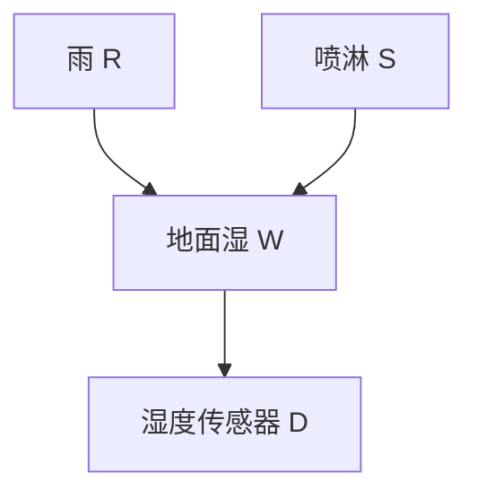

# 第 7 章：贝叶斯分类器自学笔记

> 依据：周志华《机器学习》第7章，正文第147—165页，课后习题见第166页。本文沿“最优决策需要什么概率—有限样本怎样估计概率—怎样限制依赖关系—怎样利用图推断—有隐变量怎样学习”的主线展开。人工例题用于说明机制，不能替代真实任务的独立评价。标为“拓展”的内容补充严格条件或实际使用方法。
>
> 格式约定：独立公式统一使用 GitHub 支持的 math 围栏；正文和表格使用普通文字与 Unicode 符号，避免行内公式定界符显示异常。全文 ln 为自然对数；互信息手算若用以2为底的对数，会明确注明单位为 bit。

## 目录

- [一、作者思路与本章地图](#一作者思路与本章地图)
- [二、先验似然后验与证据](#二先验似然后验与证据)
- [三、贝叶斯决策与分类阈值](#三贝叶斯决策与分类阈值)
- [四、极大似然估计从何而来](#四极大似然估计从何而来)
- [五、朴素贝叶斯的假设与训练](#五朴素贝叶斯的假设与训练)
- [六、零概率平滑与参数先验](#六零概率平滑与参数先验)
- [七、完整算例与西瓜数据核对](#七完整算例与西瓜数据核对)
- [八、半朴素贝叶斯与依赖关系](#八半朴素贝叶斯与依赖关系)
- [九、贝叶斯网的结构和参数](#九贝叶斯网的结构和参数)
- [十、条件独立与有向分离](#十条件独立与有向分离)
- [十一、贝叶斯网怎样学习](#十一贝叶斯网怎样学习)
- [十二、精确推断与吉布斯采样](#十二精确推断与吉布斯采样)
- [十三、EM算法的目标与完整推导](#十三em算法的目标与完整推导)
- [十四、EM手算与高斯混合模型](#十四em手算与高斯混合模型)
- [十五、与线性模型及贝叶斯学习的联系](#十五与线性模型及贝叶斯学习的联系)
- [十六、数值计算与建模流程](#十六数值计算与建模流程)
- [十七、分层样题与详细解答](#十七分层样题与详细解答)
- [十八、可以直接运行的代码实验](#十八可以直接运行的代码实验)
- [十九、实际应用场景与判断标准](#十九实际应用场景与判断标准)
- [二十、课后题导引自学检查与参考资料](#二十课后题导引自学检查与参考资料)

## 一、作者思路与本章地图

### 1.1 为什么在前面几章之后讨论概率

线性模型、决策树、神经网络和支持向量机都能给出分类结果。本章换一个出发点：先假设知道“给定这个样本，各类别有多大可能”，再考虑怎样作出损失最小的决策。

这个顺序有实际意义。概率为0.6时是否应该预测正类，取决于误报和漏报的代价；一个分类器准确率很高，也可能因为漏掉少量高代价事件而不适合使用。因此，“估计概率”和“根据概率决策”需要分开理解。

理想概率通常不知道，于是作者进一步问：能否用有限数据估计？若直接统计所有特征组合，维度稍高就会遇到组合爆炸。朴素贝叶斯用强独立假设压缩参数；半朴素方法保留少量依赖；贝叶斯网用一般图结构组织依赖。最后，EM解决训练数据中有未观测变量时怎样估计参数的问题。

### 1.2 各节之间的逻辑

| 原书小节 | 要解决的问题 | 方法 | 学完应能做什么 |
|---|---|---|---|
| 7.1 贝叶斯决策论 | 已知类别概率，怎样决策最好？ | 最小条件风险 | 按损失矩阵计算风险与阈值 |
| 7.2 极大似然估计 | 类条件分布参数怎样从数据得到？ | 最大化似然或对数似然 | 推导频率、均值与方差估计 |
| 7.3 朴素贝叶斯 | 特征组合太多，怎样少估参数？ | 给定类别时特征独立 | 从计数算分数、后验和类别 |
| 7.4 半朴素贝叶斯 | 完全独立过强，怎样保留依赖？ | ODE、SPODE、TAN、AODE | 比较它们保留哪些关系 |
| 7.5 贝叶斯网 | 怎样一般地表达、学习和查询分布？ | DAG、CPT、评分搜索、采样 | 分解联合概率并判断条件独立 |
| 7.6 EM | 部分变量看不见，参数怎样估计？ | 后验期望与参数优化交替 | 写出E步、M步并手算一次 |
| 7.7 阅读材料 | 上述方法如何连接更广的统计学习？ | 生成建模、隐变量、概率图 | 分清分类、概率估计与因果解释 |

### 1.3 建议的自学顺序

先读第2—7节，做到能够独立完成一个朴素贝叶斯分类算例；再读第8—12节，区分“怎样表示分布”“怎样从数据学习”“怎样在已有模型中推断”；最后读第13—15节，完成EM手算。代码实验用于核对概念，不能只看输出而跳过假设。

本章会反复使用条件概率、乘法公式、求和归一化、对数、求导和期望。下面从这些对象的含义讲起。

## 二、先验似然后验与证据

### 2.1 先把事件、变量和观测值分开

设C是类别变量，可能取类别c；X是特征向量，观测到的具体值为x。P(C=c)表示类别取c的概率，P(C=c|X=x)表示已经知道特征为x后，类别仍为c的概率。

为简洁，后文写成P(c)、P(c|x)。其中c、x都是代入的具体取值，不是另一个新的概率变量。

条件概率的定义为：

```math
P(A\mid B)=\frac{P(A,B)}{P(B)},
\qquad P(B)>0.
```

同一个联合概率可以从两个方向分解：

```math
P(c,x)=P(c)P(x\mid c)
      =P(x)P(c\mid x).
```

因此得到贝叶斯公式：

```math
\boxed{
P(c\mid x)=\frac{P(c)P(x\mid c)}{P(x)}.}
```

### 2.2 四个量各回答什么问题

| 名称 | 记号 | 回答的问题 | 设备故障分类中的例子 |
|---|---|---|---|
| 类先验 prior | P(c) | 看到本次特征前，这个类别有多常见？ | 所有设备中故障比例 |
| 类条件概率或密度 | P(x\|c)或p(x\|c) | 假设属于这个类别，出现该特征有多典型？ | 故障设备出现报警的概率 |
| 后验 posterior | P(c\|x) | 看到当前特征后，各类别有多大可能？ | 报警后设备故障的概率 |
| 证据 evidence | P(x)或p(x) | 不区分类别，当前特征有多常见？ | 所有设备中的报警概率 |

类别穷尽全部可能时，全概率公式给出证据：

```math
P(x)=\sum_{r=1}^{K}P(c_r)P(x\mid c_r).
```

因此后验也可写为：

```math
P(c_k\mid x)
=\frac{P(c_k)P(x\mid c_k)}
{\sum_{r=1}^{K}P(c_r)P(x\mid c_r)}.
```

**似然与后验的方向不同。** “故障时经常报警”不等于“报警时一定故障”，因为未故障设备也可能很多，而且也会误报。

### 2.3 一个低先验事件的完整计算

假设设备故障率为1%；故障时报警的概率为90%；正常时误报警的概率为5%。

在10000台设备中，可以先想象期望计数：

| 实际状态 | 台数 | 报警台数 |
|---|---:|---:|
| 故障 | 100 | 90 |
| 正常 | 9900 | 495 |

报警设备共585台，其中90台故障，因此：

```math
P(\mathrm{故障}\mid\mathrm{报警})
=\frac{0.01\times0.90}
{0.01\times0.90+0.99\times0.05}
=\frac{90}{585}
\approx0.153846.
```

报警提高了故障概率，但后验约15.38%，并非90%。判断概率时必须同时看基率与两类条件概率，不能只盯住一个灵敏度。

### 2.4 连续特征使用密度

若X是连续变量，单个精确点通常满足P(X=x)=0，但密度p(x)可以非零，甚至大于1。概率来自对区间积分：

```math
P(a\le X\le b)=\int_a^b p(x)\,dx.
```

例如均值0、标准差0.1的正态分布，在0处密度约3.989，完全合法。密度带有与变量单位有关的尺度，不应被当作“某个点发生的概率”。

连续特征下依然可以用贝叶斯公式：

```math
P(c\mid x)=
\frac{P(c)p(x\mid c)}
{\sum_rP(c_r)p(x\mid c_r)}.
```

类别仍然离散，所以最终的类别后验在0到1之间，且各类之和为1。混合离散、连续特征时，类分数中可以同时出现概率质量和密度。

### 2.5 “忽略分母”只适用于什么情况

对固定样本x，比较哪个类别后验最大时，P(x)与类别无关，可以忽略：

```math
\arg\max_c P(c\mid x)
=\arg\max_c P(c)P(x\mid c).
```

但如果要报告真实归一化后验、计算期望损失或比较概率质量，就不能把未归一化分数直接当后验。不同样本的分母也不一定相同，不能随意跨样本比较原始分数大小。

## 三、贝叶斯决策与分类阈值

### 3.1 决策最优是对什么最优

设采取决策“预测为cᵢ”，实际类别为cⱼ，损失为λᵢⱼ。本文固定约定：损失矩阵的行对应预测，列对应实际。

给定样本x，选择cᵢ的条件风险为：

```math
R(c_i\mid x)=\sum_{j=1}^{K}\lambda_{ij}P(c_j\mid x).
```

因为真实类别还不确定，必须对各种可能的实际类别按后验加权。贝叶斯决策规则是：

```math
\boxed{
h^*(x)=\arg\min_i R(c_i\mid x).}
```

总体风险是对输入分布再求期望。对每个x都选条件风险最小的决策，也就最小化总体风险：

```math
R(h)=\mathbb E_X\!\left[R(h(X)\mid X)\right].
```

这里的最优依赖真实分布、可用特征与规定的损失函数，不是某个训练算法在任何数据上都能达到的保证。

### 3.2 0—1损失为什么变成最大后验

若预测正确损失0、错误损失1：

```math
\lambda_{ij}=
\begin{cases}
0,&i=j,\\
1,&i\ne j,
\end{cases}
\qquad
R(c_i\mid x)=1-P(c_i\mid x).
```

因此：

```math
\boxed{
h^*(x)=\arg\max_c P(c\mid x).}
```

这只保证最小化分类错误率。换成不对称损失，后验最大的类别未必是风险最小的决策。

0—1损失下，贝叶斯错误率与理论最大准确率分别为：

```math
R^*=\mathbb E_X\!\left[1-\max_cP(c\mid X)\right],
\qquad
\mathrm{Accuracy}_{\max}=1-R^*.
```

**一般损失下不能把1−风险直接称作准确率。** 此处的准确率解释依赖0—1损失。

### 3.3 推导二分类代价阈值

令p=P(C=1|x)，预测1但实际0的损失为C_FP；预测0但实际1的损失为C_FN；正确分类损失为0。

| 决策 | 实际为0 | 实际为1 |
|---|---:|---:|
| 预测0 | 0 | C_FN |
| 预测1 | C_FP | 0 |

两个风险为：

```math
R(1\mid x)=C_{\mathrm{FP}}(1-p),
\qquad
R(0\mid x)=C_{\mathrm{FN}}p.
```

预测1的条件是：

```math
\begin{aligned}
C_{\mathrm{FP}}(1-p)&\le C_{\mathrm{FN}}p,\\
p&\ge
\boxed{\frac{C_{\mathrm{FP}}}
{C_{\mathrm{FP}}+C_{\mathrm{FN}}}}.
\end{aligned}
```

例如漏报代价9、误报代价1，阈值为0.1。p=0.2时，预测1的风险0.8，预测0的风险1.8，因此应预测1，即使正类后验尚未超过0.5。

这个理论阈值要求后验估计可用于目标人群，且代价定义适用。若概率未校准、样本分布变化，实际风险未必与公式估计一致，应通过训练内验证检查。

### 3.4 似然比形式揭示先验的作用

对正的类先验，决策也可写成：

```math
\frac{p(x\mid C=1)}{p(x\mid C=0)}
\ge
\frac{C_{\mathrm{FP}}}{C_{\mathrm{FN}}}
\frac{P(C=0)}{P(C=1)}.
```

左边是当前证据对两类的相对支持；右边结合了代价和先验。正类越罕见，若其他因素不变，需要越强的似然支持才能按同一规则选择正类。

### 3.5 拓展：允许拒绝预测

若分类错误损失1、正确0，拒绝预测的固定代价为r，且0<r<1，那么：

```math
R(\mathrm{拒绝}\mid x)=r,
\qquad
\min_c R(c\mid x)=1-\max_cP(c\mid x).
```

当最大类别后验仍小于1−r时，可以选择拒绝并转交人工或追加测量。拒绝规则改变了决策集合，评价时应同时报告覆盖率与保留样本上的表现，不能只展示被挑选出的简单样本。

## 四、极大似然估计从何而来

### 4.1 为什么先选择分布族

假设有d个二值特征。每个类别下共有2ᵈ种完整特征组合，完全自由的联合分布需要2ᵈ−1个独立参数。d=30时，仅一个类别就超过十亿个参数。

训练数据往往远少于组合数。“没有观测到某种组合”不能直接理解为“这种组合不可能发生”。一种解决办法是选一个参数较少的分布族，例如正态分布，再用数据估计参数。

参数化降低了估计难度，同时引入分布形式假设。真实分布若偏斜、多峰或有截断，单个正态模型未必合适。

### 4.2 似然是关于参数的函数

设数据D={x₁,…,xₙ}独立同分布于参数θ决定的模型。把观测数据固定，似然函数为：

```math
L(\theta;D)=\prod_{k=1}^{n}p(x_k\mid\theta).
```

极大似然估计MLE选择使观测数据最受模型支持的参数：

```math
\widehat\theta_{\mathrm{MLE}}
=\arg\max_\theta L(\theta;D).
```

L不必是θ上的概率分布，也不必对θ积分为1。它与“给定数据后参数有多大概率”的后验不是同一个对象。

对数严格单调，取对数不改变最大位置：

```math
\ell(\theta;D)=\ln L(\theta;D)
=\sum_{k=1}^{n}\ln p(x_k\mid\theta),
\qquad
\arg\max L=\arg\max\ell.
```

取对数既把乘法变为加法，也改善很小概率连乘的数值问题。

### 4.3 伯努利分布MLE

设n次独立试验中有s次取1，成功概率为θ：

```math
\begin{aligned}
L(\theta)&=\theta^s(1-\theta)^{n-s},\\
\ell(\theta)&=s\ln\theta+(n-s)\ln(1-\theta).
\end{aligned}
```

对内部解求导并令其为0：

```math
\frac{d\ell}{d\theta}
=\frac{s}{\theta}-\frac{n-s}{1-\theta}=0
\quad\Longrightarrow\quad
\boxed{\widehat\theta=\frac{s}{n}}.
```

所以频率估计来自明确的优化问题。若s=0或s=n，最大值在边界，分别为0、1；不能机械套用只讨论内部驻点的推理而漏掉边界。

### 4.4 多类别计数MLE

一个离散变量有r个可能取值，对应概率p₁…pᵣ、计数n₁…nᵣ，总数n。约束为概率非负且和为1。

用拉格朗日乘子：

```math
\mathcal L
=\sum_{j=1}^{r}n_j\ln p_j
+\lambda\left(1-\sum_{j=1}^{r}p_j\right).
```

求导得nⱼ/pⱼ=λ，结合概率和为1，得到λ=n：

```math
\boxed{\widehat p_j=\frac{n_j}{n}}.
```

类先验P(c)与离散类条件概率P(xᵢ|c)的频率估计都可以这样得到，只是分别在哪个子样本集合中计数。

### 4.5 一维正态分布MLE完整推导

设类内n个连续观测独立服从N(μ,σ²)：

```math
\ell(\mu,\sigma^2)
=-\frac n2\ln(2\pi)
-\frac n2\ln\sigma^2
-\frac1{2\sigma^2}\sum_{k=1}^{n}(x_k-\mu)^2.
```

先对μ求导：

```math
\frac{\partial\ell}{\partial\mu}
=\frac1{\sigma^2}\sum_k(x_k-\mu)=0
\quad\Longrightarrow\quad
\boxed{\widehat\mu=\frac1n\sum_kx_k}.
```

再把v=σ²当作变量求导：

```math
\frac{\partial\ell}{\partial v}
=-\frac n{2v}+\frac1{2v^2}\sum_k(x_k-\mu)^2=0,
```

因此：

```math
\boxed{
\widehat{\sigma}^2_{\mathrm{MLE}}
=\frac1n\sum_k(x_k-\widehat\mu)^2.}
```

若全部样本完全相同，方差可以趋于0，连续高斯密度的无约束似然会退化；实际需要方差下限或其他约束，不能直接代入除以0。

### 4.6 分母n与n−1为什么不同

MLE方差用n作分母；估计总体方差时常见的无偏样本方差用n−1：

```math
s^2=\frac1{n-1}\sum_k(x_k-\overline x)^2.
```

二者目标不同，不是谁在所有情况下都更正确。例如数据1、2、3的均值2，平方离差和2，MLE方差为2/3，无偏样本方差为1。

在复现原书西瓜算例时要特别记录这一约定：原书展示的标准差与本笔记代码采用的MLE标准差可能不同。不能只看最终概率末位差异，就把一种合法估计习惯误判成程序错误。

### 4.7 多元正态与样本量限制

对d维向量，MLE为：

```math
\widehat\mu=\frac1n\sum_kx_k,
\qquad
\widehat\Sigma
=\frac1n\sum_k(x_k-\widehat\mu)(x_k-\widehat\mu)^\top.
```

均值需要d个参数，对称协方差需要d(d+1)/2个。若类内样本很少，协方差可能奇异，不能直接求逆。采用对角协方差、共享协方差或收缩估计，都是降低估计难度的不同假设。

## 五、朴素贝叶斯的假设与训练

### 5.1 “朴素”究竟省略了什么

朴素贝叶斯NB假设：**给定类别C之后，各特征联合条件独立。**

```math
\boxed{
P(x_1,\ldots,x_d\mid c)
=\prod_{i=1}^{d}P(x_i\mid c).}
```

这不是“所有特征无条件独立”，也不是“每个特征与类别独立”。

例如在同一种设备状态内，两项传感器读数可能近似独立；把故障和正常设备混在一起后，两项读数会因为共同受类别影响而相关。

对于三个及以上变量，两两独立也不自动推出联合独立。NB需要的是能让整项联合概率分解的假设。

### 5.2 从贝叶斯公式得到分类器

代入条件独立分解：

```math
P(c\mid x)
=\frac{P(c)\prod_iP(x_i\mid c)}
{\sum_rP(c_r)\prod_iP(x_i\mid c_r)}.
```

对0—1损失，分类规则为：

```math
\boxed{
h_{\mathrm{NB}}(x)
=\arg\max_c
P(c)\prod_{i=1}^{d}P(x_i\mid c).}
```

训练通常只需估计类先验和每个特征的类内分布；预测时将对应项取出并相乘，或在对数域相加。

### 5.3 离散属性怎样计数

设总样本数n，类别c的样本数n_c；其中第i个属性取a的样本数为n_cia：

```math
\widehat P(c)=\frac{n_c}{n},
\qquad
\widehat P(X_i=a\mid c)=\frac{n_{cia}}{n_c}.
```

分母是“已经给定类别后的子集大小”，不是总样本数。每个属性、每个类别对应一张条件概率表，同一张表中各可能取值的概率和为1。

若某属性在类别c中有缺失，直接可用的计数样本数可能少于n_c。是否可以只用该属性被观测到的样本估计，需要考虑缺失机制；缺失模式与类别、变量值相关时，不能默默当成随机缺失。

### 5.4 连续属性怎样处理

高斯朴素贝叶斯假设每个类别内，每个连续属性分别服从一维正态分布：

```math
p(x_i\mid c)
=\frac1{\sqrt{2\pi\sigma_{ci}^2}}
\exp\left[-\frac{(x_i-\mu_{ci})^2}{2\sigma_{ci}^2}\right].
```

训练时按类别、按属性估计均值和方差。注意：这意味着类内联合高斯的协方差是对角的，不等于所有类别共用同一个方差。

连续特征不能因为小数取值很多，就每个精确值开一个离散格子再直接计数；几乎每个测试值都可能没出现。可以选择合适密度族，或在训练数据内设计离散化。

### 5.5 参数为什么少很多

K个类别，第i个离散属性有rᵢ个取值时，NB独立参数数目为：

```math
\boxed{
(K-1)+K\sum_{i=1}^{d}(r_i-1).}
```

若全部为二值属性，就是(K−1)+Kd；而完全自由的类条件联合分布需要(K−1)+K(2ᵈ−1)个参数。

训练中的计数一般与样本数、特征数的乘积同阶；预测K类大致需要Kd项运算。计算与存储节约来自假设，不是贝叶斯公式本身自动消除了组合爆炸。

### 5.6 独立假设不成立，为什么仍可能分对

分类只要求哪个类别后验更大判断正确，不要求每个概率数值都精确。某些依赖会改变概率大小，却不改变类别排序。

若真实类条件分布可写成：

```math
p_{\mathrm{true}}(x\mid c)
=g(x)\prod_i p_i(x_i\mid c),
\qquad g(x)>0,
```

且同一个g对各类别相同、这些量组成合法分布，那么g在类别比较时可以抵消。这个形式给出一种足够情形，不是所有相关数据都能这样处理。

因此两件事可以同时成立：NB分类不错，概率却过于自信。概率要用于成本决策时，应另检查对数损失、校准及目标分布。

### 5.7 重复特征为什么危险

如果把同一个证据复制成两个输入，NB会将它当作两份独立支持，重复相乘。某证据带来的似然比为3，一份对应3倍支持，两份就变成9倍。

真实情况下复制没有增加任何新信息，但模型置信度可能升高。应检查重复列、高度重合的编码以及同源测量；是否删除、合并或改用能表达依赖的模型，应在开发数据内部选择。

## 六、零概率平滑与参数先验

### 6.1 零频率怎样把整个类别抹掉

若某属性值在类c中未出现，MLE给出0。即使其他特征都非常支持c，只要连乘中有一项为0，该类分数就为0。

这是有限样本估计的问题。平滑表达的是：样本中没见过，不一定代表真实分布禁止出现。若由领域规则确定某事件结构上不可能，则不应只为方便而一律给正概率。

### 6.2 拉普拉斯修正

第i个属性有rᵢ个可能取值，给每个取值加α个伪计数：

```math
\boxed{
\widehat P(X_i=a\mid c)
=\frac{n_{cia}+\alpha}{n_c+\alpha r_i},
\qquad\alpha>0.}
```

α=1就是常见拉普拉斯修正；一般α称加性平滑。给所有类别也加α_c，可得到平滑类先验：

```math
\widehat P(c)=\frac{n_c+\alpha_c}{n+K\alpha_c}.
```

两种平滑可以分别规定。某些软件只对条件分布加伪计数，先验仍使用经验类别比例，不能假定任何程序默认都完全复现原书两条公式。

### 6.3 分母为什么也要增加

假设类内4个样本，属性可能取A、B、C，计数为3、1、0。加1后为4、2、1，总数7，所以概率为4/7、2/7、1/7。

如果只给分子加1、分母仍用4，概率和会大于1。分母中的rᵢ来自属性值总数，不是类别数，也不是当前测试样本数。

### 6.4 平滑强度的判断

α越大，估计越趋近均匀分布；α固定而样本数增大时，数据计数影响逐渐占主导。α不宜只凭“常用1”永久固定，可以通过训练内验证选择。

已知取值集合可以来自任务定义，例如工作模式确实只有三档。如果从数据学习取值表，应只用训练部分；对于预测时的新取值，应事先定义未知类别或其他处理规则。把未知值随意编码成已有类别，会引入错误含义。

### 6.5 拓展：为什么平滑可以用参数先验解释

对于r类概率向量，选择Dirichlet先验，超参数为α₁…αᵣ。观测计数n₁…nᵣ后，后验超参数变成nⱼ+αⱼ，后验均值为：

```math
\mathbb E[p_j\mid D]
=\frac{n_j+\alpha_j}{n+\sum_s\alpha_s}.
```

对称地取所有αⱼ=1，得到加1形式。也可以把它理解为下一次观测的后验预测概率。

但“加1等于均匀先验下的MAP”通常不正确。内部MAP的公式为：

```math
\widehat p_j^{\mathrm{MAP}}
=\frac{n_j+\alpha_j-1}
{n+\sum_s\alpha_s-r},
```

该内部公式有适用条件；若后验密度在边界最大，还需处理边界。均匀Dirichlet(1,…,1)下，内部MAP通常等于MLE，而不是加1估计。区分后验均值、后验预测和后验众数，比只记“平滑来自先验”更重要。

### 6.6 类先验与参数先验不是同一层

P(C=c)是某条新样本属于类别c的概率；P(θ)是我们对未知参数的分布描述。两者都叫先验，但对象不同。

例如“故障比例估计为10%”是在说类先验；“故障率参数服从Beta分布”是在说参数先验。不能把二者直接相互代换。

## 七、完整算例与西瓜数据核对

### 7.1 用两项二值特征完成一次分类

训练集有8条样本，两类各4条。已统计出：

| 类别 | 样本数 | X₁=1的数目 | X₂=1的数目 |
|---|---:|---:|---:|
| C=1 | 4 | 3 | 3 |
| C=0 | 4 | 1 | 1 |

对新样本x=(1,1)，先不平滑，NB给出：

```math
\begin{aligned}
s_1&=\frac48\frac34\frac34=\frac9{32},\\
s_0&=\frac48\frac14\frac14=\frac1{32}.
\end{aligned}
```

分数比较可直接选择C=1；若需要后验，则归一化：

```math
P_{\mathrm{NB}}(C=1\mid x)
=\frac{9/32}{9/32+1/32}=0.9.
```

这里0.28125是类分数，0.9才是NB模型下的类别后验。由边际计数无法恢复真实类内联合表，NB的0.9依赖独立假设，不是仅凭这张计数表就无条件证明出的真实后验。

### 7.2 加1平滑后重新计算

类先验平滑后仍各为0.5；每类、每个二值属性分母为4+2=6。因此：

```math
\begin{aligned}
s_1&=\frac12\left(\frac46\right)^2=\frac29,\\
s_0&=\frac12\left(\frac26\right)^2=\frac1{18},\\
P_{\mathrm{NB}}(C=1\mid x)
&=\frac{2/9}{2/9+1/18}=0.8.
\end{aligned}
```

平滑让估计不过分依赖小样本。这里分类没变、置信程度降低；并不代表平滑在任何数据上都会降低最大后验或提高准确率。

### 7.3 对照原书“测1”需要哪些步骤

原书西瓜3.0共有17条训练样本，8条好瓜、9条坏瓜；“测1”的属性为：

| 色泽 | 根蒂 | 敲声 | 纹理 | 脐部 | 触感 | 密度 | 含糖率 |
|---|---|---|---|---|---|---:|---:|
| 青绿 | 蜷缩 | 浊响 | 清晰 | 凹陷 | 硬滑 | 0.697 | 0.460 |

完整处理顺序：

1. 从训练集计算好瓜、坏瓜的先验。
2. 分别统计6个离散属性在各类中的条件频率。
3. 按类别为密度、含糖率分别估计均值与方差。
4. 将测试值代入相应高斯密度。
5. 将先验、6项离散概率和2项密度相乘，或取对数相加。
6. 比较类分数；需要类别后验时再归一化。

例如未平滑时，青绿在好瓜中的条件频率为3/8，清晰为7/8；这两项不能直接当作“这个青绿或清晰西瓜是好瓜的概率”。

原书给出的最终分数约为好瓜0.038、坏瓜6.80×10⁻⁵，所以预测好瓜。它们是未归一化类分数，不能分别当作好瓜与坏瓜的最终后验。

核对扫描本第152页与原始表4.3时，需要修正两项：

| 条件概率 | 扫描本中的呈现 | 按原始数据应使用 |
|---|---|---|
| 根蒂为蜷缩，给定好瓜 | 5/8=0.375 | 5/8=0.625，小数误写 |
| 脐部为凹陷，给定好瓜 | 6/8=0.750 | 前8条好瓜中实际有5条凹陷，应为5/8=0.625 |

用完整17条数据重新计算、不做平滑、连续项使用分母n−1的样本标准差，得到好瓜分数约0.052378719、坏瓜约6.858424×10⁻⁵，仍预测好瓜。本笔记的计数表与代码以原始记录为准，不沿用以上错误。

### 7.4 复现时怎样解释数值差别

本笔记实验一直接列出17条数据，离散项与类别先验采用加1平滑，连续项使用MLE方差，即分母为该类样本数。它用来检验清晰规定的一套算法。

因此比较输出时，应分别核对是否平滑、连续方差的估计约定，以及上面指出的原书计数与小数错误。实验还会同时打印分母n与n−1对应的标准差，便于核对。

这个小数据集用于演示计数、密度和归一化，训练样本与“测1”特征重合，不能拿其预测结果宣称已获得独立测试性能。

### 7.5 为什么不用直接相乘的程序写法

当属性很多，每项都小于1时，连乘可能小到浮点数表示为0。更稳妥地定义对数分数：

```math
a_c=\ln P(c)+\sum_i\ln p(x_i\mid c).
```

最大对数分数对应最大原始分数。若要后验，使用：

```math
P(c\mid x)
=\frac{\exp(a_c-a_{\max})}
{\sum_r\exp(a_r-a_{\max})},
\qquad a_{\max}=\max_r a_r.
```

同时减去最大分数不改变比例，又避免直接对极端得分求指数。

## 八、半朴素贝叶斯与依赖关系

### 8.1 为什么不直接放开所有依赖

NB忽略了类内依赖；完全自由联合模型又可能需要太多参数。半朴素贝叶斯在中间选择：保留受限制的一部分关系，使表示更灵活但仍能估计。

依赖越多，单个条件表需要分割的条件组合越多。因此“更符合真实依赖”不自动意味着有限样本下泛化更好，仍要权衡偏差、估计波动与数据量。

### 8.2 独依赖估计ODE

在类别之外，每个属性最多再依赖一个其他属性：

```math
P(c,x)=P(c)\prod_iP(x_i\mid c,x_{\mathrm{pa}(i)}).
```

没有额外父属性的节点，就使用P(xᵢ|c)。这里“独依赖”表示最多一个额外父属性，不是说属性之间全部独立。

依赖结构需要能形成合法的无环分解，不能随意让X₁依赖X₂，同时X₂又依赖X₁，再声称这一乘积自动是规范化的贝叶斯网。

### 8.3 SPODE：选一个超父

选择属性X_s作超父，其余属性在类别之外都依赖它：

```math
\boxed{
P(c,x)
=P(c)P(x_s\mid c)
\prod_{i\ne s}P(x_i\mid c,x_s)
=P(c,x_s)\prod_{i\ne s}P(x_i\mid c,x_s).}
```

例如类别C、温度档位T、压力档位P、外观A，可设T为超父，再建P(P|C,T)和P(A|C,T)。

超父可以通过训练内交叉验证等选择。它的取值若很稀少，子表计数会很少，因此通常需要平滑和支持度检查。

### 8.4 条件互信息究竟衡量什么

对两个属性Xᵢ、Xⱼ，给定类别C后的标准条件互信息为：

```math
\boxed{
I(X_i;X_j\mid C)
=\sum_cP(c)\sum_{a,b}P(a,b\mid c)
\ln\frac{P(a,b\mid c)}
{P(a\mid c)P(b\mid c)}.}
```

也可将外部权重写成联合概率P(a,b,c)。当某联合概率为0，对应项按极限约定取0。

它是在每个类别内部衡量两属性偏离独立的程度，再按类别概率加权。一般条件下非负；等于0对应给定类别后的独立，不等于无条件独立。

扫描本式（7.22）的求和项写的是P(a,b|c)，未显式乘类别权重P(c)。这里采用TAN原论文中的标准条件互信息定义，写清权重；若选择各类别等权的另一指标，应另行说明，不能与标准定义混用。

用自然对数时单位为nat；用以2为底的对数时为bit。统一变换对数底只把全部边权乘同一正常数，不改变最大生成树的排序。

### 8.5 TAN怎样得到树结构

TAN是树增强朴素贝叶斯。步骤为：

1. 对任意属性对估计给定类别的条件互信息。
2. 以属性为节点建立无向完全图，边权为条件互信息。
3. 选最大权重生成树，保留d−1条边，保证连通且没有环。
4. 任选属性作根，将树边从根向外定向。
5. 加入类别节点C，并从C连向所有属性。

每个属性最多有一个属性父节点，再加共同的类别父节点。树根在属性树内没有父属性，但仍有类别父节点。

为何不是每个属性独立选择最强的另一属性？因为这样可能形成环或不连通；最大生成树是在全局树约束下选择总边权最大的结构。

### 8.6 一个最大生成树手算

四属性A、B、C、D，边权如下：

| 边 | 权重 |
|---|---:|
| A—B | 0.5 |
| A—C | 0.4 |
| A—D | 0.1 |
| B—C | 0.3 |
| B—D | 0.2 |
| C—D | 0.6 |

按权重从大到小加入且避免成环，选C—D、A—B、A—C，总权重1.5。若以A为根，属性边可定向为A→B、A→C、C→D，再加入类别指向四个属性的边。

边的方向在这个树构造步骤中用于给出分解，不意味着已通过观测数据证明了物理因果方向。

### 8.7 AODE：平均多个超父模型

SPODE只选一个超父；AODE让多个有足够数据支持的属性值分别作超父，再合并相应模型的联合分数。

对当前测试样本x，令S(x)为支持度达到阈值m′的属性索引集合，则：

```math
\boxed{
s_c(x)
=\frac1{|S(x)|}
\sum_{i\in S(x)}
P(c,x_i)\prod_{j\ne i}P(x_j\mid c,x_i).}
```

分类时各类别共用的1/|S(x)|可省略，后验则应对合并后的类分数再归一化。平均联合分数，一般不等于先将每个模型独立归一化后再平均后验。

j=i的项若写入乘积，真实条件分布P(Xᵢ=xᵢ|c,Xᵢ=xᵢ)恒为1；实现时直接省略，避免把平滑后的自条件计数误当一份新证据。

### 8.8 AODE需要估计哪些量

对离散属性，可采用与原书类似的加1估计：

```math
\widehat P(c,x_i)
=\frac{n_{c,x_i}+1}{n+Kr_i},
\qquad
\widehat P(x_j\mid c,x_i)
=\frac{n_{c,x_i,x_j}+1}{n_{c,x_i}+r_j}.
```

第一项是类别与超父取值的联合分布，因此分母涉及K×rᵢ种组合；第二项在固定类别和超父值的子集中估计。

支持度门槛是当前属性值在训练集中出现的次数，不等同于类内每个条件表都一定充分。原书给出的常见m′=30，在17条西瓜样本上不可能满足。实现必须提前规定无候选超父时的策略，例如回退NB，或为小数据教学明确降低门槛。

连续超父会使“精确取值支持度”失去离散计数意义。需要连续扩展、核方法或训练内离散化；不能把整数计数公式原封不动套到几乎不重复的小数上。

### 8.9 方法比较

| 方法 | 保留的类内依赖 | 主要优势 | 主要限制 |
|---|---|---|---|
| NB | 不保留 | 参数少、计数快 | 重复或相关证据可能被多算 |
| SPODE | 所有属性依赖一个超父 | 结构简单，能表示部分关联 | 依赖超父选择和子表支持度 |
| TAN | 属性之间为一棵树 | 在树约束中系统选择关联 | 超出树的依赖仍被忽略 |
| AODE | 合并多个超父分解 | 降低只选单个超父的敏感性 | 二阶计数开销、稀疏与门槛 |
| 一般贝叶斯网 | 允许更一般的DAG | 表达更灵活的条件关系 | 结构学习与推断更难 |

选择标准是任务指标、样本量、条件表稀疏程度与计算预算，不是方法名字越复杂就越好。

## 九、贝叶斯网的结构和参数

### 9.1 图中的节点与箭头代表什么

贝叶斯网由有向无环图G和参数Θ组成。节点表示随机变量，箭头组织局部条件分布，参数决定每种父节点取值下的概率。

它与神经网络不是同一种“网络”：神经网络节点常是确定性计算单元；这里节点是随机变量，CPT是概率分布，不是把输入经过激活函数得到响应。

“无环”是指不能沿箭头方向绕回原节点。图的无向骨架可以有环，例如A→B、A→C、B→D、C→D仍是合法DAG。

### 9.2 从一般概率链式法则到局部分解

任意联合分布都能按某个变量顺序写成：

```math
P(x_1,\ldots,x_d)
=\prod_{i=1}^{d}P(x_i\mid x_1,\ldots,x_{i-1}).
```

贝叶斯网假设给定父节点后，节点与其非后裔中的其他节点独立，从而把条件集合缩小为父节点集合Paᵢ：

```math
\boxed{
P(x_1,\ldots,x_d)
=\prod_{i=1}^{d}P(x_i\mid \mathrm{Pa}_i).}
```

“非后裔”不包括沿箭头从本节点能够到达的后继；父节点已在条件集合中，不再当作待独立的对象。

节点数不多、每个父集合较小时，局部表可以远小于整个联合概率表。所有局部条件表都规范化时，该DAG乘积分解也定义规范化联合分布。

### 9.3 CPT怎样填写

若二值变量D有二值父节点B、C，则需对4种父组合分别给出P(D=1|B,C)。相应P(D=0|B,C)=1减去该值。

| B | C | P(D=1\|B,C) | P(D=0\|B,C) |
|---:|---:|---:|---:|
| 0 | 0 | 0.1 | 0.9 |
| 0 | 1 | 0.4 | 0.6 |
| 1 | 0 | 0.7 | 0.3 |
| 1 | 1 | 0.9 | 0.1 |

每一行是一份不同条件下的分布，每行和为1；不同父组合的行不需要相互加起来为1。

### 9.4 独立参数如何计算

变量Xᵢ有rᵢ个取值，父节点共有qᵢ种取值组合，则该CPT独立参数数为qᵢ(rᵢ−1)：

```math
\boxed{
k=\sum_i(r_i-1)\prod_{j\in\mathrm{Pa}_i}r_j.}
```

无父节点时，空乘积按1计算。参数个数是能自由指定的数目，不是把所有互补概率都重复计入。

例：4个二值变量，结构A→B、A→C、B→D、C→D，参数数目为1+2+2+4=9；自由联合分布则需2⁴−1=15个。

### 9.5 图结构不自动等于因果关系

从观测数据学到的DAG可以表达概率分解与条件独立。若要把箭头解释成干预意义上的因果方向，还需额外领域知识、因果假设或干预数据。

例如A→B和B→A都能表示两个变量的一般联合分布。仅因某个方向拟合得通，不能认定反方向在物理上不可能。

## 十、条件独立与有向分离

### 10.1 独立与条件独立的定义

边际独立为：

```math
X\perp Y
\quad\Longleftrightarrow\quad
P(x,y)=P(x)P(y).
```

条件独立为：

```math
X\perp Y\mid Z
\quad\Longleftrightarrow\quad
P(x,y\mid z)=P(x\mid z)P(y\mid z),
```

其中只讨论条件概率有定义的取值。条件独立说的是知道Z后，Y不再为预测X提供额外信息；它没有要求不知道Z时二者也独立。

### 10.2 三种基本结构

| 结构 | 分解 | 中间节点未观测时 | 中间节点观测后 |
|---|---|---|---|
| 链X→Z→Y | P(x)P(z\|x)P(y\|z) | 路径可以传递关联 | 该路径被阻断，X⊥Y\|Z |
| 同父X←Z→Y | P(z)P(x\|z)P(y\|z) | 共同来源可以造成关联 | 该路径被阻断，X⊥Y\|Z |
| 碰撞X→Z←Y | P(x)P(y)P(z\|x,y) | 在这三节点图中X⊥Y | 观测Z通常使路径打开，可能产生依赖 |

表中“通常”“可以”是必要限定。图的活动路径表示允许依赖，不保证每组参数都会产生严格非零依赖。例如某条条件分布实际上与父节点无关，就可能有额外独立关系。

### 10.3 同父结构的直观解释

设Z为设备状态，X、Y为两项测量。在固定状态内，两个测量可以条件独立；不区分状态时，故障组与正常组的均值不同，使两个测量表现出相关。

从代数看：

```math
P(x,y)=\sum_zP(z)P(x\mid z)P(y\mid z).
```

一般不能拆成两个边际和的乘积。把两项测量相关就直接判定“给定类别也不独立”，会混淆这两层关系。

### 10.4 碰撞结构为什么出现解释竞争

考虑雨R、喷淋S、地面湿W，假设雨与喷淋在先验中独立：



在未知地面是否湿时，雨不提供喷淋的信息；已知地面湿后，若又知道喷淋开启，“需要用下雨来解释”的程度会下降。这称为解释消除或解释竞争。

上图还显示一个重要扩展：即使没有直接观测W，只观测它的后裔D，也可能打开R与S之间的碰撞路径。

### 10.5 用数值验证解释竞争

取P(R=1)=0.2、P(S=1)=0.1，W的条件表为：

| R | S | P(W=1\|R,S) |
|---:|---:|---:|
| 0 | 0 | 0.01 |
| 0 | 1 | 0.90 |
| 1 | 0 | 0.80 |
| 1 | 1 | 0.99 |

先计算：

```math
\begin{aligned}
P(W=1)
&=0.8(0.9\times0.01+0.1\times0.90)\\
&\quad+0.2(0.9\times0.80+0.1\times0.99)\\
&=0.243.
\end{aligned}
```

于是：

```math
P(R=1\mid W=1)=\frac{0.1638}{0.243}
\approx0.674074.
```

但再知道喷淋开启时：

```math
P(R=1\mid W=1,S=1)
=\frac{0.2\times0.99}
{0.2\times0.99+0.8\times0.90}
\approx0.215686.
```

如果知道喷淋关闭：

```math
P(R=1\mid W=1,S=0)
=\frac{0.2\times0.80}
{0.2\times0.80+0.8\times0.01}
\approx0.952381.
```

同一个“地面湿”，在不同额外证据下支持下雨的程度不同。不能只把箭头理解成信息只能顺箭头传播；概率推断也可以从结果推原因。

### 10.6 有向分离的活动路径规则

给定证据集合Z，检查X与Y之间的路径时，先把路径当作无向连接来看，但保留每条边原本的箭头，以判断中间节点类型。

一条路径活动，需要同时满足：

1. 路径上的每个非碰撞中间节点都不在证据集合Z中。
2. 路径上的每个碰撞中间节点，其本身或至少一个后裔在证据集合Z中。

若X到Y的所有路径都被阻断，称X与Y被Z有向分离，记为d-separation。对按该DAG分解的分布，可以推出X⊥Y|Z。

注意“所有路径”：关闭一条路径，如果另一条仍活动，就不能据此宣布条件独立。

### 10.7 用道德图判断时不能漏掉祖先步骤

对指定查询X、Y与条件集合Z，严格的图判定步骤是：

1. 只保留X、Y、Z及它们所有祖先形成的诱导子图。
2. 在该子图中，将同一个子节点的所有父节点两两连接。
3. 去掉箭头方向，得到相应道德化无向图。
4. 移除条件集合Z，检查X与Y是否断开。

教材介绍道德化的直观做法。要将它用于任意查询，必须补上第一步；直接对整张图道德化，会在简单碰撞图X→W←Y且没有证据时误把X、Y连起来。

此时W不是X或Y的祖先，第一步会移除W，X、Y保持断开；若W或其后裔成为证据，祖先子图又会保留W，结果相应变化。

### 10.8 额外独立与马尔可夫等价

d分离提供由图结构保证的独立关系。反过来，数据里发现独立，未必说明图中一定d分离；特定参数可能让关联抵消。

不同DAG也可能表达完全相同的一组条件独立关系，称为马尔可夫等价。仅靠观测独立关系，某些方向无法区分。因果解释需要额外条件，不能把结构学习成绩好直接当作因果发现成功。

## 十一、贝叶斯网怎样学习

### 11.1 结构学习与参数学习分开

参数学习：结构已给定，估计各CPT。结构学习：哪些边存在、方向如何、是否满足DAG约束。

在完整离散数据中，固定结构的CPT可用局部计数得到：

```math
\widehat P(X_i=a\mid\mathrm{Pa}_i=u)
=\frac{n(X_i=a,\mathrm{Pa}_i=u)}
{n(\mathrm{Pa}_i=u)}.
```

这里的独立假设针对不同训练样本；一个样本内部的变量是否独立由图表达。二者不可混为一谈。

分母为0时，MLE不能唯一决定这行条件表，需要平滑、参数共享或额外规则。不是简单写“0/0=0”。

### 11.2 为什么不能只追求训练似然

增加依赖边往往扩大可表示分布的集合，使最大训练似然不下降；但条件表变多，每行数据变少，可能过拟合。

最小描述长度MDL把两种成本合起来：描述模型本身的复杂度、用模型编码数据的成本。一般评分可写为：

```math
s(B;D)=f(n)k-\ell(\widehat\Theta_G;D).
```

其中k是独立参数数目，第一项惩罚复杂度，第二项奖励拟合。这里选择评分最小的结构。

### 11.3 AIC与BIC的系数约定

教材采用的最小化形式为：

```math
\begin{aligned}
s_{\mathrm{AIC}}&=k-\ell,\\
s_{\mathrm{BIC}}&=\frac{k}{2}\ln n-\ell.
\end{aligned}
```

很多资料写成：

```math
\mathrm{AIC}=2k-2\ell,
\qquad
\mathrm{BIC}=k\ln n-2\ell.
```

后者是前者整体乘2，比较排序相同。还有软件使用相反号的“得分越大越好”形式，因此必须先检查定义。

BIC不等于测试错误率，也不是后验概率本身。在相应正则条件下它有模型证据近似的解释；隐变量混合模型、参数边界等情况可能不满足简单推导的假设。

### 11.4 一个BIC选择例子

n=100，模型A有5个参数、最大对数似然−120；模型B有9个参数、最大对数似然−115。

按教材形式：

```math
\begin{aligned}
s_A&=\frac52\ln100+120\approx131.512925,\\
s_B&=\frac92\ln100+115\approx135.723266.
\end{aligned}
```

虽然B训练拟合更好，但似然改善不足以抵消复杂度惩罚，因此选择A。不能只比较两个负对数似然谁更接近0。

### 11.5 评分搜索怎样实际进行

常见做法是从一个合法DAG出发，尝试加边、删边、反转边；只有保持无环且改善评分的候选才接受。局部贪心可能停在局部最优，不保证穷尽所有结构。

限制每个节点父节点数、规定变量时间顺序、禁止不可能的连接，可以减少搜索空间。这些限制表达领域知识或建模偏好，报告中应说明。

完整数据下某些分数可分解为局部项，便于重用计算；存在隐变量时，结构与参数学习往往更复杂，不能直接沿用“数一数即可”的结论。

## 十二、精确推断与吉布斯采样

### 12.1 学习好模型后还需要推断什么

设Q为查询变量、E为证据、H为其他未观测变量，目标为：

```math
P(Q=q\mid E=e)
=\frac{\sum_hP(q,e,h)}
{\sum_{q',h}P(q',e,h)}.
```

证据在这里表示已观测的变量取值，与第2节贝叶斯公式分母“证据概率”相关但不完全是同一种用法。推断必须对不关心但未观测的H进行边际化，不能直接忽略它们的存在。

### 12.2 枚举与变量消元

直接枚举所有未观测状态一定义清楚，但组合数可能随变量数指数增长。

变量消元通过重排乘法和求和，尽量先消去局部变量。例如链A→B→C中：

```math
P(C=c)
=\sum_bP(c\mid b)
\left[\sum_aP(b\mid a)P(a)\right].
```

括号内先算一次，再复用，避免每次重复全联合计算。消元顺序会影响中间因子大小；某些稀疏图推断很高效，不能说任何贝叶斯网查询都必然困难。一般图上，复杂度与结构、树宽及变量取值数有关。

### 12.3 吉布斯采样每一步做什么

固定证据变量，初始化所有非证据变量。然后反复选一个非证据变量Xᵢ，给定其他变量当前值，按其完整条件分布重新随机采样：

```math
x_i^{\mathrm{new}}
\sim P(X_i\mid x_{-i},E=e).
```

一次完整扫描中，后更新的变量应使用已经更新过的前面变量当前值，而非一律使用上一整轮旧值。

**必须更新所有需要边际化的非证据变量，不只是最终查询变量。** 例如只问“下雨概率”，喷淋未知时也应作为潜在状态参与采样；把喷淋固定成随手选的0，得到的是另一个条件概率。

### 12.4 马尔可夫毯为什么减少局部计算

给定其他变量后，Xᵢ的完整条件分布只需其父节点、子节点与子节点的其他父节点，合称马尔可夫毯：

```math
P(x_i\mid x_{-i},e)
\propto
P(x_i\mid\mathrm{Pa}_i)
\prod_{j\in\mathrm{Ch}_i}
P(x_j\mid\mathrm{Pa}_j).
```

与Xᵢ无关的因子可在归一化时约掉。但凡是子节点已观测，其条件概率项仍然必须保留，不能因为“证据不更新”就删除。

这条公式说明采样不是从Xᵢ自己的CPT直接抽值，而是从同时考虑父、子证据的完整条件分布抽值。

### 12.5 估计概率与判断采样是否够用

在去除预设预热阶段后，若保留T次状态，其中Q=q出现n_q次，可估计：

```math
\widehat P(Q=q\mid e)=\frac{n_q}{T}.
```

这些样本通常相关，不能把T自动当作T个独立样本。可以比较多条链、观察运行均值、查看自相关，必要时估计有效样本量。

预热和抽稀本身不保证正确。概率极端或模态之间很难移动时，链可能混合缓慢，应与可行的小规模精确结果对照。

### 12.6 0和1概率真正的问题

某些确定性约束会让单变量更新无法在所有合法状态间移动。例如允许状态只有(0,0)与(1,1)，单次只改一个分量不能从一个合法状态到另一个。

这种链可能不具有所需的遍历性，频率依赖初值。应考虑分块采样、精确消元或针对约束设计的方法。

严格说，有限状态马尔可夫链存在平稳分布；0、1概率的主要风险是不可约性、收敛与可达性等条件失效，不能笼统理解为“一出现0或1就一定不存在平稳分布”。

## 十三、EM算法的目标与完整推导

### 13.1 为什么隐变量让MLE困难

设X为已观测数据、Z为隐变量、θ为模型参数。完整数据联合分布为P(X,Z|θ)，但训练时没有观察到Z。

我们实际应最大化的是观测数据对数似然：

```math
\boxed{
\ell(\theta)
=\ln P(X\mid\theta)
=\ln\sum_ZP(X,Z\mid\theta).}
```

连续隐变量时将求和换为积分。困难在于“对数包着求和”，许多模型不容易直接得到闭式最优参数。

隐变量不一定是“原本该记录但弄丢的标签”，也可以是主动引入的成分编号、潜在状态或主题。

### 13.2 E步和M步的准确含义

给定当前参数θ⁽ᵗ⁾：

```math
q^{(t)}(Z)=P(Z\mid X,\theta^{(t)}).
```

E步用这个后验分布计算完整数据对数似然的期望：

```math
\boxed{
Q(\theta\mid\theta^{(t)})
=\mathbb E_{q^{(t)}}[\ln P(X,Z\mid\theta)].}
```

M步最大化这个关于新参数θ的函数：

```math
\boxed{
\theta^{(t+1)}
=\arg\max_\theta Q(\theta\mid\theta^{(t)}).}
```

E步的分布用旧参数计算，M步优化的是新参数。若一边更改新参数，一边又把E步权重重新随意改变，就不再是这一轮所规定的M步。

### 13.3 为什么不是把Z直接替换成均值

一般有：

```math
\mathbb E[f(Z)]\ne f(\mathbb E[Z]).
```

例如Z等概率取0、1，则E[Z²]=0.5，而(E[Z])²=0.25。

EM需要对完整对数似然求期望，通常表现为对充分统计量求期望。在某些特殊模型中，确实可以通过期望统计简化，但不能普遍把Z换成一个平均值后照常代入原式。

隐变量若表示“成分1或成分2”，均值1.4甚至不是有效的成分类别；后验权重0.6、0.4才是E步保留的不确定性。

### 13.4 用Jensen不等式构造下界

选任意分布q(Z)，使所需项有定义：

```math
\begin{aligned}
\ell(\theta)
&=\ln\sum_Zq(Z)\frac{P(X,Z\mid\theta)}{q(Z)}\\
&\ge\sum_Zq(Z)\ln\frac{P(X,Z\mid\theta)}{q(Z)}\\
&=\mathcal F(q,\theta).
\end{aligned}
```

因为ln是凹函数，ln E[A]≥E[ln A]。下界可拆为：

```math
\mathcal F(q,\theta)
=\mathbb E_q[\ln P(X,Z\mid\theta)]+H(q),
\qquad
H(q)=-\sum_Zq(Z)\ln q(Z).
```

E步让q等于当前参数下的真实隐变量后验，使下界在当前参数处贴住真实对数似然；M步固定q，提升下界。

### 13.5 KL形式说明什么时候贴住

```math
\boxed{
\ell(\theta)
=\mathcal F(q,\theta)
+\mathrm{KL}\!\left(
q(Z)\,\|\,P(Z\mid X,\theta)
\right).}
```

KL散度非负；当两个分布相同时为0。因此E步不是任意填一个标签，而是在当前模型下得到能使该下界变紧的分布。

M步时q固定，所以H(q)是关于θ的常数，最大化下界等价于最大化Q函数。

### 13.6 为什么似然不下降

若E步精确、M步精确最大化，或至少使相应Q不降低，则：

```math
\begin{aligned}
\ell(\theta^{(t+1)})
&\ge\mathcal F(q^{(t)},\theta^{(t+1)})\\
&\ge\mathcal F(q^{(t)},\theta^{(t)})\\
&=\ell(\theta^{(t)}).
\end{aligned}
```

这是EM的单调性。它针对观测数据似然，不保证验证准确率、所有参数误差或每个样本的似然都同时改善。

若只近似E步，或者给M步加了没有纳入目标的额外操作，上述保证需要重新检查。MAP-EM最大化含先验的目标时，单调性所针对的目标也随之改变。

### 13.7 EM能保证什么，不能保证什么

可以在合适条件下获得单调改进，并收敛到驻点等候选解；不能无条件保证全局最优或参数一定收敛到唯一值。初值、局部极值、边界与不可辨识性都会影响结果。

混合模型交换成分编号可表示同一个分布，所以参数标签不唯一。高斯混合的方差趋于0还可能造成无约束似然无界，此时仅看到似然升高并不代表得到实用模型。

### 13.8 EM与硬分配及k均值的关系

普通EM保留后验责任度，是软分配。硬分配每条样本只选一个最可能成分，是不同的优化形式。

k均值与具有相同球形方差等限制的高斯混合模型，在硬分配或小方差极限下有密切联系；不能把一般的k均值迭代无条件等同于精确软EM。

## 十四、EM手算与高斯混合模型

### 14.1 两枚硬币但不知道用了哪枚

每组实验先随机选择硬币A或B，然后用该枚硬币独立抛10次。观察到4组正面次数h=(9,8,2,1)，不知道每组用的哪枚硬币。

设π为选A的概率，θ_A、θ_B为各自正面概率。隐变量zᵢ表示第i组使用的硬币。

注意“一组10次来自同一枚硬币”。若每次抛掷都重新独立选硬币，观测结构不同，不能照搬这份混合模型来识别两枚硬币。

### 14.2 E步计算责任度

第i组正面hᵢ次、反面10−hᵢ次。A的后验责任度为：

```math
r_i=
\frac{\pi\theta_A^{h_i}(1-\theta_A)^{10-h_i}}
{\pi\theta_A^{h_i}(1-\theta_A)^{10-h_i}
 +(1-\pi)\theta_B^{h_i}(1-\theta_B)^{10-h_i}}.
```

因为每组的二项式系数对A、B相同，计算责任度时可以约去；若报告“正面计数的实际对数似然”，则应保留相应组合系数。

初始化π=0.5、θ_A=0.6、θ_B=0.4：

| 组别 | 正面数 | 反面数 | 属于A的责任度 |
|---|---:|---:|---:|
| 1 | 9 | 1 | 约0.962447 |
| 2 | 8 | 2 | 约0.919294 |
| 3 | 2 | 8 | 约0.080706 |
| 4 | 1 | 9 | 约0.037553 |

第2组不是被绝对判给A，而是按约0.919的权重贡献给A，余下权重贡献给B。

### 14.3 M步是加权计数

有效A组数是Σrᵢ，B组数是Σ(1−rᵢ)；有效A正面数是Σrᵢhᵢ。

```math
\begin{aligned}
\pi^{\mathrm{new}}&=\frac14\sum_i r_i,\\
\theta_A^{\mathrm{new}}
&=\frac{\sum_i r_i h_i}{10\sum_i r_i},\\
\theta_B^{\mathrm{new}}
&=\frac{\sum_i(1-r_i)h_i}{10\sum_i(1-r_i)}.
\end{aligned}
```

本例对称，有效A组数为2，更新后π仍为0.5；θ_A约0.810767、θ_B约0.189233。第18节实验三会打印未舍入的结果，并检查多轮观测似然是否单调。

分母不是4，也不是40，而是分给该枚硬币的有效抛掷总数。如果每组抛掷次数不同，应把10替换成对应组的次数nᵢ，并在分母内加权求和。

### 14.4 高斯混合模型GMM

若连续数据来自K个潜在成分：

```math
p(x)=\sum_{k=1}^{K}\pi_k
\mathcal N(x\mid\mu_k,\Sigma_k),
\qquad
\pi_k\ge0,\quad\sum_k\pi_k=1.
```

E步责任度：

```math
r_{ik}
=\frac{\pi_k\mathcal N(x_i\mid\mu_k,\Sigma_k)}
{\sum_s\pi_s\mathcal N(x_i\mid\mu_s,\Sigma_s)}.
```

定义N_k=Σᵢrᵢₖ，M步：

```math
\boxed{
\begin{aligned}
\pi_k^{\mathrm{new}}&=\frac{N_k}{n},\\
\mu_k^{\mathrm{new}}&=\frac1{N_k}\sum_i r_{ik}x_i,\\
\Sigma_k^{\mathrm{new}}
&=\frac1{N_k}\sum_i r_{ik}
(x_i-\mu_k^{\mathrm{new}})
(x_i-\mu_k^{\mathrm{new}})^\top.
\end{aligned}}
```

与已知类别的高斯MLE相比，原来“属于该类记1，否则0”的计数，被软责任度替代。协方差必须围绕本轮更新后的均值计算。

### 14.5 用EM学习含缺失变量的贝叶斯网

结构固定时：

1. 用当前CPT对每条不完整样本推断缺失变量的条件分布。
2. 根据该分布计算每个节点、每种父配置下的期望计数。
3. 用期望计数更新CPT。
4. 重复，监控观测似然或预先规定的目标。

完整观测的局部配置贡献1；不确定配置按后验权重分摊。所需E步推断本身可能很贵，因此EM并没有自动解决一般图上的推断困难。

若缺失与未观测值本身有关，忽略缺失机制可能造成偏差；EM是一种给定模型的估计算法，不保证模型对所有缺失问题都正确。

## 十五、与线性模型及贝叶斯学习的联系

### 15.1 高斯类条件分布为什么产生线性边界

二分类，设：

```math
p(x\mid C=k)=\mathcal N(x\mid\mu_k,\Sigma),
\qquad
P(C=k)=\pi_k,
```

且两类共享正定协方差Σ。后验对数比为：

```math
\begin{aligned}
\ln\frac{P(1\mid x)}{P(0\mid x)}
&=\ln\frac{\pi_1}{\pi_0}
+\ln p(x\mid1)-\ln p(x\mid0)\\
&=(\mu_1-\mu_0)^\top\Sigma^{-1}x\\
&\quad-\frac12\left(
\mu_1^\top\Sigma^{-1}\mu_1
-\mu_0^\top\Sigma^{-1}\mu_0
\right)+\ln\frac{\pi_1}{\pi_0}.
\end{aligned}
```

两类中相同的二次项相消，剩下wᵀx+b。因此：

```math
P(1\mid x)=\sigma(w^\top x+b).
```

这给出生成式高斯假设、LDA与对率后验之间的联系。等先验、等误判代价时，与第三章Fisher方向对应的适当阈值规则一致。有限样本估计有误时，得到的分类器不自动等于真实分布下的贝叶斯最优。

### 15.2 协方差不同时发生什么

若两类协方差不同，关于x的二次项通常不能消去，边界一般为二次型，对应QDA的思路。

高斯NB的协方差为对角，并且不同类可以不同；因此**高斯朴素贝叶斯并不普遍等价于线性判别分析。**

### 15.3 伯努利NB的对数比也可以是线性的

对二值特征，设p_ci=P(Xᵢ=1|c)。则：

```math
\begin{aligned}
\ln\frac{P(1\mid x)}{P(0\mid x)}
&=\ln\frac{\pi_1}{\pi_0}\\
&\quad+\sum_i\left[
x_i\ln\frac{p_{1i}}{p_{0i}}
+(1-x_i)\ln\frac{1-p_{1i}}{1-p_{0i}}
\right].
\end{aligned}
```

把常数项与xᵢ项整理，也能写成wᵀx+b。函数形式相似，不代表训练目标相同：NB先拟合各类生成分布，对率回归直接拟合条件分布，有限数据下可能得到不同参数和性能。

### 15.4 生成式与判别式怎样区分

| 角度 | 生成式 | 判别式 |
|---|---|---|
| 典型建模对象 | P(c,x)或P(c)P(x\|c) | P(c\|x)或直接决策函数 |
| 例子 | NB、按联合分布训练的贝叶斯网 | 对率回归、常见分类神经网络、SVM |
| 能利用的信息 | 各类输入分布与类别先验 | 输入到类别的条件关系 |
| 主要风险之一 | 输入分布假设不合适 | 不直接提供完整输入生成分布 |

SVM并不天然输出校准后验；被称为判别式，不要求一定显式估计P(c|x)。同样，“生成式”不代表每次训练都真的要生成一批新样本。

### 15.5 贝叶斯分类器不等于完整贝叶斯学习

用MLE估计参数、再代入贝叶斯公式分类，也可以叫贝叶斯分类器，但它没有对参数不确定性完整积分。

完整贝叶斯预测一般写成：

```math
P(c\mid x,D)
=\int P(c\mid x,\theta)P(\theta\mid x,D)\,d\theta.
```

在参数后验不受未标记x额外影响的适当建模条件下，权重可相应写成P(θ|D)；在生成模型中观测x也可能更新参数后验，不能在所有模型中不加说明地替换。

更一般且直接的联合预测形式是：

```math
P(c\mid x,D)
=\frac{\int P(c,x\mid\theta)P(\theta\mid D)\,d\theta}
{\sum_r\int P(c_r,x\mid\theta)P(\theta\mid D)\,d\theta}.
```

与代入一个MLE或MAP参数相比，这体现了对多组可能参数的加权。类别上的最大后验决策，与参数上的MAP估计，是不同对象上的“最大后验”。

## 十六、数值计算与建模流程

### 16.1 对数域计算的完整做法

先求每类对数分数a_c，再算log-sum-exp：

```math
\mathrm{LSE}(a)
=a_{\max}+\ln\sum_r e^{a_r-a_{\max}},
\qquad
\ln P(c\mid x)=a_c-\mathrm{LSE}(a).
```

若所有类别分数均为负无穷，说明模型给样本零支持或实现有问题，不能仅靠“减最大值”修复；需要检查平滑、未知取值和概率建模。

对高斯项可以直接写对数密度，避免先算极小密度再取对数：

```math
\ln p(x_i\mid c)
=-\frac12\ln(2\pi\sigma_{ci}^2)
-\frac{(x_i-\mu_{ci})^2}{2\sigma_{ci}^2}.
```

### 16.2 选择合适的NB变体

| 数据含义 | 常见模型 | 每类主要估计什么 | 易错点 |
|---|---|---|---|
| 连续测量 | GaussianNB | 每个属性的均值与方差 | 单峰高斯不适合所有分布 |
| 一个属性取有限类别 | CategoricalNB | 每个类别值的条件概率 | 整数编码不代表连续距离 |
| 每个词出现几次 | MultinomialNB | 类内词元相对频率 | 词频分母是该类词元总数 |
| 每个词是否出现 | BernoulliNB | 每词出现与不出现概率 | 缺席项也参与似然 |
| 混合离散和连续 | 分类型条件分布组合 | 各属性按类型估计 | 不要把所有列强行塞进同一种密度 |

MultinomialNB常用于非负文本表示；严格的多项式计数模型对应词计数。TF-IDF作为非负权重有实践用法，但此时不能把权重不加解释地说成真实整数词计数。

### 16.3 预测时缺一个属性怎么办

在NB独立模型中，若只观测到部分特征，对未观测特征边际化会得到：

```math
P(x_{\mathrm{obs}}\mid c)
=\prod_{i\in\mathrm{obs}}P(x_i\mid c),
```

因为每个未观测属性的条件分布求和或积分为1。这解释了某些NB实现为什么可以跳过缺失项。

但若“是否缺失”本身携带类别信息，或者缺失机制依赖未观测值，单纯跳过可能丢失信息或产生偏差。具体软件也未必原生接收缺失值，需要检查接口并设计处理流程。

### 16.4 类比例变化时不要机械沿用后验

假设训练与部署的类条件分布保持相同，只是类先验变化，称为一种先验或标签分布变化。二分类后验赔率可调整为：

```math
\frac{P_{\mathrm{new}}(1\mid x)}{P_{\mathrm{new}}(0\mid x)}
=
\frac{P_{\mathrm{train}}(1\mid x)}
{P_{\mathrm{train}}(0\mid x)}
\frac{\pi_{\mathrm{new}}/(1-\pi_{\mathrm{new}})}
{\pi_{\mathrm{train}}/(1-\pi_{\mathrm{train}})}.
```

例如训练时先验0.5、某样本后验0.8，原赔率4；新先验0.1，则新赔率4/9，后验4/13≈0.307692。

这依赖类条件分布稳定的假设。不能只因测试准确率下降，就随意改先验并宣称已经修复分布偏移。

### 16.5 评价概率与评价类别要同时考虑

准确率、宏F1或召回率评价分类决策；对数损失、Brier分数与可靠性图评价概率的不同方面。低错误率不保证后验可靠。

多分类对数损失为：

```math
L_{\log}=-\frac1n\sum_{i=1}^{n}\ln p_{i,y_i}.
```

本笔记实验四采用未除以类别数的多分类Brier约定：

```math
L_{\mathrm{Brier}}
=\frac1n\sum_i\sum_{k=1}^{K}
\left(p_{ik}-\mathbf1[y_i=k]\right)^2.
```

不同软件或文献可能使用额外缩放，比较数值前要统一。是否需要概率校准，应通过开发数据设计检查；校准模型不能在最终测试集上拟合。

### 16.6 可复用训练流程

1. 明确类别、可用特征、预测时点与错误代价。
2. 按实验、对象、时间等合理单位划分最终测试集。
3. 只在训练数据内部确定编码、词表、离散阈值、缺失处理与缩放。
4. 建立NB基线，并比较合适的线性、树或SVM模型。
5. 在开发数据内部选择平滑、结构、方差稳定项与分类阈值。
6. 方案固定后评估最终测试集，同时报告类别指标与需要的概率指标。
7. 部署后监控先验、输入分布和未知取值的变化。

### 16.7 出现异常时怎样定位

| 现象 | 可能原因 | 检查方法 |
|---|---|---|
| 全部类分数都为0 | 下溢或零频率 | 改用对数域，检查未见类别值 |
| 概率极端但经常判断错 | 特征重复、独立或分布假设失效 | 检查同源特征、对数损失与可靠性 |
| 高斯得分出现无穷 | 方差为0或接近0 | 检查类内样本量、方差下限 |
| AODE没有候选 | 门槛高于训练支持度 | 明确回退规则或教学门槛 |
| 贝叶斯网查询很慢 | 中间因子大或链混合慢 | 改消元顺序，比较小规模精确结果 |
| EM似然下降 | E/M实现错误或目标改变 | 核对旧参数责任度、当前目标和数值误差 |
| EM不同初值差异很大 | 局部最优或退化 | 多次初始化、约束与合理模型选择 |

## 十七、分层样题与详细解答

下面24题为配套自编练习，部分对应原书课后题的同类问题。建议先遮住解答独立计算，再检查用了什么假设、分母属于哪个集合，以及最终得到的是分数还是后验。

### 题1：报警后是不是90%的概率故障

**题目：** 故障先验1%，故障时报警率90%，正常时误报率5%。求报警后的故障概率。

**解答：** 分子为0.01×0.9=0.009，分母还要加入正常误报0.99×0.05=0.0495。后验0.009/0.0585=2/13≈0.153846。90%是报警给定故障的概率，不是故障给定报警的概率。

### 题2：概率不到一半为什么也要判正类

**题目：** 误报代价1、漏报代价9，p=0.2。最小风险应如何决策？

**解答：** 理论阈值1/(1+9)=0.1。判正风险1×0.8=0.8；判负风险9×0.2=1.8，选择正类。最大后验规则只在0—1等代价损失等相应条件下成立。

### 题3：类分数与后验

**题目：** 两类未归一化分数为0.12和0.03。第一类后验是多少？如果连续密度导致分数为1.8和0.9，是否非法？

**解答：** 第一种后验0.12/0.15=0.8。第二种分数可大于1，因为可能含密度；后验1.8/2.7=2/3仍合法。把分数直接打印成类别概率才是错误。

### 题4：频率估计、后验均值和MAP

**题目：** 抛硬币10次，8次正面。MLE、Beta(1,1)先验下的后验均值、该先验下的内部MAP分别是多少？

**解答：** MLE为8/10=0.8。后验Beta(9,3)，均值9/12=0.75，内部众数(9−1)/(9+3−2)=0.8。因此加1估计与此均匀先验下的后验均值一致，但不是它的MAP。

### 题5：两种方差

**题目：** 类内连续数据为1、2、3，求高斯MLE均值与方差，以及无偏样本方差。

**解答：** 均值2，平方离差和2；MLE方差2/3；无偏方差2/(3−1)=1。实现前应明确约定，而非一律把任何方差分母改为n−1。

### 题6：条件独立为何仍能边际相关

**题目：** P(C=1)=P(C=0)=0.5；给定C时X、Y独立，两者在C=1中取1的概率均0.8，在C=0中均0.2。求P(X=1,Y=1)，判断边际独立。

**解答：** 联合概率0.5×0.8²+0.5×0.2²=0.34；两个边际概率均0.5，乘积0.25。0.34≠0.25，所以边际不独立。这不违反题设的条件独立。

### 题7：独立与朴素贝叶斯

**题目：** 两类各4条数据；类1中两个属性各有3条取1，类0中各有1条取1。对(1,1)，未平滑NB后验是多少？加1后呢？

**解答：** 未平滑类分数9/32与1/32，类1后验0.9。加1后分数2/9与1/18，后验0.8。两项结果都依赖NB类内独立假设，不是从边际计数无条件推得真实联合。

### 题8：零概率和平滑分母

**题目：** 某类4条样本，一个三值属性的计数为3、1、0。加1后概率是多少？

**解答：** 新总数4+3=7，概率为4/7、2/7、1/7。分母既不是4，也不是全部类别样本总数再加3。

### 题9：重复证据怎样放大置信度

**题目：** 两类先验相同，某证据的似然比为3。只用一份证据，正类后验多少？误当独立地复制为两份后呢？

**解答：** 一份证据后赔率3，概率3/4=0.75。复制后模型赔率变为9，概率9/10=0.9。复制没有增加真实信息，升高的置信度来自错误的独立处理。

### 题10：避免下溢

**题目：** 1000项概率均为0.01，直接连乘数量级是多少？应怎样比较类别并恢复概率？

**解答：** 连乘为10⁻²⁰⁰⁰，普通双精度浮点会下溢。对数和为1000ln0.01≈−4605.170186；先加各项对数比较，再对类分数用log-sum-exp归一化。简单把所有0改成一个小数不能区分下溢与真正零支持。

### 题11：独立假设不成立但仍可最优

**题目：** 两类先验各0.5；类内两个二值变量的联合表如下。NB是否仍能实现0—1损失下的贝叶斯最优决策？

| 类别 | P(0,0) | P(0,1) | P(1,0) | P(1,1) |
|---|---:|---:|---:|---:|
| 1 | 0.1 | 0.1 | 0.1 | 0.7 |
| 0 | 0.7 | 0.1 | 0.1 | 0.1 |

**解答：** 类1的两个“取1”边际概率均0.8，但P(1,1)=0.7≠0.64，条件独立不成立。真实最优在(1,1)选1、(0,0)选0，另外两点后验相等，任一决策都最优。

NB对(1,1)的类条件分数为0.64与0.04，选1；对(0,0)为0.04与0.64，选0；另外两点均0.16，仍为并列。它的概率数值不完全正确，却实现了最优分类排序。这给出原书7.2所需的一类反例式证明。

### 题12：高斯条件如何导出LDA

**题目：** 一维两类均值分别0、2，共享方差1、先验各0.5。求后验对数比及分类边界。

**解答：** ln[P(1|x)/P(0|x)]=−(x−2)²/2+x²/2=2x−2。等代价时以0为对数比阈值，所以x≥1选1。若方差不同，二次项一般不会消掉。

### 题13：NB与SPODE参数量

**题目：** 三个二值属性、二分类；计算NB、以一个属性为超父的SPODE及自由联合分布的独立参数数。

**解答：** NB为1+2×3=7。SPODE为类先验1、超父给定类别2、另外两属性各有类别×超父的4种父配置，所以1+2+4+4=11。四个二值变量的自由联合分布为2⁴−1=15。

### 题14：TAN怎样选边

**题目：** 四属性边权AB=0.5、AC=0.4、AD=0.1、BC=0.3、BD=0.2、CD=0.6。给最大生成树并说明不能逐节点各选一条的原因。

**解答：** 选CD、AB、AC，总权重1.5，3条边连接4节点且无环。逐节点各选最强邻居可能产生重复、环或不连通，不一定构成全局合法树。

### 题15：AODE门槛与样本不足

**题目：** 只有17条训练数据，超父属性值支持度门槛m′=30。是否有候选？应怎样实现？

**解答：** 任一属性值最多出现17次，所以没有候选。应按事先规定回退NB，或为教学明确改变门槛；不能对空集合求平均，也不能报告实际上未运行的AODE集成结果。

### 题16：贝叶斯网参数量

**题目：** A、B、C、D均二值，结构A→B、A→C、B→D、C→D。写联合分解与独立参数数。

**解答：**

```math
P(a,b,c,d)=P(a)P(b\mid a)P(c\mid a)P(d\mid b,c).
```

参数数1+2+2+4=9。D的每一父配置只需一个自由概率，不要再把互补概率重复算一次。

### 题17：为什么不能把整张图直接道德化

**题目：** 图A→W←B，没有任何观测，A、B是否由图保证独立？直接道德化得到A—B说明了什么错误？

**解答：** 在这个三节点分解中A、B边际独立。查询时先取A、B及其祖先，W不是祖先，所以应先移除W；再道德化后A、B不连通。直接整图道德化漏掉了祖先步骤。

### 题18：观测碰撞节点的后裔

**题目：** A→W←B、W→D，仅观测D，A到B的路径是否被阻断？能否断言任何参数下A、B都一定相关？

**解答：** 碰撞节点W有后裔D被观测，该路径活动，不能由图保证A⊥B|D。但特定参数可能让某条依赖无效或抵消，因此“不d分离”不等于每组参数都严格相关。

### 题19：BIC惩罚怎样改变模型选择

**题目：** n=100，A有5个参数、最大对数似然−120；B有9个参数、最大对数似然−115。按教材BIC选谁？

**解答：** A的分数约131.512925，B约135.723266，越小越好，选A。增加4个参数的惩罚约9.210340，超过拟合改善5。

### 题20：吉布斯更新为何不能只查自身CPT

**题目：** 雨与喷淋先验独立；P(R=1)=0.2，喷淋关闭时湿地概率分别为P(W=1|R=1,S=0)=0.8和P(W=1|R=0,S=0)=0.01。已知W=1、S=0，雨的更新概率是多少？

**解答：** 应取完整条件分布，概率0.2×0.8/(0.2×0.8+0.8×0.01)=20/21≈0.952381。直接从P(R)取0.2会漏掉已观测子节点W提供的证据。

### 题21：EM第一轮怎样加权

**题目：** 第14节硬币例子中，初始π=0.5、θ_A=0.6、θ_B=0.4；某组9正1反。求该组属于A的责任度，并说明其正面计数如何贡献。

**解答：** 似然比为(0.6/0.4)⁹(0.4/0.6)=1.5⁸，责任度约0.962447。该组向A贡献约9×0.962447次有效正面、10×0.962447次有效抛掷；余下权重给B，不能把它无条件当成100%来自A。

### 题22：GMM的一次M步

**题目：** 一维数据0、2，对成分A的责任度分别0.8、0.2。求N_A、混合权重、均值与MLE方差。

**解答：** N_A=1，权重1/2，均值(0.8×0+0.2×2)/1=0.4。方差为0.8(0−0.4)²+0.2(2−0.4)²=0.64。方差围绕新均值0.4计算，不是围绕任意旧中心。

### 题23：更换类别先验

**题目：** 训练先验0.5，某样本后验0.8；部署先验0.1，假设类条件分布不变。新后验是多少？

**解答：** 原赔率4；新赔率4×(0.1/0.9)/(0.5/0.5)=4/9，新概率为(4/9)/(1+4/9)=4/13≈0.307692。若类条件分布也改变，这个调整不再有同样保证。

### 题24：EM似然上涨就证明算法最好吗

**题目：** 两个初值均使训练似然单调上升，但最终值不同。是否违反EM理论？能否据此直接比较不同复杂度模型的泛化？

**解答：** 不违反；EM不保证全局最优，同一模型可有不同局部结果。同一模型多初值常比较同一观测似然目标，但不同复杂度模型还需合理复杂度控制与开发集评价。最终测试集不能反复用来选初值或成分数。

## 十八、可以直接运行的代码实验

下面四个代码块各自包含导入，可以分别复制运行，无需额外下载数据文件。实验一的数据已完整写入代码，实验四使用scikit-learn内置Wine数据。

依赖安装：

```bash
python -m pip install numpy scipy scikit-learn
```

本次核对环境为NumPy 2.3.5、SciPy 1.17.0、scikit-learn 1.8.0。不同版本、数值库或平台可能改变末位或优化轨迹；示例结果用于解释流程，不构成方法的普遍排名。


### 18.1 实验一：拉普拉斯修正的混合属性NB

该实现对类别和6个离散属性加1，对2个连续属性采用类内高斯及MLE方差。方差下限仅作数值保护，本数据未触发这个下限。

```python
import numpy as np
from scipy.special import logsumexp

# 数据来自教材表4.3；依次是6个离散属性、2个连续属性和标签。
rows = [
    "青绿 蜷缩 浊响 清晰 凹陷 硬滑 0.697 0.460 是",
    "乌黑 蜷缩 沉闷 清晰 凹陷 硬滑 0.774 0.376 是",
    "乌黑 蜷缩 浊响 清晰 凹陷 硬滑 0.634 0.264 是",
    "青绿 蜷缩 沉闷 清晰 凹陷 硬滑 0.608 0.318 是",
    "浅白 蜷缩 浊响 清晰 凹陷 硬滑 0.556 0.215 是",
    "青绿 稍蜷 浊响 清晰 稍凹 软粘 0.403 0.237 是",
    "乌黑 稍蜷 浊响 稍糊 稍凹 软粘 0.481 0.149 是",
    "乌黑 稍蜷 浊响 清晰 稍凹 硬滑 0.437 0.211 是",
    "乌黑 稍蜷 沉闷 稍糊 稍凹 硬滑 0.666 0.091 否",
    "青绿 硬挺 清脆 清晰 平坦 软粘 0.243 0.267 否",
    "浅白 硬挺 清脆 模糊 平坦 硬滑 0.245 0.057 否",
    "浅白 蜷缩 浊响 模糊 平坦 软粘 0.343 0.099 否",
    "青绿 稍蜷 浊响 稍糊 凹陷 硬滑 0.639 0.161 否",
    "浅白 稍蜷 沉闷 稍糊 凹陷 硬滑 0.657 0.198 否",
    "乌黑 稍蜷 浊响 清晰 稍凹 软粘 0.360 0.370 否",
    "浅白 蜷缩 浊响 模糊 平坦 硬滑 0.593 0.042 否",
    "青绿 蜷缩 沉闷 稍糊 稍凹 硬滑 0.719 0.103 否",
]
data = [row.split() for row in rows]
X_cat = np.array([row[:6] for row in data])
X_num = np.array([row[6:8] for row in data], dtype=float)
y = np.array([int(row[8] == "是") for row in data])
classes = np.array([0, 1])
vocab = [np.unique(X_cat[:, i]) for i in range(6)]
query_cat = ["青绿", "蜷缩", "浊响", "清晰", "凹陷", "硬滑"]
query_num = np.array([0.697, 0.460])
alpha = 1.0
log_scores = []

for label in classes:
    subset = y == label
    count = int(subset.sum())
    log_score = np.log((count + alpha) / (len(y) + 2 * alpha))
    for i, value in enumerate(query_cat):
        if value not in vocab[i]:
            raise ValueError("本教学实现要求显式定义未知取值的策略")
        hits = np.sum(X_cat[subset, i] == value)
        probability = (hits + alpha) / (count + alpha * len(vocab[i]))
        log_score += np.log(probability)

    mu = X_num[subset].mean(axis=0)
    variance = np.maximum(X_num[subset].var(axis=0, ddof=0), 1e-10)
    log_score += np.sum(
        -0.5 * np.log(2 * np.pi * variance)
        -0.5 * (query_num - mu) ** 2 / variance
    )
    log_scores.append(log_score)
    print("类别", label, "样本数", count, "均值", np.round(mu, 6))
    print("MLE标准差", np.round(np.sqrt(variance), 6))
    print("n-1标准差", np.round(X_num[subset].std(axis=0, ddof=1), 6))

log_scores = np.array(log_scores)
posterior = np.exp(log_scores - logsumexp(log_scores))
print("类别顺序，0=否、1=是:", classes)
print("对数分数:", np.round(log_scores, 6))
print("后验:", np.round(posterior, 9))
print("预测:", "是" if classes[np.argmax(log_scores)] == 1 else "否")
assert np.isclose(posterior.sum(), 1)
assert classes[np.argmax(log_scores)] == 1
```

本次类别顺序为坏瓜、好瓜，对数分数约−9.920464、−3.825788；归一化后好瓜后验约0.997750230，预测为好瓜。好瓜类的MLE标准差约[0.120865,0.094406]，分母n−1的标准差约[0.129211,0.100924]，明确展示了两种方差约定。

这里没有独立测试，不能把0.99775理解成已实证验证的正确率。它是这套小样本模型给该输入的后验估计。

### 18.2 实验二：精确枚举与吉布斯采样对照

使用第10节的雨、喷淋与湿地模型，固定W=1。查询R时同时采样未知的S，以正确边际化喷淋状态；更新中使用先验与湿地条件概率共同形成完整条件分布。

```python
import numpy as np

rain_prior = 0.2
sprinkler_prior = 0.1
wet_probability = np.array([[0.01, 0.90], [0.80, 0.99]])

def prior(value, probability):
    return probability if value == 1 else 1 - probability

joint_given_wet = np.array([
    [
        prior(r, rain_prior) * prior(s, sprinkler_prior)
        * wet_probability[r, s]
        for s in [0, 1]
    ]
    for r in [0, 1]
])
p_wet = joint_given_wet.sum()
exact = joint_given_wet[1].sum() / p_wet
exact_s_on = joint_given_wet[1, 1] / joint_given_wet[:, 1].sum()
exact_s_off = joint_given_wet[1, 0] / joint_given_wet[:, 0].sum()
print("P(W=1):", round(p_wet, 9))
print("P(R=1|W=1):", round(exact, 9))
print("P(R=1|W=1,S=1):", round(exact_s_on, 9))
print("P(R=1|W=1,S=0):", round(exact_s_off, 9))

rng = np.random.default_rng(42)
r, s = 0, 0
burn_in = 5000
n_kept = 100000
samples = np.empty(n_kept, dtype=float)

for sweep in range(burn_in + n_kept):
    weights_r = np.array([
        prior(v, rain_prior) * wet_probability[v, s] for v in [0, 1]
    ])
    r = int(rng.random() < weights_r[1] / weights_r.sum())
    # 使用刚刚更新的r；W始终固定为1。
    weights_s = np.array([
        prior(v, sprinkler_prior) * wet_probability[r, v] for v in [0, 1]
    ])
    s = int(rng.random() < weights_s[1] / weights_s.sum())
    if sweep >= burn_in:
        samples[sweep - burn_in] = r

estimate = samples.mean()
lag_one = np.corrcoef(samples[:-1], samples[1:])[0, 1]
print("Gibbs估计:", round(estimate, 6))
print("绝对误差:", round(abs(estimate - exact), 6))
print("一阶样本自相关:", round(lag_one, 4))
assert abs(estimate - exact) < 0.015
```

精确结果P(R=1|W=1)约0.674074074；固定随机种子后，采样估计约0.673840，绝对误差约0.000234。样本一阶自相关约0.5758，说明100000次状态并不是100000份独立信息。

这是有精确答案的小模型验证，不代表任意大网络都具有同样混合速度或误差。代码中的容差检查也只是这一固定演示的核对。

### 18.3 实验三：两枚硬币的EM

每组10次抛掷来自同一枚未知硬币，观察正面数9、8、2、1。使用对数域计算责任度，报告包含二项式系数的计数似然，检查每一轮观测对数似然不下降。

```python
import numpy as np
from scipy.special import gammaln, logsumexp

heads = np.array([9., 8., 2., 1.])
trials = np.full_like(heads, 10.)
pi = np.array([0.5, 0.5])
theta = np.array([0.6, 0.4])
log_choose = (
    gammaln(trials + 1) - gammaln(heads + 1)
    - gammaln(trials - heads + 1)
)

def expectation(pi, theta):
    log_joint = (
        np.log(pi)[None, :]
        + log_choose[:, None]
        + heads[:, None] * np.log(theta)[None, :]
        + (trials - heads)[:, None] * np.log1p(-theta)[None, :]
    )
    log_normalizer = logsumexp(log_joint, axis=1)
    responsibilities = np.exp(log_joint - log_normalizer[:, None])
    return float(log_normalizer.sum()), responsibilities

initial_ll, _ = expectation(pi, theta)
history = [initial_ll]
for iteration in range(1, 201):
    _, responsibilities = expectation(pi, theta)
    effective_groups = responsibilities.sum(axis=0)
    pi = effective_groups / len(heads)
    theta = (
        (responsibilities * heads[:, None]).sum(axis=0)
        / (responsibilities * trials[:, None]).sum(axis=0)
    )
    current_ll, _ = expectation(pi, theta)
    history.append(current_ll)
    if iteration == 1:
        print("首轮A责任度:", np.round(responsibilities[:, 0], 9))
        print("首轮pi:", np.round(pi, 9))
        print("首轮theta:", np.round(theta, 9))
        print("首轮前后对数似然:", round(initial_ll, 9), round(current_ll, 9))
    if abs(history[-1] - history[-2]) < 1e-10:
        break

print("迭代次数:", iteration)
print("最终pi:", np.round(pi, 9))
print("最终theta:", np.round(theta, 9))
print("最终观测对数似然:", round(history[-1], 9))
assert np.all(np.diff(history) >= -1e-10)
assert np.allclose(pi.sum(), 1)
```

首轮责任度约[0.962446820,0.919293820,0.080706180,0.037553180]；更新后θ约[0.810766880,0.189233120]，观测对数似然从−13.175057253提高到−7.674746466。按给定停止条件，4轮后θ约[0.849990560,0.150009440]，最终对数似然约−7.462394771。

若两枚硬币以完全相同参数初始化，E步可能对两者始终给相同责任度，难以自动打破对称。可自行更改初值，观察单调性与最终结果；不是看到一次收敛就断定全局最优。

### 18.4 实验四：高斯NB与对率回归的独立测试

先固定分层测试集，再在剩余训练数据内部用相同交叉验证折分别调参。标准化放入Pipeline，使每一折只在该折训练数据上拟合处理步骤。模型选择按对数损失，最后同时报告准确率、对数损失和Brier。

```python
import numpy as np
from sklearn.datasets import load_wine
from sklearn.linear_model import LogisticRegression
from sklearn.metrics import accuracy_score, confusion_matrix, log_loss
from sklearn.model_selection import (
    GridSearchCV, StratifiedKFold, train_test_split,
)
from sklearn.naive_bayes import GaussianNB
from sklearn.pipeline import Pipeline
from sklearn.preprocessing import StandardScaler

X, y = load_wine(return_X_y=True)
X_train, X_test, y_train, y_test = train_test_split(
    X, y, test_size=0.25, stratify=y, random_state=42
)
folds = list(StratifiedKFold(
    n_splits=5, shuffle=True, random_state=42
).split(X_train, y_train))
models = [
    (
        "GaussianNB",
        Pipeline([("scale", StandardScaler()), ("model", GaussianNB())]),
        {"model__var_smoothing": [1e-11, 1e-9, 1e-7]},
    ),
    (
        "LogisticRegression",
        Pipeline([
            ("scale", StandardScaler()),
            ("model", LogisticRegression(max_iter=3000)),
        ]),
        {"model__C": [0.1, 1.0, 10.0]},
    ),
]

for name, pipeline, grid in models:
    search = GridSearchCV(
        pipeline, grid, scoring="neg_log_loss", cv=folds, n_jobs=1
    )
    search.fit(X_train, y_train)
    proba = search.predict_proba(X_test)
    pred = search.predict(X_test)
    class_order = search.classes_
    target = (y_test[:, None] == class_order[None, :]).astype(float)
    brier = np.mean(np.sum((proba - target) ** 2, axis=1))
    print(name)
    print("最佳参数:", search.best_params_)
    print("CV对数损失:", round(-search.best_score_, 6))
    print("测试准确率:", round(accuracy_score(y_test, pred), 6))
    print("测试对数损失:", round(log_loss(y_test, proba), 6))
    print("测试Brier:", round(brier, 6))
    print("混淆矩阵，行实际，列预测:")
    print(confusion_matrix(y_test, pred, labels=class_order))
    assert np.allclose(proba.sum(axis=1), 1)
```

本次GaussianNB选择var_smoothing=10⁻⁷，内部CV对数损失约0.100154；测试准确率约0.977778，对数损失约0.023626，Brier约0.015351。对率回归选择C=10，CV对数损失约0.056397；测试准确率同为0.977778，对数损失约0.052252，Brier约0.031304。

两者在该测试划分中准确率相同，但概率指标不同；CV与测试的相对表现也不完全相同，反映小样本估计的波动。单个划分不能推出NB或对率回归在所有任务上更优。

GaussianNB的var_smoothing是按软件规定加入的方差稳定量，不是离散属性加1平滑的α，也不是类别先验。此处没有在测试集上再拟合校准器或选择分类阈值。

## 十九、实际应用场景与判断标准

### 19.1 文本分类与信息筛选

输入可以是词计数或词是否出现，任务可以是主题分类、邮件归类、实验记录类型识别等。NB计数与预测快，可作为文本任务基线。

应先定义词表、分词和清洗规则，并将这些处理限制在训练部分。把相同模板或同一来源的近重复文档随机拆进训练与测试，容易夸大效果。

若某些词极少见，平滑可防止零频率；若多个词几乎总是连用，独立假设会重复计算信息。评价不仅看准确率，还应看少数类别召回、误判代价及概率可靠性。

### 19.2 设备状态与实验条件分类

温度、压力、组成、设备状态等表格数据可以用混合属性NB建立基线。每个特征按自身类型选择分布，而不是因为可以输入一个矩阵，就把所有列看成高斯数值。

温度与压力可能相关；关键检查的是在给定目标类别后，相关性是否仍显著、是否影响预测与概率。若依赖重要，可比较TAN、其他受限贝叶斯网或不同模型，不必先假定更复杂结构一定有效。

模型的类先验还应对应实际使用场景。人为把少数类别过采样到一半，之后直接把训练比例当成部署先验，会改变概率含义。

### 19.3 首次结晶区域与诱导时间研究

若预测首次结晶区域，可以预先定义区域类别，用初始接触方式、温度等预测时已知条件作为输入。NB可作为简单基线，贝叶斯网则可用于明确表达一组候选依赖假设。

必须区分“预测首次结晶位置”与“解释接触方式对成核的因果作用”。从观测数据拟合出一条箭头，不足以证明作用机制；随机化、重复实验、测量一致性和物理证据仍然重要。

同一实验的视频相邻帧不能当作大量独立重复。测试若面向新实验，应按实验编号或批次划分。预测首次事件时，首次事件之后的终态图像不能提前进入输入。

诱导时间是连续或带删失的事件时间，不是随意分成“快、慢”就等于解决了完整问题。若为了教学离散化，应说明丢掉的信息；实际建模要与目标和观测机制匹配。

### 19.4 缺失观测与潜在实验状态

如果某个实验属性没有记录，固定结构的贝叶斯网可用EM在给定模型下估计期望计数；如果假设样本由多个潜在群体组成，混合模型也可描述这种未观测异质性。

但拟合出两个成分，不等于已经证明存在两种真实成核机制。统计成分可能吸收测量误差、批次差异或分布偏态，需要独立实验和物理解释检验。

小样本下应限制结构与参数，报告不同初值和合理模型设定的敏感性。EM不会创造原本没有被数据提供的信息。

### 19.5 故障诊断和追加测量

贝叶斯网可以根据多个观测症状推断候选状态，并在模型中计算“再获得哪项观测可能改变判断”。这种用途需要明确CPT来自数据、领域知识还是两者结合。

诊断后验的高低与操作决策仍然不同。如果一次误操作损失很大，应该按风险而非只按最高后验决策；若证据不足，可以拒绝自动决策或追加测量。

概率查询也不自动等于干预预测。P(结果|观察到操作)与强制执行操作后的分布，可能因混杂而不同，不能把普通条件概率直接当作干预效应。

### 19.6 何时值得选择本章方法

| 任务条件 | 可优先尝试 | 应检查的证据 |
|---|---|---|
| 需要快速、简单的分类基线 | 朴素贝叶斯 | 与合理基线比较、平滑与特征类型 |
| 类内少数属性关联重要 | SPODE或TAN | 关联估计稳定性、条件表支持度 |
| 不希望只选单个超父 | AODE | 候选支持度、二阶计数与回退策略 |
| 需要多种证据下的概率查询 | 受约束贝叶斯网 | 结构假设、CPT来源、推断正确性 |
| 存在合理定义的潜变量 | EM估计 | 观测似然、初值敏感性、可辨识性 |
| 需要行动选择 | 贝叶斯风险决策 | 概率校准、代价矩阵和目标场景 |

选择方法前先问：数据是否足以支撑这些参数？独立假设与分布族是否合理？最终关心类别、概率还是行动代价？这三个问题通常比算法名称更重要。

## 二十、课后题导引自学检查与参考资料

### 20.1 原书课后题对应导引

本笔记24道练习为自编题；下面对应教材第166页的原题。表中明确区分已经提供的推导、已运行代码和仍需另行完成的任务，避免把教学演示当作所有课后编程实验的完成结果。

| 教材题号 | 主要考查 | 对应内容与完成要点 |
|---|---|---|
| 7.1 | 前3个属性的类条件MLE | 第4—5节；分别按好瓜和坏瓜计数，分母为该类样本数；实验一包含全部原始数据，可据此核对 |
| 7.2 | 非独立情况下NB仍可能最优 | 第5.6节、样题11给出明确联合表，证明依赖存在且所有输入上的最优决策与NB一致 |
| 7.3 | 拉普拉斯NB与“测1” | 第7节、实验一；离散项加1、连续项高斯，报告方差约定与归一化后验；已实际运行 |
| 7.4 | 高维连乘下溢 | 第7.5、16.1节与样题10；对数域累加，再用log-sum-exp恢复后验 |
| 7.5 | 高斯等协方差与LDA | 第15.1节；展开二次型，证明公共二次项抵消；注意等先验与相应决策阈值条件 |
| 7.6 | AODE编程与西瓜分类 | 第8.7—8.8节给出分解与估计式；需另行实现连续属性处理和小样本门槛规则；本笔记不把NB结果冒充AODE结果 |
| 7.7 | AODE先验项的数据需求 | 第20.2节；说明每个类别—属性值计数可由同一条样本同时贡献，不同覆盖要求不能混淆 |
| 7.8 | 同父、顺序结构的独立关系 | 第10节、样题6；用分解证明给定中间节点时独立，再构造一般边际相关的例子；不能把“一般不独立”理解为任何参数下都必不独立 |
| 7.9 | 基于BIC学贝叶斯网 | 第11节；从西瓜2.0离散数据开始，设定合法DAG搜索与父节点数上限，按同一BIC约定比较；尚需完成实际结构搜索 |
| 7.10 | 隐去脐部后的EM贝叶斯网 | 第13—14节；先固定或限制候选结构，E步推期望计数，M步更新CPT；结构也未知时需额外结构学习，不等于填均值后普通计数 |

### 20.2 关于7.7的样本量边界

假设类别和每个属性均二值，并要求每个“类别c—属性取值a”条件组至少有30条样本，才能充分支撑相应联合先验项。对一个属性有4种(c,a)组合，因此最少需要120条。

这个下界可以对任意d≥1同时达到：让所有属性取值相同，在两类内部各准备30条全0样本、30条全1样本，总共120条；每个属性的4个(c,a)组合都有30条。同一条样本可以同时给d张计数表增加计数，不能把120再机械乘d。

若另提出更强要求：“每个完整的d维二值特征向量与类别的联合模式都至少出现30次”，则需要：

```math
n\ge30\times2^{d+1}.
```

但这要求覆盖所有完整联合模式，严格强于仅估计AODE所需的二元先验P(c,xᵢ)，不能把它当作后者在所有分布下的必要下界。

若“最坏情形”是指不对真实分布作任何限制、仅靠随机抽样保证每个组都出现30次，则不存在统一有限样本保证：某组可能概率为0，或小到任意难以采到。讨论样本复杂度时必须说清覆盖对象、最小概率假设和保证概率，而不能只写一个指数表达式就当成普遍结论。

### 20.3 原书前3个属性的MLE速查

根据表4.3的17条记录，不做平滑：

| 属性 | 取值 | 好瓜计数/8 | 坏瓜计数/9 |
|---|---|---:|---:|
| 色泽 | 青绿 | 3/8 | 3/9 |
| 色泽 | 乌黑 | 4/8 | 2/9 |
| 色泽 | 浅白 | 1/8 | 4/9 |
| 根蒂 | 蜷缩 | 5/8 | 3/9 |
| 根蒂 | 稍蜷 | 3/8 | 4/9 |
| 根蒂 | 硬挺 | 0/8 | 2/9 |
| 敲声 | 浊响 | 6/8 | 4/9 |
| 敲声 | 沉闷 | 2/8 | 3/9 |
| 敲声 | 清脆 | 0/8 | 2/9 |

每个属性、每个类别下三行加起来均为1。类先验是8/17和9/17，不能把先验与这张条件表混成同一个分母。

### 20.4 自学检查表

- [ ] 能从条件概率定义推导贝叶斯公式。
- [ ] 能区分先验、似然、后验与证据。
- [ ] 能解释连续密度为什么可以大于1。
- [ ] 能按指定损失矩阵计算条件风险。
- [ ] 能推导误报、漏报不等代价时的分类阈值。
- [ ] 能推导伯努利、多类别计数和正态分布的MLE。
- [ ] 能区分MLE方差与无偏样本方差。
- [ ] 能解释NB需要的是联合条件独立。
- [ ] 能独立完成混合属性NB的一次预测。
- [ ] 能解释零概率、拉普拉斯分母与未知取值。
- [ ] 能区分类别先验与参数先验。
- [ ] 能区分MAP、后验均值和后验预测。
- [ ] 能构造NB独立假设失效却仍最优的例子。
- [ ] 能比较SPODE、TAN和AODE保留的依赖。
- [ ] 能说明标准条件互信息的类别权重。
- [ ] 能写出DAG联合分解并计算独立参数数。
- [ ] 能区分链、同父和碰撞结构。
- [ ] 能在多路径图中运用d分离。
- [ ] 能解释道德图判定中的祖先步骤。
- [ ] 能区分结构学习、参数学习和推断。
- [ ] 能按同一约定比较AIC或BIC。
- [ ] 能写出吉布斯完整条件分布并保留子节点因子。
- [ ] 能说明为何需采样查询以外的未观测变量。
- [ ] 能写出EM的观测目标、Q函数与两步更新。
- [ ] 能用下界解释EM单调性及其适用条件。
- [ ] 能完成硬币混合或GMM的一轮软加权更新。
- [ ] 能区分普通EM、硬分配与k均值的关系。
- [ ] 能解释概率预测、类别预测、代价决策与因果推断的差别。

如果能够背出“先验乘似然”，却分不清哪个分母应当是全体样本、哪个是类内样本，先回到计数例题；如果把EM记成“先猜标签再重训”，先回到Q函数与软责任度。

### 20.5 参考资料

教材用于概念主线与原题对应。其余为原始研究、作者所在机构资料、大学课程或官方软件文档；推导、人工数据和代码由本笔记组织。在线资料核对日期为2026-10-24。

1. 周志华，《机器学习》，第7章“贝叶斯分类器”，正文第147—165页，课后习题第166页；西瓜3.0数据见第84页表4.3。
2. [Friedman, Geiger与Goldszmidt，1997，Bayesian Network Classifiers](https://dang.cs.technion.ac.il/journal_papers/friedman1997Bayesian.pdf)。TAN的条件互信息、树结构与分类模型，作者院校保存的原论文。
3. [Webb, Boughton与Wang，2005，Not so naive Bayes: aggregating one-dependence estimators](https://research.monash.edu/en/publications/not-so-naive-bayes-aggregating-one-dependence-estimators/)。AODE论文的作者院校记录与DOI。
4. [Stanford CS228：Bayesian networks](https://ermongroup.github.io/cs228-notes/representation/directed/)。DAG分解、活动路径和独立关系。
5. [CMU 10-708：Directed Graphical Models](https://www.cs.cmu.edu/~mgormley/courses/10708/slides/lecture2-dgm.pdf)。马尔可夫毯、d分离与祖先道德图。
6. [Stanford CS228：Learning in latent variable models](https://ermongroup.github.io/cs228-notes/learning/latent/)。隐变量模型、软计数与EM。
7. [scikit-learn：Naive Bayes用户指南](https://scikit-learn.org/stable/modules/naive_bayes.html)。高斯、多项式、伯努利及类别型NB的模型区分。
8. [scikit-learn：GaussianNB](https://scikit-learn.org/stable/modules/generated/sklearn.naive_bayes.GaussianNB.html)。类先验、方差稳定参数与软件属性。
9. [scikit-learn：load_wine](https://scikit-learn.org/stable/modules/generated/sklearn.datasets.load_wine.html)。实验四使用的内置数据。
10. [GitHub：Writing mathematical expressions](https://docs.github.com/en/get-started/writing-on-github/working-with-advanced-formatting/writing-mathematical-expressions)。Markdown数学表达式与math围栏。

### 20.6 格式与复现说明

所有独立数学表达式均使用math围栏，正文和表格避免行内数学定界符。GitHub渲染视图显示公式，Raw与代码编辑视图显示源码。

目录链接指向本文件各主要部分。代码块各自独立，结果使用上面说明的环境核对；代码中的“通过断言”只针对相应教学示例，不意味着任何新数据或改动后的模型都已验证。

原书的某些直观陈述在本文补上严格条件，包括条件互信息的类别权重、活动路径与实际依赖的区别、祖先道德图、有限链的平稳分布，以及EM的软期望与单调性条件。学习时应同时保留原书脉络与这些适用边界。


