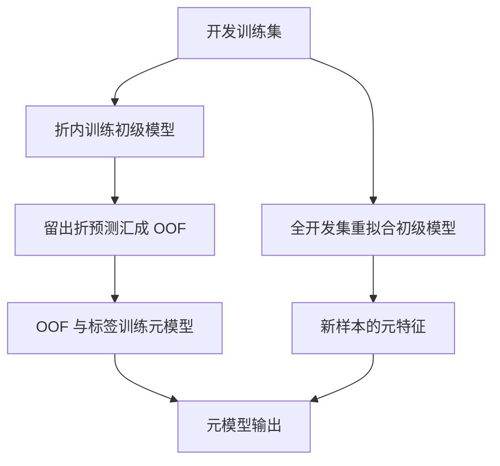

# 第 8 章：集成学习自学笔记

> 依据：周志华《机器学习》第8章，正文第171—191页，课后习题见第192页。本文按“为什么结合有效—怎样生成个体—怎样结合输出—怎样理解多样性—怎样可靠评估”的思路展开，补足定义、推导、完整手算、判断条件和应用场景。标为“拓展”的部分连接梯度提升与实际建模。人工例题只用于教学，不代表真实任务上的性能结论。
>
> 格式约定：独立公式统一使用GitHub支持的math围栏，正文及表格避免行内数学定界符。经典AdaBoost主线采用标签−1、+1；代码若使用0、1标签，会明确说明。n表示训练样本数，T表示个体学习器数，d表示输入特征数，ln表示自然对数。

## 目录

- [一、作者思路与本章地图](#一作者思路与本章地图)
- [二、好而不同与多数投票理论](#二好而不同与多数投票理论)
- [三、AdaBoost的定义与完整流程](#三adaboost的定义与完整流程)
- [四、从指数损失逐步推导AdaBoost](#四从指数损失逐步推导adaboost)
- [五、完整手算两轮AdaBoost](#五完整手算两轮adaboost)
- [六、间隔噪声与损失一致性](#六间隔噪声与损失一致性)
- [七、Bagging自助采样与包外评估](#七bagging自助采样与包外评估)
- [八、随机森林如何增加差异](#八随机森林如何增加差异)
- [九、平均法与方差降低](#九平均法与方差降低)
- [十、投票法概率与校准](#十投票法概率与校准)
- [十一、Stacking与折外预测](#十一stacking与折外预测)
- [十二、误差分歧分解的推导](#十二误差分歧分解的推导)
- [十三、多样性度量与误差图](#十三多样性度量与误差图)
- [十四、四种多样性增强机制](#十四四种多样性增强机制)
- [十五、拓展梯度提升与集成修剪](#十五拓展梯度提升与集成修剪)
- [十六、建模流程与常见错误](#十六建模流程与常见错误)
- [十七、分层样题与详细解答](#十七分层样题与详细解答)
- [十八、可以直接运行的代码实验](#十八可以直接运行的代码实验)
- [十九、实际应用场景与选择依据](#十九实际应用场景与选择依据)
- [二十、课后题导引自学检查与参考资料](#二十课后题导引自学检查与参考资料)

## 一、作者思路与本章地图

### 1.1 从选择一个模型到结合多个模型

前几章讨论怎样训练一个预测器。本章问：能否把多个预测器结合起来，使结果更稳定、更准确，或表示单个模型难以描述的关系？

关键并不是简单地“模型越多越好”。如果所有模型在同样的地方犯错，复制它们没有帮助；如果个体都很差，多数投票还可能放大错误。因此作者用“好而不同”概括核心：个体应有一定预测能力，错误又不能完全重合。

随后，本章围绕三个问题展开：怎样生成这样的个体？怎样结合它们？怎样量化它们的差异及其价值？

### 1.2 本章各节的衔接

| 原书小节 | 核心问题 | 主要内容 | 应掌握的能力 |
|---|---|---|---|
| 8.1 个体与集成 | 多个模型为什么可能胜过一个？ | 准确性、多样性、独立投票分析 | 判断理论结论用了哪些假设 |
| 8.2 Boosting | 怎样让后面的个体关注前面的不足？ | AdaBoost、指数损失、重赋权 | 推导权重并完成手算 |
| 8.3 Bagging与随机森林 | 怎样靠随机扰动产生不同模型？ | 自助采样、包外预测、特征随机化 | 区分训练抽样与评估抽样 |
| 8.4 结合策略 | 输出如何合并？ | 平均、投票、Stacking | 选择合适表示并防止泄漏 |
| 8.5 多样性 | 差异怎样影响误差？ | 误差—分歧分解、成对度量 | 解释度量的含义与局限 |
| 8.6 阅读材料 | 还有哪些发展？ | 梯度提升、修剪、解释与扩展 | 将基本机制连接到实际应用 |

### 1.3 同质、异质与弱学习器

同质集成使用同类算法生成个体，例如多棵决策树；异质集成使用不同类型算法，例如线性模型、树和SVM共同预测。算法相同不意味着训练出的函数相同，抽样、特征、初值与参数都可以改变结果。

弱学习器通常指在规定条件下略优于随机猜测的学习器。经典二分类Boosting理论中的要求，是能在算法给出的加权分布上获得小于0.5的错误率，而不是仅在初始均匀样本上达到51%准确率就永远满足要求。

实际集成也可以使用较强个体。弱学习器是理论与结构描述，不应被理解为“所有集成都必须故意训练差模型”。

### 1.4 串行与并行是训练依赖关系

| 类型 | 个体之间的训练关系 | 代表 |
|---|---|---|
| 序列式 | 后一轮训练使用前一轮的结果 | AdaBoost、典型梯度提升 |
| 并行式 | 个体可在给定抽样规则下分别训练 | Bagging、随机森林 |
| 分层结合 | 先生成初级预测，再训练元模型 | Stacking |

“可并行”不等于统计上完全独立；多个模型仍共享原始数据与任务。“串行”也不意味着每个基学习器内部的计算都无法并行。

## 二、好而不同与多数投票理论

### 2.1 三个模型怎样得到更好的结果

考虑3条测试样本：

| 个体 | 样本1 | 样本2 | 样本3 |
|---|---|---|---|
| 模型1 | 错 | 对 | 对 |
| 模型2 | 对 | 错 | 对 |
| 模型3 | 对 | 对 | 错 |
| 多数投票 | 对 | 对 | 对 |

各模型准确率都是2/3，投票却全部正确，因为错误分散。若三者都只错样本1，投票仍错样本1。需要观察错误是否互补，不能只比较三个单独准确率。

对于回归，“分散”还可能表现为偏差方向不同：一个偏高、另一个偏低，平均后接近真实值。但系统性共同偏差不会因简单复制而消失。

### 2.2 独立等错误率下的精确公式

假设二分类，T为奇数，每个个体错误率均为ε，且对同一随机试验，其错误指示变量相互独立。错误模型数S服从二项分布：

```math
S\sim\mathrm{Binomial}(T,\varepsilon).
```

超过一半个体出错时，集成出错：

```math
\boxed{
P(H(X)\ne Y)
=\sum_{k=(T+1)/2}^{T}
\binom Tk\varepsilon^k(1-\varepsilon)^{T-k}.}
```

若用“正确个体数”作变量，得到原书式（8.3）对应的另一种求和形式：

```math
P(H(X)\ne Y)
=\sum_{k=0}^{(T-1)/2}
\binom Tk(1-\varepsilon)^k\varepsilon^{T-k}.
```

两个公式只是计数对象不同。不要把“正确个数”的下限与“错误个数”的幂次混用。

### 2.3 一个精确计算

T=3、ε=0.3时：

```math
P(\mathrm{集成出错})
=3(0.3)^2(0.7)+(0.3)^3
=0.216<0.3.
```

T=5、ε=0.2时，错误率为0.05792，低于单个的0.2。若ε=0.6、T=3，错误率则为0.648，比0.6更差：多数机制在这里加强了错误方向。

### 2.4 Hoeffding上界怎样得到

令E_t为第t个个体的0—1错误指示量。ε<0.5时，集成出错对应平均错误指示量至少0.5：

```math
\begin{aligned}
P(H(X)\ne Y)
&\le P\left(\frac1T\sum_tE_t-\varepsilon
\ge\frac12-\varepsilon\right)\\
&\le\exp\left[-2T\left(\frac12-\varepsilon\right)^2\right]\\
&=\boxed{\exp\left[-\frac T2(1-2\varepsilon)^2\right]}.
\end{aligned}
```

这就是原书的指数上界。奇数T的真实出错门槛略高于T/2，用0.5作为阈值给出一个方便的上界。

若要求上界不超过δ，则足够条件是：

```math
T\ge
\frac{\ln(1/\delta)}
{2(1/2-\varepsilon)^2}.
```

例如ε=0.3、δ=0.01，需T≥57.5646；若要求奇数，可取59。上界通常较松，不能把它当精确实际错误率。

### 2.5 为什么现实中不能直接外推到零误差

多个模型往往共享训练数据、特征、标签噪声与困难样本，因此错误相关。一个样本若本身无法由现有特征辨别，所有模型都可能同时出错。

上面的结论依赖独立、统一错误率等假设，不能把某个测试集上的平均个体错误率直接代入，就宣称“增加到足够多个模型，真实错误率必为0”。

实际要在相同合理划分下，检查个体质量、错误重合与集成表现。它是理解集成潜力的理想化分析，不是现实任务的无条件保证。

## 三、AdaBoost的定义与完整流程

### 3.1 先分清三种不同的量

经典二分类AdaBoost建立实值得分：

```math
F_T(x)=\sum_{t=1}^{T}\alpha_t h_t(x),
\qquad h_t(x)\in\{-1,+1\}.
```

最终类别由符号决定：

```math
H(x)=\mathrm{sign}(F_T(x)).
```

| 量 | 含义 | 是否随样本而变 |
|---|---|---|
| h_t(x) | 第t个分类器的输出 | 是 |
| α_t | 第t个分类器在集成中的权重 | 对固定模型，不随当前测试样本变化 |
| D_t(i) | 第t轮训练时，第i条训练样本的权重 | 随样本与轮次变化 |

α不是样本权重；D也不是测试样本真实类别的后验概率。F是有正负的得分，不自动是概率。

### 3.2 一轮训练的四步

初始化：

```math
D_1(i)=\frac1n.
```

第t轮依次进行：

1. 用当前样本权重D_t训练个体h_t。
2. 计算它在同一权重分布下的错误率ε_t。
3. 根据ε_t确定个体权重α_t。
4. 提高本轮错分样本的相对权重，得到D_(t+1)。

核心公式为：

```math
\boxed{
\begin{aligned}
\varepsilon_t
&=\sum_{i=1}^{n}D_t(i)\mathbf1[h_t(x_i)\ne y_i],\\
\alpha_t
&=\frac12\ln\frac{1-\varepsilon_t}{\varepsilon_t},\\
D_{t+1}(i)
&=\frac{D_t(i)\exp[-\alpha_ty_ih_t(x_i)]}{Z_t}.
\end{aligned}}
```

其中Z_t是让新权重和为1的归一化常数。

### 3.3 为什么错分样本受到更多关注

正确分类时yᵢh_t(xᵢ)=+1，权重乘exp(−α_t)；错误时为−1，乘exp(+α_t)。若ε_t<0.5，则α_t>0，错误样本的相对权重增加。

错分与正确样本的相对放大倍数为：

```math
\frac{\exp(\alpha_t)}{\exp(-\alpha_t)}
=\exp(2\alpha_t)
=\frac{1-\varepsilon_t}{\varepsilon_t}.
```

必须先乘各自因子再统一归一化。不能只增加错误样本而不调整总和，然后仍把这些数当概率分布。

### 3.4 加权错误率不是错分条数除总数

若某轮5条样本权重为0.5、0.125、0.125、0.125、0.125，只错第一条，普通错误率为0.2，加权错误率却为0.5。

AdaBoost应使用0.5计算本轮α，而不是0.2。前面轮次认为困难的样本，已经获得更大影响。

### 3.5 重赋权与重采样

重赋权：学习算法直接接收每条样本的权重。重采样：按D_t有放回抽取训练数据，让普通训练算法间接感受到分布变化。

两者在目标机制上相近，但有限抽样会带来额外随机性，不能说每次训练数值完全一样。不能接收权重的算法可以考虑重采样，但还需检查抽样后个体是否优于相应门槛。

### 3.6 边界情况与停止规则

| 加权错误率 | α的意义 | 常见处理 |
|---|---|---|
| 0<ε<0.5 | α为正，越小错误率得到越大权重 | 正常更新 |
| ε=0.5 | α=0，当前个体没有改进作用 | 停止、重训或按预设策略处理 |
| ε>0.5 | α为负，未满足经典弱学习要求 | 标准流程通常丢弃并停止；可逆转二分类输出时需明确规则 |
| ε=0 | 理论最优α趋向正无穷 | 检查完美分类，停止或采用明确的数值上限 |

直接计算ln(0)或除以0会产生异常。数值截断是实现约定，需要说明，不能把截断后的有限α当成边界处解析最优值。

多分类变体的弱学习门槛与系数可能不同，不能机械照搬二分类0.5规则。

## 四、从指数损失逐步推导AdaBoost

### 4.1 为什么考虑指数损失

定义边际m=yF(x)。分类正确时m>0，错误时m<0。指数损失：

```math
\ell_{\exp}(y,F)=e^{-yF}.
```

它随正确方向的边际增加而减小；当很自信却预测错误时，损失迅速增大。与0—1损失相比，它连续可微，便于优化，但也可能更关注异常点。

经验损失为：

```math
L(F)=\frac1n\sum_i e^{-y_iF(x_i)}.
```

### 4.2 固定一个x时的最优得分

设p=P(Y=+1|x)，给定x的期望损失为：

```math
R_x(F)=pe^{-F}+(1-p)e^{F}.
```

求导：

```math
-p e^{-F}+(1-p)e^{F}=0
\quad\Longrightarrow\quad
\boxed{F^*(x)=\frac12\ln\frac{p}{1-p}}.
```

当0<p<1时，F*的符号与p−0.5相同，所以最小化总体指数风险的理想得分给出0—1损失下的贝叶斯决策。

p=0或1时，最优得分在无穷极限；不能认为一定存在有限最优参数。有限数据、受限函数族和优化误差也会使实际模型达不到这个理想解。

### 4.3 加性模型怎样逐步优化

已得到F_(t−1)，新加入αh：

```math
F_t(x)=F_{t-1}(x)+\alpha h(x).
```

则：

```math
\begin{aligned}
L(F_t)
&=\frac1n\sum_i
e^{-y_iF_{t-1}(x_i)}e^{-\alpha y_i h(x_i)}\\
&=C_{t-1}\sum_iD_t(i)e^{-\alpha y_i h(x_i)},
\end{aligned}
```

其中：

```math
D_t(i)=
\frac{e^{-y_iF_{t-1}(x_i)}}
{\sum_j e^{-y_jF_{t-1}(x_j)}},
\qquad
C_{t-1}=\frac1n\sum_j e^{-y_jF_{t-1}(x_j)}.
```

旧模型上边际小、尤其边际为负的样本，自动获得更大D_t。这说明重赋权并非凭空设计，而是来自当前指数损失的结构。

### 4.4 为什么先找加权错误率小的h

对固定α>0，由于yh只能为+1或−1：

```math
\sum_iD_t(i)e^{-\alpha y_i h(x_i)}
=(1-\varepsilon)e^{-\alpha}+\varepsilon e^\alpha.
```

也可写成：

```math
e^{-\alpha}
+\varepsilon(e^\alpha-e^{-\alpha}).
```

系数为正，因此对固定正α，最小化这一目标等价于最小化加权错误率ε。

本解释对二值输出给出直接精确关系，不必把某个泰勒近似误当算法每步都严格依赖的唯一理由。实际基学习算法也未必找到所有可能h中的全局最优，只需满足采用的弱学习要求。

### 4.5 求解α

固定h及其ε，对：

```math
Z(\alpha)=(1-\varepsilon)e^{-\alpha}
+\varepsilon e^\alpha
```

求导并令其为0：

```math
\begin{aligned}
Z'(\alpha)
&=-(1-\varepsilon)e^{-\alpha}
+\varepsilon e^\alpha=0,\\
e^{2\alpha}&=\frac{1-\varepsilon}{\varepsilon},\\
\boxed{\alpha}
&=\boxed{\frac12\ln\frac{1-\varepsilon}{\varepsilon}}.
\end{aligned}
```

对0<ε<1，二阶导数为正，因此这是该一维目标的极小点。若再要求α>0，需ε<0.5。

### 4.6 得到新的样本权重

新分布与新指数损失成比例：

```math
\begin{aligned}
D_{t+1}(i)
&\propto e^{-y_iF_t(x_i)}\\
&=e^{-y_iF_{t-1}(x_i)}
  e^{-\alpha_ty_ih_t(x_i)}\\
&\propto D_t(i)e^{-\alpha_ty_ih_t(x_i)}.
\end{aligned}
```

归一化便得到第3节算法。新权重由同一轮旧D、当前h和α共同计算，不应边处理样本边重新归一化并混用状态。

### 4.7 训练错误率上界

若ε_t在0与0.5之间，代入最优α_t：

```math
\boxed{
Z_t=2\sqrt{\varepsilon_t(1-\varepsilon_t)}.}
```

初始化均匀时：

```math
\frac1n\sum_i e^{-y_iF_T(x_i)}
=\prod_{t=1}^{T}Z_t.
```

每个错分或零边际样本满足e^(−yF)≥1，所以：

```math
\widehat R_{0/1}
\le\frac1n\sum_i e^{-y_iF_T(x_i)}
=\prod_t2\sqrt{\varepsilon_t(1-\varepsilon_t)}.
```

令γ_t=0.5−ε_t，则：

```math
2\sqrt{\varepsilon_t(1-\varepsilon_t)}
=\sqrt{1-4\gamma_t^2}
\le e^{-2\gamma_t^2}.
```

因此：

```math
\boxed{\widehat R_{0/1}\le
\exp\left(-2\sum_t\gamma_t^2\right).}
```

这里是训练错误上界，不是直接的测试误差保证；与第2节独立投票分析不同，这个代数推导不要求各轮个体错误相互独立。

## 五、完整手算两轮AdaBoost

### 5.1 数据与两轮个体输出

取5条样本，初始每条权重0.2。为突出权重计算，给定两轮学到的分类器输出：

| 样本i | 真实y | h₁输出 | h₂输出 |
|---|---:|---:|---:|
| 1 | +1 | +1 | −1 |
| 2 | +1 | +1 | +1 |
| 3 | −1 | −1 | −1 |
| 4 | −1 | −1 | −1 |
| 5 | +1 | −1 | +1 |

第一轮只错样本5；第二轮只错样本1。这里演示给定弱分类器后的AdaBoost更新，不宣称它们对任意具体特征空间都是最优树桩。

### 5.2 第一轮

```math
\varepsilon_1=0.2,\qquad
\alpha_1=\frac12\ln4=\ln2\approx0.693147.
```

正确项乘1/2，错误项乘2，未归一化权重为：

```math
(0.1,\ 0.1,\ 0.1,\ 0.1,\ 0.4),
\qquad Z_1=0.8.
```

所以：

```math
D_2=(1/8,\ 1/8,\ 1/8,\ 1/8,\ 1/2).
```

样本5现在占全部训练权重的一半，尽管它仅是5条中的1条。

### 5.3 第二轮

h₂只错样本1，必须按D₂计算：

```math
\varepsilon_2=\frac18,
\qquad
\alpha_2=\frac12\ln7\approx0.972955.
```

归一化常数：

```math
Z_2=2\sqrt{\frac18\frac78}=\frac{\sqrt7}{4}
\approx0.661438.
```

计算得到：

```math
D_3=
\left(\frac12,\frac1{14},\frac1{14},
\frac1{14},\frac27\right).
```

例如样本5本轮改判正确，其权重从1/2变为2/7；样本1新近错分，权重升到1/2。

### 5.4 两轮结合后的结果

最终得分为：

```math
F_2(x)=0.693147h_1(x)+0.972955h_2(x).
```

样本1两轮冲突，因为第二轮权重大，最终错分；样本5两轮也冲突，但第二轮是对的，因此最终纠正。其他样本两轮都对。

两轮后普通训练错误率仍是1/5，但指数损失从第一轮的0.8降到：

```math
Z_1Z_2=0.8\frac{\sqrt7}{4}
=\frac{\sqrt7}{5}\approx0.529150.
```

**优化损失下降，不要求每一轮离散错误率都严格下降。** 这也说明关注当前错分样本，并不保证下一轮可以同时修复全部旧错且不产生新错。

## 六、间隔噪声与损失一致性

### 6.1 边际是什么

原始边际为mᵢ=yᵢF(xᵢ)。正表示方向正确，负表示错误，绝对值反映带符号得分离0的距离。

当α非负且总和非零，可以定义归一化边际：

```math
\rho_i=
\frac{y_i\sum_t\alpha_th_t(x_i)}
{\sum_t\alpha_t}\in[-1,1].
```

这与SVM的几何间隔不是同一个对象，不能直接用它解释为输入空间中到超平面的欧氏距离。

### 6.2 训练错误达到0后为何还可能改变泛化

错误率只看边际正负；指数损失还区分“小正边际”和“大正边际”。所有样本刚刚分对时，模型仍可能继续增大某些边际，改变分类边界及其稳定性。

这能帮助理解某些任务中继续训练仍有收益，但不是“永不过拟合”。噪声、异常点、弱学习器复杂度与训练轮数都会影响结果，必须监控合理验证指标。

### 6.3 为什么标签噪声可能被反复强调

若一个样本标错，或其标签由现有特征难以预测，它可能长期获得很大指数损失和样本权重。继续追赶这些点可能损害其他区域。

可检查标签、异常测量与高权重点；也可通过开发数据选择学习率、轮数、基模型复杂度或更合适损失。不能把“高权重”直接解释为“最有科学价值的实验”，它也可能是错误记录。

### 6.4 损失一致性的含义与条件

分类一致性讨论的是：理想地最小化某种替代风险，其决策是否与0—1贝叶斯决策相符。它不等于任意有限样本、任意优化过程都会达到最优准确率。

对边际损失φ(yF)，仅仅知道φ严格递减，通常还不够排除F=0成为条件风险的最小点。一个便于使用的充分条件组合是：在对称可行区间内连续、严格递减，并在0处可微且φ′(0)<0，同时相关最小化问题有适当解。

因为p>0.5时，对F>0有：

```math
R_x(F)-R_x(-F)
=(2p-1)\left[\phi(F)-\phi(-F)\right]<0,
```

负得分被相反正得分支配；而：

```math
R_x'(0)=(2p-1)\phi'(0)<0
```

又排除0为最小点。p<0.5的情况对称。指数损失满足这些局部条件。

### 6.5 拓展：单调性本身不足的反例

在边际m∈[−1,1]上定义：

```math
\phi(m)=
\begin{cases}
1-100m,&m<0,\\
1-m,&m\ge0.
\end{cases}
```

它连续且严格递减，但在0有折角。若p=0.6，则：

```math
R_x(F)=
\begin{cases}
1-59.6F,&F<0,\\
1+39.4F,&F\ge0.
\end{cases}
```

最小点是0；p=0.4时最小点也为0。固定的零分数决策不能同时为这两种后验给出正确的贝叶斯类别。

因此阅读原书习题8.2时，应先明确边际、符号与正则条件，不能把一般的“递减”当作完整充分条件直接套用。

### 6.6 软件系数为何可能差一个2

多分类SAMME等变体可能采用：

```math
\alpha_t=\ln\frac{1-\varepsilon_t}{\varepsilon_t}
+\ln(K-1).
```

K=2时，它是本章经典α的2倍，但相应权重更新和得分约定也发生变化；归一化后的样本分布仍可能等价。不能只看一个系数就认定实现错误。

多分类弱学习门槛通常为ε<1−1/K；概率输出也可能使用特定得分变换。实验一手写经典二分类版本，直接核对本章公式，不将软件多分类接口当作完全相同的定义。

## 七、Bagging自助采样与包外评估

### 7.1 为什么用有放回抽样

Bagging是Bootstrap Aggregating的缩写。对含n条样本的训练集，有放回抽取n次，形成一个大小为n的自助样本集；重复T次，训练T个个体，然后结合预测。

每个自助样本集仍有n行，但部分行重复、部分原始样本没出现。不同个体的训练数据有重叠，不是把原数据平均分成T份。

若每个模型只用互不相交的n/T条记录，数据量可能太少，个体质量会明显降低。自助采样希望在保持一定训练信息的同时制造差异。

### 7.2 63.2%与36.8%怎样推导

某个固定原始样本一次未被抽中的概率为1−1/n，n次都未被抽中：

```math
q_n=\left(1-\frac1n\right)^n
\longrightarrow e^{-1}\approx0.367879.
```

因此被至少抽中一次的概率为：

```math
1-q_n\longrightarrow1-e^{-1}\approx0.632121.
```

不同样本的期望数为n(1−q_n)。这些是期望或大样本近似，不意味着每个自助样本集恰有63.2%的不同记录。

例如n=5，包外概率为(4/5)⁵=0.32768，并非精确0.368；不同样本期望数为5×0.67232=3.3616。

### 7.3 分类和回归如何结合

经典Bagging分类对个体类别作等权投票；回归对数值作简单平均：

```math
H_{\mathrm{reg}}(x)=\frac1T\sum_t h_t(x).
```

一些软件分类实现会先平均个体类别概率再取最大值，属于软结合，与每棵树先取类别再数票不总相同。第18节实验二手写硬投票，实验三则遵循软件各接口的定义。

### 7.4 OOB预测必须逐样本排除见过它的模型

记第t个模型的自助训练索引集合为I_t，样本i对应的包外模型集合：

```math
\mathcal O_i=\{t:i\notin I_t\}.
```

对样本i，只使用这些模型的输出。例如回归：

```math
\widehat y_i^{\mathrm{OOB}}
=\frac1{|\mathcal O_i|}
\sum_{t\in\mathcal O_i}h_t(x_i).
```

分类则对这些模型的类别投票或按规定平均概率。不能先用全部模型预测训练集，再把结果称为OOB。

如果某样本没有包外模型，分母为0，需要按预先规定跳过、增加模型数或报告无法评价。不能默默把它预测成某一类。

### 7.5 每个样本大约有多少包外票

对同一种独立自助抽样规则，样本i的包外模型数近似服从：

```math
|\mathcal O_i|\sim\mathrm{Binomial}(T,q_n),
\qquad
\mathbb E[|\mathcal O_i|]=Tq_n.
```

大样本下T=100时平均约36.8票，并不是100票。树数少时，OOB覆盖与估计稳定性都可能不足。

该二项分析针对给定训练集后的抽样随机性，不代表原始训练样本在实际科学问题中已经独立。

### 7.6 OOB误差与独立测试的区别

OOB利用训练集内部的抽样排除来估计泛化表现，有助于节约单独留验证集的成本。它不是一份从未参与任何选择的最终测试集。

若反复用OOB结果选择特征、超参数、阈值或模型结构，OOB已经参与了选择，最终仍需要适当独立评估。OOB样本若被用于个体剪枝或早停，也需区分“用于训练选择的包外数据”与“独立评估”。

OOB的完整流程还应考虑预处理。先在所有训练记录上做目标编码、特征选择，再声称每条OOB记录完全未参与模型形成，会发生泄漏；即使是非监督处理，也应明确其是否使用了被评估记录的信息。

### 7.7 为什么更适合不稳定学习器

如果训练样本略改，模型预测就明显变化，说明它对抽样较敏感。深决策树常具有这种性质；平均多个扰动版本可以减小波动。

若个体主要问题是稳定的系统性偏差，重复抽样未必有帮助。例如NB独立假设严重不合适时，Bagging不会自动把它变成能表达全部属性依赖的模型。

“主要降低方差”是常见机制解释，不是断言Bagging从不影响偏差，或所有算法都能按同一比例改进。

### 7.8 计算成本怎样理解

若一次训练代价为C(n)，训练T个个体通常需约T次相应代价，外加抽样与结合。把T看成常数时，某些渐近分析与单模型同阶；实际墙钟时间、内存、存储及推断量仍会增加。

并行可减少等待时间，但不能消除总计算量。树更多时应检查性能收益是否足以抵消部署成本。

## 八、随机森林如何增加差异

### 8.1 在样本扰动之外加入特征扰动

随机森林RF以决策树为个体，通常同时使用：

1. 每棵树使用自助采样数据。
2. 每个节点划分时，随机挑选部分特征作为候选。
3. 只在候选中寻找最优划分。

因此多样性不仅来自训练样本不同，还来自不同树、不同节点看到的候选特征不同。

### 8.2 每个节点抽特征，不是整棵树只看同一子集

RF的节点候选集合可以不断变化。随机子空间法则常为每个个体先抽固定特征子集，再用该子集训练整个模型。两者都利用输入扰动，但粒度不同。

例如有10个特征，每次节点只选3个；某棵树根节点可能考虑1、4、7号，左子节点改为2、6、9号。这棵树仍可能在全树中使用多种原始特征。

### 8.3 候选特征数k怎样影响结果

| k的选择 | 个体可能发生什么变化 | 需要观察什么 |
|---|---|---|
| 接近d | 每个节点更容易选到强特征，树之间可能更相似 | 相关性是否过高 |
| 很小 | 随机性更强，个体可能变弱 | 弱化是否超过差异带来的收益 |
| k=d | 不再有这一特征随机化来源 | 接近树Bagging，但实现细节与随机打平规则仍可不同 |

k=1表示随机选一个候选特征，然后通常仍在该特征上寻找合适切分；不等于阈值也完全随机。额外随机树等方法还会随机化阈值，是另一种设计。

原书给出log₂d的常见经验值；软件还可采用sqrt(d)、比例或整数。scikit-learn的RandomForestClassifier默认使用sqrt，代码应明确设置和记录，而不是把某条经验公式当成所有任务的最优定理。

### 8.4 为什么可能比树Bagging更快

在相同节点样本量下，普通树Bagging通常检查全部d个特征，RF只检查k个候选，可能降低一次节点搜索代价。

但总时间还受树深、有效节点数、实现、并行和样本量影响。有些实现为找到合法划分会检查更多特征，因此不能用“k/d倍”作为无条件精确耗时公式。

### 8.5 个体强度与相关性的权衡

候选特征减少，树可能较弱，但树间错误相关也可能降低。RF试图获得这两种因素的合适平衡，而不是单纯追求树之间最不相同。

若数据只有极少量关键特征，过强的随机子空间扰动可能频繁漏掉重要信息；若存在大量冗余信息，随机挑选特征更容易保留个体能力。

### 8.6 树数多是否不再过拟合

在固定树生成机制下，增加独立随机化生成的树，可使平均或投票逐渐稳定；有限训练数据的系统性问题不会因此消失。

“随树数增大趋于某个误差水平”不等于该误差为0，也不等于所有超参数和数据条件下都没有过拟合。树深、叶节点样本数、特征选择与调参过程仍然重要。

### 8.7 应重点记录的参数

| 参数 | 控制什么 | 常见影响 |
|---|---|---|
| n_estimators | 树数 | 稳定性、时间与存储 |
| max_features | 每个节点的候选特征 | 个体强度与差异 |
| max_depth | 最大深度 | 模型复杂度 |
| min_samples_leaf | 叶节点最小样本数 | 平滑程度、细分能力 |
| max_samples | 每棵树抽样规模 | 个体信息量与抽样差异 |
| bootstrap | 是否有放回抽样 | 是否可按该机制进行OOB |
| class_weight | 类别加权 | 训练目标与少数类关注 |
| random_state | 随机化可复现性 | 固定结果便于排查，不代表性能保证 |

不同库对默认值、概率输出与缺失值有不同支持，应查对应版本。实验三使用当前核对环境中的明确参数。

## 九、平均法与方差降低

### 9.1 三种可能收益

作者从三个角度解释结合的价值：

- 统计方面：有限数据下，多个假设都拟合得相近，结合可减少选错单个假设的风险。
- 计算方面：随机初始化或局部搜索可能到达不同解，结合可缓解只落在某个差解的风险。
- 表示方面：组合扩大了可表示函数集合，例如许多树桩叠加形成更复杂边界。

这些是可能机制，不保证任何组合都优于所有单模型。

### 9.2 简单平均与加权平均

```math
H_{\mathrm{avg}}(x)=\frac1T\sum_t h_t(x),
\qquad
H_w(x)=\sum_tw_th_t(x).
```

常用约束为：

```math
w_t\ge0,\qquad\sum_tw_t=1.
```

这样输出位于个体输出的凸包中，数值尺度也保持可解释。相同权重是特例，但并非唯一选择。

权重非负并不保证一定超过最佳个体。若真实y=0，两个预测分别0、10，等权预测5，显然不如单独使用第一个。能得到的某些保证是相对加权平均个体误差，而不是相对每一个个体。

### 9.3 独立误差下的方差

设在固定x处，个体预测随训练数据或模型随机性变化，方差均为σ²且相互独立，则：

```math
\mathrm{Var}\left(\frac1T\sum_t h_t(x)\right)
=\frac1{T^2}\sum_t\sigma^2
=\frac{\sigma^2}{T}.
```

这说明平均可以消减独立波动。但如果每个模型都比真实值平均高5，简单平均仍会保留这个共同偏差。

### 9.4 有相关性时的方差地板

若所有个体等方差、任意两个不同个体的协方差都为ρσ²：

```math
\begin{aligned}
\mathrm{Var}(H)
&=\frac1{T^2}
\left[T\sigma^2+T(T-1)\rho\sigma^2\right]\\
&=\boxed{\sigma^2\left[\rho+\frac{1-\rho}{T}\right]}.
\end{aligned}
```

例如σ²=4、ρ=0.25、T=100，平均预测方差为1.03；继续增加T，极限为1，而非0。若ρ=1，所有个体完全同向变化，平均不降方差。

这里是特定等方差、等协方差模型中的公式，随机性来自重复训练等机制。对一个测试集上两列固定预测算出的相关系数，不应直接当作这个公式中所有随机变量关系的完整描述。

### 9.5 为什么不能只按误差倒数分权

两个个体单独表现相同，但若其中一个和已有模型几乎重复，它加入后的新信息可能很少。最优权重依赖误差之间的协方差，不仅是各自误差大小。

一个简化回归例子：两个无偏、互不相关预测的误差方差分别1和4，权重为w与1−w。组合方差：

```math
V(w)=w^2+4(1-w)^2.
```

令导数为0，得到w=0.8，另一权重0.2；最小方差0.8。若误差相关或带不同偏差，权重需要重新分析。

实际协方差只能从有限数据估计，学习很多权重容易过拟合。这解释了为什么等权平均有时比复杂的权重学习更稳健。

## 十、投票法概率与校准

### 10.1 绝对多数与相对多数

绝对多数：某类别获得超过总票数一半才输出，否则拒绝预测。相对多数：选择票数最多类别，即使没过半也输出。

例如三类票数4、3、3：相对多数选第一类；绝对多数没有超过5票，应拒绝。并列时如何决定也需要预先规定，不能按测试标签打破平局。

### 10.2 硬投票

个体输出类别，转换为指示量：

```math
H_{\mathrm{hard}}(x)
=\arg\max_c\sum_tw_t\mathbf1[h_t(x)=c].
```

只保留选择了哪个类别，不保留它对其他类别的支持程度。权重相同时就是数票。

### 10.3 软投票

个体提供可比较的类别概率p_t(c|x)，先按类别平均：

```math
\overline p(c\mid x)=\sum_tw_tp_t(c\mid x),
\qquad
H_{\mathrm{soft}}(x)=\arg\max_c\overline p(c\mid x).
```

要保证各模型的概率列对应同一类别顺序。一个模型输出“正、负”，另一个输出“负、正”，直接按列平均会把含义混乱。

### 10.4 硬软投票可能相反

三个模型给出的正类概率分别0.51、0.51、0.01。硬投票有两票正、一票负，输出正；软平均为：

```math
(0.51+0.51+0.01)/3\approx0.343333,
```

所以按0.5阈值输出负。哪个更好取决于概率是否有意义及任务需求，没有脱离数据的固定排序。

### 10.5 得分不能随意当概率

SVM间隔、树的票数、神经网络logit等具有不同数值含义，不能把原始值直接混合成“平均概率”。把数值缩放到0到1，也不等于完成概率校准。

概率校准检查的是：预测为约0.8的一组事件，实际正类比例是否接近0.8。Platt缩放、等分回归等可以作为校准方法，但校准器也需要合法的训练内数据。

不同类型模型可以进行软结合，前提是输出已经对应同一类别、同一目标人群、可比较的概率含义。不能把“异质”本身当成绝对禁止软投票的理由。

### 10.6 平均概率之后仍要独立选择决策

若目标是不对称代价，平均得到后验估计后，还要按风险规则决定类别。0.5只是常见等代价二分类阈值。

概率质量可用对数损失、Brier分数与可靠性图检查；类别质量可用准确率、宏F1、召回率等。分类正确率高，不证明概率已经校准。

## 十一、Stacking与折外预测

### 11.1 元学习器学什么

Stacking让另一个模型学习怎样结合初级模型。若有J个初级模型，二分类时可以用各模型正类概率形成新的J维特征：

```math
z_i=
\left(
p_1(C=1\mid x_i),\ldots,
p_J(C=1\mid x_i)
\right).
```

元学习器以zᵢ为输入、原标签yᵢ为目标。它可以学习哪些模型更可靠，或如何利用不同模型的输出组合；但元层也会过拟合，不是无成本的自动优化。

### 11.2 为什么不能直接用训练集重代入预测

一棵深树可能在训练集准确率接近100%，在新数据上远低于100%。如果用它见过的训练样本生成元特征，元模型会误以为这棵树永远可靠。

问题不仅是元模型复杂度高，而是元训练输入与部署时输入的统计性质不同：前者来自“模型已经见过此样本”，后者来自未见样本。

### 11.3 正确的K折OOF流程

将开发训练集分为K折，最终测试集先留出：

1. 对第k折，用其他K−1折训练每种初级模型。
2. 预测第k折，将输出填入这部分样本对应的元特征行。
3. 重复K次，使每条训练样本的元特征都来自未用它训练的模型。
4. 用完整OOF矩阵和标签训练元模型。
5. 在全部开发训练数据上重新拟合各初级模型。
6. 用这些重拟合模型产生最终测试的元特征，再由元模型预测。



图中没有使用最终测试标签来选择元模型。

### 11.4 每一层预处理都要放在折内

标准化、缺失填补、类别编码、目标编码、特征选择与过采样，若依赖训练数据，都应在相应折内拟合。先对全部开发数据选特征，再构造OOF，也会让留出折的信息提前进入模型。

使用Pipeline可以帮助保证处理步骤随每个训练折重新拟合，但前提是确实把全部相关操作放了进去。

### 11.5 OOF元特征不是整个Stacking的验证成绩

每条OOF特征来自未见该样本的初级模型，这是训练元层的必要设计。元模型却在这些OOF行及其标签上进行了拟合。

因此，元模型在同一OOF矩阵上的得分仍是它的训练得分，不能直接作为整个Stacking的交叉验证性能。评价完整系统需额外的外层交叉验证或最终独立测试。

如果还要选择初级模型超参数，也应在相应外层训练部分内部进行，避免预先用全部样本标签选择模型后再声称每一行都是完全独立的验证。

### 11.6 多分类、分组和时间数据

多分类可以使用各初级模型的类别概率向量。由于每个向量各列和为1，线性元模型可能有冗余列；可以删去一列或采用合适正则化，但类别排列必须一致。

同一受试对象、实验或批次的记录应使用分组划分；时间任务应保证只用过去训练、预测未来。滚动验证中最早的一部分记录可能没有合法的折外预测，应只保留有合法元特征的行，不应为了填满矩阵而使用未来数据。

### 11.7 Stacking、Blending与BMA

| 方法 | 怎样确定结合方式 | 主要注意点 |
|---|---|---|
| 简单平均 | 固定等权 | 个体尺度与概率含义一致 |
| 学习加权 | 在开发数据上优化权重 | 权重估计与验证要分开 |
| Stacking | 用OOF等方式训练元模型 | 防止重代入与多层选择泄漏 |
| Blending | 常用一块专门留出数据训练结合层 | 简单但减少初级模型训练数据，术语有不同用法 |
| 贝叶斯模型平均BMA | 按模型后验等贝叶斯规则加权预测 | 依赖候选模型、先验和证据估计 |

BMA与Stacking有不同目标和假设。不能从某些特定理论条件或实验结论，推出其中一种在所有实际任务上总是更好。

## 十二、误差分歧分解的推导

### 12.1 定义预测、误差与分歧

对固定x，设目标为f(x)，个体输出为h_t(x)，非负权重和为1，集成H=Σw_th_t。

个体平方误差的加权平均为：

```math
\overline E(x)=\sum_tw_t\left(h_t(x)-f(x)\right)^2.
```

定义加权分歧：

```math
A(x)=\sum_tw_t\left(h_t(x)-H(x)\right)^2.
```

分歧衡量的是个体围绕集成均值的分散程度，不直接等于个体对真值的误差。

### 12.2 逐项展开

将个体误差拆成两部分：

```math
h_t-f=(h_t-H)+(H-f).
```

平方后加权求和：

```math
\begin{aligned}
\overline E
&=\sum_tw_t(h_t-H)^2\\
&\quad+2(H-f)\sum_tw_t(h_t-H)\\
&\quad+(H-f)^2\sum_tw_t.
\end{aligned}
```

因为：

```math
\sum_tw_t(h_t-H)
=\sum_tw_th_t-H\sum_tw_t=0,
```

且权重和为1，所以：

```math
\boxed{
(H-f)^2=\overline E-A.}
```

在同一输入分布下积分或求期望，得到原书的误差—分歧分解：

```math
\boxed{E=\overline E-A.}
```

### 12.3 一个完整算例

目标f=2，两个预测分别1、3，权重各0.5。集成预测H=2。

```math
\overline E=\tfrac12(1-2)^2+\tfrac12(3-2)^2=1,
\qquad A=1,
\qquad E=1-1=0.
```

两个个体都不完美，但方向互补，平均恰好正确。

若两个预测都是3，个体平均误差仍为1，分歧为0，集成误差仍为1。不是任何“两个模型”都自动改善。

### 12.4 不能只最大化分歧

若再加一个非常差的预测10，并改为三者等权，分歧会增大，但平均个体误差也从1增到22，集成预测为14/3，误差为64/9≈7.111111，反而更差。

公式中的两个量不是能任意独立操纵的旋钮。为了制造差异而加入错误很多的模型，可能得不偿失。

这个恒等式针对平方损失与线性加权平均；不能直接把其中E换成分类错误率、把A换成任意一个成对差异指标，就宣称同样等式仍成立。

### 12.5 与偏差—方差分解的区别

偏差—方差分析通常考察学习算法在重复训练集上的随机性；这里的分歧恒等式可以在一组已经固定的个体、一个固定输入上成立。

二者都帮助理解平均的效果，但定义的期望、随机来源和误差对象不同。使用时应先写清楚正在对什么求平均。

## 十三、多样性度量与误差图

### 13.1 先明确列联表记录什么

沿用原书二分类预测标签的定义。下面行对应h_i，列对应h_j：

|  | h_j预测+1 | h_j预测−1 |
|---|---:|---:|
| h_i预测+1 | a | b |
| h_i预测−1 | c | d |

总数n=a+b+c+d。这不是“预测与真实标签”的混淆矩阵，两轴都是模型预测。单靠它通常无法恢复各模型准确率。

另一类文献会用“两个模型是否预测正确”构造同形表；那时a表示都对、d表示都错，含义已经变化。公式形式相似，不代表统计对象相同。第18节实验四明确使用预测标签表。

### 13.2 不合度量

```math
\mathrm{dis}_{ij}=\frac{b+c}{n}.
```

取值0到1，越大表示这两模型的预测越不一致。二分类中，预测不一致时恰有一个模型对、另一个错；多分类时两个不同预测也可能都错，因此解释需要调整。

不合很高不保证整体好。例如一个模型总把正确答案取反，虽与好模型差异大，却不是理想的普通等权投票成员。

### 13.3 二值相关系数

```math
\rho_{ij}
=\frac{ad-bc}
{\sqrt{(a+b)(a+c)(b+d)(c+d)}}.
```

这是按二值变量计算的Pearson相关，也称phi系数。正表示倾向同向预测，负表示倾向相反，0表示没有这一二值相关。

分母为0时，至少一列预测没有变化，相关系数未定义。不能为了方便把所有未定义值记为0，再解释成“模型独立”。

### 13.4 Q统计量

```math
Q_{ij}=\frac{ad-bc}{ad+bc}.
```

分母正时，Q与相关系数同号，反映列联表中的关联方向和强度，但会对零计数敏感。它与ρ不是相同尺度，不能把Q=0.9直接解释成Pearson相关0.9。

例如a=d=1、b=98、c=0时，Q=1，而一致率只有2%，ρ只有1/99。某个交叉计数为0就可能使Q达到边界，因此Q=1不等于两个模型逐样本完全一致。

核对扫描本第187页时，式（8.39）后写出的“|Q|≤|ρ|”方向有误。在分母有定义时应有：

```math
\boxed{|Q_{ij}|\ge|\rho_{ij}|.}
```

因为：

```math
\begin{aligned}
(a+b)(c+d)&\ge ad+bc,\\
(a+c)(b+d)&\ge ad+bc,
\end{aligned}
```

故ρ的分母不小于Q的分母，分子绝对值相同。若ad+bc=0，Q未定义，应单独处理。

### 13.5 κ统计量

实际一致率为：

```math
p_o=\frac{a+d}{n}.
```

按两个模型各自预测类别的边际比例，估计偶然一致率：

```math
p_e=
\frac{(a+b)(a+c)+(c+d)(b+d)}{n^2}.
```

于是：

```math
\boxed{\kappa=\frac{p_o-p_e}{1-p_e}}.
```

κ=1表示完全一致；κ=0表示一致程度与该边际基准相同；负值表示低于这个偶然一致基准。

κ并不是准确率校正，也不直接检查真值。若p_e=1，公式分母为0，需报告未定义，不能简单宣称κ必为1或0。

### 13.6 同一张表完整算一次

取a=d=40、b=c=10，n=100：

```math
\begin{aligned}
\mathrm{dis}&=0.2,\\
\rho&=\frac{1600-100}{2500}=0.6,\\
Q&=\frac{1600-100}{1600+100}
=\frac{15}{17}\approx0.882353,\\
p_o&=0.8,\qquad p_e=0.5,\\
\kappa&=\frac{0.8-0.5}{1-0.5}=0.6.
\end{aligned}
```

这也直接验证|Q|≤|ρ|不成立。表中没有真实标签，仍不能据此说两个模型的准确率分别是多少。

### 13.7 κ—误差图怎样读

对每一对模型画一个点：

- 横坐标：两模型预测之间的κ。
- 纵坐标：两模型分类错误率的平均值。
- 模型较多时，用所有模型对形成点云。

点越高，个体平均误差越大；点越靠右，预测越一致。理想上希望个体误差小、又有可用差异，因此常关注相对靠下、靠左的分布。

但它不是“只要左下就一定最佳”的优化定理。许多模型间的高阶共同错误不能由单一成对量完整描述；不同点之间也共享模型，并非相互独立的统计样本。

### 13.8 需要标签的错误重合信息

如果真正关心“哪些模型同时失败”，可另统计：

```math
\mathrm{DoubleFault}_{ij}
=\frac1n\sum_k
\mathbf1[h_i(x_k)\ne y_k]\,
\mathbf1[h_j(x_k)\ne y_k].
```

这与预测标签列联表的d通常不是同一个量；只有改用正确/错误表，d才表示双错。

在训练重代入数据上计算这些指标可能低估共同泛化错误。更适合使用验证或合法OOF预测，同时保留一个最终未参与选择的测试方案。

## 十四、四种多样性增强机制

### 14.1 数据样本扰动

通过自助采样、子采样或序列重赋权，让不同个体看到不同训练分布。Bagging和AdaBoost分别是典型例子。

效果取决于算法对样本变化是否敏感。深树通常较敏感；较强正则化的线性模型、某些NB或kNN配置可能相对稳定。但稳定性取决于数据与参数，不是对某个算法名称永久不变的属性。

### 14.2 输入属性扰动

为个体或节点选不同特征子集，例如随机子空间和RF。它能减少所有模型反复依赖同一组强特征的情况。

若特征冗余多，删掉部分特征仍能保留预测信息；若只有少数关键特征，扰动太强可能显著损害个体。选择子空间大小应在开发数据内部完成。

连续变换、随机投影也可以生成不同表示，但“子空间”不总等于直接删原始列。

### 14.3 输出表示扰动

教材列出标签翻转、输出调制与纠错输出码ECOC等。共同点是改变训练子任务或输出表示，制造不同模型。

ECOC把多分类编码成多个二分类任务，最后按编码距离等规则合并。标签翻转则是特定算法的训练扰动设计，不能把随机改标签当作数据清洗，也不能改写原始实验真值后不说明。

是否有益取决于扰动设计，不能仅因“增加随机性”就期待提高性能。

### 14.4 算法参数扰动

改变初始化、网络结构、正则化、距离度量、树划分规则等，也可以得到不同个体。随机初始化神经网络是常见例子。

参数范围应保持个体可用，不能把大量明显失效的配置混进来。若已用验证集挑选一组候选，再学习结合，整个选择过程仍要纳入评估。

### 14.5 多种机制可以同时存在

| 方法 | 样本扰动 | 特征或表示扰动 | 参数或训练扰动 |
|---|---|---|---|
| Bagging深树 | 自助采样 | 不一定 | 树的随机打平等可附加 |
| 随机森林 | 通常有自助采样 | 每节点随机候选特征 | 随机种子等 |
| 神经网络集成 | 可选不同样本 | 可选不同输入表示 | 不同初值、结构、训练配置 |
| 随机子空间kNN | 可选子采样 | 每个体不同属性子集 | 不同k或距离设置 |
| ECOC | 视实现而定 | 输出编码任务变化 | 可用不同个体配置 |

研究某种机制是否有效，应该在控制其他条件的比较中检验，而不是只把所有随机机制都堆叠。

## 十五、拓展梯度提升与集成修剪

### 15.1 Gradient Boosting的一般思想

梯度提升保留“逐步增加一个函数”的加性结构，但不局限于AdaBoost的指数损失或二值分类器。

对损失ℓ，当前预测F_(t−1)，为每条样本计算负梯度：

```math
r_{it}
=-\left.
\frac{\partial\ell(y_i,F)}{\partial F}
\right|_{F=F_{t-1}(x_i)}.
```

用一个回归型个体h_t拟合这些数值，再选择步长或叶值，并更新：

```math
F_t(x)=F_{t-1}(x)+\eta\gamma_t h_t(x).
```

η是收缩学习率，γ_t可通过当前损失的线搜索等方式确定；具体树算法也可在每个叶区域单独求更新值。

### 15.2 为什么平方损失变成拟合残差

若：

```math
\ell(y,F)=\frac12(y-F)^2,
```

则：

```math
-\frac{\partial\ell}{\partial F}=y-F.
```

因此平方损失下的负梯度就是普通残差。第一个模型没解释的部分，交给下一棵回归树近似。

对其他损失，负梯度通常不是简单y−原始得分。不能把“所有Boosting都拟合残差”理解成所有任务都用完全相同的数值目标。

### 15.3 分类的伪残差

对0、1标签的二元交叉熵，采用F为logit、p=σ(F)的约定：

```math
r=y-p.
```

它与回归的y−F不同。这里F是完整logit，和经典AdaBoost理想得分中的半对数比有尺度差异，阅读不同推导时要核对定义。

例如y=1、p=0.8，负梯度0.2；不是1减去logit≈1.386294，得到−0.386294。

### 15.4 AdaBoost与梯度提升的比较

| 角度 | 本章经典AdaBoost | 一般梯度提升 |
|---|---|---|
| 目标 | 指数损失的二分类构造 | 可选适当可微损失 |
| 个体 | 常见为输出±1的弱分类器 | 常见为拟合负梯度的回归树 |
| 对前一轮的反应 | 改变样本相对权重 | 改变本轮数值拟合目标 |
| 步长 | 按加权错误率求α | 线搜索、叶值与学习率等 |
| 主要任务 | 经典形式为二分类 | 回归、分类及其他适当目标 |

它们都属于序列加性集成，但不是两个名字完全相同的算法。实验一实现AdaBoost，实验三的GradientBoostingClassifier使用软件规定的梯度提升分类目标。

### 15.5 学习率、树深与轮数共同决定容量

较小η使每轮更新较保守，通常需更多轮；较深的树能表达更复杂交互，但单轮拟合能力也更强。不能固定其他条件不看，就断言“轮数多一定更好”或“学习率小一定更准确”。

可用开发数据中的早停或参数搜索选择配置，最终测试不参与选择。调整η后，应重新检查本章AdaBoost某些精确等式是否仍与所用更新约定一致，不能把经典α下的归一化常数公式机械用于任意收缩算法。

### 15.6 题目中的两种嵌套结构

按原书习题8.8给定的结构，可以比较：

| 结构 | 外层作用 | 内层作用 | 训练依赖 |
|---|---|---|---|
| Bagging多个AdaBoost | 减少不同抽样下组合模型的波动 | AdaBoost逐步改进弱个体组合 | 外层可并行，内层顺序训练 |
| Boosting多个Bagging | 外层继续关注难样本 | 每轮Bagging先形成较稳定个体 | 外层顺序，内层个体可并行 |

外层Boosting的样本权重必须传入内层学习过程，否则并未实现所声称的加权任务。总拟合成本通常随外层数与内层数的乘积增长。

具体论文和软件中，MultiBoosting、Iterated Bagging等名称还涉及特定的抽样或校正设计，不能把所有实现都等同于上面的简化套娃。比较应写清实际算法，而非只比较名称。

### 15.7 集成修剪与蒸馏

集成修剪是在已训练候选中选择一部分个体，或重新分配权重，以降低模型规模、推断时间或改善泛化。选择过程只能使用训练内的合法预测，不应按最终测试表现删模型。

模型蒸馏则训练一个较小模型去近似集成输出，也可结合真实标签。修剪仍保留多个个体；蒸馏得到的是新的预测器，二者不相同，也都不保证压缩后性能必然保持。

### 15.8 动态结合与混合专家

固定加权对所有输入使用同一组权重；混合专家等方法可让权重依赖输入：

```math
H(x)=\sum_tg_t(x)h_t(x),
\qquad
g_t(x)\ge0,\quad\sum_tg_t(x)=1.
```

门控函数g选择不同输入区域更适合哪些个体。它更灵活，也增加了需要学习和评估的部分。教材阅读材料提到这些方向，是对基本结合策略的扩展，不是要求初学时立即跳过基础公式使用复杂结构。

## 十六、建模流程与常见错误

### 16.1 先明确预测对象与独立单位

一行记录不必是一份独立样本。同一实验的多张谱、视频帧、重复读取，可能共享样品和条件；随机按行划分会让几乎相同的信息流入训练与测试。

应根据目标决定按样品、实验、批次或时间划分，再在开发部分内训练、调参与结合。集成算法不能弥补评估单位定义错误。

### 16.2 基线、指标与预算

先建立一个与任务匹配的单模型基线，再比较Bagging、RF或Boosting。若加入Stacking，应与简单平均比较，确认元层的额外成本是否产生稳定收益。

分类不平衡时只看准确率可能不足；回归需报告具有原目标单位的误差。概率用于代价决策时，还需评价概率质量。

计算预算至少记录个体数、参数搜索范围、交叉验证层数和时间。比较一个精心调参的大集成与一个未调参基线，不能直接说明算法机制本身更优。

### 16.3 推荐的完整流程

1. 定义输入、目标、预测时点、独立实验单位和指标。
2. 留出最终测试；时间与分组任务使用相应划分。
3. 在开发数据内部拟合全部预处理，建立单模型基线。
4. 选择合适的集成机制与合理个体复杂度。
5. 用内部验证、合法OOB或OOF选择配置。
6. 方案固定后，重新拟合并评估最终测试。
7. 保存训练配置、随机种子、数据版本与评估记录。
8. 检查分布偏移、错误子群与部署成本。

### 16.4 解释方法可以提供什么

树的不纯度重要性反映在模型训练中哪些特征帮助分裂；置换重要性检查扰乱某特征后预测指标如何变化；局部解释尝试解释特定预测。

它们都不是无需条件的因果效应。相关特征可能相互替代，重要性会分摊；高取值数特征可能在不纯度重要性中占优势。应结合合理验证与领域知识解读，而不是看到排名第一就宣布“最关键机理已发现”。

### 16.5 树间分散不是完整预测区间

RF各树预测的离散程度，反映特定抽样和随机化下的差异，不自动覆盖观测噪声、模型偏差、数据不足与分布外输入。

若需要预测区间，应选择明确的区间构造方法，并在独立于拟合的适当数据上检查覆盖率及区间宽度。不能把“均值±两倍树间标准差”无说明地宣称为可靠95%区间。

### 16.6 常见错误速查

| 现象或说法 | 问题 | 应怎样核对 |
|---|---|---|
| Boosting每轮用错分条数算ε | 忽略当前样本权重 | 按D_t加权求和 |
| AdaBoost先改部分样本再边算边归一化 | 混用同一轮状态 | 统一计算未归一化权重后再归一化 |
| 用全部树预测训练集称OOB | 每条记录被部分树见过 | 逐样本排除in-bag树 |
| 自助样本有n行所以有n条不同记录 | 混淆行数与独特样本数 | 记录重复索引与OOB掩码 |
| RF每棵树固定抽一次特征 | 混淆随机子空间与节点随机化 | 核对实现的特征抽取粒度 |
| 元层用个体训练集重代入预测 | 元层学到过分乐观关系 | 使用合法OOF或专门留出数据 |
| 元层在OOF矩阵上高分就是系统CV成绩 | 元模型见过这些标签 | 增加系统外层评价 |
| 多样性越大越好 | 忽略个体准确性与高阶错误 | 同时检查个体质量和实际集成 |
| 树多就有可靠不确定性 | 树间差异不等于完整误差来源 | 明确区间方法并检验覆盖率 |
| 特征重要性就是因果作用 | 预测关联与干预不同 | 结合实验设计及额外因果条件 |

## 十七、分层样题与详细解答

以下26题为配套自编练习。建议先独立计算，再核对符号、权重分布、评估数据来源与适用条件。

### 题1：独立投票的精确误差

**题目：** 三个二分类器错误率均0.3，错误独立，多数投票错误率是多少？若三个模型错误完全重合呢？

**解答：** 独立时，至少两个出错的概率3×0.3²×0.7+0.3³=0.216。若错误完全重合，集成错误率仍0.3。相同个体错误率不意味着相同集成表现。

### 题2：Hoeffding需要多少个体

**题目：** 在第2节的理想假设下，ε=0.3，要求上界≤0.01，至少取多少个体？T要求奇数。

**解答：** T≥ln100/[2×0.2²]≈57.564627，最小满足的奇数是59。它是上界给出的充分数量，不是现实任务保证1%错误率的模型数。

### 题3：加权错误率

**题目：** 样本权重为(0.5,0.125,0.125,0.125,0.125)，某分类器只错第一条。普通错误率、AdaBoost本轮错误率及α分别是多少？

**解答：** 普通错误率0.2，加权错误率0.5，因此经典公式给α=0。不能用0.2算出正权重，假装该个体满足当前弱学习要求。

### 题4：计算分类器权重

**题目：** ε=0.2，求α、正确项乘数、错误项乘数及二者比值。

**解答：** α=0.5ln4=ln2≈0.693147；正确项乘0.5，错误项乘2；错误相对正确放大4倍。这个4不是归一化后某一条样本权重必然增加4倍。

### 题5：一次完整权重更新

**题目：** 5条样本初始等权，第5条错，其余正确，接题4。求新分布与Z。

**解答：** 未归一化为(0.1,0.1,0.1,0.1,0.4)，Z=0.8；归一化为(1/8,1/8,1/8,1/8,1/2)。和为1是检查实现的必要条件。

### 题6：第二轮是否一定降低普通错误率

**题目：** 接题5，第二轮只错第1条。计算ε₂、α₂，并判断前两轮最终错误样本。

**解答：** ε₂=1/8，α₂=0.5ln7≈0.972955。第二轮权重大于第一轮；最终第1条错，第5条被纠正，其余仍对，普通训练错误率还是1/5。指数损失降低不意味着离散错误率每轮严格下降。

### 题7：归一化常数与训练上界

**题目：** ε=0.2时Z是多少？前两轮ε分别0.2、0.125，指数损失是多少？

**解答：** Z₁=2√(0.2×0.8)=0.8；Z₂=√7/4；均匀初始化下两轮指数损失为Z₁Z₂=√7/5≈0.529150。训练错误率不超过这一值，但它不是最终测试错误率。

### 题8：小样本自助抽样

**题目：** n=5，有放回抽5次。某固定样本成为包外样本的概率、期望不同样本数各是多少？

**解答：** 包外概率(4/5)⁵=0.32768；期望不同数5×(1−0.32768)=3.3616。63.2%是大样本近似，不应把这份抽样固定说成含3.16条不同样本。

### 题9：OOB到底使用哪些树

**题目：** 对样本i，100棵树中只有37棵的训练样本不含i，包外预测应使用多少棵？能否用其余63棵提高稳定性？

**解答：** 只使用37棵。其余树见过i，用它们会破坏该样本的包外排除定义。增加可用OOB票应增加新的合法个体，而不是混入in-bag树。

### 题10：RF与随机子空间

**题目：** 一种方法每棵树开始时抽3个特征并全树固定；另一种方法每个节点重新抽3个候选。哪一种符合本章RF核心机制？

**解答：** 后者。前者是随机子空间粒度。k=1时通常仍优化这个候选特征上的阈值，不代表切分值完全随机。

### 题11：相关性造成方差下限

**题目：** 个体预测方差4，等相关ρ=0.25，T=100。平均方差及T趋于无穷的极限是多少？

**解答：** 方差4[0.25+0.75/100]=1.03，极限1。把公式机械简化为4/100=0.04，漏掉了相关项。

### 题12：两个无偏预测怎样分权

**题目：** 两个预测误差独立、方差1和4，求最小方差权重。

**解答：** 对V(w)=w²+4(1−w)²求导，2w−8(1−w)=0，得w=0.8、另一权重0.2，方差0.8。若误差相关或偏差不同，需重新建模。

### 题13：硬投票与软投票相反

**题目：** 正类概率0.51、0.51、0.01，等权硬投票和软投票分别输出什么？

**解答：** 硬投票两正一负，选正；平均概率约0.343333，按0.5阈值选负。只有在输出概率具有适当含义时，软结合才有相应解释。

### 题14：没有过半数时怎么办

**题目：** 三类票数4、3、3，绝对多数与相对多数如何处理？

**解答：** 绝对多数没有任何类别超过5票，拒绝；相对多数选4票类别。拒绝规则需要报告覆盖率，不能只展示被接受样本的准确率而隐去拒绝比例。

### 题15：OOF训练次数

**题目：** J=4个初级算法、K=5折，生成OOF后在全开发集重拟合全部初级模型。显式初级拟合多少次？元模型另外拟合几次？

**解答：** 4×5+4=24次初级拟合，元模型1次。没有计算各算法内部调参、概率估计等额外拟合；不能把这个数字当所有实现的底层求解次数。

### 题16：元模型在OOF上高分合法吗

**题目：** 用正确OOF矩阵训练元模型，再在这份矩阵上取得99%准确率。能否叫整个Stacking的交叉验证准确率？

**解答：** 不能。OOF排除了初级模型对对应样本的训练参与，但元模型已经用这份矩阵和标签拟合。完整系统还需要外层验证或独立测试。

### 题17：误差—分歧恒等式

**题目：** 真值2、预测1和3，等权。求平均个体平方误差、分歧和集成误差。

**解答：** H=2，平均个体误差1，分歧1，集成误差0，满足E=1−1。若都预测3，分歧0，集成误差1。

### 题18：Q、相关与κ

**题目：** 预测标签列联表a=d=40、b=c=10。计算不合、ρ、Q、κ，并判断|Q|≤|ρ|。

**解答：** 不合0.2，ρ=0.6，Q=15/17≈0.882353，κ=0.6。因此该不等号方向错误。这张预测对预测的表本身没有给出真实标签，不能求准确率。

### 题19：常数预测的未定义统计量

**题目：** 两个模型对100条样本都输出正类，a=100、b=c=d=0，ρ、Q、κ能否直接记成0？

**解答：** 三者的公式均出现零分母，应标记未定义并说明原因。不合度为0仍有定义。将未定义相关记为0会错误暗示无相关或较大多样性。

### 题20：分歧大为何可能更差

**题目：** 真值2，预测1、3原本等权平均正确。加入第三个预测10并改成等权，是否一定改进？

**解答：** 不会。新均值14/3，误差64/9≈7.111111；平均个体误差22，分歧134/9。尽管分歧增大，个体质量下降更多，最终更差。

### 题21：回归残差与分类伪残差

**题目：** 平方损失回归中y=3、F=2；二分类交叉熵中y=1、p=0.8。各自负梯度是多少？

**解答：** 回归为y−F=1；分类采用logit得分时为y−p=0.2。不能把分类的原始logit直接当概率代入同一种残差式。

### 题22：原始边际与归一化边际

**题目：** y=+1，两模型输出+1、−1，权重0.6、0.4。将两权重同时乘10，会怎样改变原始边际与归一化边际？

**解答：** 原始边际由0.2变为2，分类符号不变；归一化边际都为0.2。说明原始得分的尺度与归一化边际不同，也不能把得分直接当概率。

### 题23：随机森林回归能否任意外推

**题目：** 标准RF回归的训练目标都在5到15之间，每棵树叶输出训练目标的平均，最后再平均。对一个新输入能否输出20？

**解答：** 在这些条件下不能；叶均值与非负平均仍位于5到15内。它可在输入空间内作分段近似，但不会自动学出超出训练目标范围的物理外推规律。

### 题24：不剪枝树使AdaBoost第一轮完美

**题目：** 原书练习要求用不剪枝树运行AdaBoost，第一棵树已将训练集全部分对，后续为什么没有很多轮？

**解答：** 加权错误率0，经典最优α趋向无穷，正常实现应处理并可能提前停止。不能假造11轮；若另限制深度或叶样本数，应明确已改变个体复杂度。原书图8.4用的是树桩，条件并不相同。

### 题25：高样本权重意味着重要机理吗

**题目：** AdaBoost长期给某次实验极高权重，是否可以直接宣布它揭示最关键机制？

**解答：** 不可以。高权重表示当前模型难以正确拟合它，也可能来自记录错误、异常测量、标签问题或现有特征不足。应回查原始实验与模型假设，而非把算法权重直接当科学重要性。

### 题26：设计一个kNN集成

**题目：** 有大量相关特征，单个kNN不稳定或距离受冗余影响。给出可验证的集成思路。

**解答：** 在训练内缩放后，生成多个合理随机特征子集，配合少量不同k或距离设置，分别训练kNN，再软平均或硬投票。子空间大小与k在开发数据内选；若OOF学习权重，缩放和选特征须在折内。与单个调参kNN、简单平均比较，而不是只报告最好的随机种子。

## 十八、可以直接运行的代码实验

四个代码块各自包含所需导入，可以分别复制运行。实验一使用完整写入代码的西瓜3.0a数据；实验二、四使用可复现模拟数据；实验三使用软件内置Wine数据，均无需额外下载。

依赖安装：

```bash
python -m pip install numpy scipy scikit-learn
```

核对环境为NumPy 2.3.5、SciPy 1.17.0、scikit-learn 1.8.0。不同平台或版本可能改变末位、随机轨迹或决策树的打平选择，结果只用于演示相应流程。


### 18.1 实验一：手写经典AdaBoost及损失恒等式

枚举两个连续特征上的阈值与极性，直接选择加权0—1错误率最小的树桩。每轮检查样本权重和为1、Z的解析式以及指数损失等于各轮Z的乘积。特征0为密度，特征1为含糖率。

```python
import numpy as np

# 教材表4.5：密度、含糖率；前8条好瓜，后9条坏瓜。
X = np.array([
    [0.697, 0.460], [0.774, 0.376], [0.634, 0.264],
    [0.608, 0.318], [0.556, 0.215], [0.403, 0.237],
    [0.481, 0.149], [0.437, 0.211], [0.666, 0.091],
    [0.243, 0.267], [0.245, 0.057], [0.343, 0.099],
    [0.639, 0.161], [0.657, 0.198], [0.360, 0.370],
    [0.593, 0.042], [0.719, 0.103],
])
y = np.r_[np.ones(8), -np.ones(9)]

def stump_predict(X, feature, threshold, polarity):
    return polarity * np.where(X[:, feature] > threshold, 1.0, -1.0)

def fit_weighted_stump(X, y, weights):
    best = None
    for feature in range(X.shape[1]):
        values = np.unique(X[:, feature])
        thresholds = np.r_[
            -np.inf, (values[:-1] + values[1:]) / 2, np.inf
        ]
        for threshold in thresholds:
            for polarity in [-1, 1]:
                pred = stump_predict(X, feature, threshold, polarity)
                error = float(np.sum(weights[pred != y]))
                if best is None or error < best[0] - 1e-14:
                    best = (error, feature, threshold, polarity, pred)
    return best

weights = np.full(len(y), 1 / len(y))
score = np.zeros(len(y))
product_Z = 1.0
learners = []
for iteration in range(1, 12):
    error, feature, threshold, polarity, pred = fit_weighted_stump(
        X, y, weights
    )
    if error >= 0.5 - 1e-14:
        break
    # 边界数值保护；本例正常轮次不触发完美分类截断。
    safe_error = np.clip(error, 1e-12, 1 - 1e-12)
    alpha = 0.5 * np.log((1 - safe_error) / safe_error)
    unnormalized = weights * np.exp(-alpha * y * pred)
    Z = unnormalized.sum()
    weights = unnormalized / Z
    score += alpha * pred
    product_Z *= Z
    learners.append((feature, threshold, polarity, alpha))
    if 0 < error < 0.5:
        assert np.isclose(Z, 2 * np.sqrt(error * (1 - error)))
    assert np.isclose(weights.sum(), 1)
    exponential_loss = np.mean(np.exp(-y * score))
    assert np.isclose(exponential_loss, product_Z)
    # 零得分统一判+1；误差仍不超过指数损失。
    train_error = np.mean(np.where(score >= 0, 1, -1) != y)
    assert train_error <= exponential_loss + 1e-12
    if iteration <= 3 or iteration in [5, 11]:
        print(
            "轮次", iteration, "特征", feature,
            "阈值", round(float(threshold), 6), "极性", polarity,
            "加权错误率", round(error, 6),
            "alpha", round(alpha, 6),
            "训练错误率", round(float(train_error), 6),
            "指数损失", round(float(exponential_loss), 6),
        )
    if error <= 1e-12:
        break
print("实际个体数:", len(learners))
print("最终训练预测:", np.where(score >= 0, 1, -1).astype(int))
```

本次第一轮选择含糖率阈值0.2045，加权错误率约0.176471，alpha约0.770223。第3轮训练错误率约0.058824；11轮后训练错误率0，指数损失约0.169421，全部恒等式检查通过。

这是17条数据上的训练演示，没有独立泛化评估。该树桩直接优化加权分类错误率，和默认按Gini不纯度划分的树桩不必逐轮一致；不能只因边界或轮次不同就判定其中一个错误。

### 18.2 实验二：手写Bagging与逐样本OOB

只使用每条记录对应的包外树产生其OOB预测，另外保留独立模拟测试集。使用硬投票，记录不同训练样本比例及包外票数，核对自助采样公式。

```python
import numpy as np
from sklearn.datasets import make_moons
from sklearn.metrics import accuracy_score
from sklearn.model_selection import train_test_split
from sklearn.tree import DecisionTreeClassifier

X, y = make_moons(n_samples=400, noise=0.28, random_state=42)
X_train, X_test, y_train, y_test = train_test_split(
    X, y, test_size=0.25, stratify=y, random_state=42
)
n = len(y_train)
n_trees = 150
rng = np.random.default_rng(42)
oob_votes = np.zeros((n, 2), dtype=int)
oob_count = np.zeros(n, dtype=int)
test_votes = np.zeros((len(y_test), 2), dtype=int)
unique_fractions = []

for tree_index in range(n_trees):
    indices = rng.integers(0, n, size=n)
    seen = np.zeros(n, dtype=bool)
    seen[indices] = True
    unique_fractions.append(seen.mean())
    tree = DecisionTreeClassifier(random_state=tree_index)
    tree.fit(X_train[indices], y_train[indices])

    oob_indices = np.flatnonzero(~seen)
    pred_oob = tree.predict(X_train[oob_indices])
    oob_votes[oob_indices, pred_oob] += 1
    oob_count[oob_indices] += 1
    pred_test = tree.predict(X_test)
    test_votes[np.arange(len(y_test)), pred_test] += 1

valid = oob_count > 0
oob_prediction = oob_votes[valid].argmax(axis=1)
test_prediction = test_votes.argmax(axis=1)
single = DecisionTreeClassifier(random_state=42)
single.fit(X_train, y_train)
expected_oob_probability = (1 - 1 / n) ** n

print("单树测试准确率:", round(single.score(X_test, y_test), 6))
print("Bagging测试准确率:", round(accuracy_score(y_test, test_prediction), 6))
print("OOB覆盖率:", round(valid.mean(), 6))
print("OOB准确率:", round(accuracy_score(y_train[valid], oob_prediction), 6))
print("平均不同样本比例:", round(float(np.mean(unique_fractions)), 6))
print("平均OOB票数:", round(float(oob_count.mean()), 6))
print("理论平均OOB票数:", round(n_trees * expected_oob_probability, 6))
assert np.all(test_votes.sum(axis=1) == n_trees)
assert np.all(oob_votes.sum(axis=1) == oob_count)
assert valid.all()
```

本次单树测试准确率0.89，Bagging为0.91；OOB准确率约0.893333，覆盖率1。每个自助样本集平均不同样本比例约0.633311；每条训练记录平均OOB票数约55.003333，理论均值约55.089818。

OOB与测试值不要求相等，它们来自不同评估构造与有限样本。该代码没有用最终测试选择树数、深度或投票规则，也没有把全体树对训练集的预测误作OOB。

### 18.3 实验三：单树Bagging随机森林与梯度提升

先固定独立测试，再在开发训练数据内部使用相同三折选择配置。这里按分类准确率选择参数，另外报告宏F1与对数损失。四种方法各比较两个配置，这只是固定教学预算，不代表它们已经得到所有可能最优设置。

```python
from sklearn.datasets import load_wine
from sklearn.ensemble import (
    BaggingClassifier, GradientBoostingClassifier, RandomForestClassifier,
)
from sklearn.metrics import accuracy_score, f1_score, log_loss
from sklearn.model_selection import (
    GridSearchCV, StratifiedKFold, train_test_split,
)
from sklearn.tree import DecisionTreeClassifier

X, y = load_wine(return_X_y=True)
X_train, X_test, y_train, y_test = train_test_split(
    X, y, test_size=0.25, stratify=y, random_state=42
)
folds = list(StratifiedKFold(
    n_splits=3, shuffle=True, random_state=42
).split(X_train, y_train))
models = [
    (
        "DecisionTree",
        DecisionTreeClassifier(min_samples_leaf=2, random_state=42),
        {"max_depth": [2, None]},
    ),
    (
        "Bagging",
        BaggingClassifier(
            estimator=DecisionTreeClassifier(
                min_samples_leaf=2, random_state=42
            ),
            n_estimators=100, bootstrap=True, random_state=42, n_jobs=1,
        ),
        {"max_samples": [0.7, 1.0]},
    ),
    (
        "RandomForest",
        RandomForestClassifier(
            n_estimators=150, min_samples_leaf=2,
            random_state=42, n_jobs=1,
        ),
        {"max_features": ["sqrt", 1.0]},
    ),
    (
        "GradientBoosting",
        GradientBoostingClassifier(
            max_depth=1, learning_rate=0.05, random_state=42
        ),
        {"n_estimators": [50, 100]},
    ),
]
for name, model, grid in models:
    search = GridSearchCV(
        model, grid, scoring="accuracy", cv=folds, n_jobs=1
    )
    search.fit(X_train, y_train)
    pred = search.predict(X_test)
    proba = search.predict_proba(X_test)
    print(name, "最佳参数:", search.best_params_)
    print(
        "CV准确率:", round(search.best_score_, 6),
        "测试准确率:", round(accuracy_score(y_test, pred), 6),
        "宏F1:", round(f1_score(y_test, pred, average="macro"), 6),
        "对数损失:", round(log_loss(y_test, proba), 6),
    )
```

本次结果如下。对数损失按未舍入概率计算，此表保留六位小数。

| 方法 | 选中配置 | 内部CV准确率 | 测试准确率 | 宏F1 | 测试对数损失 |
|---|---|---:|---:|---:|---:|
| 单树 | max_depth=None | 0.880135 | 1.000000 | 1.000000 | 约0.000000 |
| Bagging | max_samples=1.0 | 0.947306 | 1.000000 | 1.000000 | 0.103748 |
| 随机森林 | max_features=sqrt | 0.985185 | 1.000000 | 1.000000 | 0.141251 |
| 梯度提升 | n_estimators=50 | 0.947475 | 0.977778 | 0.979724 | 0.176214 |

测试集只有45条样本，某次全对不等于真实错误率为0。单树在这次测试中刚好全对，也不推翻其内部CV表现更不稳定的事实；不能用这个单次划分给出脱离任务的算法排名。

软件Bagging及RF在此按其概率结合接口运行，与实验二的纯硬投票定义应分开。集成能改善某些错误，不保证所有指标、所有划分都胜过单模型。

### 18.4 实验四：手工OOF Stacking与成对多样性

三个初级算法使用相同五折，标准化放在各自Pipeline内。对二分类保留正类概率作为元特征，全开发集重拟合个体后产生测试元特征。分类比较统一用概率0.5阈值，避免SVC的决策值类别与概率阈值可能不同造成定义混用。

```python
import itertools
import numpy as np
from sklearn.base import clone
from sklearn.datasets import make_moons
from sklearn.linear_model import LogisticRegression
from sklearn.metrics import accuracy_score, log_loss
from sklearn.model_selection import (
    StratifiedKFold, cross_val_predict, train_test_split,
)
from sklearn.pipeline import Pipeline
from sklearn.preprocessing import StandardScaler
from sklearn.svm import SVC
from sklearn.tree import DecisionTreeClassifier

X, y = make_moons(n_samples=600, noise=0.30, random_state=12)
X_train, X_test, y_train, y_test = train_test_split(
    X, y, test_size=0.25, stratify=y, random_state=42
)
models = [
    ("Logistic", Pipeline([
        ("scale", StandardScaler()),
        ("model", LogisticRegression(max_iter=2000)),
    ])),
    ("Tree", DecisionTreeClassifier(
        max_depth=4, min_samples_leaf=3, random_state=42
    )),
    ("RBF-SVM", Pipeline([
        ("scale", StandardScaler()),
        ("model", SVC(C=2, gamma="scale", probability=True, random_state=42)),
    ])),
]
folds = list(StratifiedKFold(
    n_splits=5, shuffle=True, random_state=42
).split(X_train, y_train))
Z_oof = np.empty((len(y_train), len(models)))
Z_test = np.empty((len(y_test), len(models)))

for col, (name, model) in enumerate(models):
    # 每一行由未使用该行训练的模型生成，缩放也在折内拟合。
    Z_oof[:, col] = cross_val_predict(
        clone(model), X_train, y_train, cv=folds,
        method="predict_proba", n_jobs=1,
    )[:, 1]
    full_model = clone(model).fit(X_train, y_train)
    Z_test[:, col] = full_model.predict_proba(X_test)[:, 1]
    print(
        name, "个体OOF准确率:",
        round(accuracy_score(y_train, Z_oof[:, col] >= 0.5), 6),
        "个体重代入准确率:",
        round(accuracy_score(
            y_train, full_model.predict_proba(X_train)[:, 1] >= 0.5
        ), 6),
        "个体测试准确率:",
        round(accuracy_score(y_test, Z_test[:, col] >= 0.5), 6),
    )

meta = LogisticRegression(max_iter=2000)
meta.fit(Z_oof, y_train)
stack_probability = meta.predict_proba(Z_test)[:, 1]
soft_probability = Z_test.mean(axis=1)
print("OOF矩阵形状:", Z_oof.shape)
print(
    "软平均测试准确率:",
    round(accuracy_score(y_test, soft_probability >= 0.5), 6),
    "对数损失:", round(log_loss(y_test, soft_probability), 6),
)
print(
    "Stacking测试准确率:",
    round(accuracy_score(y_test, stack_probability >= 0.5), 6),
    "对数损失:", round(log_loss(y_test, stack_probability), 6),
)

def pair_metrics(first, second):
    a = int(np.sum((first == 1) & (second == 1)))
    b = int(np.sum((first == 1) & (second == 0)))
    c = int(np.sum((first == 0) & (second == 1)))
    d = int(np.sum((first == 0) & (second == 0)))
    n = a + b + c + d
    p1 = (a + d) / n
    p2 = ((a + b) * (a + c) + (c + d) * (b + d)) / n**2
    kappa = (p1 - p2) / (1 - p2) if p2 < 1 else np.nan
    denominator = np.sqrt(float((a+b) * (a+c) * (b+d) * (c+d)))
    correlation = (a*d - b*c) / denominator if denominator > 0 else np.nan
    q = (a*d - b*c) / (a*d + b*c) if a*d + b*c > 0 else np.nan
    return (b+c) / n, kappa, correlation, q

oof_pred = (Z_oof >= 0.5).astype(int)
for i, j in itertools.combinations(range(len(models)), 2):
    disagreement, kappa, correlation, q = pair_metrics(oof_pred[:, i], oof_pred[:, j])
    mean_error = 0.5 * (
        np.mean(oof_pred[:, i] != y_train)
        + np.mean(oof_pred[:, j] != y_train)
    )
    print(
        models[i][0], "/", models[j][0],
        "不合", round(disagreement, 6),
        "kappa", round(kappa, 6),
        "rho", round(correlation, 6),
        "Q", round(q, 6),
        "平均OOF错误率", round(float(mean_error), 6),
    )
assert np.isfinite(Z_oof).all()
```

本次OOF矩阵为450×3。三个个体的测试准确率分别约0.826667、0.860000、0.900000；简单软平均约0.893333，对数损失约0.284041；Stacking约0.913333，对数损失约0.267921。

OOF成对结果：Logistic与Tree的kappa约0.843871、平均错误率约0.121111；Logistic与RBF-SVM约0.813200、0.113333；Tree与RBF-SVM约0.852792、0.101111。把每对的两个数分别作为横纵坐标，即可得到对应的kappa—误差图。

最后一对个体平均更准确，却也更一致。仅看最小kappa不能判断最终最佳组合。所有成对量使用预测标签表；代码没有将元模型在训练用OOF矩阵上的得分冒充系统CV成绩。该例的提升仍需在其他合理划分或真实任务中检验。

## 十九、实际应用场景与选择依据

### 19.1 表格分类与回归

输入为温度、压力、组成、操作条件等表格特征时，可把单树、RF、梯度提升与合适线性或核方法放在同一开发评估流程中比较。

RF通过不同树的局部划分与平均处理非线性；梯度提升通过序列加性修正当前预测。哪一种更适用，需要看独立样本量、噪声、交互、误差指标和计算预算，不能仅凭“集成更先进”下结论。

若数据点远少于参数或条件组合，集成也会面临信息不足。树数不是新的实验次数，1000棵树不能把20次独立实验变成1000次观测。

### 19.2 温压矩阵与实验性能预测

若研究温压对释放量、容量或速率等目标的影响，可以先把每次独立实验的条件与结果整理成一行，再比较不同预测模型。RF能表示条件区域内的局部变化，提升树可组合多轮修正，Stacking则可结合不同模型的预测。

评估必须反映使用目的。若未来是在已测范围内补点，可设计相应的留出；若要预测新的温度区间、压力区间或批次，应让评估体现这种距离，不能只依赖随机拆分后的平均分数。

标准树回归主要作分段预测，不能因为某个边界区域拟合得好，就宣称已经学到可外推的物理规律。实验规律、因果作用与预测误差仍是不同问题。

### 19.3 拉曼谱或其他高维信号

一张谱可以提供多个波数位置强度、峰面积、峰位或其他经过定义的特征；不能把同一张谱中的几千个波数点当作几千个独立实验样本。

集成可比较不同特征表示上的模型，例如峰特征模型与全谱表示模型。但预处理、选峰、降维和缩放若从数据学习，都必须在训练部分内部进行；同一样品的重复谱应遵循分组划分。

随机特征子空间可以产生差异，但把关键谱区频繁删掉也可能损害个体。应通过训练内比较检验，不能把某波段的重要性排名直接当成分子占据或反应路径的独立证明。

### 19.4 不同结果类型如何结合

若同一实验同时有释放量与谱特征，可以先明确模型任务：

| 任务 | 输入 | 输出 | 集成可以怎样使用 |
|---|---|---|---|
| 实验前预测性能 | 预测时已知的条件 | 连续性能 | 比较回归模型，必要时做合法OOF结合 |
| 根据已测谱推断结果 | 已获取的谱或峰特征 | 状态或连续结果 | 对不同表示训练个体并验证 |
| 同时预测多个实验终点 | 合法条件输入 | 多个连续或类别目标 | 分目标或适当多输出模型；指标分别报告 |
| 解释测量与结果关联 | 条件及已有观测 | 关联结构与预测变化 | 结合重要性分析，但另作机理验证 |

如果目标是实验前预测，不能把实验完成后才获得的谱或终态信息提前当输入，再把其高分称为事前预测能力。

### 19.5 模型可先搭建，可靠性必须由真实数据检验

实验开始前可以用模拟数据或少量示例检验数据格式、划分、训练、OOF与指标计算是否正常。模拟实验可发现流程错误，但不能证明模型在尚未发生的真实实验中准确。

真实数据到来后，应保留独立重复与原始记录，再逐步评估是否需要更复杂集成。小数据上先建立清楚的单模型基线，有助于判断额外模型是否提供新信息，而不是只提高训练成绩。

### 19.6 什么时候采用哪种方式

| 当前问题 | 值得检查的方法 | 选择依据 |
|---|---|---|
| 单个深树随划分波动大 | Bagging、RF | 方差是否下降，独立评价是否稳定 |
| 简单树桩表示不足 | AdaBoost或适当梯度提升 | 偏差是否改善，噪声是否被过度强调 |
| 已有多个互补、可用模型 | 简单平均，再与Stacking比较 | OOF误差结构、元层收益与成本 |
| 需要低延迟部署 | 控制树数、修剪或蒸馏 | 压缩后的性能与时间实测 |
| 需要科学解释 | 简单基线、合适解释及实验验证 | 预测关联是否稳定，是否有额外机制证据 |
| 需要新范围外推或预测区间 | 检查模型结构与专门验证设计 | 不能只靠树数或树间标准差作保证 |

所有选择都要回到任务、数据单位和指标。没有一种集成机制能跳过第2章的评估原则。

## 二十、课后题导引自学检查与参考资料

### 20.1 原书课后题对应导引

前面26题为配套自编练习，下表对应教材第192页原题。原书要求与本笔记已经实际完成的实验分开列出，避免把不同个体复杂度下的结果混作同一个复现。

| 教材题号 | 主要考查 | 对应内容与完成要点 |
|---|---|---|
| 8.1 | 从Hoeffding推导投票错误上界 | 第2.2—2.4节：取错误或正确指示变量，令偏离量为0.5−ε，说明T奇数与独立假设 |
| 8.2 | 0—1损失的一致替代函数 | 第4.2、6.4—6.5节：先明确边际与可行区间；仅一般单调性不足，补可微且原点导数为负等条件，避免忽略零得分最小点 |
| 8.3 | 不剪枝树AdaBoost与图8.4比较 | 实验一提供经典更新与树桩实现；原题还需改为不剪枝树。若第一轮已零训练错，应处理ε=0并如实报告，不能与树桩图当作相同设置 |
| 8.4 | Gradient Boosting与AdaBoost异同 | 第15.1—15.5节：比较损失、个体输出、加权分布与负梯度目标；平方损失残差只是特例 |
| 8.5 | 树桩Bagging与图8.6比较 | 实验二给自助采样和OOB框架；原题需改用西瓜3.0a和树桩。图8.6使用较复杂树，个体容量不同会影响比较 |
| 8.6 | Bagging为何常难提升NB | 第7.7、14.1节：样本扰动下预测可能很相似；共同模型偏差不因平均自动消失；该判断不是绝对不可能改进 |
| 8.7 | RF为何可能快于树Bagging | 第8.4节：候选特征减少降低节点搜索开销，但总时间还受树结构与实现影响 |
| 8.8 | 组合Boosting与Bagging | 第15.6节：按题目给定嵌套结构，比较偏差、波动、噪声、权重传递与内外层并行；具体论文算法需另核对细节 |
| 8.9 | 可视多样性度量 | 第13节与实验四：可绘kappa—误差图，另比较双错热图或预测不合图；计算必须来自合法评价预测 |
| 8.10 | kNN集成设计 | 第14.2、14.4节和样题26：随机子空间、不同k或距离与合法结合；把预处理和选择放在折内，与单个调参kNN比较 |

实验一没有假装完成原题8.3的不剪枝树设定，实验二也没有假装完成原题8.5的西瓜树桩Bagging。读者可沿代码框架修改，但更改后应重新执行、检查和报告。

### 20.2 学习时需要特别核对的约定

| 容易混淆的地方 | 本笔记采用的约定或结论 |
|---|---|
| AdaBoost标签 | 经典推导用−1、+1；0、1需先转换 |
| α与样本权重 | α属于分类器，D_t(i)属于训练样本 |
| 指数得分与概率 | F不是概率；理想总体最优有半对数比关系 |
| Bagging分类结合 | 经典硬投票与软件概率平均可不同 |
| RF候选特征 | 按节点随机选择；不是每树固定一个子空间 |
| OOB | 对每条样本只用未见它的个体 |
| OOF | 留出行的初级预测；不等于元模型整体评价 |
| 方差公式 | 等方差、等协方差假设下使用，随机来源要明确 |
| 误差—分歧 | 平方损失与线性平均的恒等式 |
| 多样性列联表 | 明确记录预测标签还是预测正确与否 |
| Q与ρ | 分母有定义时，绝对值关系为\|Q\|≥\|ρ\| |
| 损失一致性 | 不能只用一般递减就排除零得分最优，需要补条件 |
| 集成胜过最佳个体 | 并非普通非负平均的普遍保证 |

### 20.3 自学检查表

- [ ] 能解释为什么个体需要“好而不同”。
- [ ] 能区分同质、异质、串行与并行的含义。
- [ ] 能写出独立多数投票的精确二项尾概率。
- [ ] 能从Hoeffding推导原书指数上界并说明假设。
- [ ] 能区分h_t、α_t、D_t(i)与最终F。
- [ ] 能按当前样本权重计算ε_t。
- [ ] 能推导α_t与样本分布更新。
- [ ] 能完成两轮手算并检查总权重为1。
- [ ] 能解释ε为0、0.5及超过0.5时的处理。
- [ ] 能推导指数风险理想最优得分。
- [ ] 能推导训练误差不超过指数损失与Z的乘积。
- [ ] 能解释训练错率不变但指数损失下降。
- [ ] 能区分原始边际、归一化边际与SVM几何间隔。
- [ ] 能说明噪声和异常点为何可能被反复强调。
- [ ] 能推导自助样本未抽中概率及63.2%近似。
- [ ] 能按每条记录对应的OOB个体集合评价。
- [ ] 能说明OOB参与调参后为何不再是完全独立最终测试。
- [ ] 能区分RF与随机子空间的抽特征粒度。
- [ ] 能解释个体强度与相关性的权衡。
- [ ] 能推导等相关平均方差公式。
- [ ] 能区分绝对多数、相对多数、硬投票与软投票。
- [ ] 能说明输出类别顺序、尺度与概率校准的重要性。
- [ ] 能完整描述OOF Stacking训练和部署流程。
- [ ] 能说明元层的训练得分为什么不是系统CV性能。
- [ ] 能推导误差—分歧恒等式并说明限制。
- [ ] 能计算dis、ρ、Q、κ并处理零分母。
- [ ] 能区分预测不合、错误重合和最终集成效果。
- [ ] 能比较四种多样性增强机制。
- [ ] 能写出梯度提升负梯度，并说明残差特例。
- [ ] 能区分集成修剪、蒸馏与动态门控。
- [ ] 能为分组实验或时间数据设计不泄漏的集成评价。

如果只能记住“Bagging并行、Boosting串行”，还不足以自行建模。应进一步说清每个个体看到什么数据、每条预测是否独立于该样本的训练参与、组合函数怎样形成，以及性能来自哪一份评价数据。

### 20.4 参考资料

教材提供概念主线与原题对应；人工算例、反例、推导和代码为本笔记组织。现代补充及软件行为参考原论文、作者院校资料或官方文档。在线核对日期为2026-10-24。

1. 周志华，《机器学习》，第8章“集成学习”，正文第171—191页，课后习题第192页；西瓜3.0a数据见第89页表4.5。
2. [Freund与Schapire，1997：A Decision-Theoretic Generalization of On-Line Learning and an Application to Boosting](https://collaborate.princeton.edu/en/publications/a-decision-theoretic-generalization-of-on-line-learning-and-an-ap/)。原始AdaBoost论文的作者院校记录与DOI。
3. [Breiman：Bagging Predictors，作者技术报告](https://www.stat.berkeley.edu/~breiman/bagging.pdf)。自助抽样、聚合与不稳定学习器；此链接为1994年技术报告，正式论文发表于1996年。
4. [Breiman，2001：Random Forests](https://www.stat.berkeley.edu/~breiman/randomforest2001.pdf)。随机森林、个体强度与相关性。
5. [Zhu、Rosset、Zou与Hastie：Multi-class AdaBoost，作者预印本](https://web.stanford.edu/~hastie/Papers/samme.pdf)。SAMME的类别数门槛与系数；该文件首页日期为2006年。
6. [Friedman，2001：Greedy Function Approximation: A Gradient Boosting Machine](https://doi.org/10.1214/aos/1013203451)。梯度提升的原论文DOI。
7. [scikit-learn：集成方法用户指南](https://scikit-learn.org/stable/modules/ensemble.html)。Bagging、RF、梯度提升、Voting与Stacking的实现说明。
8. [scikit-learn：RandomForestClassifier](https://scikit-learn.org/stable/modules/generated/sklearn.ensemble.RandomForestClassifier.html)。节点候选特征、参数与概率平均。
9. [scikit-learn：BaggingClassifier](https://scikit-learn.org/stable/modules/generated/sklearn.ensemble.BaggingClassifier.html)。分类概率结合与OOB接口。
10. [scikit-learn：StackingClassifier](https://scikit-learn.org/stable/modules/generated/sklearn.ensemble.StackingClassifier.html)。OOF元训练与prefit的过拟合风险。
11. [scikit-learn：AdaBoostClassifier](https://scikit-learn.org/stable/modules/generated/sklearn.ensemble.AdaBoostClassifier.html)。软件接口约定；本笔记的经典手算不依赖其特定版本默认系数。
12. [GitHub：Writing mathematical expressions](https://docs.github.com/en/get-started/writing-on-github/working-with-advanced-formatting/writing-mathematical-expressions)。Markdown数学表达式及math围栏。

### 20.5 格式与复现说明

所有独立数学表达式使用math围栏，正文及表格避免行内数学定界符。GitHub渲染视图显示公式，Raw及代码编辑视图显示源码。目录指向本文件各主要部分。

四个代码块与实际执行版本一致，示例输出已核对。数学推导中的权重、标签与归一化约定在相应位置给出；软件实现若不同，已单独说明。

扫描本中Q与相关系数绝对值关系的方向、一般单调损失的适用条件，以及加权平均是否必优于最佳个体等容易误读处，本文均补充了可直接验算的说明或反例。阅读时应同时掌握原书主线与这些边界。


